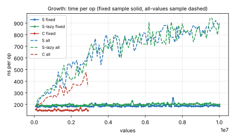
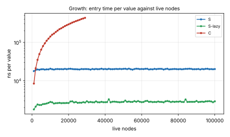
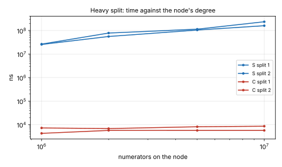
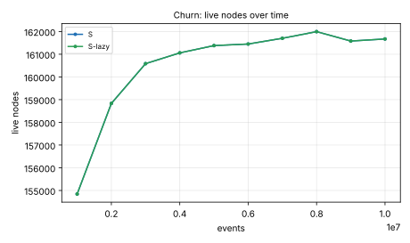
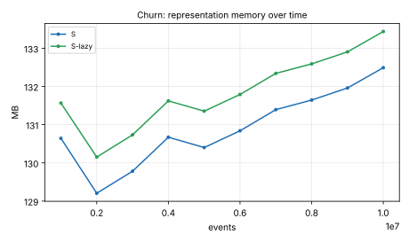
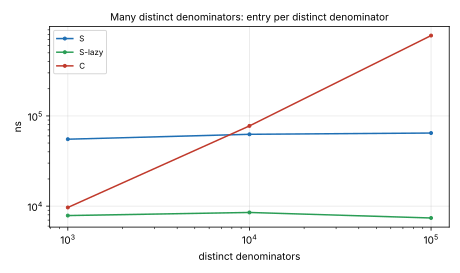
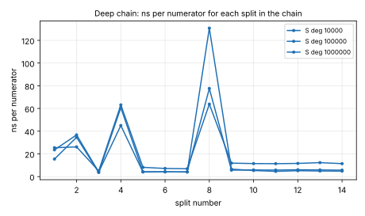

# Scalability stress test: S, S-lazy and C

Generated 2026-10-28 02:04 by `scale_bench.py` on Intel(R) Xeon(R) Processor; clang `-std=c2x -O3 -march=native`, GMP for the product trees.  Spec: research/idea.md, "Scalability requirements".  Rows: S (every requirement), S-lazy (S without Miller-Rabin or rho at entry; leftovers refined in the idle pass), C (round two's V0' entry, reference only).  Every step's sampled results were checked against `fractions`; audits run outside the timers.

## Verdicts

| Sweep | Row | Criterion | Result | Checks |
| --- | --- | --- | --- | --- |
| growth | S | each within 2x: fixed-sample op time and its cold repetition (median of the second half against median of batches 1-3); entry ns/value, idle ns/value, all-values op time relative to C (worst against batch 1) | **pass**: fixed 1.03x, cold 1.02x, entry 1.16x, idle 0.01x, all-values vs C 1.49x over 29 matched steps (all-values alone 5.12x); 17% of timed ops overflowed | ok, audits 11/11 ok |
| growth | S-lazy | each within 2x: fixed-sample op time and its cold repetition (median of the second half against median of batches 1-3); entry ns/value, idle ns/value, all-values op time relative to C (worst against batch 1) | **pass**: fixed 1.06x, cold 0.94x, entry 1.83x, idle 1.07x, all-values vs C 1.53x over 29 matched steps (all-values alone 5.05x); 17% of timed ops overflowed | ok, audits 11/11 ok |
| growth | C | each within 2x: fixed-sample op time and its cold repetition (median of the second half against median of batches 1-3); entry ns/value, idle ns/value, all-values op time relative to C (worst against batch 1) | **fail** (entry_ratio): fixed 0.98x, cold 1.01x, entry 51.29x, idle 0.00x, all-values vs C — (all-values alone 3.23x) (stopped by budget); 17% of timed ops overflowed | ok, audits 3/3 ok |
| churn | S | nodes, memory per value, ns per event within 2x of step 1 (after the warm-up); no leak | **pass**: nodes 1.05x, memory per value 1.01x, ns/event 1.01x, leak check clean | ok, audits 11/11 ok |
| churn | S-lazy | nodes, memory per value, ns per event within 2x of step 1 (after the warm-up); no leak | **pass**: nodes 1.05x, memory per value 1.01x, ns/event 1.19x, leak check clean | ok, audits 11/11 ok |
| heavy | S | {'deg': 1000000, 'seed': 1} | (see table) | ok, audits 3/3 ok |
| heavy | S | {'deg': 2000000, 'seed': 1} | (see table) | ok, audits 3/3 ok |
| heavy | S | {'deg': 5000000, 'seed': 1} | (see table) | ok, audits 3/3 ok |
| heavy | S | {'deg': 10000000, 'seed': 1} | (see table) | ok, audits 3/3 ok |
| heavy | C | {'deg': 1000000, 'seed': 1} | (see table) | ok, audits 3/3 ok |
| heavy | C | {'deg': 2000000, 'seed': 1} | (see table) | ok, audits 3/3 ok |
| heavy | C | {'deg': 5000000, 'seed': 1} | (see table) | ok, audits 3/3 ok |
| heavy | C | {'deg': 10000000, 'seed': 1} | (see table) | ok, audits 3/3 ok |
| chain | S | {'deg': 10000, 'seed': 1} | (see table) | ok, audits 14/14 ok |
| chain | S | {'deg': 100000, 'seed': 1} | (see table) | ok, audits 14/14 ok |
| chain | S | {'deg': 1000000, 'seed': 1} | (see table) | ok, audits 14/14 ok |
| chain | C | {'deg': 10000, 'seed': 1} | (see table) | ok, audits 14/14 ok |
| chain | C | {'deg': 100000, 'seed': 1} | (see table) | ok, audits 14/14 ok |
| chain | C | {'deg': 1000000, 'seed': 1} | (see table) | ok, audits 14/14 ok |
| distinct | S | {'ND': 1000, 'per': 10, 'seed': 1} | (see table) | ok, audits 1/1 ok |
| distinct | S | {'ND': 10000, 'per': 10, 'seed': 1} | (see table) | ok, audits 1/1 ok |
| distinct | S | {'ND': 100000, 'per': 10, 'seed': 1} | (see table) | ok, audits 1/1 ok |
| distinct | S-lazy | {'ND': 1000, 'per': 10, 'seed': 1} | (see table) | ok, audits 1/1 ok |
| distinct | S-lazy | {'ND': 10000, 'per': 10, 'seed': 1} | (see table) | ok, audits 1/1 ok |
| distinct | S-lazy | {'ND': 100000, 'per': 10, 'seed': 1} | (see table) | ok, audits 1/1 ok |
| distinct | C | {'ND': 1000, 'per': 10, 'seed': 1} | (see table) | ok, audits 1/1 ok |
| distinct | C | {'ND': 10000, 'per': 10, 'seed': 1} | (see table) | ok, audits 1/1 ok |
| distinct | C | {'ND': 100000, 'per': 10, 'seed': 1} | (see table) | ok, audits 1/1 ok |

## 1. Growth: S

Parameters {'N': 10000000, 'B': 100000, 'M': 100000, 'T': 100000, 'audit_every': 10, 'nchk': 2000, 'nval': 1000, 'seed': 1}; wall 240 s; checks: 200,000 ops, 100,000 values: all right; overflows 33689 true, 17 explained by the lcm.

| Step | Values | Live nodes | Entry ns/value | Idle ms | Fixed ns/op (add, mul) | Fixed, cold rep | All-values ns/op | All, cold rep | Ovf (fixed/all) | Splits (entry/op/idle) | Memory MB | Audit |
| --- | --- | --- | --- | --- | --- | --- | --- | --- | --- | --- | --- | --- |
| 0 | 100,000 | 1,025 | 17,811.0 | 0.0 | 181.7 (186.8, 176.6) | 248.8 | 180.0 | 256.8 | 16744/17055 | 106/0/0 | 30 | ok |
| 1 | 200,000 | 2,025 | 19,065.9 | 0.0 | 176.7 (181.6, 171.9) | 227.1 | 217.2 | 314.7 | 16744/17010 | 157/0/0 | 36 |  |
| 2 | 300,000 | 3,025 | 19,628.0 | 0.0 | 180.7 (184.8, 176.6) | 226.0 | 244.2 | 352.2 | 16744/16800 | 187/0/0 | 52 |  |
| 3 | 400,000 | 4,025 | 19,315.5 | 0.0 | 188.3 (193.8, 182.7) | 220.2 | 271.3 | 408.4 | 16744/17002 | 204/0/0 | 67 |  |
| 4 | 500,000 | 5,025 | 19,849.6 | 0.0 | 183.7 (187.9, 179.5) | 224.7 | 274.8 | 444.3 | 16744/16916 | 223/0/0 | 70 |  |
| 5 | 600,000 | 6,025 | 19,955.2 | 0.0 | 179.2 (184.7, 173.8) | 238.2 | 281.0 | 462.0 | 16744/17013 | 241/0/0 | 81 |  |
| 6 | 700,000 | 7,025 | 19,501.0 | 0.0 | 182.3 (189.3, 175.4) | 227.8 | 312.5 | 503.0 | 16744/16882 | 257/0/0 | 84 |  |
| 7 | 800,000 | 8,025 | 19,770.0 | 0.0 | 177.5 (182.7, 172.4) | 222.8 | 286.5 | 522.2 | 16744/17104 | 268/0/0 | 85 |  |
| 8 | 900,000 | 9,025 | 19,735.1 | 0.0 | 177.0 (179.8, 174.1) | 223.0 | 305.9 | 529.4 | 16744/17188 | 281/0/0 | 88 |  |
| 9 | 1,000,000 | 10,025 | 20,582.1 | 0.0 | 187.8 (192.0, 183.6) | 228.1 | 361.5 | 582.3 | 16744/17200 | 290/0/0 | 134 |  |
| 10 | 1,100,000 | 11,025 | 19,912.5 | 0.0 | 181.3 (183.9, 178.6) | 224.6 | 365.8 | 591.2 | 16744/17045 | 301/0/0 | 154 | ok |
| 11 | 1,200,000 | 12,025 | 19,552.9 | 0.0 | 180.0 (185.1, 175.0) | 228.4 | 346.4 | 580.6 | 16744/17140 | 313/0/0 | 156 |  |
| 12 | 1,300,000 | 13,025 | 20,054.2 | 0.0 | 192.2 (197.8, 186.6) | 242.2 | 480.2 | 692.5 | 16744/17044 | 322/0/0 | 157 |  |
| 13 | 1,400,000 | 14,025 | 20,161.6 | 0.0 | 189.8 (198.2, 181.4) | 230.3 | 392.5 | 625.9 | 16744/16725 | 329/0/0 | 159 |  |
| 14 | 1,500,000 | 15,025 | 20,012.3 | 0.0 | 180.3 (184.1, 176.5) | 229.1 | 428.4 | 721.0 | 16744/17058 | 338/0/0 | 162 |  |
| 15 | 1,600,000 | 16,025 | 20,071.3 | 0.0 | 192.1 (196.6, 187.7) | 241.8 | 342.9 | 650.5 | 16744/17182 | 342/0/0 | 166 |  |
| 16 | 1,700,000 | 17,025 | 19,905.1 | 0.0 | 187.2 (192.2, 182.2) | 233.2 | 398.9 | 688.7 | 16744/16896 | 349/0/0 | 170 |  |
| 17 | 1,800,000 | 18,025 | 20,331.8 | 0.0 | 179.5 (184.4, 174.6) | 225.3 | 540.0 | 723.1 | 16744/17131 | 354/0/0 | 172 |  |
| 18 | 1,900,000 | 19,025 | 19,949.3 | 0.0 | 183.7 (187.1, 180.2) | 225.1 | 553.8 | 760.3 | 16744/17101 | 361/0/0 | 174 |  |
| 19 | 2,000,000 | 20,025 | 20,364.5 | 0.0 | 185.9 (189.1, 182.7) | 237.7 | 514.1 | 793.1 | 16744/17186 | 370/0/0 | 176 |  |
| 20 | 2,100,000 | 21,025 | 20,487.4 | 0.0 | 182.8 (186.6, 179.0) | 226.8 | 569.3 | 803.8 | 16744/17056 | 372/0/0 | 211 | ok |
| 21 | 2,200,000 | 22,025 | 20,169.6 | 0.0 | 181.6 (185.9, 177.2) | 233.2 | 546.1 | 766.5 | 16744/17066 | 378/0/0 | 264 |  |
| 22 | 2,300,000 | 23,025 | 19,955.0 | 0.0 | 181.2 (184.8, 177.7) | 223.7 | 579.2 | 806.6 | 16744/16764 | 382/0/0 | 267 |  |
| 23 | 2,400,000 | 24,025 | 19,921.8 | 0.0 | 186.3 (189.2, 183.4) | 226.7 | 480.2 | 815.7 | 16744/16840 | 386/0/0 | 302 |  |
| 24 | 2,500,000 | 25,025 | 19,774.3 | 0.0 | 185.8 (190.7, 180.9) | 228.2 | 545.3 | 786.8 | 16744/16986 | 391/0/0 | 306 |  |
| 25 | 2,600,000 | 26,025 | 19,600.7 | 0.0 | 185.9 (190.4, 181.5) | 236.3 | 537.3 | 810.2 | 16744/17122 | 392/0/0 | 311 |  |
| 26 | 2,700,000 | 27,025 | 20,177.8 | 0.0 | 187.5 (191.8, 183.1) | 229.0 | 572.3 | 820.8 | 16744/16846 | 397/0/0 | 313 |  |
| 27 | 2,800,000 | 28,025 | 20,024.1 | 0.0 | 186.4 (191.1, 181.7) | 225.6 | 572.2 | 796.1 | 16744/16937 | 404/0/0 | 315 |  |
| 28 | 2,900,000 | 29,025 | 20,144.7 | 0.0 | 182.3 (185.6, 179.0) | 231.0 | 625.9 | 862.3 | 16744/17006 | 406/0/0 | 317 |  |
| 29 | 3,000,000 | 30,025 | 20,118.7 | 0.0 | 180.4 (183.3, 177.6) | 218.4 | 636.0 | 840.1 | 16744/16883 | 410/0/0 | 319 |  |
| 30 | 3,100,000 | 31,025 | 19,997.6 | 0.0 | 181.8 (185.7, 177.9) | 224.6 | 576.5 | 846.2 | 16744/17045 | 415/0/0 | 321 | ok |
| 31 | 3,200,000 | 32,025 | 19,482.6 | 0.0 | 181.9 (186.3, 177.4) | 222.4 | 689.4 | 861.9 | 16744/16998 | 422/0/0 | 323 |  |
| 32 | 3,300,000 | 33,025 | 20,234.4 | 0.0 | 207.2 (223.4, 190.9) | 275.2 | 766.2 | 1,088.9 | 16744/17246 | 427/0/0 | 327 |  |
| 33 | 3,400,000 | 34,025 | 19,825.4 | 0.0 | 192.8 (196.1, 189.5) | 240.5 | 613.5 | 887.7 | 16744/17181 | 428/0/0 | 331 |  |
| 34 | 3,500,000 | 35,025 | 20,245.4 | 0.0 | 184.4 (185.1, 183.8) | 227.2 | 712.0 | 902.5 | 16744/16912 | 431/0/0 | 338 |  |
| 35 | 3,600,000 | 36,025 | 19,939.4 | 0.0 | 180.8 (185.3, 176.3) | 231.5 | 540.8 | 874.6 | 16744/16981 | 435/0/0 | 340 |  |
| 36 | 3,700,000 | 37,025 | 20,091.6 | 0.0 | 186.9 (193.9, 179.9) | 236.8 | 615.0 | 902.4 | 16744/17019 | 436/0/0 | 342 |  |
| 37 | 3,800,000 | 38,025 | 20,560.6 | 0.0 | 185.8 (190.7, 180.9) | 232.5 | 764.3 | 965.7 | 16744/17295 | 439/0/0 | 344 |  |
| 38 | 3,900,000 | 39,025 | 19,966.1 | 0.0 | 205.9 (212.3, 199.6) | 241.4 | 797.9 | 972.5 | 16744/16895 | 444/0/0 | 345 |  |
| 39 | 4,000,000 | 40,025 | 20,220.2 | 0.0 | 190.1 (195.6, 184.6) | 245.3 | 714.2 | 942.5 | 16744/17150 | 445/0/0 | 347 |  |
| 40 | 4,100,000 | 41,025 | 19,881.8 | 0.0 | 186.3 (194.0, 178.5) | 227.8 | 700.2 | 926.5 | 16744/17003 | 447/0/0 | 349 | ok |
| 41 | 4,200,000 | 42,025 | 20,412.0 | 0.0 | 180.1 (183.8, 176.4) | 220.2 | 660.4 | 927.7 | 16744/16971 | 449/0/0 | 418 |  |
| 42 | 4,300,000 | 43,025 | 20,009.1 | 0.0 | 185.7 (194.0, 177.4) | 232.0 | 789.9 | 946.4 | 16744/16766 | 451/0/0 | 420 |  |
| 43 | 4,400,000 | 44,025 | 20,001.2 | 0.0 | 188.4 (192.7, 184.1) | 228.0 | 795.7 | 939.0 | 16744/17050 | 453/0/0 | 422 |  |
| 44 | 4,500,000 | 45,025 | 20,090.0 | 0.0 | 183.9 (188.2, 179.6) | 224.0 | 716.5 | 923.4 | 16744/17237 | 456/0/0 | 424 |  |
| 45 | 4,600,000 | 46,025 | 20,266.7 | 0.0 | 181.9 (186.0, 177.8) | 221.4 | 602.6 | 889.2 | 16744/17206 | 457/0/0 | 527 |  |
| 46 | 4,700,000 | 47,025 | 20,107.8 | 0.0 | 179.0 (182.9, 175.1) | 220.1 | 700.6 | 925.3 | 16744/16879 | 458/0/0 | 530 |  |
| 47 | 4,800,000 | 48,025 | 20,330.9 | 0.0 | 189.3 (194.7, 183.9) | 241.3 | 724.6 | 960.9 | 16744/16886 | 461/0/0 | 532 |  |
| 48 | 4,900,000 | 49,025 | 20,110.2 | 0.0 | 181.5 (184.9, 178.0) | 225.0 | 789.0 | 1,000.1 | 16744/17068 | 463/0/0 | 535 |  |
| 49 | 5,000,000 | 50,025 | 20,338.5 | 0.0 | 188.0 (192.8, 183.1) | 236.1 | 711.1 | 971.4 | 16744/17075 | 466/0/0 | 537 |  |
| 50 | 5,100,000 | 51,025 | 20,512.1 | 0.0 | 188.4 (195.2, 181.7) | 233.3 | 760.4 | 979.6 | 16744/17250 | 467/0/0 | 606 | ok |
| 51 | 5,200,000 | 52,025 | 20,030.3 | 0.0 | 185.3 (189.6, 181.0) | 233.6 | 744.2 | 930.7 | 16744/17044 | 469/0/0 | 608 |  |
| 52 | 5,300,000 | 53,025 | 20,623.2 | 0.0 | 183.4 (189.5, 177.3) | 230.2 | 782.5 | 938.6 | 16744/17210 | 470/0/0 | 614 |  |
| 53 | 5,400,000 | 54,025 | 19,920.0 | 0.0 | 184.1 (188.8, 179.3) | 227.3 | 658.6 | 919.7 | 16744/17036 | 470/0/0 | 616 |  |
| 54 | 5,500,000 | 55,025 | 19,468.7 | 0.0 | 181.3 (185.1, 177.4) | 228.4 | 688.9 | 945.9 | 16744/16926 | 472/0/0 | 623 |  |
| 55 | 5,600,000 | 56,025 | 20,147.5 | 0.0 | 182.3 (186.7, 178.0) | 226.7 | 752.9 | 945.8 | 16744/16969 | 474/0/0 | 625 |  |
| 56 | 5,700,000 | 57,025 | 20,574.3 | 0.0 | 204.2 (204.8, 203.7) | 253.5 | 730.9 | 965.9 | 16744/16968 | 476/0/0 | 627 |  |
| 57 | 5,800,000 | 58,025 | 20,393.8 | 0.0 | 181.8 (186.9, 176.8) | 226.4 | 759.7 | 976.3 | 16744/17064 | 478/0/0 | 629 |  |
| 58 | 5,900,000 | 59,025 | 20,060.5 | 0.0 | 183.4 (186.5, 180.2) | 235.2 | 815.6 | 964.8 | 16744/16977 | 479/0/0 | 631 |  |
| 59 | 6,000,000 | 60,025 | 20,199.1 | 0.0 | 186.6 (190.6, 182.6) | 242.8 | 811.2 | 972.4 | 16744/17139 | 480/0/0 | 633 |  |
| 60 | 6,100,000 | 61,025 | 20,087.1 | 0.0 | 202.9 (219.0, 186.8) | 232.4 | 719.7 | 1,086.2 | 16744/17176 | 482/0/0 | 635 | ok |
| 61 | 6,200,000 | 62,025 | 20,429.5 | 0.0 | 182.2 (185.7, 178.7) | 228.9 | 774.7 | 954.5 | 16744/17069 | 486/0/0 | 637 |  |
| 62 | 6,300,000 | 63,025 | 20,460.3 | 0.0 | 183.9 (187.3, 180.5) | 247.8 | 775.3 | 1,037.8 | 16744/17234 | 489/0/0 | 639 |  |
| 63 | 6,400,000 | 64,025 | 19,641.8 | 0.0 | 190.0 (195.3, 184.6) | 232.1 | 762.7 | 1,003.4 | 16744/16940 | 490/0/0 | 641 |  |
| 64 | 6,500,000 | 65,025 | 19,964.2 | 0.0 | 185.6 (190.2, 180.9) | 242.8 | 777.0 | 1,044.8 | 16744/17012 | 493/0/0 | 643 |  |
| 65 | 6,600,000 | 66,025 | 19,768.0 | 0.0 | 184.7 (186.2, 183.2) | 235.2 | 727.6 | 979.7 | 16744/17125 | 493/0/0 | 650 |  |
| 66 | 6,700,000 | 67,025 | 20,338.9 | 0.0 | 188.1 (194.2, 182.1) | 235.2 | 736.0 | 1,025.3 | 16744/17052 | 494/0/0 | 652 |  |
| 67 | 6,800,000 | 68,025 | 20,013.4 | 0.0 | 184.1 (188.3, 179.9) | 224.8 | 830.4 | 1,008.1 | 16744/16853 | 495/0/0 | 654 |  |
| 68 | 6,900,000 | 69,025 | 20,323.1 | 0.0 | 182.8 (187.4, 178.3) | 230.9 | 832.2 | 1,010.2 | 16744/17112 | 496/0/0 | 656 |  |
| 69 | 7,000,000 | 70,025 | 20,388.0 | 0.0 | 193.6 (198.0, 189.2) | 237.7 | 876.2 | 1,042.4 | 16744/16997 | 497/0/0 | 658 |  |
| 70 | 7,100,000 | 71,025 | 20,331.4 | 0.0 | 185.8 (185.9, 185.8) | 228.4 | 881.1 | 1,107.5 | 16744/17141 | 501/0/0 | 664 | ok |
| 71 | 7,200,000 | 72,025 | 19,592.7 | 0.0 | 202.1 (209.2, 195.1) | 241.0 | 868.0 | 1,192.8 | 16744/17079 | 502/0/0 | 666 |  |
| 72 | 7,300,000 | 73,025 | 20,170.1 | 0.0 | 185.3 (190.9, 179.7) | 229.5 | 814.5 | 977.8 | 16744/16932 | 504/0/0 | 668 |  |
| 73 | 7,400,000 | 74,025 | 20,512.6 | 0.0 | 181.5 (185.9, 177.0) | 228.0 | 775.3 | 1,011.0 | 16744/17031 | 507/0/0 | 679 |  |
| 74 | 7,500,000 | 75,025 | 19,690.1 | 0.0 | 252.3 (260.7, 243.9) | 296.4 | 779.3 | 1,033.5 | 16744/17219 | 507/0/0 | 681 |  |
| 75 | 7,600,000 | 76,025 | 19,917.6 | 0.0 | 185.7 (191.6, 179.7) | 242.6 | 733.3 | 1,004.2 | 16744/17208 | 508/0/0 | 682 |  |
| 76 | 7,700,000 | 77,025 | 20,086.6 | 0.0 | 186.3 (191.7, 181.0) | 227.0 | 873.5 | 1,031.9 | 16744/17077 | 509/0/0 | 684 |  |
| 77 | 7,800,000 | 78,025 | 20,219.4 | 0.0 | 182.8 (187.5, 177.9) | 230.9 | 764.9 | 1,009.1 | 16744/17150 | 509/0/0 | 686 |  |
| 78 | 7,900,000 | 79,025 | 20,084.9 | 0.0 | 185.6 (190.1, 181.0) | 230.4 | 835.6 | 1,021.1 | 16744/17189 | 510/0/0 | 688 |  |
| 79 | 8,000,000 | 80,025 | 19,901.3 | 0.0 | 190.1 (195.6, 184.5) | 242.3 | 797.7 | 1,057.1 | 16744/16908 | 510/0/0 | 690 |  |
| 80 | 8,100,000 | 81,025 | 20,134.2 | 0.0 | 188.8 (191.4, 186.3) | 238.3 | 843.0 | 1,058.5 | 16744/16964 | 510/0/0 | 692 | ok |
| 81 | 8,200,000 | 82,025 | 19,821.6 | 0.0 | 186.9 (188.7, 185.1) | 226.7 | 811.7 | 999.5 | 16744/16983 | 513/0/0 | 694 |  |
| 82 | 8,300,000 | 83,025 | 20,089.0 | 0.0 | 183.4 (188.4, 178.4) | 225.0 | 835.4 | 1,089.3 | 16744/16933 | 514/0/0 | 696 |  |
| 83 | 8,400,000 | 84,025 | 20,330.4 | 0.0 | 188.2 (192.0, 184.4) | 223.7 | 790.3 | 1,014.5 | 16744/17016 | 516/0/0 | 832 |  |
| 84 | 8,500,000 | 85,025 | 20,302.8 | 0.0 | 182.6 (187.1, 178.1) | 226.3 | 847.2 | 998.6 | 16744/16984 | 517/0/0 | 834 |  |
| 85 | 8,600,000 | 86,025 | 20,541.9 | 0.0 | 184.0 (189.2, 178.9) | 250.2 | 880.5 | 1,048.2 | 16744/16967 | 519/0/0 | 836 |  |
| 86 | 8,700,000 | 87,025 | 20,352.1 | 0.0 | 184.1 (188.9, 179.3) | 233.9 | 862.5 | 1,033.4 | 16744/17196 | 519/0/0 | 838 |  |
| 87 | 8,800,000 | 88,025 | 19,892.8 | 0.0 | 185.4 (190.4, 180.3) | 226.1 | 846.4 | 1,029.0 | 16744/16891 | 519/0/0 | 840 |  |
| 88 | 8,900,000 | 89,025 | 19,971.1 | 0.0 | 183.6 (187.7, 179.5) | 230.9 | 876.0 | 1,044.5 | 16744/16820 | 519/0/0 | 842 |  |
| 89 | 9,000,000 | 90,025 | 19,999.0 | 0.0 | 182.4 (186.8, 178.1) | 238.0 | 777.7 | 1,022.2 | 16744/17096 | 521/0/0 | 844 |  |
| 90 | 9,100,000 | 91,025 | 20,201.1 | 0.0 | 184.0 (189.8, 178.2) | 224.7 | 839.7 | 1,010.4 | 16744/17225 | 521/0/0 | 846 | ok |
| 91 | 9,200,000 | 92,025 | 19,629.7 | 0.0 | 190.6 (194.6, 186.5) | 236.0 | 806.9 | 1,031.8 | 16744/17027 | 521/0/0 | 848 |  |
| 92 | 9,300,000 | 93,025 | 20,194.7 | 0.0 | 191.5 (194.5, 188.6) | 237.7 | 868.2 | 1,053.8 | 16744/17027 | 521/0/0 | 850 |  |
| 93 | 9,400,000 | 94,025 | 19,951.1 | 0.0 | 182.6 (185.8, 179.4) | 235.7 | 874.2 | 1,028.5 | 16744/17294 | 523/0/0 | 852 |  |
| 94 | 9,500,000 | 95,025 | 20,361.7 | 0.0 | 190.3 (193.6, 187.1) | 233.5 | 829.7 | 1,068.3 | 16744/17106 | 523/0/0 | 1055 |  |
| 95 | 9,600,000 | 96,025 | 20,448.0 | 0.0 | 191.7 (195.3, 188.1) | 231.8 | 859.9 | 1,076.9 | 16744/17194 | 523/0/0 | 1059 |  |
| 96 | 9,700,000 | 97,025 | 19,944.0 | 0.0 | 186.4 (194.2, 178.5) | 275.9 | 890.0 | 1,052.5 | 16744/17027 | 523/0/0 | 1061 |  |
| 97 | 9,800,000 | 98,025 | 20,093.3 | 0.0 | 190.7 (194.3, 187.0) | 238.2 | 922.3 | 1,058.4 | 16744/17281 | 523/0/0 | 1063 |  |
| 98 | 9,900,000 | 99,025 | 19,862.9 | 0.0 | 187.6 (190.6, 184.7) | 231.3 | 895.3 | 1,042.6 | 16744/17170 | 524/0/0 | 1065 |  |
| 99 | 10,000,000 | 100,025 | 20,120.3 | 0.0 | 184.0 (188.9, 179.1) | 228.0 | 859.7 | 1,087.9 | 16744/17047 | 526/0/0 | 1067 | ok |

## 1. Growth: S-lazy

Parameters {'N': 10000000, 'B': 100000, 'M': 100000, 'T': 100000, 'audit_every': 10, 'nchk': 2000, 'nval': 1000, 'seed': 1}; wall 169 s; checks: 200,000 ops, 100,000 values: all right; overflows 33689 true, 17 explained by the lcm.

| Step | Values | Live nodes | Entry ns/value | Idle ms | Fixed ns/op (add, mul) | Fixed, cold rep | All-values ns/op | All, cold rep | Ovf (fixed/all) | Splits (entry/op/idle) | Memory MB | Audit |
| --- | --- | --- | --- | --- | --- | --- | --- | --- | --- | --- | --- | --- |
| 0 | 100,000 | 1,025 | 1,797.7 | 1322.0 | 185.2 (189.4, 181.0) | 275.0 | 186.5 | 266.8 | 16744/17055 | 7/0/9920 | 32 | ok |
| 1 | 200,000 | 2,025 | 2,126.2 | 1053.2 | 201.1 (203.3, 198.8) | 257.4 | 251.4 | 359.5 | 16744/17010 | 7/0/20036 | 37 |  |
| 2 | 300,000 | 3,025 | 2,410.0 | 897.0 | 189.5 (191.8, 187.2) | 233.8 | 253.0 | 383.4 | 16744/16800 | 7/0/29920 | 53 |  |
| 3 | 400,000 | 4,025 | 2,341.4 | 806.5 | 193.1 (194.2, 192.0) | 275.0 | 271.0 | 416.6 | 16744/17002 | 7/0/39862 | 68 |  |
| 4 | 500,000 | 5,025 | 2,341.0 | 802.7 | 187.4 (189.6, 185.2) | 228.7 | 278.3 | 471.8 | 16744/16916 | 7/0/49782 | 70 |  |
| 5 | 600,000 | 6,025 | 2,469.4 | 742.9 | 187.2 (189.5, 184.9) | 230.3 | 308.8 | 497.3 | 16744/17013 | 7/0/59845 | 81 |  |
| 6 | 700,000 | 7,025 | 2,490.4 | 734.8 | 188.0 (191.7, 184.3) | 225.5 | 327.3 | 534.8 | 16744/16882 | 7/0/69861 | 86 |  |
| 7 | 800,000 | 8,025 | 2,560.3 | 761.6 | 187.0 (191.0, 182.9) | 230.0 | 323.2 | 550.9 | 16744/17104 | 7/0/79863 | 87 |  |
| 8 | 900,000 | 9,025 | 2,659.7 | 713.3 | 186.1 (190.0, 182.3) | 237.8 | 337.6 | 565.1 | 16744/17188 | 7/0/89833 | 90 |  |
| 9 | 1,000,000 | 10,025 | 2,808.2 | 724.1 | 195.2 (199.9, 190.4) | 235.1 | 334.2 | 588.6 | 16744/17200 | 7/0/99973 | 135 |  |
| 10 | 1,100,000 | 11,025 | 2,741.4 | 703.5 | 193.5 (195.7, 191.3) | 234.5 | 321.0 | 644.2 | 16744/17045 | 7/0/109949 | 155 | ok |
| 11 | 1,200,000 | 12,025 | 2,553.8 | 703.8 | 197.0 (201.0, 193.0) | 251.7 | 409.6 | 620.8 | 16744/17140 | 7/0/119836 | 157 |  |
| 12 | 1,300,000 | 13,025 | 2,610.7 | 700.2 | 191.3 (193.8, 188.9) | 236.1 | 388.1 | 641.5 | 16744/17044 | 7/0/129796 | 159 |  |
| 13 | 1,400,000 | 14,025 | 2,622.5 | 708.3 | 189.7 (192.3, 187.1) | 252.1 | 422.4 | 792.5 | 16744/16725 | 7/0/139786 | 161 |  |
| 14 | 1,500,000 | 15,025 | 2,658.8 | 726.2 | 191.6 (193.2, 189.9) | 242.3 | 463.0 | 679.5 | 16744/17058 | 7/0/149785 | 164 |  |
| 15 | 1,600,000 | 16,025 | 2,605.6 | 693.3 | 190.2 (193.7, 186.8) | 246.3 | 537.0 | 758.3 | 16744/17182 | 7/0/159638 | 168 |  |
| 16 | 1,700,000 | 17,025 | 2,627.3 | 687.8 | 196.9 (199.4, 194.4) | 232.9 | 456.2 | 824.3 | 16744/16896 | 7/0/169592 | 170 |  |
| 17 | 1,800,000 | 18,025 | 2,620.6 | 754.9 | 197.3 (198.6, 196.0) | 240.1 | 463.2 | 750.7 | 16744/17131 | 7/0/179718 | 172 |  |
| 18 | 1,900,000 | 19,025 | 2,642.6 | 728.5 | 204.3 (214.8, 193.8) | 265.1 | 429.9 | 750.8 | 16744/17101 | 7/0/189585 | 174 |  |
| 19 | 2,000,000 | 20,025 | 2,626.8 | 741.1 | 198.0 (200.7, 195.3) | 237.4 | 409.9 | 711.4 | 16744/17186 | 7/0/199582 | 176 |  |
| 20 | 2,100,000 | 21,025 | 2,879.8 | 737.4 | 199.0 (201.3, 196.6) | 247.7 | 432.0 | 759.6 | 16744/17056 | 7/0/209538 | 211 | ok |
| 21 | 2,200,000 | 22,025 | 2,910.0 | 783.4 | 186.8 (189.9, 183.6) | 228.7 | 425.1 | 740.2 | 16744/17066 | 7/0/219497 | 264 |  |
| 22 | 2,300,000 | 23,025 | 2,727.0 | 769.0 | 190.0 (194.7, 185.3) | 220.7 | 526.0 | 800.9 | 16744/16764 | 7/0/229464 | 270 |  |
| 23 | 2,400,000 | 24,025 | 2,799.2 | 734.0 | 185.9 (189.3, 182.6) | 225.2 | 445.1 | 745.1 | 16744/16840 | 7/0/239335 | 305 |  |
| 24 | 2,500,000 | 25,025 | 2,656.7 | 738.1 | 187.8 (191.9, 183.8) | 233.6 | 507.8 | 764.3 | 16744/16986 | 7/0/249216 | 309 |  |
| 25 | 2,600,000 | 26,025 | 2,688.8 | 763.7 | 186.2 (190.6, 181.7) | 227.9 | 465.6 | 761.5 | 16744/17122 | 7/0/259177 | 314 |  |
| 26 | 2,700,000 | 27,025 | 2,677.2 | 762.0 | 197.2 (203.8, 190.7) | 289.0 | 551.4 | 816.5 | 16744/16846 | 7/0/269197 | 316 |  |
| 27 | 2,800,000 | 28,025 | 2,778.8 | 780.7 | 191.6 (196.9, 186.2) | 237.2 | 530.0 | 830.6 | 16744/16937 | 7/0/279119 | 318 |  |
| 28 | 2,900,000 | 29,025 | 2,708.9 | 784.0 | 187.3 (190.7, 184.0) | 234.9 | 610.4 | 813.4 | 16744/17006 | 7/0/289241 | 320 |  |
| 29 | 3,000,000 | 30,025 | 2,924.9 | 789.0 | 199.5 (203.4, 195.5) | 253.0 | 678.0 | 876.0 | 16744/16883 | 7/0/299302 | 322 |  |
| 30 | 3,100,000 | 31,025 | 2,754.6 | 810.1 | 207.7 (206.8, 208.6) | 256.0 | 720.1 | 903.6 | 16744/17045 | 7/0/309251 | 324 | ok |
| 31 | 3,200,000 | 32,025 | 2,803.6 | 794.7 | 193.3 (194.6, 191.9) | 234.0 | 670.8 | 869.7 | 16744/16998 | 7/0/319084 | 325 |  |
| 32 | 3,300,000 | 33,025 | 2,756.3 | 813.0 | 193.6 (195.8, 191.3) | 238.6 | 675.4 | 910.8 | 16744/17246 | 7/0/329167 | 327 |  |
| 33 | 3,400,000 | 34,025 | 2,740.8 | 847.0 | 195.8 (196.6, 194.9) | 235.7 | 656.3 | 876.1 | 16744/17181 | 7/0/338943 | 331 |  |
| 34 | 3,500,000 | 35,025 | 2,896.6 | 870.6 | 196.2 (200.1, 192.2) | 234.1 | 672.5 | 880.1 | 16744/16912 | 7/0/348941 | 338 |  |
| 35 | 3,600,000 | 36,025 | 2,759.4 | 879.9 | 197.1 (200.6, 193.6) | 249.2 | 685.6 | 918.4 | 16744/16981 | 7/0/358842 | 340 |  |
| 36 | 3,700,000 | 37,025 | 2,747.2 | 908.7 | 202.5 (204.5, 200.4) | 265.7 | 650.1 | 892.4 | 16744/17019 | 7/0/368810 | 342 |  |
| 37 | 3,800,000 | 38,025 | 2,826.1 | 924.0 | 201.1 (204.2, 197.9) | 242.7 | 698.4 | 962.0 | 16744/17295 | 7/0/378893 | 344 |  |
| 38 | 3,900,000 | 39,025 | 2,764.1 | 907.2 | 189.1 (191.8, 186.4) | 236.3 | 710.7 | 914.5 | 16744/16895 | 7/0/388907 | 345 |  |
| 39 | 4,000,000 | 40,025 | 2,766.2 | 888.7 | 193.4 (196.8, 189.9) | 239.4 | 674.4 | 884.2 | 16744/17150 | 7/0/398855 | 347 |  |
| 40 | 4,100,000 | 41,025 | 2,776.7 | 984.8 | 195.2 (202.1, 188.3) | 247.1 | 761.9 | 975.5 | 16744/17003 | 7/0/408726 | 349 | ok |
| 41 | 4,200,000 | 42,025 | 3,280.8 | 921.8 | 194.0 (196.6, 191.5) | 235.4 | 667.5 | 920.8 | 16744/16971 | 7/0/418740 | 418 |  |
| 42 | 4,300,000 | 43,025 | 2,744.7 | 898.0 | 205.1 (212.8, 197.4) | 235.4 | 767.9 | 1,021.7 | 16744/16766 | 7/0/428697 | 420 |  |
| 43 | 4,400,000 | 44,025 | 2,845.5 | 962.0 | 200.7 (202.9, 198.4) | 248.9 | 778.0 | 967.1 | 16744/17050 | 7/0/438696 | 422 |  |
| 44 | 4,500,000 | 45,025 | 2,857.2 | 994.1 | 204.4 (206.6, 202.2) | 252.2 | 789.1 | 1,179.8 | 16744/17237 | 7/0/448662 | 424 |  |
| 45 | 4,600,000 | 46,025 | 2,825.4 | 945.2 | 195.5 (200.7, 190.3) | 239.3 | 754.0 | 1,077.1 | 16744/17206 | 7/0/458745 | 527 |  |
| 46 | 4,700,000 | 47,025 | 2,785.3 | 955.5 | 191.2 (195.1, 187.2) | 235.1 | 603.7 | 906.9 | 16744/16879 | 7/0/468814 | 530 |  |
| 47 | 4,800,000 | 48,025 | 2,754.6 | 973.7 | 193.4 (197.6, 189.1) | 244.3 | 715.7 | 993.6 | 16744/16886 | 7/0/478937 | 532 |  |
| 48 | 4,900,000 | 49,025 | 2,792.7 | 945.6 | 199.3 (201.3, 197.2) | 239.6 | 775.7 | 975.2 | 16744/17068 | 7/0/488986 | 535 |  |
| 49 | 5,000,000 | 50,025 | 2,814.0 | 973.1 | 199.4 (203.0, 195.9) | 282.6 | 716.5 | 940.4 | 16744/17075 | 7/0/499083 | 537 |  |
| 50 | 5,100,000 | 51,025 | 3,043.8 | 961.8 | 199.7 (203.7, 195.8) | 236.6 | 689.5 | 942.5 | 16744/17250 | 7/0/509185 | 606 | ok |
| 51 | 5,200,000 | 52,025 | 2,826.1 | 953.5 | 200.2 (205.2, 195.2) | 242.7 | 747.0 | 966.4 | 16744/17044 | 7/0/519135 | 608 |  |
| 52 | 5,300,000 | 53,025 | 2,876.1 | 981.4 | 228.2 (228.4, 228.0) | 290.4 | 788.9 | 1,083.5 | 16744/17210 | 7/0/529277 | 614 |  |
| 53 | 5,400,000 | 54,025 | 2,810.7 | 943.7 | 194.2 (198.8, 189.5) | 237.4 | 730.1 | 946.7 | 16744/17036 | 7/0/539170 | 616 |  |
| 54 | 5,500,000 | 55,025 | 2,811.9 | 944.7 | 195.8 (199.7, 191.9) | 232.2 | 793.9 | 973.8 | 16744/16926 | 7/0/549019 | 623 |  |
| 55 | 5,600,000 | 56,025 | 2,950.7 | 1025.8 | 198.2 (202.7, 193.6) | 256.6 | 744.0 | 975.7 | 16744/16969 | 7/0/559037 | 631 |  |
| 56 | 5,700,000 | 57,025 | 2,836.8 | 1042.0 | 194.1 (199.2, 188.9) | 236.9 | 817.5 | 1,038.7 | 16744/16968 | 7/0/569195 | 633 |  |
| 57 | 5,800,000 | 58,025 | 2,960.7 | 1066.4 | 195.2 (199.4, 191.0) | 232.7 | 718.0 | 946.9 | 16744/17064 | 7/0/579360 | 635 |  |
| 58 | 5,900,000 | 59,025 | 2,835.9 | 966.4 | 195.8 (199.7, 191.9) | 240.9 | 719.1 | 956.2 | 16744/16977 | 7/0/589336 | 637 |  |
| 59 | 6,000,000 | 60,025 | 2,769.8 | 1008.3 | 193.7 (198.6, 188.8) | 233.0 | 719.3 | 948.7 | 16744/17139 | 7/0/599512 | 639 |  |
| 60 | 6,100,000 | 61,025 | 2,800.4 | 993.2 | 193.7 (197.0, 190.5) | 237.1 | 711.4 | 962.7 | 16744/17176 | 7/0/609520 | 641 | ok |
| 61 | 6,200,000 | 62,025 | 2,954.0 | 1077.8 | 205.2 (211.7, 198.7) | 246.5 | 905.6 | 1,032.3 | 16744/17069 | 7/0/619731 | 643 |  |
| 62 | 6,300,000 | 63,025 | 2,996.2 | 1044.2 | 197.9 (203.2, 192.6) | 252.4 | 712.9 | 993.8 | 16744/17234 | 7/0/629845 | 645 |  |
| 63 | 6,400,000 | 64,025 | 2,814.8 | 1030.0 | 212.0 (210.6, 213.4) | 260.4 | 826.4 | 986.0 | 16744/16940 | 7/0/639795 | 647 |  |
| 64 | 6,500,000 | 65,025 | 2,851.4 | 1049.8 | 201.9 (208.3, 195.5) | 246.3 | 703.0 | 984.7 | 16744/17012 | 7/0/649787 | 649 |  |
| 65 | 6,600,000 | 66,025 | 2,780.7 | 1020.3 | 203.6 (207.4, 199.7) | 246.3 | 825.7 | 1,008.7 | 16744/17125 | 7/0/659695 | 650 |  |
| 66 | 6,700,000 | 67,025 | 2,807.2 | 1219.8 | 208.6 (214.3, 202.9) | 267.2 | 827.9 | 1,017.3 | 16744/17052 | 7/0/669732 | 652 |  |
| 67 | 6,800,000 | 68,025 | 2,790.4 | 1209.2 | 200.3 (209.8, 190.9) | 316.1 | 810.2 | 1,020.8 | 16744/16853 | 7/0/679760 | 654 |  |
| 68 | 6,900,000 | 69,025 | 2,878.7 | 1199.8 | 206.5 (211.7, 201.3) | 239.6 | 725.0 | 1,002.7 | 16744/17112 | 7/0/689838 | 656 |  |
| 69 | 7,000,000 | 70,025 | 2,811.3 | 1169.3 | 210.1 (208.7, 211.4) | 245.2 | 747.9 | 993.3 | 16744/16997 | 7/0/699896 | 658 |  |
| 70 | 7,100,000 | 71,025 | 2,807.7 | 1180.7 | 195.5 (200.2, 190.7) | 249.9 | 714.9 | 988.8 | 16744/17141 | 7/0/709811 | 664 | ok |
| 71 | 7,200,000 | 72,025 | 2,741.2 | 1188.1 | 213.2 (212.9, 213.5) | 245.6 | 882.8 | 1,071.5 | 16744/17079 | 7/0/719598 | 666 |  |
| 72 | 7,300,000 | 73,025 | 2,909.4 | 1229.3 | 197.0 (204.0, 190.1) | 234.2 | 724.1 | 997.8 | 16744/16932 | 7/0/729632 | 668 |  |
| 73 | 7,400,000 | 74,025 | 2,965.7 | 1211.7 | 199.5 (203.2, 195.9) | 236.3 | 908.7 | 1,044.8 | 16744/17031 | 7/0/739805 | 679 |  |
| 74 | 7,500,000 | 75,025 | 2,901.9 | 1198.2 | 202.6 (208.3, 196.8) | 242.7 | 835.0 | 1,031.1 | 16744/17219 | 7/0/749580 | 681 |  |
| 75 | 7,600,000 | 76,025 | 2,785.9 | 1216.5 | 206.1 (210.1, 202.1) | 259.9 | 858.9 | 1,060.5 | 16744/17208 | 7/0/759509 | 683 |  |
| 76 | 7,700,000 | 77,025 | 2,863.3 | 1176.7 | 196.5 (200.1, 193.0) | 234.1 | 749.9 | 985.4 | 16744/17077 | 7/0/769524 | 684 |  |
| 77 | 7,800,000 | 78,025 | 2,812.2 | 1253.6 | 207.7 (213.0, 202.4) | 248.2 | 880.5 | 1,064.5 | 16744/17150 | 7/0/779485 | 686 |  |
| 78 | 7,900,000 | 79,025 | 2,859.7 | 1230.1 | 199.3 (205.7, 192.8) | 236.7 | 807.9 | 1,008.9 | 16744/17189 | 7/0/789515 | 688 |  |
| 79 | 8,000,000 | 80,025 | 2,839.5 | 1173.1 | 199.2 (203.6, 194.8) | 241.7 | 894.8 | 1,013.8 | 16744/16908 | 7/0/799347 | 690 |  |
| 80 | 8,100,000 | 81,025 | 2,898.9 | 1242.6 | 206.3 (211.0, 201.6) | 253.3 | 825.5 | 1,038.4 | 16744/16964 | 7/0/809281 | 692 | ok |
| 81 | 8,200,000 | 82,025 | 2,801.6 | 1199.8 | 200.1 (207.2, 193.1) | 240.9 | 823.6 | 1,004.2 | 16744/16983 | 7/0/819090 | 694 |  |
| 82 | 8,300,000 | 83,025 | 2,794.4 | 1225.3 | 198.6 (205.4, 191.9) | 239.2 | 831.4 | 1,040.2 | 16744/16933 | 7/0/829142 | 696 |  |
| 83 | 8,400,000 | 84,025 | 3,254.2 | 1242.0 | 204.0 (217.2, 190.8) | 268.2 | 825.1 | 1,058.1 | 16744/17016 | 7/0/839090 | 832 |  |
| 84 | 8,500,000 | 85,025 | 2,803.7 | 1268.4 | 202.4 (206.9, 197.9) | 238.3 | 837.0 | 1,044.5 | 16744/16984 | 7/0/849069 | 834 |  |
| 85 | 8,600,000 | 86,025 | 2,821.4 | 1297.9 | 202.2 (207.1, 197.3) | 248.9 | 737.3 | 1,031.3 | 16744/16967 | 7/0/859208 | 836 |  |
| 86 | 8,700,000 | 87,025 | 2,827.6 | 1281.3 | 202.7 (207.2, 198.3) | 240.6 | 789.8 | 1,046.6 | 16744/17196 | 7/0/869318 | 838 |  |
| 87 | 8,800,000 | 88,025 | 2,823.7 | 1300.3 | 212.3 (218.9, 205.7) | 253.1 | 860.1 | 1,046.4 | 16744/16891 | 7/0/879242 | 840 |  |
| 88 | 8,900,000 | 89,025 | 2,829.5 | 1282.5 | 202.9 (209.1, 196.8) | 242.7 | 865.3 | 1,067.4 | 16744/16820 | 7/0/889171 | 842 |  |
| 89 | 9,000,000 | 90,025 | 2,972.3 | 1280.9 | 196.8 (202.1, 191.6) | 235.5 | 787.7 | 1,015.1 | 16744/17096 | 7/0/899166 | 844 |  |
| 90 | 9,100,000 | 91,025 | 2,787.4 | 1285.2 | 199.9 (209.1, 190.8) | 237.7 | 810.5 | 1,050.1 | 16744/17225 | 7/0/909202 | 846 | ok |
| 91 | 9,200,000 | 92,025 | 2,824.2 | 1273.8 | 204.8 (210.6, 199.2) | 248.9 | 837.7 | 1,051.6 | 16744/17027 | 7/0/919143 | 848 |  |
| 92 | 9,300,000 | 93,025 | 2,858.9 | 1320.7 | 208.1 (213.7, 202.5) | 245.6 | 770.3 | 1,046.4 | 16744/17027 | 7/0/929101 | 850 |  |
| 93 | 9,400,000 | 94,025 | 2,814.5 | 1289.5 | 203.8 (208.8, 198.8) | 238.9 | 858.7 | 1,033.7 | 16744/17294 | 7/0/938951 | 852 |  |
| 94 | 9,500,000 | 95,025 | 2,905.2 | 1413.2 | 212.2 (209.7, 214.8) | 263.7 | 942.6 | 1,100.5 | 16744/17106 | 7/0/948987 | 1055 |  |
| 95 | 9,600,000 | 96,025 | 2,921.2 | 1362.4 | 197.7 (202.1, 193.3) | 232.2 | 941.6 | 1,146.3 | 16744/17194 | 7/0/959115 | 1059 |  |
| 96 | 9,700,000 | 97,025 | 2,946.4 | 1379.6 | 202.2 (208.0, 196.4) | 242.2 | 866.4 | 1,065.3 | 16744/17027 | 7/0/968989 | 1061 |  |
| 97 | 9,800,000 | 98,025 | 2,892.9 | 1369.6 | 199.4 (204.9, 194.0) | 241.3 | 866.0 | 1,045.1 | 16744/17281 | 7/0/978958 | 1063 |  |
| 98 | 9,900,000 | 99,025 | 2,762.5 | 1381.9 | 196.1 (200.8, 191.4) | 242.5 | 800.5 | 1,037.1 | 16744/17170 | 7/0/988849 | 1065 |  |
| 99 | 10,000,000 | 100,025 | 2,914.2 | 1394.0 | 198.8 (203.1, 194.5) | 245.2 | 899.1 | 1,083.2 | 16744/17047 | 7/0/998795 | 1067 | ok |

## 1. Growth: C

Parameters {'N': 10000000, 'B': 100000, 'M': 100000, 'T': 100000, 'audit_every': 10, 'nchk': 2000, 'nval': 1000, 'seed': 1}; wall 636 s; checks: 58,000 ops, 29,000 values: all right; overflows 9793 true, 4 explained by the lcm.

| Step | Values | Live nodes | Entry ns/value | Idle ms | Fixed ns/op (add, mul) | Fixed, cold rep | All-values ns/op | All, cold rep | Ovf (fixed/all) | Splits (entry/op/idle) | Memory MB | Audit |
| --- | --- | --- | --- | --- | --- | --- | --- | --- | --- | --- | --- | --- |
| 0 | 100,000 | 1,025 | 8,432.7 | 0.0 | 155.9 (162.1, 149.6) | 215.5 | 146.8 | 169.7 | 16744/17055 | 111/—/— | 21 | ok |
| 1 | 200,000 | 2,025 | 21,112.5 | 0.0 | 145.4 (154.2, 136.6) | 187.9 | 195.2 | 222.1 | 16744/17010 | 162/—/— | 25 |  |
| 2 | 300,000 | 3,025 | 34,925.7 | 0.0 | 151.3 (160.3, 142.2) | 191.2 | 205.7 | 271.0 | 16744/16800 | 192/—/— | 35 |  |
| 3 | 400,000 | 4,025 | 49,230.8 | 0.0 | 146.4 (152.5, 140.3) | 188.4 | 211.0 | 294.8 | 16744/17002 | 209/—/— | 49 |  |
| 4 | 500,000 | 5,025 | 64,299.2 | 0.0 | 146.0 (150.2, 141.8) | 195.7 | 224.4 | 320.2 | 16744/16916 | 228/—/— | 51 |  |
| 5 | 600,000 | 6,025 | 79,754.5 | 0.0 | 147.3 (157.6, 137.1) | 192.4 | 248.3 | 340.4 | 16744/17013 | 246/—/— | 61 |  |
| 6 | 700,000 | 7,025 | 94,117.1 | 0.0 | 145.5 (154.9, 136.1) | 197.8 | 260.4 | 381.6 | 16744/16882 | 262/—/— | 63 |  |
| 7 | 800,000 | 8,025 | 109,983.1 | 0.0 | 150.8 (160.5, 141.2) | 194.6 | 267.3 | 405.5 | 16744/17104 | 273/—/— | 65 |  |
| 8 | 900,000 | 9,025 | 124,717.2 | 0.0 | 144.9 (155.7, 134.2) | 196.7 | 270.2 | 391.1 | 16744/17188 | 286/—/— | 66 |  |
| 9 | 1,000,000 | 10,025 | 141,248.2 | 0.0 | 145.5 (151.7, 139.2) | 190.3 | 260.4 | 415.3 | 16744/17200 | 295/—/— | 101 |  |
| 10 | 1,100,000 | 11,025 | 157,675.2 | 0.0 | 157.9 (168.4, 147.4) | 198.6 | 283.5 | 433.9 | 16744/17045 | 306/—/— | 120 | ok |
| 11 | 1,200,000 | 12,025 | 169,166.7 | 0.0 | 147.6 (156.5, 138.8) | 192.9 | 263.5 | 424.6 | 16744/17140 | 318/—/— | 121 |  |
| 12 | 1,300,000 | 13,025 | 185,714.8 | 0.0 | 157.9 (161.0, 154.7) | 204.5 | 289.6 | 486.6 | 16744/17044 | 327/—/— | 123 |  |
| 13 | 1,400,000 | 14,025 | 202,017.5 | 0.0 | 147.2 (153.2, 141.2) | 199.9 | 364.6 | 476.4 | 16744/16725 | 334/—/— | 125 |  |
| 14 | 1,500,000 | 15,025 | 219,204.1 | 0.0 | 144.6 (154.5, 134.8) | 188.0 | 331.1 | 491.4 | 16744/17058 | 343/—/— | 126 |  |
| 15 | 1,600,000 | 16,025 | 231,484.5 | 0.0 | 148.1 (157.4, 138.8) | 188.0 | 276.8 | 475.3 | 16744/17182 | 347/—/— | 128 |  |
| 16 | 1,700,000 | 17,025 | 247,179.5 | 0.0 | 150.9 (151.9, 150.0) | 190.9 | 357.7 | 515.0 | 16744/16896 | 354/—/— | 130 |  |
| 17 | 1,800,000 | 18,025 | 264,232.7 | 0.0 | 150.9 (157.2, 144.6) | 202.5 | 295.7 | 509.0 | 16744/17131 | 359/—/— | 132 |  |
| 18 | 1,900,000 | 19,025 | 278,866.9 | 0.0 | 147.2 (156.2, 138.1) | 192.5 | 318.5 | 516.4 | 16744/17101 | 366/—/— | 133 |  |
| 19 | 2,000,000 | 20,025 | 293,324.4 | 0.0 | 147.4 (156.5, 138.3) | 188.8 | 328.2 | 532.4 | 16744/17186 | 375/—/— | 135 |  |
| 20 | 2,100,000 | 21,025 | 308,975.7 | 0.0 | 143.3 (151.1, 135.4) | 194.6 | 375.9 | 527.1 | 16744/17056 | 377/—/— | 170 | ok |
| 21 | 2,200,000 | 22,025 | 325,574.8 | 0.0 | 151.0 (158.3, 143.6) | 189.6 | 371.4 | 559.2 | 16744/17066 | 383/—/— | 222 |  |
| 22 | 2,300,000 | 23,025 | 339,856.7 | 0.0 | 155.1 (161.3, 148.8) | 201.3 | 366.9 | 616.0 | 16744/16764 | 387/—/— | 223 |  |
| 23 | 2,400,000 | 24,025 | 355,048.2 | 0.0 | 146.7 (154.1, 139.4) | 185.4 | 363.4 | 556.6 | 16744/16840 | 391/—/— | 242 |  |
| 24 | 2,500,000 | 25,025 | 369,165.9 | 0.0 | 167.8 (183.5, 152.1) | 200.7 | 367.1 | 581.4 | 16744/16986 | 396/—/— | 243 |  |
| 25 | 2,600,000 | 26,025 | 383,464.0 | 0.0 | 146.2 (152.2, 140.2) | 195.5 | 385.6 | 588.1 | 16744/17122 | 397/—/— | 245 |  |
| 26 | 2,700,000 | 27,025 | 402,668.0 | 0.0 | 149.7 (159.1, 140.3) | 198.5 | 438.5 | 628.5 | 16744/16846 | 402/—/— | 247 |  |
| 27 | 2,800,000 | 28,025 | 416,465.5 | 0.0 | 160.3 (174.8, 145.8) | 190.6 | 474.3 | 705.1 | 16744/16937 | 409/—/— | 248 |  |
| 28 | 2,900,000 | 29,025 | 432,539.4 | 0.0 | 146.1 (151.2, 140.9) | 200.6 | 356.4 | 610.4 | 16744/17006 | 411/—/— | 250 |  |
| stopped: budget at step 28 | | | | | | | | | | | | |

## 2. Heavy split

Node 30030 shared by `deg` single values (each its own numerator), then 1/7 (split 1: 7 out of 30030) and 1/6 (split 2: 2·3 out of 4290).  C factors at entry, so it never holds 30030; its entry time for the same values is shown for reference.

| Row | Degree | Build ns/value | Split | Entry ms | Split ms | Numerators looped | ns per numerator | Memory MB | Audit | Checks |
| --- | --- | --- | --- | --- | --- | --- | --- | --- | --- | --- |
| S | 1,000,000 | 74.7 | 1 (1/7) | 25.56 | 25.55 | 1,000,000 | 25.55 | 104 | ok | ok |
| S | 1,000,000 | 74.7 | 2 (1/6) | 26.99 | 26.39 | 1,000,000 | 26.39 | 237 | ok | ok |
| S | 2,000,000 | 63.2 | 1 (1/7) | 55.67 | 55.66 | 2,000,000 | 27.83 | 208 | ok | ok |
| S | 2,000,000 | 63.2 | 2 (1/6) | 79.36 | 77.95 | 2,000,000 | 38.98 | 473 | ok | ok |
| S | 5,000,000 | 74.0 | 1 (1/7) | 107.23 | 104.76 | 5,000,000 | 20.95 | 624 | ok | ok |
| S | 5,000,000 | 74.0 | 2 (1/6) | 120.73 | 113.93 | 5,000,000 | 22.79 | 1723 | ok | ok |
| S | 10,000,000 | 68.8 | 1 (1/7) | 160.10 | 160.09 | 10,000,000 | 16.01 | 1247 | ok | ok |
| S | 10,000,000 | 68.8 | 2 (1/6) | 260.63 | 235.54 | 10,000,000 | 23.55 | 3446 | ok | ok |
| C | 1,000,000 | 73.8 | 1 (1/7) | 0.00 | 0.00 | 0 | 0.00 | 92 | ok | ok |
| C | 1,000,000 | 73.8 | 2 (1/6) | 0.01 | 0.00 | 0 | 0.00 | 92 | ok | ok |
| C | 2,000,000 | 72.0 | 1 (1/7) | 0.01 | 0.00 | 0 | 0.00 | 183 | ok | ok |
| C | 2,000,000 | 72.0 | 2 (1/6) | 0.01 | 0.00 | 0 | 0.00 | 183 | ok | ok |
| C | 5,000,000 | 82.0 | 1 (1/7) | 0.01 | 0.00 | 0 | 0.00 | 684 | ok | ok |
| C | 5,000,000 | 82.0 | 2 (1/6) | 0.01 | 0.00 | 0 | 0.00 | 684 | ok | ok |
| C | 10,000,000 | 70.3 | 1 (1/7) | 0.01 | 0.00 | 0 | 0.00 | 1368 | ok | ok |
| C | 10,000,000 | 70.3 | 2 (1/6) | 0.01 | 0.00 | 0 | 0.00 | 1368 | ok | ok |

## 3. Churn: S

Parameters {'L': 1000000, 'E': 10000000, 'b': 1000, 'step': 1000000, 'W': 20000, 'rate': 20, 'Bi': 10000, 'nchk': 1000, 'nval': 1000, 'seed': 1}; wall 183 s; checks: 10,000 ops, 10,000 values: all right; overflows 1693 true, 2 explained by the lcm.

| Step | Events | Live values | Live nodes | Node slots | ns/event | Memory MB | Bytes/value | Blocks over baseline | Nodes freed | Audit |
| --- | --- | --- | --- | --- | --- | --- | --- | --- | --- | --- |
| 0 | 1,000,000 | 1,000,000 | 154,843 | 154,843 | 10,863.0 | 131 | 131 | 317,486 | 41,747 | ok |
| 1 | 2,000,000 | 1,000,000 | 158,833 | 158,833 | 10,857.5 | 129 | 129 | 326,966 | 63,624 | ok |
| 2 | 3,000,000 | 1,000,000 | 160,585 | 160,585 | 10,805.9 | 130 | 130 | 331,970 | 87,764 | ok |
| 3 | 4,000,000 | 1,000,000 | 161,059 | 161,163 | 10,834.2 | 131 | 131 | 334,418 | 113,125 | ok |
| 4 | 5,000,000 | 1,000,000 | 161,380 | 161,433 | 10,868.0 | 130 | 130 | 336,560 | 138,686 | ok |
| 5 | 6,000,000 | 1,000,000 | 161,449 | 161,575 | 10,914.5 | 131 | 131 | 338,198 | 164,505 | ok |
| 6 | 7,000,000 | 1,000,000 | 161,702 | 161,748 | 10,961.0 | 131 | 131 | 340,192 | 190,127 | ok |
| 7 | 8,000,000 | 1,000,000 | 161,994 | 162,053 | 10,877.1 | 132 | 132 | 342,195 | 215,803 | ok |
| 8 | 9,000,000 | 1,000,000 | 161,580 | 162,053 | 10,893.6 | 132 | 132 | 342,624 | 242,072 | ok |
| 9 | 10,000,000 | 1,000,000 | 161,671 | 162,053 | 10,893.7 | 132 | 132 | 343,799 | 267,843 | ok |

After deleting everything: {'blocks_over_baseline': 0, 'nodes_live': 0, 'holders': 0, 'pool_used': 0, 'handles_live': 0, 'arrays': 0} (no leak).

## 3. Churn: S-lazy

Parameters {'L': 1000000, 'E': 10000000, 'b': 1000, 'step': 1000000, 'W': 20000, 'rate': 20, 'Bi': 10000, 'nchk': 1000, 'nval': 1000, 'seed': 1}; wall 536 s; checks: 10,000 ops, 10,000 values: all right; overflows 1693 true, 2 explained by the lcm.

| Step | Events | Live values | Live nodes | Node slots | ns/event | Memory MB | Bytes/value | Blocks over baseline | Nodes freed | Audit |
| --- | --- | --- | --- | --- | --- | --- | --- | --- | --- | --- |
| 0 | 1,000,000 | 1,000,000 | 154,843 | 154,930 | 37,469.7 | 132 | 132 | 317,486 | 681,518 | ok |
| 1 | 2,000,000 | 1,000,000 | 158,833 | 158,940 | 38,682.5 | 130 | 130 | 326,966 | 795,185 | ok |
| 2 | 3,000,000 | 1,000,000 | 160,585 | 160,668 | 39,276.2 | 131 | 131 | 331,970 | 911,482 | ok |
| 3 | 4,000,000 | 1,000,000 | 161,059 | 161,266 | 41,609.9 | 132 | 132 | 334,418 | 1,028,588 | ok |
| 4 | 5,000,000 | 1,000,000 | 161,380 | 161,524 | 42,501.3 | 131 | 131 | 336,560 | 1,146,254 | ok |
| 5 | 6,000,000 | 1,000,000 | 161,449 | 161,671 | 43,012.3 | 132 | 132 | 338,198 | 1,264,544 | ok |
| 6 | 7,000,000 | 1,000,000 | 161,702 | 161,842 | 44,474.7 | 132 | 132 | 340,192 | 1,381,980 | ok |
| 7 | 8,000,000 | 1,000,000 | 161,994 | 162,142 | 41,589.1 | 133 | 133 | 342,195 | 1,499,792 | ok |
| 8 | 9,000,000 | 1,000,000 | 161,580 | 162,142 | 41,774.6 | 133 | 133 | 342,624 | 1,618,307 | ok |
| 9 | 10,000,000 | 1,000,000 | 161,671 | 162,142 | 41,479.3 | 133 | 133 | 343,799 | 1,735,832 | ok |

After deleting everything: {'blocks_over_baseline': 0, 'nodes_live': 0, 'holders': 0, 'pool_used': 0, 'handles_live': 0, 'arrays': 0} (no leak).

## 3. Churn: C

Parameters {'L': 1000000, 'E': 10000000, 'b': 1000, 'step': 1000000, 'W': 20000, 'rate': 20, 'Bi': 10000, 'nchk': 1000, 'nval': 1000, 'seed': 1}; wall 605 s; checks: 0 ops, 0 values: all right.

| Step | Events | Live values | Live nodes | Node slots | ns/event | Memory MB | Bytes/value | Blocks over baseline | Nodes freed | Audit |
| --- | --- | --- | --- | --- | --- | --- | --- | --- | --- | --- |

## 4. Many distinct denominators

| Row | Distinct | Values | Entry ns/value | Entry ns/distinct | Idle ms | ns/op (add, mul) | Live nodes | Memory MB | Audit | Checks |
| --- | --- | --- | --- | --- | --- | --- | --- | --- | --- | --- |
| S | 1,000 | 10,000 | 5,517.7 | 55,177.0 | 0.0 | 78.7 (77.3, 80.2) | 255 | 7 | ok | ok |
| S | 10,000 | 100,000 | 6,253.4 | 62,533.5 | 0.0 | 155.5 (142.3, 168.7) | 2,493 | 18 | ok | ok |
| S | 100,000 | 1,000,000 | 42,005.2 | 64,572.5 | 0.2 | 334.1 (306.4, 361.7) | 24,933 | 137 | ok | ok |
| S-lazy | 1,000 | 10,000 | 785.8 | 7,857.5 | 5.9 | 79.5 (78.3, 80.7) | 255 | 7 | ok | ok |
| S-lazy | 10,000 | 100,000 | 850.3 | 8,503.4 | 155.0 | 250.6 (249.6, 251.7) | 2,493 | 18 | ok | ok |
| S-lazy | 100,000 | 1,000,000 | 4,805.0 | 7,386.6 | 23473.6 | 332.5 (293.0, 371.9) | 24,933 | 138 | ok | ok |
| C | 1,000 | 10,000 | 965.9 | 9,658.5 | 0.0 | 63.9 (63.2, 64.5) | 255 | 5 | ok | ok |
| C | 10,000 | 100,000 | 7,748.3 | 77,483.3 | 0.0 | 124.1 (121.9, 126.3) | 2,493 | 13 | ok | ok |
| C | 100,000 | 1,000,000 | 505,913.9 | 777,715.3 | 0.0 | 253.0 (246.3, 259.7) | 24,933 | 102 | ok | ok |

## 5. Deep refinement chain

A node over the first 15 primes (614889782588491410) shared by `deg` numerators; 1/2, 1/3, ..., 1/43 then split one prime out at a time (14 splits of the same composite).

| Row | Degree | Split | Den | Split ms | Numerators | ns per numerator | Audit |
| --- | --- | --- | --- | --- | --- | --- | --- |
| S | 10,000 | 1 | 2 | 0.15 | 10,000 | 15.45 | ok |
| S | 10,000 | 2 | 3 | 0.35 | 10,000 | 34.63 | ok |
| S | 10,000 | 3 | 5 | 0.04 | 10,000 | 3.62 | ok |
| S | 10,000 | 4 | 7 | 0.61 | 10,000 | 60.64 | ok |
| S | 10,000 | 5 | 11 | 0.04 | 10,000 | 4.29 | ok |
| S | 10,000 | 6 | 13 | 0.04 | 10,000 | 4.24 | ok |
| S | 10,000 | 7 | 17 | 0.04 | 10,000 | 4.01 | ok |
| S | 10,000 | 8 | 19 | 1.31 | 10,000 | 130.75 | ok |
| S | 10,000 | 9 | 23 | 0.07 | 10,000 | 6.58 | ok |
| S | 10,000 | 10 | 29 | 0.05 | 10,000 | 5.35 | ok |
| S | 10,000 | 11 | 31 | 0.05 | 10,000 | 4.59 | ok |
| S | 10,000 | 12 | 37 | 0.05 | 10,000 | 5.19 | ok |
| S | 10,000 | 13 | 41 | 0.05 | 10,000 | 4.91 | ok |
| S | 10,000 | 14 | 43 | 0.05 | 10,000 | 4.80 | ok |
| S | 100,000 | 1 | 2 | 2.35 | 100,000 | 23.54 | ok |
| S | 100,000 | 2 | 3 | 3.67 | 100,000 | 36.72 | ok |
| S | 100,000 | 3 | 5 | 0.40 | 100,000 | 4.02 | ok |
| S | 100,000 | 4 | 7 | 4.50 | 100,000 | 44.98 | ok |
| S | 100,000 | 5 | 11 | 0.40 | 100,000 | 4.01 | ok |
| S | 100,000 | 6 | 13 | 0.42 | 100,000 | 4.16 | ok |
| S | 100,000 | 7 | 17 | 0.42 | 100,000 | 4.19 | ok |
| S | 100,000 | 8 | 19 | 7.76 | 100,000 | 77.62 | ok |
| S | 100,000 | 9 | 23 | 0.57 | 100,000 | 5.67 | ok |
| S | 100,000 | 10 | 29 | 0.58 | 100,000 | 5.84 | ok |
| S | 100,000 | 11 | 31 | 0.57 | 100,000 | 5.74 | ok |
| S | 100,000 | 12 | 37 | 0.60 | 100,000 | 6.01 | ok |
| S | 100,000 | 13 | 41 | 0.59 | 100,000 | 5.87 | ok |
| S | 100,000 | 14 | 43 | 0.56 | 100,000 | 5.65 | ok |
| S | 1,000,000 | 1 | 2 | 25.43 | 1,000,000 | 25.43 | ok |
| S | 1,000,000 | 2 | 3 | 26.15 | 1,000,000 | 26.15 | ok |
| S | 1,000,000 | 3 | 5 | 5.00 | 1,000,000 | 5.00 | ok |
| S | 1,000,000 | 4 | 7 | 63.16 | 1,000,000 | 63.16 | ok |
| S | 1,000,000 | 5 | 11 | 8.15 | 1,000,000 | 8.15 | ok |
| S | 1,000,000 | 6 | 13 | 7.16 | 1,000,000 | 7.16 | ok |
| S | 1,000,000 | 7 | 17 | 6.90 | 1,000,000 | 6.89 | ok |
| S | 1,000,000 | 8 | 19 | 63.82 | 1,000,000 | 63.82 | ok |
| S | 1,000,000 | 9 | 23 | 11.84 | 1,000,000 | 11.84 | ok |
| S | 1,000,000 | 10 | 29 | 11.47 | 1,000,000 | 11.47 | ok |
| S | 1,000,000 | 11 | 31 | 11.37 | 1,000,000 | 11.37 | ok |
| S | 1,000,000 | 12 | 37 | 11.60 | 1,000,000 | 11.60 | ok |
| S | 1,000,000 | 13 | 41 | 12.29 | 1,000,000 | 12.29 | ok |
| S | 1,000,000 | 14 | 43 | 11.40 | 1,000,000 | 11.40 | ok |
| C | 10,000 | 1 | 2 | 0.00 | 0 | 0.00 | ok |
| C | 10,000 | 2 | 3 | 0.00 | 0 | 0.00 | ok |
| C | 10,000 | 3 | 5 | 0.00 | 0 | 0.00 | ok |
| C | 10,000 | 4 | 7 | 0.00 | 0 | 0.00 | ok |
| C | 10,000 | 5 | 11 | 0.00 | 0 | 0.00 | ok |
| C | 10,000 | 6 | 13 | 0.00 | 0 | 0.00 | ok |
| C | 10,000 | 7 | 17 | 0.00 | 0 | 0.00 | ok |
| C | 10,000 | 8 | 19 | 0.00 | 0 | 0.00 | ok |
| C | 10,000 | 9 | 23 | 0.00 | 0 | 0.00 | ok |
| C | 10,000 | 10 | 29 | 0.00 | 0 | 0.00 | ok |
| C | 10,000 | 11 | 31 | 0.00 | 0 | 0.00 | ok |
| C | 10,000 | 12 | 37 | 0.00 | 0 | 0.00 | ok |
| C | 10,000 | 13 | 41 | 0.00 | 0 | 0.00 | ok |
| C | 10,000 | 14 | 43 | 0.00 | 0 | 0.00 | ok |
| C | 100,000 | 1 | 2 | 0.00 | 0 | 0.00 | ok |
| C | 100,000 | 2 | 3 | 0.00 | 0 | 0.00 | ok |
| C | 100,000 | 3 | 5 | 0.00 | 0 | 0.00 | ok |
| C | 100,000 | 4 | 7 | 0.00 | 0 | 0.00 | ok |
| C | 100,000 | 5 | 11 | 0.00 | 0 | 0.00 | ok |
| C | 100,000 | 6 | 13 | 0.00 | 0 | 0.00 | ok |
| C | 100,000 | 7 | 17 | 0.00 | 0 | 0.00 | ok |
| C | 100,000 | 8 | 19 | 0.00 | 0 | 0.00 | ok |
| C | 100,000 | 9 | 23 | 0.00 | 0 | 0.00 | ok |
| C | 100,000 | 10 | 29 | 0.00 | 0 | 0.00 | ok |
| C | 100,000 | 11 | 31 | 0.00 | 0 | 0.00 | ok |
| C | 100,000 | 12 | 37 | 0.00 | 0 | 0.00 | ok |
| C | 100,000 | 13 | 41 | 0.00 | 0 | 0.00 | ok |
| C | 100,000 | 14 | 43 | 0.00 | 0 | 0.00 | ok |
| C | 1,000,000 | 1 | 2 | 0.00 | 0 | 0.00 | ok |
| C | 1,000,000 | 2 | 3 | 0.00 | 0 | 0.00 | ok |
| C | 1,000,000 | 3 | 5 | 0.00 | 0 | 0.00 | ok |
| C | 1,000,000 | 4 | 7 | 0.00 | 0 | 0.00 | ok |
| C | 1,000,000 | 5 | 11 | 0.00 | 0 | 0.00 | ok |
| C | 1,000,000 | 6 | 13 | 0.00 | 0 | 0.00 | ok |
| C | 1,000,000 | 7 | 17 | 0.00 | 0 | 0.00 | ok |
| C | 1,000,000 | 8 | 19 | 0.00 | 0 | 0.00 | ok |
| C | 1,000,000 | 9 | 23 | 0.00 | 0 | 0.00 | ok |
| C | 1,000,000 | 10 | 29 | 0.00 | 0 | 0.00 | ok |
| C | 1,000,000 | 11 | 31 | 0.00 | 0 | 0.00 | ok |
| C | 1,000,000 | 12 | 37 | 0.00 | 0 | 0.00 | ok |
| C | 1,000,000 | 13 | 41 | 0.00 | 0 | 0.00 | ok |
| C | 1,000,000 | 14 | 43 | 0.00 | 0 | 0.00 | ok |

## Notes on bias

- The all-values op sample touches memory spread over every value, so its time rises with the working set (cache and TLB misses), for C as much as for S; the fixed sample keeps the operands and their memory the same at every step, so it isolates the graph's size.  The pass rule uses the fixed sample.
- Op results are stored in a ring of holders (linked, so S pays for its two-sided edges on every result); operands are values entered by the workload, not earlier results.
- S's entry cost is dominated by rho on two-large-prime denominators (C finds those factors by its gcd scan instead); S-lazy moves that work to the idle pass, whose cost per batch grows with the number of settled large atoms (the remainder tree and the descents are linear in them).
- Heavy split and chain use single values (V3's all-exception arrays), so each value is its own numerator; a V3 array of 10^7 equal denominators would be one numerator on the node.
- Memory counts the representation's allocations (tables, pools, lists, arrays, handles), not the verification copies of the entered values or the GMP temporaries of audits and the idle pass.  The edge pool has size classes (1, 2, 4, 8, 16 edges) whose freed slots are reused only within a class, so a split that grows millions of edge lists past a class boundary raises memory by a step (heavy split).
- Deviation from the entry order in idea.md: "exact division by the large primes already in the dictionary" is a bounded hot list of the 16 most recent large primes (plus a lookup of the whole leftover), because a pass over every known large prime grows with the graph (prior-art-3 section 4).
- S-lazy's coprime invariant holds after the idle pass, which the workloads run right after every entry. Between an entry and the idle pass, values are exact but an op on two pending leftovers that share a factor may give a false overflow or a result not in lowest terms.
- Overflows: an add whose operands' lcm reaches 2^63 overflows even if the reduced sum would fit (the shared V0' op code tests the unreduced common denominator; S and C alike); any other overflow whose exact result fits fails the check.  About 17% of the timed ops (the share is in the verdicts) are true overflows that exit early, so they cost less than a completed op and lower the mean.
- The hot list of 16 recent large primes is bounded and rarely hits on these workloads; coprimality does not depend on it (every leftover is factored, or checked in the idle pass, before it is trusted).
- S-lazy's idle pass compares the pending atoms against every settled large atom (the product Z_K and the descents, g_s.c's K scan): that comparison grows with the graph, and its idle time rises with it; the idle criterion grades it.
- The idle-time criterion is taken against max(step 1, 50 ns per value), since S's idle pass is nearly free.  The fixed-sample and cold-repetition criteria compare the median of the second half of the steps with the median of steps 1-3.
- Heavy split, the chain and many distinct denominators are reported without a pass or fail rule: their tables (time against degree, per split, per distinct denominator) are for reading, and only their checks and audits are graded.
- Op time includes S's hook for nodes with several atoms (first sightings): one exact-division test per atom when a node keeps a power; a hit splits the node during the op (counted as op splits).
