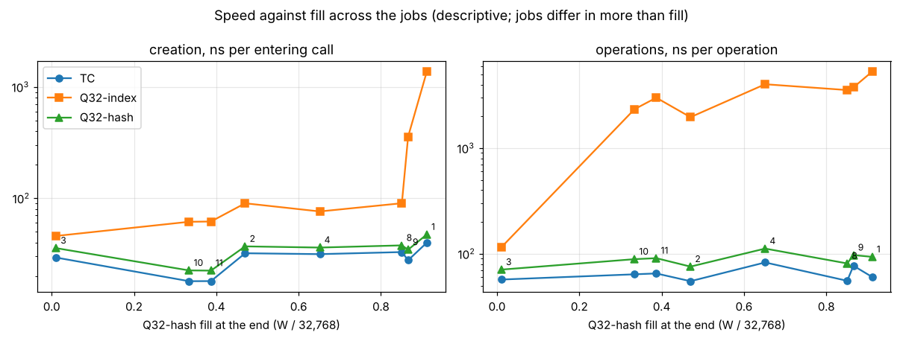

# Design 3, round 3: results

Run started 2026-10-29T20:47:36-05:00.

## The measurement rule (research/rule-r3.md, verbatim, written before the first trial)

sha256 `f4671f1fbc53273a193e63fc1e1c13e116aa0d7d6a06647aadbf6890407f2cf9`

<!-- rule begins -->
# Design 3, round 3: measurement rule

Oct 29, 2026 · **Fixed: approved by the author, Oct 29, 2026**, after one independent review whose fixes are applied. Each threshold is either **carried over** from round 2's fixed rule ([`rule-r2.md`](rule-r2.md), with its two revisions; approved by the author, Oct 29, 2026), and marked so, or new to this round and marked **approved by the author, Oct 29, 2026**. The harness refuses a measured run unless this file has the approved text (by sha256, pinned in the harness), and while any mark of a proposal awaiting approval remains in it, as in round 2. A change after the first trial is a revision, dated and explained at the top. Round 2's rule stays fixed and unedited. Its run ([`../test/results-r2/`](../test/results-r2/results.md)) stays on record as **"three-structure Q32 (retired)"**.

**Revision of Oct 29, 2026 (before any measurement; the author's decisions of Oct 29, 2026; spec v0.3 §17).** Nothing of round 3 had been timed or run. The rows change as spec v0.3 §17 amends them:
- 0 and 1 are stored at creation at handles 0 and 1 in both Q32 rows, and counted in $W$;
- all three rows take the special cases of a denominator equal to 1 (addition and multiplication) and of a numerator equal to 0 (every operation), ordered by the cost of their result;
- TC's source is `lib/src/tc3.c`, round 2's `tc.c` with those cases; `tc.c` stays unchanged and hash-checked as round 2's record.

This revision changes items 2, 7 and 12 to match, and the Workloads table: $W$ grows by 1 on jobs 1, 3, 4 and 10, and every fill moves by under 0.01%. **Every threshold, number, measure, verdict and step of the run plan is unchanged.** The harness pins this revised text's sha256.

This rule measures the three rows of [spec v0.3](../v0.3.md):
- **TC**: one structure, the list of rationals, in `lib/src/tc3.c` (round 3's textbook control: round 2's `tc.c` with the special cases above);
- **Q32-index**: two structures, the rationals $R$ and the list $W$ of whole numbers in arrival order, searched top to bottom;
- **Q32-hash**: two structures, the rationals $R$ and a fixed table of 32,768 slots holding the whole numbers.

Their arithmetic is identical, call for call (spec v0.3 §12.1). They differ only in how whole numbers are stored. Results are reported **per measure, with no overall winner**. The profile is **reported, not judged**.

Three points are the author's (Oct 29, 2026), carried over: the 30-minute hard stop; no background process of the runner's own during timed phases; and the rows (now the author's three, spec v0.3 §0).

## Measurement rule

1. **Rows.** Each job runs four rows:
   - **TC** (spec v0.3 §9);
   - **Q32-index** (§7);
   - **Q32-hash** (§8);
   - **Q32-hash-null**: Q32-hash's binary, run as a separate row for the null control (item 8) (**approved by the author, Oct 29, 2026**: the null copy is of Q32-hash, as round 2's was of its Q32 row, and cheap to run; the alternative is a copy of TC).

   Retired, and not run: round 2's three-structure Q32 and Q32-null, and every row retired by round 2 (spec v0.3 §14).

2. **Builds.** As rule-r2 item 2 (carried over), for the three rows:
   - one compiler and one set of flags (`gcc -std=c11 -O2`);
   - the 08 module, `tc.h` and round 2's `tc.c` unchanged, their sha256 checked before every run (*revised Oct 29, 2026:* TC is built from `tc3.c`, spec v0.3 §17.4; `tc.c` is checked as round 2's record);
   - four builds per row;
   - one counting run and one memory run per row and job, with the per-call counter reads of the call-for-call check;
   - repeats on jobs **3 and 10**, which MUST be identical (carried over);
   - a limit of **10 minutes** per counting or memory run (carried over).

   Q32-hash-null shares Q32-hash's gates, counting and memory runs.

3. **Gates before the measured run.** As rule-r2 item 3 (carried over), for each row: the unit tests of spec v0.3 §12.3, and on every job the gate and the exact checks of spec v0.3 §12.1. Those checks cover:
   - every stored value;
   - $W$ in both Q32 rows;
   - every case and K counter;
   - Q32-index's list, searches and entries examined;
   - Q32-hash's table, stores, probes and longest store;
   - the agreement between the two Q32 rows.

   The counting runs MUST pass the call-for-call check: Q32-index's and Q32-hash's per-call arithmetic each equal to TC's. Gates MAY run two at a time, only before the timed steps.

4. **Timing.** As rule-r2 item 4, every number carried over:
   - **12 interleaved rounds**, the order rotated by one row per round over the four rows;
   - **r**, the smallest power of two with a rep of at least **50 ms**;
   - **3 reps** per invocation, with the first discarded and the minimum of the other two kept, or **1 rep** if the calibration rep lasts at least **1 s**;
   - calibration per job just before round 1, for TC, Q32-index and Q32-hash, with the null row taking Q32-hash's r;
   - pinning to **core 1**, with the runner on core 0;
   - a time cap of **10 s** per rep (over cap is a reported finding);
   - the process's own CPU time, reported only.

   **The parts** (spec v0.3 §11.3):
   - **creation**: `create` and every entering call (`create` timed: **approved by the author, Oct 29, 2026**, spec R3-4). `create`'s own time is also reported separately, per run and as a share of the creation part, with no verdict, so its share is visible, especially on small jobs such as job 3;
   - **operations**: every add, sub, mul and div call;
   - **read-out**.

   A row's time in a round is each part's time per run, and the **total** is their sum.

5. **Nothing of the runner's own runs during a timed phase.** **Carried over in full** from rule-r2 item 5 with both its revisions. This covers:
   - the single-threaded runner;
   - the start of each timed invocation by `fork` and `exec`, with `sched_setaffinity` to core 1 and `dup2` to a file before `exec`, and with no `posix_spawn` or `subprocess`;
   - one blocking `waitpid`;
   - the kernel timer for the hard stop;
   - no writes during an invocation;
   - the operator's duty to start the runner once, as one background command with a timeout of at least **35 minutes**, and to run nothing else until it exits.

   **The disturbance check by process**, after each timed block, is carried over with all its numbers:
   - snapshots by process with start times;
   - ticks including reaped children;
   - the credit for children reaped during the block;
   - the fork counter reported only;
   - other processes limited to $5 + \lceil 1 \cdot L \rceil$ ticks;
   - a new process limited to under 1 tick;
   - host processes held to the allowance $5 + \lceil 2\,R_h\,L \rceil$, with $R_h$ from the pilot and at least 1 tick over the longest pilot block;
   - a stop if any host's measured rate exceeds **4 ticks per second**;
   - a disturbed block re-run once, and a second disturbance stopping the run.

   **The runner's ticks** are reported in total and per launch, with the sanity limit of **more than 1 tick per launch plus 2** per block, a harness bug (carried over). The one addition, untimed: the runner reads `CLOCK_MONOTONIC` just before each `fork` and just after its `waitpid` returns. This is one vDSO read each, with no I/O. The runner keeps the readings in memory, to give the pilot's $P_\text{idx}$ (Run plan step 3).

6. **Idle machine.** Carried over from rule-r2 item 6: a **2-second** sample before each timed block. The machine is idle when no process outside the runner used more than **5%** of one core and core 1 was at most **2%** busy. If it is busy, the runner re-checks every **15 s** and stops after **10 minutes**.

7. **Measures**, per job, for each **pairing**:
   - **Q32-index against TC**;
   - **Q32-hash against TC**;
   - **Q32-hash against Q32-index** (**approved by the author, Oct 29, 2026**: the author's model has two structures, and this pairing compares its two forms directly; without it, the two forms are compared only through TC).

   The measures are:
   - **Creation time.** T_c(reference) / T_c(row), with the reference TC, or Q32-index in the third pairing. T_c is the median over rounds of the creation part per run. Above 1, the row is faster. The 95% interval [lo, hi] comes from **10,000 paired bootstrap resamples** of the rounds, with seed 20261029 (carried over).
   - **Operation time.** The same, on the operations part.
   - **Total time and read-out time.** Reported with ratio and interval, **without a verdict** (the author: creation and operations are the measures; the total is reported too).
   - **Bytes per rational, accounted (B_used):**
     - TC: 16;
     - Q32-index: $4 + 8W/N$, with $W$ counting 0 and 1, stored by `create` (*revised Oct 29, 2026*, spec v0.3 §17.2);
     - Q32-hash: $4 + 262{,}144/N$, the table counted in full whatever its fill.
   - **Bytes per rational, heap (B_heap):** the growth of `mallinfo2` (`uordblks + hblkhd`) from just before `create`, over $N$, with `mallopt` as in round 2 (carried over). Both memory figures come from one memory run per row and job, after entry and at the end. Verdicts use the end figures.
   - **Gcd work: a check, not a verdict** (carried over). G(row)/G(TC) MUST be exactly 1 for both Q32 rows, by the call-for-call check. It is reported with G per operation. Any other value is a bug.

8. **Null control.** Q32-hash against Q32-hash-null, by item 7, gives a null spread **for each time measure**: max(1 − lo, hi − 1, 0) of the creation ratio, and likewise of the operation ratio. Each time verdict uses its own measure's band, **h = max(5%, that measure's null spread)** (the 5% floor carried over; one band per measure: **approved by the author, Oct 29, 2026**, since round 2 had one time measure). The same h applies to every pairing.

   **Caveat: Q32-index's own noise is not measured.** The null row is a copy of Q32-hash, not of Q32-index. On the large jobs, where its calibration rep lasts at least 1 s, Q32-index runs 1 rep per invocation with no discarded rep (item 4), so its noise may differ from Q32-hash's. The shared band h is used for the pairings with Q32-index anyway, and the report states this caveat beside each of their time verdicts.

9. **Verdicts per job, pairing and measure, with magnitudes** (thresholds carried over):

   | Measure | Row wins | Row loses | Tie | Magnitude reported |
   | --- | --- | --- | --- | --- |
   | Creation time | lo > 1 + h_c | hi < 1 − h_c | otherwise | ratio, [lo, hi], h_c |
   | Operation time | lo > 1 + h_o | hi < 1 − h_o | otherwise | ratio, [lo, hi], h_o |
   | B_used (end) | ratio ≤ 0.90 | ratio ≥ 1.10 | otherwise | ratio after entry and at the end; W, N, W/N, fill |
   | B_heap (end) | ratio ≤ 0.90 | ratio ≥ 1.10 | otherwise | ratio after entry and at the end |

   - The total time and read-out time are given beside the verdicts, with ratio and interval, and get no verdict.
   - A memory ratio of at least **2.0** raises the severe-memory-loss flag (carried over).
   - A row over cap has the verdict **over cap** on both time measures.
   - A verdict is never reported without its magnitude.

10. **The profile: reported, not judged.** As rule-r2 item 10, every number carried over:
    - K = **32**;
    - **3 invocations per row**, at the timing build's r, with 3 reps each and the first discarded;
    - the slowdown limit of **1.5**, with an invocation over it having its phase figures withheld;
    - per-case shares for cases with at least **100** sampled calls.

    The profile runs for the three rows (not the null row), in the order Q32-index, Q32-hash, TC, repeated three times per job. The phases are adapted per row (spec v0.3 §11.4). I is the linear search and append in Q32-index, and the hashing and probing in Q32-hash. M covers list growth only, and `create` is reported as its own batch figure. The per-phase differences of each Q32 row from TC, and of Q32-hash from Q32-index, are labelled **indicative only**.

11. **Strata, and no overall winner.** As rule-r2 item 11 (carried over): MONEY (jobs 1–2), SMALL (3–4) and CHAINS (8–11). For each stratum, pairing and measure, the report gives the counts of wins, ties, losses, over-cap and n/a, the median ratio, and the severe flags. The rule combines no measures and names no better row.

12. **Checks, and bugs after the gates.** As rule-r2 item 12 (carried over). Every stored value of every invocation is checked against `fractions`. After the gates, each of these is a **bug**:
    - a check failure;
    - an overflow;
    - a failed exact check of spec v0.3 §12.1;
    - a non-repeating count;
    - either Q32 row reaching its capacity, which for Q32-hash is a full table;
    - gcd work differing between rows.

    A fix to `q32i.c` re-runs Q32-index. A fix to `q32h.c` re-runs Q32-hash and its null row. A fix to `tc3.c` re-runs TC (*revised Oct 29, 2026*; `tc.c` is round 2's and is not changed).

13. **Also reported:**
    - **Storage, per job, after entry and at the end:**
      - Q32-hash's **fill** ($W/32{,}768$), **average probes per store** and **longest store**;
      - Q32-index's **average entries examined per search**, with the searches split into found and appended.
    - **Speed against fill.** A table and a plot across the 8 jobs, sorted by Q32-hash's fill at the end. It shows each row's creation and operation time per call (ns), and the ratios to TC, beside the fill and the average probes or entries examined. It is presented, not judged, so the curve of speed against fill is visible. The jobs differ in more than fill (their operations, cases and reuse differ too), so the curve is descriptive. A dedicated fill sweep is left to a later round (spec v0.3 §0 item 3).
    - Realized reuse, counts per operation, the known-answer skips with their predictions, memory against reuse, the idle and disturbance checks (with the runner's ticks per launch), and the process's own CPU time: as rule-r2 item 13 (carried over).
    - **Round 2, for reference only:** a link to the three-structure Q32 (retired) results. They enter no round-3 measure.

## Workloads

**Exactly round 2's** (carried over): the same generator (`test/gen.py` via `r2_gen.py`), master seed 20261029, job $n$ seeded 20261029 + $n$. Every workload file is **byte-identical** to round 1's and round 2's, checked by sha256 against round 1's pinned `results-q32/state.json`. The jobs that fit (capacity 32,768) are run:

| Job | Name | Stratum | $W$ at the end | Q32-hash fill | Run |
| --- | --- | --- | --- | --- | --- |
| 1 | MONEY-wide | MONEY | 29,867 | 91.1% | yes |
| 2 | MONEY-catalog | MONEY | 15,403 | 47.0% | yes |
| 3 | SMALL8 | SMALL | 351 | 1.1% | yes |
| 4 | SMALL64 | SMALL | 21,347 | 65.1% | yes |
| 5 | MOD-mixed | MOD | 40,849 | — | **no: over capacity** |
| 6 | MOD-muldiv | MOD | 40,798 | — | **no: over capacity** |
| 7 | NEW-add | NEW | 50,795 | — | **no: over capacity** |
| 8 | CH-money | CHAINS | 27,881 | 85.1% | yes |
| 9 | CH-closed | CHAINS | 28,379 | 86.6% | yes |
| 10 | CH-small | CHAINS | 10,946 | 33.4% | yes |
| 11 | CH-mixed | CHAINS | 12,682 | 38.7% | yes |

Both Q32 rows store the same whole numbers as round 2's Q32, plus 0 and 1 from `create` (*revised Oct 29, 2026*): $W$ is round 2's, +1 on jobs 1, 3, 4 and 10, where 0 was not otherwise stored. The table has no fill limit; its fill is set by the jobs alone.

## Run plan

1. Build every row in its four builds, check the hashes of the 08 module and `tc.c`, and generate or verify the workloads, references and predictions. The predictions include Q32-index's entries examined and Q32-hash's probes.
2. Unit tests of the three rows (test build, and the sanitizer build).
3. **Pilot:** jobs **1, 3 and 10** (carried over), with every row, r calibration and **2 rounds**, then **one profiling run** of each of the three rows on **job 1** (carried over), in its own block. It records:
   - the host rates $R_h$;
   - each row's profiling slowdown;
   - $P_\text{prof}$, the profiling block's wall time;
   - $P_\text{idx}$, the summed wall time of Q32-index's launches in the pilot's round blocks (from the runner's readings around `fork` and `waitpid`, item 5);
   - $P_\text{rest}$, the rest of the pilot's wall time.

   **Stop rule** (**approved by the author, Oct 29, 2026**: one term added to round 2's formula):
   $$\text{projection} = \text{elapsed} + 5\ \text{min} \times \max(1,\ P_\text{rest} / 0.5\ \text{min}) + 42 \times P_\text{idx} + 36 \times P_\text{prof}.$$
   - The 5 and 0.5 minutes (carried over) cover the work outside Q32-index: TC, Q32-hash and its null row cost about what round 2's three rows did.
   - The factor 36 (carried over) is 24 × 1.5, since step 7 makes 72 profile invocations against the pilot's 3.
   - **The factor 42 (approved by the author, Oct 29, 2026)** projects Q32-index's own remaining work. Its pilot makes 7 reps on jobs 1, 3 and 10. In steps 4–7 it makes about 37 timed reps per job plus about 5 run-equivalents of gates, counting and memory runs, so about 6 times as many runs. Its search work over all 8 jobs is 3.4 to 4.6 times that of the pilot's three jobs (the bounds below). That gives 6 × 4.6 = 28, and half again for margin gives 42.
   - **If the projection exceeds 22 minutes (carried over), the run stops** and is reported to the author before anything else runs. It also stops if any host's measured rate exceeds 4 ticks per second, or any row's profiling slowdown exceeds 1.5 (carried over).
4. Gates (item 3), two at a time.
5. Counting and memory runs, two at a time. Then the worker pool is shut down and joined.
6. Per job, in job order: the idle check, then calibration (3 launches) and the 12 rounds (48 launches), then the disturbance check.
7. Per job, in job order: the idle check, then the profile runs (9 launches), then the disturbance check.
8. Analysis and report, untimed, after the last timed block.

**Hard stop at 30 minutes (the author's, carried over),** from step 1 to the end of step 7, re-runs included, enforced by the kernel timer. A stopped run reports no verdict.

### Runtime estimate (non-normative)

**Q32-index's search work is the unknown.** It is exact and deterministic: the model predicts it before any timing. It is bounded here from round 2's counts (`test/results-r2/results.md`, counts per operation and realized reuse). A new whole number scans the whole list, which gives $W(W-1)/2$ entries per run over a job. A found one scans at least 1 entry and at most $W$.

| Job | W | searches | entries examined per run (lower – upper) | avg per search | at 0.4 ns per entry |
| --- | --- | --- | --- | --- | --- |
| 1 | 29,866 | 59,415 | 4.5e8 – 1.3e9 | 7,500 – 22,400 | 0.18 – 0.53 s |
| 2 | 15,403 | 59,390 | 1.2e8 – 8.0e8 | 2,000 – 13,400 | 0.05 – 0.32 s |
| 3 | 350 | 53,699 | 1.1e5 – 1.9e7 | 2 – 350 | < 0.01 s |
| 4 | 21,346 | 59,435 | 2.3e8 – 1.0e9 | 3,800 – 17,500 | 0.09 – 0.42 s |
| 8 | 27,881 | 83,093 | 3.9e8 – 1.9e9 | 4,700 – 23,200 | 0.16 – 0.77 s |
| 9 | 28,379 | 83,993 | 4.0e8 – 2.0e9 | 4,800 – 23,600 | 0.16 – 0.79 s |
| 10 | 10,945 | 35,926 | 6.0e7 – 3.3e8 | 1,700 – 9,300 | 0.02 – 0.13 s |
| 11 | 12,682 | 35,951 | 8.0e7 – 3.8e8 | 2,200 – 10,400 | 0.03 – 0.15 s |
| all | | | 1.7e9 – 7.8e9 | | 0.7 – 3.1 s |

The machine is a 2.7 GHz Xeon with gcc 13, which does not vectorize a loop with an early exit at `-O2`. So the scalar loop compares about one entry per cycle or a little slower, about **0.4 ns per entry**. A pessimistic **1 ns** gives 1.7 – 7.8 s for one run of all eight jobs. For scale, round 2's Q32 took 1.1 – 3.7 ms per run, so Q32-index is expected to be about 50 to 500 times slower than TC on the large jobs.

| Part | At 0.4 ns per entry | At 1 ns per entry |
| --- | --- | --- |
| Q32-index, step 6 (about 37 reps per job; 13 where a rep lasts at least 1 s) | 26 – 115 s | 64 – 200 s |
| Q32-index, step 7 (9 reps per job, slowdown about 1) | 6 – 28 s | 15 – 70 s |
| Q32-index, gates, counting and memory runs (two cores) | 3 – 16 s | 8 – 40 s |
| Everything else (round 2's run took 2.5 min; Q32-hash and its null row add about a third of the rounds) | 3 – 3.5 min | 3 – 3.5 min |
| **Whole run** | **about 4 – 6 min** | **about 5 – 9 min** |
| Pilot projection (elapsed about 1 min, + 5 + 42 × P_idx + 36 × P_prof) | about 9 – 12 min | about 11 – 18 min |

- **Time cap (10 s per rep, carried over):** the longest rep is a single run of job 9, at most 0.8 s at 0.4 ns and 2 s at 1 ns. That is well under the cap, which needs no change.
- **Hard stop (30 min) and projection limit (22 min), carried over:** both hold at both rates. The projection would pass 22 minutes, and stop the run for the author, only if the search ran at about 2 ns per entry or worse. That would be a real surprise worth stopping for.
- No adjustment of the cap or the hard stop is proposed.

*Q32-hash* stores by hashing and probing in a 256 KB table that fits in cache. It is expected to cost about what round 2's Q32 did, or less, since a probe reads the value directly rather than through an index. The measured blocks are longer than round 2's: 51 launches instead of 38, and up to about a minute on jobs 8 and 9. The disturbance limits scale with the block's length, and the runner's sanity limit scales with its launches, both as carried over.

## Limitations, reported with the results

- **Textbook only.** No row is optimized. In particular, Q32-index's search is the plain linear search, and Q32-hash's table is plain open addressing with linear probing.
- **Fill is not controlled.** Q32-hash's fill varies across jobs only as the jobs' $W$ does, together with every other property of the jobs. The speed-against-fill table is descriptive. A sweep at target fills is for a later round (spec v0.3 §0 item 3).
- **Q32-index's cost grows with W.** Its time per store is roughly proportional to the list's length, so its verdicts depend on each job's size, not only on its reuse.
- **Every result is kept;** chains do not update in place. Arithmetic is 64-bit only. The profile perturbs what it measures. Jobs 5–7 are not run. The disturbance check cannot see every process. All of these are as round 2.
- **Round 2's Q32 is retired, not superseded.** Its results measured a three-structure design and stay on record under that label.

## Harness

Round 2's harness (`r2_*.py`, `bench_r2.c`, `api_r2.h`) is the starting point. New `r3_*` files sit beside it, and round 2's files stay unchanged. The changes:
- the model predicts both Q32 rows' storage exactly: Q32-index's list order and entries examined, and Q32-hash's table, probes and longest store;
- the driver drives the three rows and times `create` in the creation part;
- the runner runs four rows and records $P_\text{idx}$;
- the analysis reports items 7–13, with three pairings and two time measures.

**The official data.** Round 3 writes only to **`test/results-r3/`**. The harness refuses to write in every earlier results folder:
- `test/results/`;
- `test/results-q64-b3b88b6/`;
- `test/results-q32/`;
- `test/results-r2-stopped-193ae57/`;
- `test/results-r2-stopped-173fad1/`;
- `test/results-r2/` (round 2's complete run, the three-structure Q32 (retired)).

It checks the sha256 of every file in them before and after the run. Builder decisions go in `test/DECISIONS.md` under a round-3 heading, pending the author's review.
<!-- rule ends -->

## The run

- Started 2026-10-29T20:47:36-05:00; finished 2026-10-29T20:51:05-05:00.
- Run time 3.5 minutes (hard stop 30).
- Rule sha256 `f4671f1fbc53273a193e63fc1e1c13e116aa0d7d6a06647aadbf6890407f2cf9`; the official data after the run: unchanged.
- Host processes (the runner's ancestors): bash[15533], claude[92], environment-man[85], sh[79], process_api[1]
- Code at 2026-10-29T20:47:36-05:00: TC `639988e286d7`, Q32I `1eab4ff01427`, Q32H `343b3ddfc164`
- Unit tests: r3_unit: r3_unit: 1352538 checks, 0 failures; r3_diff: r3_diff: 300 seeds, 3 rows, 233379 operations (8210 divisions by zero, 19460 overflows), every case and K-skip met; 1283374 checks, 0 failures; r3_alloc-timing: r3_alloc (timing build): 1246 checks, 0 failures; r3_alloc-counting: r3_alloc (counting build): 1246 checks, 0 failures; r3_alloc-profiling: r3_alloc (profiling build): 1246 checks, 0 failures; r3_unit-asan: r3_unit: 1352538 checks, 0 failures; r3_diff-asan: r3_diff: 60 seeds, 3 rows, 46345 operations (1630 divisions by zero, 3765 overflows), every case and K-skip met; 254894 checks, 0 failures
- **Over capacity for both Q32 rows** (not run): job 5 (MOD-mixed, W = 40849), job 6 (MOD-muldiv, W = 40798), job 7 (NEW-add, W = 50795)

## The pilot (discarded, except what it records for the run)

- Jobs [1, 3, 10], profiling run on job 1; P = 13.1 s (P_idx = 2.3 s, P_rest = 10.9 s), P_prof = 2.9 s; projection 9.2 min (limit 22).
- Host rates R_h (ticks per second): {'1': 0.4063388866314507, '79': 0.4063388866314507, '85': 0.4063388866314507, '92': 0.4230700361475426, '15533': 0.4063388866314507}.
- Profiling slowdown: Q32-index 0.983, Q32-hash 1.230, TC 1.239.

## Verdicts, per job, pairing and measure (no overall winner)

Time: T(reference)/T(row), above 1 the row is faster; each time measure has its own band h from Q32-hash against Q32-hash-null on that measure. Total and read-out time are reported without a verdict. Bytes: row over reference, below 1 the row is smaller. Gcd work is a check, not a verdict. (c): Q32-index's own noise is not measured: the null row is a copy of Q32-hash, and on jobs where Q32-index's calibration rep lasts at least 1 s it runs 1 rep per invocation (rule-r3 item 8).

### Q32-index against TC

| job | creation: verdict, ratio [lo, hi], h | operations: verdict, ratio [lo, hi], h | total (reported) | read-out (reported) | B_used (end): verdict, ratio (after entry) | B_heap (end): verdict, ratio (after entry) |
| --- | --- | --- | --- | --- | --- | --- |
| 1 MONEY-wide | loss, 0.029 [0.029, 0.029], h 0.050 (c) | loss, 0.011 [0.011, 0.011], h 0.050 (c) | reported, 0.014 [0.014, 0.014] | reported, 0.638 [0.586, 0.780] | win, 0.748 (0.750) | win, 0.758 (0.766) |
| 2 MONEY-catalog | loss, 0.356 [0.352, 0.366], h 0.050 (c) | loss, 0.028 [0.028, 0.028], h 0.050 (c) | reported, 0.037 [0.036, 0.037] | reported, 0.714 [0.659, 0.822] | win, 0.507 (0.261) | win, 0.508 (0.274) |
| 3 SMALL8 | loss, 0.640 [0.637, 0.643], h 0.050 (c) | loss, 0.494 [0.493, 0.497], h 0.050 (c) | reported, 0.526 [0.523, 0.529] | reported, 0.755 [0.730, 0.964] | win, 0.256 (0.250) | win, 0.258 (0.251) |
| 4 SMALL64 | loss, 0.413 [0.405, 0.415], h 0.050 (c) | loss, 0.021 [0.021, 0.021], h 0.050 (c) | reported, 0.025 [0.025, 0.025] | reported, 0.633 [0.618, 0.671] | win, 0.606 (0.253) | win, 0.756 (0.263) |
| 8 CH-money | loss, 0.364 [0.357, 0.371], h 0.050 (c) | loss, 0.016 [0.016, 0.016], h 0.050 (c) | reported, 0.019 [0.019, 0.019] | reported, 0.669 [0.613, 0.822] | win, 0.582 (0.260) | win, 0.504 (0.273) |
| 9 CH-closed | loss, 0.078 [0.077, 0.078], h 0.050 (c) | loss, 0.021 [0.020, 0.021], h 0.050 (c) | reported, 0.023 [0.023, 0.023] | reported, 0.612 [0.576, 0.643] | win, 0.588 (0.413) | win, 0.504 (0.391) |
| 10 CH-small | loss, 0.293 [0.290, 0.295], h 0.050 (c) | loss, 0.027 [0.027, 0.028], h 0.050 (c) | reported, 0.037 [0.037, 0.038] | reported, 0.695 [0.679, 0.746] | win, 0.554 (0.253) | win, 0.504 (0.258) |
| 11 CH-mixed | loss, 0.292 [0.289, 0.294], h 0.050 (c) | loss, 0.022 [0.022, 0.022], h 0.050 (c) | reported, 0.030 [0.030, 0.030] | reported, 0.676 [0.650, 0.875] | win, 0.602 (0.253) | win, 0.504 (0.258) |

### Q32-hash against TC

| job | creation: verdict, ratio [lo, hi], h | operations: verdict, ratio [lo, hi], h | total (reported) | read-out (reported) | B_used (end): verdict, ratio (after entry) | B_heap (end): verdict, ratio (after entry) |
| --- | --- | --- | --- | --- | --- | --- |
| 1 MONEY-wide | loss, 0.844 [0.838, 0.851], h 0.050 | loss, 0.645 [0.644, 0.650], h 0.050 | reported, 0.688 [0.685, 0.699] | reported, 0.756 [0.709, 0.913] | win, 0.796 (1.888) | win, 0.750 (1.250) |
| 2 MONEY-catalog | loss, 0.867 [0.860, 0.880], h 0.050 | loss, 0.728 [0.722, 0.734], h 0.050 | reported, 0.757 [0.749, 0.767] | reported, 0.747 [0.707, 0.859] | win, 0.796 (1.888) | win, 0.750 (1.250) |
| 3 SMALL8 | loss, 0.823 [0.818, 0.826], h 0.050 | loss, 0.805 [0.803, 0.809], h 0.050 | reported, 0.810 [0.805, 0.814] | reported, 0.744 [0.717, 0.949] | win, 0.796 (1.888) | win, 0.750 (1.250) |
| 4 SMALL64 | loss, 0.873 [0.863, 0.881], h 0.050 | loss, 0.739 [0.737, 0.743], h 0.050 | reported, 0.757 [0.755, 0.763] | reported, 0.745 [0.708, 0.754] | win, 0.796 (1.888) | win, 0.750 (1.250) |
| 8 CH-money | loss, 0.871 [0.868, 0.875], h 0.050 | loss, 0.685 [0.680, 0.688], h 0.050 | reported, 0.713 [0.708, 0.718] | reported, 0.796 [0.753, 0.958] | win, 0.640 (1.888) | win, 0.500 (1.250) |
| 9 CH-closed | loss, 0.804 [0.799, 0.810], h 0.050 | loss, 0.792 [0.791, 0.797], h 0.050 | reported, 0.795 [0.792, 0.797] | reported, 0.752 [0.728, 0.788] | win, 0.640 (1.888) | win, 0.500 (1.250) |
| 10 CH-small | loss, 0.800 [0.796, 0.806], h 0.050 | loss, 0.719 [0.715, 0.725], h 0.050 | reported, 0.738 [0.733, 0.749] | reported, 0.720 [0.693, 0.773] | loss, 1.160 (1.888) | win, 0.750 (1.250) |
| 11 CH-mixed | loss, 0.805 [0.799, 0.808], h 0.050 | loss, 0.717 [0.715, 0.721], h 0.050 | reported, 0.739 [0.735, 0.744] | reported, 0.724 [0.702, 0.924] | loss, 1.160 (1.888) | win, 0.750 (1.250) |

### Q32-hash against Q32-index

| job | creation: verdict, ratio [lo, hi], h | operations: verdict, ratio [lo, hi], h | total (reported) | read-out (reported) | B_used (end): verdict, ratio (after entry) | B_heap (end): verdict, ratio (after entry) |
| --- | --- | --- | --- | --- | --- | --- |
| 1 MONEY-wide | win, 29.024 [28.814, 29.194], h 0.050 (c) | win, 56.644 [56.401, 57.003], h 0.050 (c) | reported, 49.717 [49.524, 50.002] | reported, 1.184 [1.140, 1.251] | tie, 1.065 (2.519) | tie, 0.990 (1.633) |
| 2 MONEY-catalog | win, 2.438 [2.357, 2.475], h 0.050 (c) | win, 25.952 [25.768, 26.123], h 0.050 (c) | reported, 20.653 [20.499, 20.778] | reported, 1.047 [1.012, 1.102] | loss, 1.571 (7.249) | loss, 1.477 (4.570) |
| 3 SMALL8 | win, 1.286 [1.279, 1.291], h 0.050 (c) | win, 1.629 [1.623, 1.637], h 0.050 (c) | reported, 1.538 [1.535, 1.547] | reported, 0.986 [0.978, 1.005] | loss, 3.112 (7.540) **severe memory loss** | loss, 2.907 (4.982) **severe memory loss** |
| 4 SMALL64 | win, 2.111 [2.086, 2.156], h 0.050 (c) | win, 35.919 [35.780, 36.044], h 0.050 (c) | reported, 30.521 [30.372, 30.616] | reported, 1.177 [1.103, 1.196] | loss, 1.314 (7.457) | tie, 0.992 (4.758) |
| 8 CH-money | win, 2.391 [2.348, 2.436], h 0.050 (c) | win, 43.732 [43.389, 44.095], h 0.050 (c) | reported, 37.333 [36.995, 37.645] | reported, 1.189 [1.135, 1.260] | tie, 1.100 (7.251) | tie, 0.993 (4.585) |
| 9 CH-closed | win, 10.352 [10.277, 10.532], h 0.050 (c) | win, 38.630 [38.513, 38.793], h 0.050 (c) | reported, 34.921 [34.790, 35.035] | reported, 1.229 [1.187, 1.305] | tie, 1.089 (4.568) | tie, 0.992 (3.200) |
| 10 CH-small | win, 2.735 [2.715, 2.762], h 0.050 (c) | win, 26.249 [26.105, 26.378], h 0.050 (c) | reported, 19.831 [19.725, 19.936] | reported, 1.036 [0.998, 1.054] | loss, 2.094 (7.458) **severe memory loss** | loss, 1.489 (4.849) |
| 11 CH-mixed | win, 2.760 [2.728, 2.784], h 0.050 (c) | win, 33.011 [32.930, 33.181], h 0.050 (c) | reported, 24.916 [24.849, 25.048] | reported, 1.071 [1.026, 1.114] | loss, 1.926 (7.458) | loss, 1.489 (4.849) |

### Gcd work (a check, not a verdict) and the call-for-call checks

| job | G per operation | G(Q32-index)/G(TC) | G(Q32-hash)/G(TC) | Q32-index vs TC call for call | Q32-hash vs TC call for call | Q32-index vs Q32-hash: stores call for call, counters, found/new |
| --- | --- | --- | --- | --- | --- | --- |
| 1 | 24.99 | 1.000000 (passed) | 1.000000 (passed) | pass | pass | pass, pass, pass |
| 2 | 18.40 | 1.000000 (passed) | 1.000000 (passed) | pass | pass | pass, pass, pass |
| 3 | 19.15 | 1.000000 (passed) | 1.000000 (passed) | pass | pass | pass, pass, pass |
| 4 | 31.65 | 1.000000 (passed) | 1.000000 (passed) | pass | pass | pass, pass, pass |
| 8 | 19.79 | 1.000000 (passed) | 1.000000 (passed) | pass | pass | pass, pass, pass |
| 9 | 28.73 | 1.000000 (passed) | 1.000000 (passed) | pass | pass | pass, pass, pass |
| 10 | 16.61 | 1.000000 (passed) | 1.000000 (passed) | pass | pass | pass, pass, pass |
| 11 | 16.52 | 1.000000 (passed) | 1.000000 (passed) | pass | pass | pass, pass, pass |

### Strata (counts of verdicts; no measure combined, no stratum scored)

| stratum | pairing | measure | wins | ties | losses | over cap | n/a | median ratio | severe flags |
| --- | --- | --- | --- | --- | --- | --- | --- | --- | --- |
| MONEY | Q32-index vs TC | creation | 0 | 0 | 2 | 0 | 0 | 0.192 | 0 |
| MONEY | Q32-index vs TC | operations | 0 | 0 | 2 | 0 | 0 | 0.020 | 0 |
| MONEY | Q32-index vs TC | B_used | 2 | 0 | 0 | 0 | 0 | 0.627 | 0 |
| MONEY | Q32-index vs TC | B_heap | 2 | 0 | 0 | 0 | 0 | 0.633 | 0 |
| MONEY | Q32-hash vs TC | creation | 0 | 0 | 2 | 0 | 0 | 0.856 | 0 |
| MONEY | Q32-hash vs TC | operations | 0 | 0 | 2 | 0 | 0 | 0.686 | 0 |
| MONEY | Q32-hash vs TC | B_used | 2 | 0 | 0 | 0 | 0 | 0.796 | 0 |
| MONEY | Q32-hash vs TC | B_heap | 2 | 0 | 0 | 0 | 0 | 0.750 | 0 |
| MONEY | Q32-hash vs Q32-index | creation | 2 | 0 | 0 | 0 | 0 | 15.731 | 0 |
| MONEY | Q32-hash vs Q32-index | operations | 2 | 0 | 0 | 0 | 0 | 41.298 | 0 |
| MONEY | Q32-hash vs Q32-index | B_used | 0 | 1 | 1 | 0 | 0 | 1.318 | 0 |
| MONEY | Q32-hash vs Q32-index | B_heap | 0 | 1 | 1 | 0 | 0 | 1.234 | 0 |
| SMALL | Q32-index vs TC | creation | 0 | 0 | 2 | 0 | 0 | 0.527 | 0 |
| SMALL | Q32-index vs TC | operations | 0 | 0 | 2 | 0 | 0 | 0.257 | 0 |
| SMALL | Q32-index vs TC | B_used | 2 | 0 | 0 | 0 | 0 | 0.431 | 0 |
| SMALL | Q32-index vs TC | B_heap | 2 | 0 | 0 | 0 | 0 | 0.507 | 0 |
| SMALL | Q32-hash vs TC | creation | 0 | 0 | 2 | 0 | 0 | 0.848 | 0 |
| SMALL | Q32-hash vs TC | operations | 0 | 0 | 2 | 0 | 0 | 0.772 | 0 |
| SMALL | Q32-hash vs TC | B_used | 2 | 0 | 0 | 0 | 0 | 0.796 | 0 |
| SMALL | Q32-hash vs TC | B_heap | 2 | 0 | 0 | 0 | 0 | 0.750 | 0 |
| SMALL | Q32-hash vs Q32-index | creation | 2 | 0 | 0 | 0 | 0 | 1.699 | 0 |
| SMALL | Q32-hash vs Q32-index | operations | 2 | 0 | 0 | 0 | 0 | 18.774 | 0 |
| SMALL | Q32-hash vs Q32-index | B_used | 0 | 0 | 2 | 0 | 0 | 2.213 | 1 |
| SMALL | Q32-hash vs Q32-index | B_heap | 0 | 1 | 1 | 0 | 0 | 1.950 | 1 |
| CHAINS | Q32-index vs TC | creation | 0 | 0 | 4 | 0 | 0 | 0.292 | 0 |
| CHAINS | Q32-index vs TC | operations | 0 | 0 | 4 | 0 | 0 | 0.021 | 0 |
| CHAINS | Q32-index vs TC | B_used | 4 | 0 | 0 | 0 | 0 | 0.585 | 0 |
| CHAINS | Q32-index vs TC | B_heap | 4 | 0 | 0 | 0 | 0 | 0.504 | 0 |
| CHAINS | Q32-hash vs TC | creation | 0 | 0 | 4 | 0 | 0 | 0.804 | 0 |
| CHAINS | Q32-hash vs TC | operations | 0 | 0 | 4 | 0 | 0 | 0.718 | 0 |
| CHAINS | Q32-hash vs TC | B_used | 2 | 0 | 2 | 0 | 0 | 0.900 | 0 |
| CHAINS | Q32-hash vs TC | B_heap | 4 | 0 | 0 | 0 | 0 | 0.625 | 0 |
| CHAINS | Q32-hash vs Q32-index | creation | 4 | 0 | 0 | 0 | 0 | 2.748 | 0 |
| CHAINS | Q32-hash vs Q32-index | operations | 4 | 0 | 0 | 0 | 0 | 35.821 | 0 |
| CHAINS | Q32-hash vs Q32-index | B_used | 0 | 2 | 2 | 0 | 0 | 1.513 | 1 |
| CHAINS | Q32-hash vs Q32-index | B_heap | 0 | 2 | 2 | 0 | 0 | 1.241 | 0 |

## `create`, on its own (reported, not judged)

The median over rounds of `create`'s time per run, and its share of the creation part (median of the per-round shares). `create` is timed inside the creation part (spec v0.3 §6 item 4).

| job | TC create ns (share) | Q32-index create ns (share) | Q32-hash create ns (share) | Q32-hash-null create ns (share) |
| --- | --- | --- | --- | --- |
| 1 MONEY-wide | 142 (0.0004) | 1658 (0.0001) | 4108 (0.0087) | 4092 (0.0087) |
| 2 MONEY-catalog | 131 (0.0004) | 1069 (0.0012) | 4144 (0.0112) | 4157 (0.0112) |
| 3 SMALL8 | 145 (0.0005) | 373 (0.0008) | 5086 (0.0143) | 5125 (0.0143) |
| 4 SMALL64 | 165 (0.0005) | 1437 (0.0019) | 4209 (0.0117) | 4232 (0.0118) |
| 8 CH-money | 208 (0.0006) | 1734 (0.0019) | 4355 (0.0115) | 4363 (0.0116) |
| 9 CH-closed | 246 (0.0009) | 1822 (0.0005) | 4335 (0.0126) | 4325 (0.0125) |
| 10 CH-small | 64 (0.0004) | 521 (0.0008) | 3898 (0.0173) | 3918 (0.0173) |
| 11 CH-mixed | 69 (0.0004) | 587 (0.0010) | 3908 (0.0175) | 3915 (0.0175) |

## The profile (reported, not judged)

Batch times per operation are close to the timing build's; the phase figures are not. **The per-phase differences between rows are indicative only**: the fences of a sampled call stop one phase's latency from overlapping the next phase's work (spec v0.2 §13.4 item 9). I is Q32-index's linear search and append, and Q32-hash's hashing and probing; M is list growth only; `create` is its own batch figure, per run (spec v0.3 §11.4). The entry part's figures leave `create` out.

### Job 1 (MONEY-wide)

- Q32-index: slowdowns 1.011, 1.003, 1.007; probe cost 56.1 cycles, K = 32, sampled calls 1881; create 2959 ns per run
- Q32-hash: slowdowns 1.228, 1.231, 1.228; probe cost 56.1 cycles, K = 32, sampled calls 59994; create 4846 ns per run
- TC: slowdowns 1.277, 1.256, 1.254; probe cost 56.1 cycles, K = 32, sampled calls 59874; create 647 ns per run

| part | row | batch ns/op | F share (raw / corr.) | C share (raw / corr.) | A.gcd share (raw / corr.) | A.rest share (raw / corr.) | I share (raw / corr.) | S share (raw / corr.) | U share (raw / corr.) | F ns/op | C ns/op | A.gcd ns/op | A.rest ns/op | I ns/op | S ns/op | U ns/op | M ns/op |
| --- | --- | --- | --- | --- | --- | --- | --- | --- | --- | --- | --- | --- | --- | --- | --- | --- | --- |
| entry | Q32-index | 1389.5 | 0.000 / 0.000 | 0.000 / 0.000 | 0.033 / 0.024 | 0.031 / 0.007 | 0.852 / 0.946 | 0.047 / 0.010 | 0.036 / 0.013 | 0.0 | 0.0 | 33.2 | 9.6 | 1307.6 | 14.5 | 17.7 | 1.7 |
| entry | Q32-hash | 57.4 | 0.000 / 0.000 | 0.000 / 0.000 | 0.187 / 0.413 | 0.177 / 0.112 | 0.189 / 0.150 | 0.254 / 0.125 | 0.187 / 0.146 | 0.0 | 0.0 | 23.5 | 6.4 | 8.6 | 7.2 | 8.3 | 0.1 |
| entry | TC | 47.4 | 0.000 / 0.000 | 0.000 / 0.000 | 0.301 / 0.586 | 0.280 / 0.169 | 0.000 / 0.000 | 0.132 / 0.060 | 0.283 / 0.177 | 0.0 | 0.0 | 27.7 | 8.0 | 0.0 | 2.8 | 8.4 | 0.1 |
| entry | Q32-index - TC (indicative only) | 1342.1 |  |  |  |  |  |  |  | 0.0 | 0.0 | 5.5 | 1.6 | 1307.6 | 11.7 | 9.3 | 1.6 |
| entry | Q32-hash - TC (indicative only) | 10.0 |  |  |  |  |  |  |  | 0.0 | 0.0 | -4.2 | -1.6 | 8.6 | 4.4 | -0.1 | 0.0 |
| entry | Q32-hash - Q32-index (indicative only) | -1332.1 |  |  |  |  |  |  |  | 0.0 | 0.0 | -9.7 | -3.2 | -1298.9 | -7.3 | -9.3 | -1.6 |
| operations | Q32-index | 5331.2 | 0.011 / 0.004 | 0.005 / 0.001 | 0.013 / 0.007 | 0.013 / 0.003 | 0.927 / 0.971 | 0.015 / 0.004 | 0.015 / 0.008 | 22.8 | 6.4 | 39.8 | 17.4 | 5187.5 | 21.1 | 44.1 | 1.0 |
| operations | Q32-hash | 109.9 | 0.140 / 0.140 | 0.062 / 0.044 | 0.169 / 0.282 | 0.166 / 0.117 | 0.151 / 0.181 | 0.164 / 0.073 | 0.148 / 0.166 | 15.4 | 4.8 | 31.0 | 12.8 | 19.9 | 8.0 | 18.2 | 0.0 |
| operations | TC | 72.1 | 0.099 / 0.081 | 0.083 / 0.033 | 0.259 / 0.423 | 0.267 / 0.222 | 0.000 / 0.000 | 0.085 / 0.038 | 0.203 / 0.181 | 6.0 | 2.4 | 30.5 | 16.4 | 0.0 | 2.8 | 13.4 | 0.0 |
| operations | Q32-index - TC (indicative only) | 5259.1 |  |  |  |  |  |  |  | 16.9 | 4.0 | 9.3 | 1.1 | 5187.5 | 18.3 | 30.7 | 1.0 |
| operations | Q32-hash - TC (indicative only) | 37.8 |  |  |  |  |  |  |  | 9.4 | 2.4 | 0.5 | -3.6 | 19.9 | 5.2 | 4.9 | 0.0 |
| operations | Q32-hash - Q32-index (indicative only) | -5221.3 |  |  |  |  |  |  |  | -7.5 | -1.6 | -8.8 | -4.6 | -5167.6 | -13.1 | -25.8 | -1.0 |
| read-out | Q32-index | 6.4 | 0.328 / 0.303 | 0.000 / 0.000 | 0.000 / 0.000 | 0.000 / 0.000 | 0.000 / 0.000 | 0.000 / 0.000 | 0.672 / 0.697 | 1.9 | 0.0 | 0.0 | 0.0 | 0.0 | 0.0 | 4.5 | 0.0 |
| read-out | Q32-hash | 6.2 | 0.332 / 0.330 | 0.000 / 0.000 | 0.000 / 0.000 | 0.000 / 0.000 | 0.000 / 0.000 | 0.000 / 0.000 | 0.668 / 0.670 | 2.1 | 0.0 | 0.0 | 0.0 | 0.0 | 0.0 | 4.2 | 0.0 |
| read-out | TC | 5.5 | 0.309 / 0.193 | 0.000 / 0.000 | 0.000 / 0.000 | 0.000 / 0.000 | 0.000 / 0.000 | 0.000 / 0.000 | 0.691 / 0.807 | 1.1 | 0.0 | 0.0 | 0.0 | 0.0 | 0.0 | 4.4 | 0.0 |
| read-out | Q32-index - TC (indicative only) | 0.9 |  |  |  |  |  |  |  | 0.9 | 0.0 | 0.0 | 0.0 | 0.0 | 0.0 | 0.0 | 0.0 |
| read-out | Q32-hash - TC (indicative only) | 0.7 |  |  |  |  |  |  |  | 1.0 | 0.0 | 0.0 | 0.0 | 0.0 | 0.0 | -0.2 | 0.0 |
| read-out | Q32-hash - Q32-index (indicative only) | -0.2 |  |  |  |  |  |  |  | 0.1 | 0.0 | 0.0 | 0.0 | 0.0 | 0.0 | -0.3 | 0.0 |

Per job phase and per case (corrected shares; cases with at least 100 sampled calls):

- Q32-index entry (321 sampled): F 0.000, C 0.000, A.gcd 0.024, A.rest 0.007, I 0.946, S 0.010, U 0.013
- Q32-index add (317 sampled): F 0.004, C 0.001, A.gcd 0.008, A.rest 0.003, I 0.972, S 0.004, U 0.008
- Q32-index sub (316 sampled): F 0.004, C 0.001, A.gcd 0.007, A.rest 0.003, I 0.971, S 0.004, U 0.008
- Q32-index read-out (927 sampled): F 0.303, C 0.000, A.gcd 0.000, A.rest 0.000, I 0.000, S 0.000, U 0.697
  - Q32-index add/add_general (237 sampled, mean 5353.9 ns): F 0.005, C 0.001, A.gcd 0.008, A.rest 0.004, I 0.971, S 0.004, U 0.007
  - Q32-index entry/entry (321 sampled, mean 1448.9 ns): F 0.000, C 0.000, A.gcd 0.024, A.rest 0.007, I 0.946, S 0.010, U 0.013
  - Q32-index read-out/read (927 sampled, mean 13.7 ns): F 0.303, C 0.000, A.gcd 0.000, A.rest 0.000, I 0.000, S 0.000, U 0.697
  - Q32-index sub/add_general (234 sampled, mean 5434.2 ns): F 0.004, C 0.001, A.gcd 0.008, A.rest 0.004, I 0.971, S 0.004, U 0.008
- Q32-hash entry (9980 sampled): F 0.000, C 0.000, A.gcd 0.413, A.rest 0.112, I 0.150, S 0.125, U 0.146
- Q32-hash add (9882 sampled): F 0.148, C 0.042, A.gcd 0.286, A.rest 0.117, I 0.185, S 0.072, U 0.156
- Q32-hash sub (10090 sampled): F 0.136, C 0.044, A.gcd 0.279, A.rest 0.117, I 0.178, S 0.074, U 0.176
- Q32-hash read-out (30042 sampled): F 0.330, C 0.000, A.gcd 0.000, A.rest 0.000, I 0.000, S 0.000, U 0.670
  - Q32-hash add/add_den (2364 sampled, mean 141.5 ns): F 0.132, C 0.087, A.gcd 0.221, A.rest 0.082, I 0.197, S 0.071, U 0.160
  - Q32-hash add/add_general (7337 sampled, mean 143.1 ns): F 0.147, C 0.027, A.gcd 0.310, A.rest 0.125, I 0.181, S 0.072, U 0.153
  - Q32-hash entry/entry (9980 sampled, mean 79.5 ns): F 0.000, C 0.000, A.gcd 0.413, A.rest 0.112, I 0.150, S 0.125, U 0.146
  - Q32-hash read-out/read (30042 sampled, mean 19.8 ns): F 0.330, C 0.000, A.gcd 0.000, A.rest 0.000, I 0.000, S 0.000, U 0.670
  - Q32-hash sub/add_den (2540 sampled, mean 130.9 ns): F 0.134, C 0.094, A.gcd 0.238, A.rest 0.089, I 0.188, S 0.077, U 0.180
  - Q32-hash sub/add_general (7333 sampled, mean 142.6 ns): F 0.136, C 0.028, A.gcd 0.298, A.rest 0.127, I 0.174, S 0.072, U 0.173
  - Q32-hash sub/add_int_x (122 sampled, mean 97.4 ns): F 0.225, C 0.110, A.gcd 0.000, A.rest 0.046, I 0.246, S 0.097, U 0.269
- TC entry (10003 sampled): F 0.000, C 0.000, A.gcd 0.586, A.rest 0.169, I 0.000, S 0.060, U 0.177
- TC add (9748 sampled): F 0.077, C 0.034, A.gcd 0.434, A.rest 0.224, I 0.000, S 0.038, U 0.180
- TC sub (10208 sampled): F 0.080, C 0.033, A.gcd 0.415, A.rest 0.228, I 0.000, S 0.038, U 0.184
- TC read-out (29915 sampled): F 0.193, C 0.000, A.gcd 0.000, A.rest 0.000, I 0.000, S 0.000, U 0.807
  - TC add/add_den (2389 sampled, mean 80.3 ns): F 0.085, C 0.037, A.gcd 0.411, A.rest 0.213, I 0.000, S 0.041, U 0.212
  - TC add/add_general (7165 sampled, mean 89.9 ns): F 0.075, C 0.033, A.gcd 0.457, A.rest 0.224, I 0.000, S 0.037, U 0.173
  - TC add/add_int_y (103 sampled, mean 44.6 ns): F 0.151, C 0.068, A.gcd 0.000, A.rest 0.261, I 0.000, S 0.078, U 0.442
  - TC entry/entry (10003 sampled, mean 59.5 ns): F 0.000, C 0.000, A.gcd 0.586, A.rest 0.169, I 0.000, S 0.060, U 0.177
  - TC read-out/read (29915 sampled, mean 13.2 ns): F 0.193, C 0.000, A.gcd 0.000, A.rest 0.000, I 0.000, S 0.000, U 0.807
  - TC sub/add_den (2621 sampled, mean 79.9 ns): F 0.085, C 0.037, A.gcd 0.406, A.rest 0.211, I 0.000, S 0.042, U 0.218
  - TC sub/add_general (7370 sampled, mean 97.5 ns): F 0.077, C 0.031, A.gcd 0.423, A.rest 0.233, I 0.000, S 0.036, U 0.172
  - TC sub/add_int_x (112 sampled, mean 44.4 ns): F 0.154, C 0.066, A.gcd 0.000, A.rest 0.274, I 0.000, S 0.071, U 0.433
  - TC sub/add_int_y (103 sampled, mean 43.4 ns): F 0.150, C 0.067, A.gcd 0.000, A.rest 0.267, I 0.000, S 0.075, U 0.440

### Job 2 (MONEY-catalog)

- Q32-index: slowdowns 1.020, 1.041, 1.008; probe cost 56.1 cycles, K = 32, sampled calls 3756; create 2322 ns per run
- Q32-hash: slowdowns 1.282, 1.273, 1.301; probe cost 56.1 cycles, K = 32, sampled calls 59994; create 4961 ns per run
- TC: slowdowns 1.266, 1.254, 1.260; probe cost 56.0 cycles, K = 32, sampled calls 59994; create 647 ns per run

| part | row | batch ns/op | F share (raw / corr.) | C share (raw / corr.) | A.gcd share (raw / corr.) | A.rest share (raw / corr.) | I share (raw / corr.) | S share (raw / corr.) | U share (raw / corr.) | F ns/op | C ns/op | A.gcd ns/op | A.rest ns/op | I ns/op | S ns/op | U ns/op | M ns/op |
| --- | --- | --- | --- | --- | --- | --- | --- | --- | --- | --- | --- | --- | --- | --- | --- | --- | --- |
| entry | Q32-index | 101.2 | 0.000 / 0.000 | 0.000 / 0.000 | 0.143 / 0.217 | 0.155 / 0.077 | 0.321 / 0.532 | 0.221 / 0.084 | 0.159 / 0.088 | 0.0 | 0.0 | 21.9 | 7.7 | 53.4 | 8.4 | 8.8 | 0.3 |
| entry | Q32-hash | 47.5 | 0.000 / 0.000 | 0.000 / 0.000 | 0.168 / 0.360 | 0.185 / 0.141 | 0.185 / 0.141 | 0.264 / 0.157 | 0.192 / 0.169 | 0.0 | 0.0 | 17.2 | 6.7 | 6.8 | 7.4 | 8.1 | 0.1 |
| entry | TC | 39.7 | 0.000 / 0.000 | 0.000 / 0.000 | 0.264 / 0.491 | 0.298 / 0.217 | 0.000 / 0.000 | 0.135 / 0.060 | 0.296 / 0.208 | 0.0 | 0.0 | 19.4 | 8.7 | 0.0 | 2.4 | 8.2 | 0.1 |
| entry | Q32-index - TC (indicative only) | 61.5 |  |  |  |  |  |  |  | 0.0 | 0.0 | 2.5 | -0.9 | 53.4 | 6.0 | 0.6 | 0.2 |
| entry | Q32-hash - TC (indicative only) | 7.8 |  |  |  |  |  |  |  | 0.0 | 0.0 | -2.3 | -2.0 | 6.8 | 5.0 | -0.2 | -0.0 |
| entry | Q32-hash - Q32-index (indicative only) | -53.7 |  |  |  |  |  |  |  | 0.0 | 0.0 | -4.7 | -1.0 | -46.7 | -1.0 | -0.8 | -0.2 |
| operations | Q32-index | 1995.0 | 0.026 / 0.010 | 0.012 / 0.003 | 0.029 / 0.016 | 0.031 / 0.008 | 0.839 / 0.940 | 0.033 / 0.008 | 0.030 / 0.014 | 19.5 | 6.3 | 32.2 | 16.8 | 1859.1 | 16.8 | 28.8 | 0.9 |
| operations | Q32-hash | 91.7 | 0.144 / 0.154 | 0.064 / 0.051 | 0.162 / 0.260 | 0.172 / 0.135 | 0.132 / 0.123 | 0.170 / 0.084 | 0.152 / 0.180 | 14.1 | 4.6 | 24.2 | 12.6 | 11.5 | 7.7 | 16.5 | 0.0 |
| operations | TC | 64.8 | 0.100 / 0.084 | 0.086 / 0.037 | 0.239 / 0.381 | 0.278 / 0.256 | 0.000 / 0.000 | 0.088 / 0.043 | 0.209 / 0.198 | 5.5 | 2.4 | 24.6 | 16.5 | 0.0 | 2.8 | 12.8 | 0.0 |
| operations | Q32-index - TC (indicative only) | 1930.2 |  |  |  |  |  |  |  | 14.0 | 3.9 | 7.7 | 0.3 | 1859.1 | 14.0 | 16.0 | 0.9 |
| operations | Q32-hash - TC (indicative only) | 26.9 |  |  |  |  |  |  |  | 8.7 | 2.3 | -0.3 | -3.9 | 11.5 | 4.9 | 3.8 | -0.0 |
| operations | Q32-hash - Q32-index (indicative only) | -1903.3 |  |  |  |  |  |  |  | -5.3 | -1.7 | -8.0 | -4.2 | -1847.6 | -9.1 | -12.3 | -0.9 |
| read-out | Q32-index | 6.4 | 0.320 / 0.268 | 0.000 / 0.000 | 0.000 / 0.000 | 0.000 / 0.000 | 0.000 / 0.000 | 0.000 / 0.000 | 0.680 / 0.732 | 1.7 | 0.0 | 0.0 | 0.0 | 0.0 | 0.0 | 4.7 | 0.0 |
| read-out | Q32-hash | 6.2 | 0.328 / 0.309 | 0.000 / 0.000 | 0.000 / 0.000 | 0.000 / 0.000 | 0.000 / 0.000 | 0.000 / 0.000 | 0.672 / 0.691 | 1.9 | 0.0 | 0.0 | 0.0 | 0.0 | 0.0 | 4.3 | 0.0 |
| read-out | TC | 5.5 | 0.311 / 0.218 | 0.000 / 0.000 | 0.000 / 0.000 | 0.000 / 0.000 | 0.000 / 0.000 | 0.000 / 0.000 | 0.689 / 0.782 | 1.2 | 0.0 | 0.0 | 0.0 | 0.0 | 0.0 | 4.3 | 0.0 |
| read-out | Q32-index - TC (indicative only) | 0.9 |  |  |  |  |  |  |  | 0.5 | 0.0 | 0.0 | 0.0 | 0.0 | 0.0 | 0.3 | 0.0 |
| read-out | Q32-hash - TC (indicative only) | 0.6 |  |  |  |  |  |  |  | 0.7 | 0.0 | 0.0 | 0.0 | 0.0 | 0.0 | -0.1 | 0.0 |
| read-out | Q32-hash - Q32-index (indicative only) | -0.3 |  |  |  |  |  |  |  | 0.2 | 0.0 | 0.0 | 0.0 | 0.0 | 0.0 | -0.4 | 0.0 |

Per job phase and per case (corrected shares; cases with at least 100 sampled calls):

- Q32-index entry (633 sampled): F 0.000, C 0.000, A.gcd 0.217, A.rest 0.077, I 0.532, S 0.084, U 0.088
- Q32-index add (595 sampled): F 0.010, C 0.003, A.gcd 0.016, A.rest 0.008, I 0.939, S 0.008, U 0.015
- Q32-index sub (654 sampled): F 0.010, C 0.003, A.gcd 0.016, A.rest 0.008, I 0.941, S 0.008, U 0.014
- Q32-index read-out (1874 sampled): F 0.268, C 0.000, A.gcd 0.000, A.rest 0.000, I 0.000, S 0.000, U 0.732
  - Q32-index add/add_den (140 sampled, mean 2058.4 ns): F 0.009, C 0.006, A.gcd 0.013, A.rest 0.006, I 0.944, S 0.008, U 0.014
  - Q32-index add/add_general (436 sampled, mean 2055.8 ns): F 0.010, C 0.002, A.gcd 0.018, A.rest 0.009, I 0.938, S 0.008, U 0.014
  - Q32-index entry/entry (633 sampled, mean 119.7 ns): F 0.000, C 0.000, A.gcd 0.217, A.rest 0.077, I 0.532, S 0.084, U 0.088
  - Q32-index read-out/read (1874 sampled, mean 16.6 ns): F 0.268, C 0.000, A.gcd 0.000, A.rest 0.000, I 0.000, S 0.000, U 0.732
  - Q32-index sub/add_den (146 sampled, mean 2009.0 ns): F 0.009, C 0.006, A.gcd 0.013, A.rest 0.006, I 0.943, S 0.008, U 0.014
  - Q32-index sub/add_general (486 sampled, mean 2066.4 ns): F 0.009, C 0.002, A.gcd 0.018, A.rest 0.009, I 0.940, S 0.008, U 0.014
- Q32-hash entry (9980 sampled): F 0.000, C 0.000, A.gcd 0.360, A.rest 0.141, I 0.141, S 0.157, U 0.169
- Q32-hash add (10013 sampled): F 0.157, C 0.052, A.gcd 0.256, A.rest 0.133, I 0.123, S 0.084, U 0.177
- Q32-hash sub (9959 sampled): F 0.151, C 0.050, A.gcd 0.270, A.rest 0.132, I 0.121, S 0.084, U 0.183
- Q32-hash read-out (30042 sampled): F 0.309, C 0.000, A.gcd 0.000, A.rest 0.000, I 0.000, S 0.000, U 0.691
  - Q32-hash add/add_den (2536 sampled, mean 116.6 ns): F 0.150, C 0.106, A.gcd 0.209, A.rest 0.104, I 0.132, S 0.092, U 0.200
  - Q32-hash add/add_general (7264 sampled, mean 131.7 ns): F 0.159, C 0.035, A.gcd 0.274, A.rest 0.142, I 0.121, S 0.083, U 0.168
  - Q32-hash add/add_int_x (110 sampled, mean 77.4 ns): F 0.231, C 0.137, A.gcd 0.000, A.rest 0.065, I 0.144, S 0.105, U 0.317
  - Q32-hash entry/entry (9980 sampled, mean 70.8 ns): F 0.000, C 0.000, A.gcd 0.360, A.rest 0.141, I 0.141, S 0.157, U 0.169
  - Q32-hash read-out/read (30042 sampled, mean 19.4 ns): F 0.309, C 0.000, A.gcd 0.000, A.rest 0.000, I 0.000, S 0.000, U 0.691
  - Q32-hash sub/add_den (2402 sampled, mean 115.6 ns): F 0.151, C 0.108, A.gcd 0.213, A.rest 0.103, I 0.133, S 0.092, U 0.200
  - Q32-hash sub/add_general (7335 sampled, mean 132.8 ns): F 0.149, C 0.031, A.gcd 0.295, A.rest 0.143, I 0.118, S 0.081, U 0.176
  - Q32-hash sub/add_int_y (118 sampled, mean 87.7 ns): F 0.305, C 0.134, A.gcd 0.000, A.rest 0.058, I 0.130, S 0.092, U 0.281
- TC entry (9980 sampled): F 0.000, C 0.000, A.gcd 0.491, A.rest 0.217, I 0.000, S 0.060, U 0.208
- TC add (10013 sampled): F 0.087, C 0.038, A.gcd 0.371, A.rest 0.269, I 0.000, S 0.043, U 0.195
- TC sub (9959 sampled): F 0.083, C 0.036, A.gcd 0.376, A.rest 0.243, I 0.000, S 0.044, U 0.201
- TC read-out (30042 sampled): F 0.218, C 0.000, A.gcd 0.000, A.rest 0.000, I 0.000, S 0.000, U 0.782
  - TC add/add_den (2536 sampled, mean 72.7 ns): F 0.094, C 0.041, A.gcd 0.344, A.rest 0.242, I 0.000, S 0.046, U 0.226
  - TC add/add_general (7264 sampled, mean 85.7 ns): F 0.082, C 0.036, A.gcd 0.386, A.rest 0.277, I 0.000, S 0.042, U 0.180
  - TC add/add_int_x (110 sampled, mean 44.0 ns): F 0.157, C 0.066, A.gcd 0.000, A.rest 0.280, I 0.000, S 0.071, U 0.422
  - TC entry/entry (9980 sampled, mean 53.7 ns): F 0.000, C 0.000, A.gcd 0.491, A.rest 0.217, I 0.000, S 0.060, U 0.208
  - TC read-out/read (30042 sampled, mean 13.2 ns): F 0.218, C 0.000, A.gcd 0.000, A.rest 0.000, I 0.000, S 0.000, U 0.782
  - TC sub/add_den (2402 sampled, mean 73.8 ns): F 0.094, C 0.041, A.gcd 0.345, A.rest 0.236, I 0.000, S 0.046, U 0.238
  - TC sub/add_general (7335 sampled, mean 87.3 ns): F 0.079, C 0.034, A.gcd 0.395, A.rest 0.245, I 0.000, S 0.043, U 0.188
  - TC sub/add_int_y (118 sampled, mean 42.6 ns): F 0.162, C 0.070, A.gcd 0.000, A.rest 0.267, I 0.000, S 0.074, U 0.426

### Job 3 (SMALL8)

- Q32-index: slowdowns 1.201, 1.226, 1.208; probe cost 56.1 cycles, K = 32, sampled calls 59994; create 703 ns per run
- Q32-hash: slowdowns 1.425, 1.291, 1.291; probe cost 56.1 cycles, K = 32, sampled calls 59994; create 6546 ns per run
- TC: slowdowns 1.457, 1.270, 1.269; probe cost 56.1 cycles, K = 32, sampled calls 120089; create 936 ns per run

| part | row | batch ns/op | F share (raw / corr.) | C share (raw / corr.) | A.gcd share (raw / corr.) | A.rest share (raw / corr.) | I share (raw / corr.) | S share (raw / corr.) | U share (raw / corr.) | F ns/op | C ns/op | A.gcd ns/op | A.rest ns/op | I ns/op | S ns/op | U ns/op | M ns/op |
| --- | --- | --- | --- | --- | --- | --- | --- | --- | --- | --- | --- | --- | --- | --- | --- | --- | --- |
| entry | Q32-index | 57.0 | 0.000 / 0.000 | 0.000 / 0.000 | 0.165 / 0.324 | 0.161 / 0.066 | 0.233 / 0.313 | 0.253 / 0.137 | 0.182 / 0.137 | 0.0 | 0.0 | 18.5 | 3.8 | 17.9 | 7.8 | 7.8 | 0.1 |
| entry | Q32-hash | 45.9 | 0.000 / 0.000 | 0.000 / 0.000 | 0.172 / 0.401 | 0.170 / 0.075 | 0.198 / 0.190 | 0.268 / 0.163 | 0.192 / 0.165 | 0.0 | 0.0 | 18.4 | 3.4 | 8.6 | 7.5 | 7.8 | 0.1 |
| entry | TC | 37.8 | 0.000 / 0.000 | 0.000 / 0.000 | 0.279 / 0.540 | 0.266 / 0.124 | 0.000 / 0.000 | 0.139 / 0.076 | 0.321 / 0.292 | 0.0 | 0.0 | 20.3 | 4.6 | 0.0 | 2.8 | 11.0 | 0.1 |
| entry | Q32-index - TC (indicative only) | 19.2 |  |  |  |  |  |  |  | 0.0 | 0.0 | -1.9 | -0.8 | 17.9 | 5.0 | -3.2 | -0.1 |
| entry | Q32-hash - TC (indicative only) | 8.1 |  |  |  |  |  |  |  | 0.0 | 0.0 | -1.9 | -1.2 | 8.6 | 4.7 | -3.2 | -0.0 |
| entry | Q32-hash - Q32-index (indicative only) | -11.0 |  |  |  |  |  |  |  | 0.0 | 0.0 | -0.1 | -0.3 | -9.3 | -0.3 | -0.1 | 0.0 |
| operations | Q32-index | 133.5 | 0.138 / 0.114 | 0.068 / 0.051 | 0.151 / 0.233 | 0.141 / 0.083 | 0.212 / 0.343 | 0.151 / 0.063 | 0.139 / 0.110 | 15.2 | 7.0 | 31.2 | 11.2 | 46.6 | 8.4 | 14.9 | 0.1 |
| operations | Q32-hash | 86.6 | 0.154 / 0.155 | 0.077 / 0.072 | 0.164 / 0.299 | 0.160 / 0.121 | 0.112 / 0.080 | 0.166 / 0.082 | 0.163 / 0.173 | 13.4 | 6.5 | 27.0 | 10.5 | 6.9 | 7.1 | 15.4 | 0.0 |
| operations | TC | 67.6 | 0.105 / 0.081 | 0.091 / 0.037 | 0.237 / 0.420 | 0.246 / 0.206 | 0.000 / 0.000 | 0.093 / 0.045 | 0.226 / 0.207 | 5.4 | 2.5 | 28.4 | 14.3 | 0.0 | 3.0 | 14.0 | 0.0 |
| operations | Q32-index - TC (indicative only) | 65.9 |  |  |  |  |  |  |  | 9.7 | 4.5 | 2.9 | -3.1 | 46.6 | 5.4 | 0.9 | 0.1 |
| operations | Q32-hash - TC (indicative only) | 19.0 |  |  |  |  |  |  |  | 7.9 | 4.0 | -1.4 | -3.8 | 6.9 | 4.1 | 1.5 | 0.0 |
| operations | Q32-hash - Q32-index (indicative only) | -46.9 |  |  |  |  |  |  |  | -1.8 | -0.5 | -4.3 | -0.8 | -39.6 | -1.3 | 0.6 | -0.1 |
| read-out | Q32-index | 6.0 | 0.322 / 0.281 | 0.000 / 0.000 | 0.000 / 0.000 | 0.000 / 0.000 | 0.000 / 0.000 | 0.000 / 0.000 | 0.678 / 0.719 | 1.7 | 0.0 | 0.0 | 0.0 | 0.0 | 0.0 | 4.3 | 0.0 |
| read-out | Q32-hash | 6.0 | 0.312 / 0.243 | 0.000 / 0.000 | 0.000 / 0.000 | 0.000 / 0.000 | 0.000 / 0.000 | 0.000 / 0.000 | 0.688 / 0.757 | 1.5 | 0.0 | 0.0 | 0.0 | 0.0 | 0.0 | 4.6 | 0.0 |
| read-out | TC | 5.5 | 0.309 / 0.199 | 0.000 / 0.000 | 0.000 / 0.000 | 0.000 / 0.000 | 0.000 / 0.000 | 0.000 / 0.000 | 0.691 / 0.801 | 1.1 | 0.0 | 0.0 | 0.0 | 0.0 | 0.0 | 4.5 | 0.0 |
| read-out | Q32-index - TC (indicative only) | 0.5 |  |  |  |  |  |  |  | 0.6 | 0.0 | 0.0 | 0.0 | 0.0 | 0.0 | -0.2 | 0.0 |
| read-out | Q32-hash - TC (indicative only) | 0.5 |  |  |  |  |  |  |  | 0.4 | 0.0 | 0.0 | 0.0 | 0.0 | 0.0 | 0.1 | 0.0 |
| read-out | Q32-hash - Q32-index (indicative only) | 0.0 |  |  |  |  |  |  |  | -0.2 | 0.0 | 0.0 | 0.0 | 0.0 | 0.0 | 0.3 | 0.0 |

Per job phase and per case (corrected shares; cases with at least 100 sampled calls):

- Q32-index entry (9980 sampled): F 0.000, C 0.000, A.gcd 0.324, A.rest 0.066, I 0.313, S 0.137, U 0.137
- Q32-index mul (9980 sampled): F 0.122, C 0.058, A.gcd 0.220, A.rest 0.086, I 0.335, S 0.064, U 0.109
- Q32-index div (9992 sampled): F 0.105, C 0.044, A.gcd 0.238, A.rest 0.080, I 0.354, S 0.063, U 0.110
- Q32-index read-out (30042 sampled): F 0.281, C 0.000, A.gcd 0.000, A.rest 0.000, I 0.000, S 0.000, U 0.719
  - Q32-index div/div_both (200 sampled, mean 59.6 ns): F 0.127, C 0.251, A.gcd 0.000, A.rest 0.068, I 0.094, S 0.136, U 0.316
  - Q32-index div/div_cross_ad (1037 sampled, mean 124.6 ns): F 0.152, C 0.092, A.gcd 0.000, A.rest 0.037, I 0.474, S 0.086, U 0.146
  - Q32-index div/div_cross_cb (788 sampled, mean 128.9 ns): F 0.128, C 0.093, A.gcd 0.000, A.rest 0.038, I 0.492, S 0.086, U 0.149
  - Q32-index div/div_den (804 sampled, mean 121.1 ns): F 0.110, C 0.102, A.gcd 0.263, A.rest 0.095, I 0.221, S 0.051, U 0.141
  - Q32-index div/div_general (5839 sampled, mean 201.9 ns): F 0.092, C 0.020, A.gcd 0.293, A.rest 0.086, I 0.367, S 0.056, U 0.086
  - Q32-index div/div_num (746 sampled, mean 125.1 ns): F 0.144, C 0.093, A.gcd 0.232, A.rest 0.101, I 0.201, S 0.055, U 0.144
  - Q32-index div/div_one_x (299 sampled, mean 45.1 ns): F 0.172, C 0.215, A.gcd 0.000, A.rest 0.099, I 0.000, S 0.083, U 0.431
  - Q32-index div/div_one_y (279 sampled, mean 50.2 ns): F 0.181, C 0.241, A.gcd 0.000, A.rest 0.100, I 0.000, S 0.105, U 0.382
  - Q32-index entry/entry (9980 sampled, mean 84.0 ns): F 0.000, C 0.000, A.gcd 0.324, A.rest 0.066, I 0.313, S 0.137, U 0.137
  - Q32-index mul/mul_both (178 sampled, mean 65.3 ns): F 0.108, C 0.269, A.gcd 0.000, A.rest 0.074, I 0.104, S 0.164, U 0.280
  - Q32-index mul/mul_cross_ad (860 sampled, mean 124.0 ns): F 0.166, C 0.102, A.gcd 0.238, A.rest 0.094, I 0.201, S 0.054, U 0.148
  - Q32-index mul/mul_cross_cb (718 sampled, mean 129.8 ns): F 0.153, C 0.116, A.gcd 0.228, A.rest 0.093, I 0.222, S 0.053, U 0.133
  - Q32-index mul/mul_den (713 sampled, mean 132.1 ns): F 0.159, C 0.093, A.gcd 0.000, A.rest 0.037, I 0.471, S 0.095, U 0.148
  - Q32-index mul/mul_general (4137 sampled, mean 210.4 ns): F 0.101, C 0.021, A.gcd 0.293, A.rest 0.097, I 0.353, S 0.053, U 0.084
  - Q32-index mul/mul_int_both (281 sampled, mean 126.1 ns): F 0.247, C 0.130, A.gcd 0.000, A.rest 0.036, I 0.330, S 0.101, U 0.150
  - Q32-index mul/mul_int_x (564 sampled, mean 165.9 ns): F 0.110, C 0.079, A.gcd 0.206, A.rest 0.083, I 0.332, S 0.072, U 0.114
  - Q32-index mul/mul_int_y (1170 sampled, mean 167.5 ns): F 0.108, C 0.077, A.gcd 0.196, A.rest 0.084, I 0.351, S 0.069, U 0.104
  - Q32-index mul/mul_num (780 sampled, mean 128.1 ns): F 0.184, C 0.102, A.gcd 0.000, A.rest 0.037, I 0.458, S 0.085, U 0.142
  - Q32-index mul/mul_one_x (286 sampled, mean 51.5 ns): F 0.164, C 0.231, A.gcd 0.000, A.rest 0.092, I 0.000, S 0.139, U 0.371
  - Q32-index mul/mul_one_y (293 sampled, mean 49.7 ns): F 0.171, C 0.256, A.gcd 0.000, A.rest 0.095, I 0.000, S 0.105, U 0.363
  - Q32-index read-out/read (30042 sampled, mean 16.5 ns): F 0.281, C 0.000, A.gcd 0.000, A.rest 0.000, I 0.000, S 0.000, U 0.719
- Q32-hash entry (9980 sampled): F 0.000, C 0.000, A.gcd 0.401, A.rest 0.075, I 0.190, S 0.163, U 0.165
- Q32-hash mul (9980 sampled): F 0.166, C 0.079, A.gcd 0.298, A.rest 0.119, I 0.072, S 0.086, U 0.175
- Q32-hash div (9992 sampled): F 0.144, C 0.060, A.gcd 0.300, A.rest 0.123, I 0.087, S 0.079, U 0.166
- Q32-hash read-out (30042 sampled): F 0.243, C 0.000, A.gcd 0.000, A.rest 0.000, I 0.000, S 0.000, U 0.757
  - Q32-hash div/div_both (200 sampled, mean 60.1 ns): F 0.121, C 0.255, A.gcd 0.000, A.rest 0.061, I 0.070, S 0.126, U 0.332
  - Q32-hash div/div_cross_ad (1037 sampled, mean 76.6 ns): F 0.227, C 0.153, A.gcd 0.000, A.rest 0.064, I 0.150, S 0.138, U 0.261
  - Q32-hash div/div_cross_cb (788 sampled, mean 73.2 ns): F 0.200, C 0.158, A.gcd 0.000, A.rest 0.067, I 0.146, S 0.148, U 0.271
  - Q32-hash div/div_den (804 sampled, mean 95.7 ns): F 0.136, C 0.126, A.gcd 0.303, A.rest 0.119, I 0.045, S 0.068, U 0.202
  - Q32-hash div/div_general (5839 sampled, mean 170.5 ns): F 0.113, C 0.028, A.gcd 0.388, A.rest 0.135, I 0.071, S 0.071, U 0.142
  - Q32-hash div/div_num (746 sampled, mean 99.5 ns): F 0.159, C 0.114, A.gcd 0.289, A.rest 0.124, I 0.042, S 0.065, U 0.202
  - Q32-hash div/div_one_x (299 sampled, mean 56.3 ns): F 0.160, C 0.202, A.gcd 0.000, A.rest 0.092, I 0.000, S 0.083, U 0.439
  - Q32-hash div/div_one_y (279 sampled, mean 50.6 ns): F 0.171, C 0.249, A.gcd 0.000, A.rest 0.095, I 0.000, S 0.087, U 0.383
  - Q32-hash entry/entry (9980 sampled, mean 65.2 ns): F 0.000, C 0.000, A.gcd 0.401, A.rest 0.075, I 0.190, S 0.163, U 0.165
  - Q32-hash mul/mul_both (178 sampled, mean 64.0 ns): F 0.114, C 0.257, A.gcd 0.000, A.rest 0.063, I 0.085, S 0.140, U 0.325
  - Q32-hash mul/mul_cross_ad (860 sampled, mean 104.8 ns): F 0.175, C 0.123, A.gcd 0.280, A.rest 0.116, I 0.042, S 0.063, U 0.189
  - Q32-hash mul/mul_cross_cb (718 sampled, mean 114.3 ns): F 0.153, C 0.124, A.gcd 0.253, A.rest 0.106, I 0.039, S 0.059, U 0.266
  - Q32-hash mul/mul_den (713 sampled, mean 91.0 ns): F 0.268, C 0.143, A.gcd 0.000, A.rest 0.061, I 0.129, S 0.138, U 0.248
  - Q32-hash mul/mul_general (4137 sampled, mean 153.8 ns): F 0.146, C 0.029, A.gcd 0.409, A.rest 0.134, I 0.074, S 0.077, U 0.129
  - Q32-hash mul/mul_int_both (281 sampled, mean 76.2 ns): F 0.292, C 0.210, A.gcd 0.000, A.rest 0.055, I 0.074, S 0.103, U 0.262
  - Q32-hash mul/mul_int_x (564 sampled, mean 109.8 ns): F 0.168, C 0.109, A.gcd 0.277, A.rest 0.120, I 0.067, S 0.081, U 0.182
  - Q32-hash mul/mul_int_y (1170 sampled, mean 112.7 ns): F 0.156, C 0.112, A.gcd 0.291, A.rest 0.120, I 0.070, S 0.076, U 0.175
  - Q32-hash mul/mul_num (780 sampled, mean 77.8 ns): F 0.240, C 0.164, A.gcd 0.000, A.rest 0.061, I 0.144, S 0.135, U 0.251
  - Q32-hash mul/mul_one_x (286 sampled, mean 60.9 ns): F 0.153, C 0.241, A.gcd 0.000, A.rest 0.088, I 0.000, S 0.102, U 0.383
  - Q32-hash mul/mul_one_y (293 sampled, mean 52.5 ns): F 0.170, C 0.244, A.gcd 0.000, A.rest 0.094, I 0.000, S 0.093, U 0.405
  - Q32-hash read-out/read (30042 sampled, mean 18.5 ns): F 0.243, C 0.000, A.gcd 0.000, A.rest 0.000, I 0.000, S 0.000, U 0.757
- TC entry (20033 sampled): F 0.000, C 0.000, A.gcd 0.540, A.rest 0.124, I 0.000, S 0.076, U 0.292
- TC mul (19722 sampled): F 0.087, C 0.037, A.gcd 0.392, A.rest 0.219, I 0.000, S 0.049, U 0.216
- TC div (20334 sampled): F 0.075, C 0.037, A.gcd 0.446, A.rest 0.192, I 0.000, S 0.042, U 0.200
- TC read-out (60000 sampled): F 0.199, C 0.000, A.gcd 0.000, A.rest 0.000, I 0.000, S 0.000, U 0.801
  - TC div/div_both (376 sampled, mean 47.0 ns): F 0.133, C 0.068, A.gcd 0.000, A.rest 0.352, I 0.000, S 0.076, U 0.374
  - TC div/div_cross_ad (1971 sampled, mean 40.8 ns): F 0.150, C 0.077, A.gcd 0.000, A.rest 0.279, I 0.000, S 0.083, U 0.417
  - TC div/div_cross_cb (1567 sampled, mean 42.0 ns): F 0.157, C 0.075, A.gcd 0.000, A.rest 0.292, I 0.000, S 0.083, U 0.398
  - TC div/div_den (1635 sampled, mean 73.8 ns): F 0.084, C 0.043, A.gcd 0.387, A.rest 0.214, I 0.000, S 0.047, U 0.226
  - TC div/div_general (12026 sampled, mean 108.3 ns): F 0.061, C 0.030, A.gcd 0.531, A.rest 0.171, I 0.000, S 0.034, U 0.161
  - TC div/div_num (1610 sampled, mean 76.4 ns): F 0.082, C 0.041, A.gcd 0.371, A.rest 0.229, I 0.000, S 0.045, U 0.224
  - TC div/div_one_x (548 sampled, mean 41.5 ns): F 0.152, C 0.073, A.gcd 0.000, A.rest 0.253, I 0.000, S 0.086, U 0.440
  - TC div/div_one_y (601 sampled, mean 42.1 ns): F 0.150, C 0.073, A.gcd 0.000, A.rest 0.265, I 0.000, S 0.087, U 0.428
  - TC entry/entry (20033 sampled, mean 53.2 ns): F 0.000, C 0.000, A.gcd 0.540, A.rest 0.124, I 0.000, S 0.076, U 0.292
  - TC mul/mul_both (331 sampled, mean 48.6 ns): F 0.130, C 0.065, A.gcd 0.000, A.rest 0.369, I 0.000, S 0.069, U 0.367
  - TC mul/mul_cross_ad (1665 sampled, mean 77.7 ns): F 0.082, C 0.040, A.gcd 0.342, A.rest 0.240, I 0.000, S 0.046, U 0.252
  - TC mul/mul_cross_cb (1526 sampled, mean 76.4 ns): F 0.084, C 0.042, A.gcd 0.362, A.rest 0.246, I 0.000, S 0.046, U 0.219
  - TC mul/mul_den (1398 sampled, mean 44.0 ns): F 0.140, C 0.071, A.gcd 0.000, A.rest 0.286, I 0.000, S 0.111, U 0.394
  - TC mul/mul_general (8160 sampled, mean 111.4 ns): F 0.059, C 0.028, A.gcd 0.511, A.rest 0.183, I 0.000, S 0.039, U 0.175
  - TC mul/mul_int_both (576 sampled, mean 50.3 ns): F 0.128, C 0.064, A.gcd 0.000, A.rest 0.341, I 0.000, S 0.081, U 0.376
  - TC mul/mul_int_x (1176 sampled, mean 82.9 ns): F 0.075, C 0.038, A.gcd 0.377, A.rest 0.259, I 0.000, S 0.041, U 0.211
  - TC mul/mul_int_y (2252 sampled, mean 92.5 ns): F 0.099, C 0.037, A.gcd 0.345, A.rest 0.243, I 0.000, S 0.040, U 0.211
  - TC mul/mul_num (1550 sampled, mean 42.8 ns): F 0.146, C 0.073, A.gcd 0.000, A.rest 0.305, I 0.000, S 0.080, U 0.402
  - TC mul/mul_one_x (514 sampled, mean 42.1 ns): F 0.150, C 0.074, A.gcd 0.000, A.rest 0.254, I 0.000, S 0.081, U 0.441
  - TC mul/mul_one_y (574 sampled, mean 44.0 ns): F 0.155, C 0.071, A.gcd 0.000, A.rest 0.270, I 0.000, S 0.083, U 0.425
  - TC read-out/read (60000 sampled, mean 14.4 ns): F 0.199, C 0.000, A.gcd 0.000, A.rest 0.000, I 0.000, S 0.000, U 0.801

### Job 4 (SMALL64)

- Q32-index: slowdowns 1.011, 1.031, 1.011; probe cost 56.1 cycles, K = 32, sampled calls 1881; create 2101 ns per run
- Q32-hash: slowdowns 1.218, 1.213, 1.252; probe cost 56.1 cycles, K = 32, sampled calls 30130; create 4894 ns per run
- TC: slowdowns 1.217, 1.219, 1.227; probe cost 56.1 cycles, K = 32, sampled calls 59994; create 673 ns per run

| part | row | batch ns/op | F share (raw / corr.) | C share (raw / corr.) | A.gcd share (raw / corr.) | A.rest share (raw / corr.) | I share (raw / corr.) | S share (raw / corr.) | U share (raw / corr.) | F ns/op | C ns/op | A.gcd ns/op | A.rest ns/op | I ns/op | S ns/op | U ns/op | M ns/op |
| --- | --- | --- | --- | --- | --- | --- | --- | --- | --- | --- | --- | --- | --- | --- | --- | --- | --- |
| entry | Q32-index | 88.3 | 0.000 / 0.000 | 0.000 / 0.000 | 0.159 / 0.274 | 0.148 / 0.047 | 0.297 / 0.490 | 0.231 / 0.096 | 0.164 / 0.095 | 0.0 | 0.0 | 24.3 | 4.1 | 43.1 | 8.6 | 8.3 | 0.2 |
| entry | Q32-hash | 46.4 | 0.000 / 0.000 | 0.000 / 0.000 | 0.182 / 0.437 | 0.171 / 0.078 | 0.186 / 0.143 | 0.269 / 0.174 | 0.191 / 0.163 | 0.0 | 0.0 | 20.2 | 3.6 | 6.6 | 8.0 | 7.8 | 0.1 |
| entry | TC | 38.9 | 0.000 / 0.000 | 0.000 / 0.000 | 0.292 / 0.611 | 0.270 / 0.112 | 0.000 / 0.000 | 0.139 / 0.069 | 0.298 / 0.209 | 0.0 | 0.0 | 23.7 | 4.3 | 0.0 | 2.7 | 8.1 | 0.1 |
| entry | Q32-index - TC (indicative only) | 49.4 |  |  |  |  |  |  |  | 0.0 | 0.0 | 0.6 | -0.2 | 43.1 | 6.0 | 0.2 | 0.1 |
| entry | Q32-hash - TC (indicative only) | 7.5 |  |  |  |  |  |  |  | 0.0 | 0.0 | -3.5 | -0.7 | 6.6 | 5.4 | -0.2 | 0.0 |
| entry | Q32-hash - Q32-index (indicative only) | -41.9 |  |  |  |  |  |  |  | 0.0 | 0.0 | -4.1 | -0.5 | -36.5 | -0.6 | -0.5 | -0.1 |
| operations | Q32-index | 4060.6 | 0.014 / 0.005 | 0.006 / 0.001 | 0.024 / 0.016 | 0.017 / 0.004 | 0.905 / 0.961 | 0.018 / 0.005 | 0.016 / 0.007 | 20.0 | 4.6 | 65.7 | 17.0 | 3902.4 | 20.3 | 30.3 | 1.1 |
| operations | Q32-hash | 129.6 | 0.128 / 0.117 | 0.052 / 0.025 | 0.223 / 0.386 | 0.161 / 0.100 | 0.142 / 0.156 | 0.155 / 0.080 | 0.135 / 0.135 | 15.5 | 3.3 | 49.7 | 13.3 | 20.7 | 10.6 | 18.0 | 0.0 |
| operations | TC | 95.2 | 0.085 / 0.055 | 0.076 / 0.028 | 0.329 / 0.579 | 0.248 / 0.158 | 0.000 / 0.000 | 0.077 / 0.030 | 0.184 / 0.147 | 5.3 | 2.6 | 55.1 | 15.0 | 0.0 | 2.8 | 14.0 | 0.0 |
| operations | Q32-index - TC (indicative only) | 3965.5 |  |  |  |  |  |  |  | 14.8 | 2.0 | 10.6 | 1.9 | 3902.4 | 17.5 | 16.3 | 1.1 |
| operations | Q32-hash - TC (indicative only) | 34.5 |  |  |  |  |  |  |  | 10.3 | 0.7 | -5.4 | -1.7 | 20.7 | 7.8 | 4.0 | 0.0 |
| operations | Q32-hash - Q32-index (indicative only) | -3931.0 |  |  |  |  |  |  |  | -4.5 | -1.3 | -16.0 | -3.7 | -3881.7 | -9.7 | -12.3 | -1.1 |
| read-out | Q32-index | 6.5 | 0.324 / 0.291 | 0.000 / 0.000 | 0.000 / 0.000 | 0.000 / 0.000 | 0.000 / 0.000 | 0.000 / 0.000 | 0.676 / 0.709 | 1.9 | 0.0 | 0.0 | 0.0 | 0.0 | 0.0 | 4.6 | 0.0 |
| read-out | Q32-hash | 6.2 | 0.327 / 0.307 | 0.000 / 0.000 | 0.000 / 0.000 | 0.000 / 0.000 | 0.000 / 0.000 | 0.000 / 0.000 | 0.673 / 0.693 | 1.9 | 0.0 | 0.0 | 0.0 | 0.0 | 0.0 | 4.3 | 0.0 |
| read-out | TC | 5.6 | 0.307 / 0.194 | 0.000 / 0.000 | 0.000 / 0.000 | 0.000 / 0.000 | 0.000 / 0.000 | 0.000 / 0.000 | 0.693 / 0.806 | 1.1 | 0.0 | 0.0 | 0.0 | 0.0 | 0.0 | 4.5 | 0.0 |
| read-out | Q32-index - TC (indicative only) | 0.9 |  |  |  |  |  |  |  | 0.8 | 0.0 | 0.0 | 0.0 | 0.0 | 0.0 | 0.1 | 0.0 |
| read-out | Q32-hash - TC (indicative only) | 0.6 |  |  |  |  |  |  |  | 0.8 | 0.0 | 0.0 | 0.0 | 0.0 | 0.0 | -0.2 | 0.0 |
| read-out | Q32-hash - Q32-index (indicative only) | -0.3 |  |  |  |  |  |  |  | 0.0 | 0.0 | 0.0 | 0.0 | 0.0 | 0.0 | -0.3 | 0.0 |

Per job phase and per case (corrected shares; cases with at least 100 sampled calls):

- Q32-index entry (321 sampled): F 0.000, C 0.000, A.gcd 0.274, A.rest 0.047, I 0.490, S 0.096, U 0.095
- Q32-index mul (331 sampled): F 0.005, C 0.001, A.gcd 0.016, A.rest 0.005, I 0.960, S 0.005, U 0.008
- Q32-index div (302 sampled): F 0.005, C 0.001, A.gcd 0.016, A.rest 0.004, I 0.962, S 0.005, U 0.007
- Q32-index read-out (927 sampled): F 0.291, C 0.000, A.gcd 0.000, A.rest 0.000, I 0.000, S 0.000, U 0.709
  - Q32-index div/div_general (294 sampled, mean 4361.0 ns): F 0.005, C 0.001, A.gcd 0.016, A.rest 0.004, I 0.963, S 0.005, U 0.007
  - Q32-index entry/entry (321 sampled, mean 107.9 ns): F 0.000, C 0.000, A.gcd 0.274, A.rest 0.047, I 0.490, S 0.096, U 0.095
  - Q32-index mul/mul_general (309 sampled, mean 4177.6 ns): F 0.005, C 0.001, A.gcd 0.017, A.rest 0.005, I 0.961, S 0.005, U 0.007
  - Q32-index read-out/read (927 sampled, mean 18.5 ns): F 0.291, C 0.000, A.gcd 0.000, A.rest 0.000, I 0.000, S 0.000, U 0.709
- Q32-hash entry (5020 sampled): F 0.000, C 0.000, A.gcd 0.437, A.rest 0.078, I 0.143, S 0.174, U 0.163
- Q32-hash mul (4998 sampled): F 0.130, C 0.025, A.gcd 0.375, A.rest 0.106, I 0.146, S 0.086, U 0.133
- Q32-hash div (5054 sampled): F 0.107, C 0.024, A.gcd 0.375, A.rest 0.093, I 0.165, S 0.082, U 0.137
- Q32-hash read-out (15058 sampled): F 0.307, C 0.000, A.gcd 0.000, A.rest 0.000, I 0.000, S 0.000, U 0.693
  - Q32-hash div/div_general (4872 sampled, mean 181.2 ns): F 0.104, C 0.023, A.gcd 0.381, A.rest 0.093, I 0.166, S 0.083, U 0.136
  - Q32-hash entry/entry (5020 sampled, mean 66.7 ns): F 0.000, C 0.000, A.gcd 0.437, A.rest 0.078, I 0.143, S 0.174, U 0.163
  - Q32-hash mul/mul_general (4627 sampled, mean 196.0 ns): F 0.126, C 0.021, A.gcd 0.384, A.rest 0.107, I 0.146, S 0.086, U 0.129
  - Q32-hash mul/mul_int_y (116 sampled, mean 152.5 ns): F 0.179, C 0.084, A.gcd 0.266, A.rest 0.093, I 0.135, S 0.073, U 0.173
  - Q32-hash read-out/read (15058 sampled, mean 19.4 ns): F 0.307, C 0.000, A.gcd 0.000, A.rest 0.000, I 0.000, S 0.000, U 0.693
- TC entry (9980 sampled): F 0.000, C 0.000, A.gcd 0.611, A.rest 0.112, I 0.000, S 0.069, U 0.209
- TC mul (9930 sampled): F 0.056, C 0.027, A.gcd 0.579, A.rest 0.165, I 0.000, S 0.030, U 0.143
- TC div (10042 sampled): F 0.055, C 0.028, A.gcd 0.589, A.rest 0.147, I 0.000, S 0.029, U 0.149
- TC read-out (30042 sampled): F 0.194, C 0.000, A.gcd 0.000, A.rest 0.000, I 0.000, S 0.000, U 0.806
  - TC div/div_cross_cb (112.000 sampled, mean 43.4 ns): F 0.150, C 0.071, A.gcd 0.000, A.rest 0.288, I 0.000, S 0.080, U 0.410
  - TC div/div_general (9671 sampled, mean 113.1 ns): F 0.054, C 0.027, A.gcd 0.596, A.rest 0.145, I 0.000, S 0.028, U 0.146
  - TC div/div_num (103.000 sampled, mean 81.4 ns): F 0.074, C 0.038, A.gcd 0.373, A.rest 0.252, I 0.000, S 0.043, U 0.220
  - TC entry/entry (9980 sampled, mean 48.7 ns): F 0.000, C 0.000, A.gcd 0.611, A.rest 0.112, I 0.000, S 0.069, U 0.209
  - TC mul/mul_cross_cb (103.000 sampled, mean 77.4 ns): F 0.080, C 0.040, A.gcd 0.384, A.rest 0.227, I 0.000, S 0.048, U 0.221
  - TC mul/mul_den (111 sampled, mean 44.5 ns): F 0.134, C 0.069, A.gcd 0.000, A.rest 0.304, I 0.000, S 0.075, U 0.432
  - TC mul/mul_general (9148 sampled, mean 114.6 ns): F 0.054, C 0.026, A.gcd 0.593, A.rest 0.160, I 0.000, S 0.029, U 0.137
  - TC mul/mul_int_x (104 sampled, mean 88.6 ns): F 0.066, C 0.033, A.gcd 0.358, A.rest 0.331, I 0.000, S 0.034, U 0.194
  - TC mul/mul_int_y (262 sampled, mean 89.1 ns): F 0.071, C 0.033, A.gcd 0.425, A.rest 0.234, I 0.000, S 0.036, U 0.198
  - TC read-out/read (30042 sampled, mean 12.3 ns): F 0.194, C 0.000, A.gcd 0.000, A.rest 0.000, I 0.000, S 0.000, U 0.806

### Job 8 (CH-money)

- Q32-index: slowdowns 1.008, 1.009, 1.005; probe cost 56.1 cycles, K = 32, sampled calls 2624; create 2519 ns per run
- Q32-hash: slowdowns 1.257, 1.270, 1.250; probe cost 56.1 cycles, K = 32, sampled calls 83739; create 4896 ns per run
- TC: slowdowns 1.306, 1.261, 1.258; probe cost 56.1 cycles, K = 32, sampled calls 83739; create 761 ns per run

| part | row | batch ns/op | F share (raw / corr.) | C share (raw / corr.) | A.gcd share (raw / corr.) | A.rest share (raw / corr.) | I share (raw / corr.) | S share (raw / corr.) | U share (raw / corr.) | F ns/op | C ns/op | A.gcd ns/op | A.rest ns/op | I ns/op | S ns/op | U ns/op | M ns/op |
| --- | --- | --- | --- | --- | --- | --- | --- | --- | --- | --- | --- | --- | --- | --- | --- | --- | --- |
| entry | Q32-index | 102.1 | 0.000 / 0.000 | 0.000 / 0.000 | 0.143 / 0.216 | 0.155 / 0.080 | 0.325 / 0.536 | 0.219 / 0.082 | 0.156 / 0.083 | 0.0 | 0.0 | 22.0 | 8.1 | 54.6 | 8.3 | 8.4 | 0.2 |
| entry | Q32-hash | 47.6 | 0.000 / 0.000 | 0.000 / 0.000 | 0.171 / 0.384 | 0.183 / 0.134 | 0.184 / 0.137 | 0.269 / 0.177 | 0.191 / 0.164 | 0.0 | 0.0 | 18.3 | 6.5 | 6.5 | 8.7 | 7.8 | 0.1 |
| entry | TC | 40.4 | 0.000 / 0.000 | 0.000 / 0.000 | 0.274 / 0.543 | 0.293 / 0.196 | 0.000 / 0.000 | 0.139 / 0.072 | 0.293 / 0.193 | 0.0 | 0.0 | 21.9 | 7.9 | 0.0 | 2.9 | 7.8 | 0.1 |
| entry | Q32-index - TC (indicative only) | 61.6 |  |  |  |  |  |  |  | 0.0 | 0.0 | 0.1 | 0.2 | 54.6 | 5.4 | 0.6 | 0.2 |
| entry | Q32-hash - TC (indicative only) | 7.1 |  |  |  |  |  |  |  | 0.0 | 0.0 | -3.6 | -1.4 | 6.5 | 5.8 | 0.0 | -0.0 |
| entry | Q32-hash - Q32-index (indicative only) | -54.5 |  |  |  |  |  |  |  | 0.0 | 0.0 | -3.7 | -1.6 | -48.1 | 0.3 | -0.6 | -0.2 |
| operations | Q32-index | 3566.8 | 0.016 / 0.005 | 0.007 / 0.002 | 0.018 / 0.010 | 0.019 / 0.005 | 0.901 / 0.965 | 0.021 / 0.006 | 0.018 / 0.008 | 18.9 | 6.2 | 34.1 | 17.2 | 3433.8 | 20.0 | 27.6 | 0.7 |
| operations | Q32-hash | 97.3 | 0.141 / 0.143 | 0.064 / 0.052 | 0.162 / 0.257 | 0.172 / 0.134 | 0.144 / 0.160 | 0.171 / 0.092 | 0.145 / 0.156 | 13.9 | 5.1 | 25.2 | 13.1 | 15.4 | 8.9 | 15.3 | 0.0 |
| operations | TC | 66.2 | 0.098 / 0.073 | 0.087 / 0.041 | 0.252 / 0.422 | 0.275 / 0.247 | 0.000 / 0.000 | 0.089 / 0.042 | 0.202 / 0.178 | 4.8 | 2.7 | 27.9 | 16.3 | 0.0 | 2.8 | 12.0 | 0.0 |
| operations | Q32-index - TC (indicative only) | 3500.6 |  |  |  |  |  |  |  | 14.1 | 3.5 | 6.2 | 0.9 | 3433.8 | 17.2 | 15.5 | 0.7 |
| operations | Q32-hash - TC (indicative only) | 31.1 |  |  |  |  |  |  |  | 9.0 | 2.4 | -2.7 | -3.2 | 15.4 | 6.2 | 3.2 | -0.0 |
| operations | Q32-hash - Q32-index (indicative only) | -3469.5 |  |  |  |  |  |  |  | -5.1 | -1.2 | -8.9 | -4.1 | -3418.3 | -11.1 | -12.3 | -0.7 |
| read-out | Q32-index | 6.6 | 0.332 / 0.324 | 0.000 / 0.000 | 0.000 / 0.000 | 0.000 / 0.000 | 0.000 / 0.000 | 0.000 / 0.000 | 0.668 / 0.676 | 2.1 | 0.0 | 0.0 | 0.0 | 0.0 | 0.0 | 4.6 | 0.0 |
| read-out | Q32-hash | 6.2 | 0.331 / 0.324 | 0.000 / 0.000 | 0.000 / 0.000 | 0.000 / 0.000 | 0.000 / 0.000 | 0.000 / 0.000 | 0.669 / 0.676 | 2.0 | 0.0 | 0.0 | 0.0 | 0.0 | 0.0 | 4.2 | 0.0 |
| read-out | TC | 5.5 | 0.303 / 0.189 | 0.000 / 0.000 | 0.000 / 0.000 | 0.000 / 0.000 | 0.000 / 0.000 | 0.000 / 0.000 | 0.697 / 0.811 | 1.0 | 0.0 | 0.0 | 0.0 | 0.0 | 0.0 | 4.7 | 0.0 |
| read-out | Q32-index - TC (indicative only) | 1.1 |  |  |  |  |  |  |  | 1.1 | 0.0 | 0.0 | 0.0 | 0.0 | 0.0 | -0.1 | 0.0 |
| read-out | Q32-hash - TC (indicative only) | 0.7 |  |  |  |  |  |  |  | 0.9 | 0.0 | 0.0 | 0.0 | 0.0 | 0.0 | -0.5 | 0.0 |
| read-out | Q32-hash - Q32-index (indicative only) | -0.4 |  |  |  |  |  |  |  | -0.1 | 0.0 | 0.0 | 0.0 | 0.0 | 0.0 | -0.4 | 0.0 |

Per job phase and per case (corrected shares; cases with at least 100 sampled calls):

- Q32-index entry (315 sampled): F 0.000, C 0.000, A.gcd 0.216, A.rest 0.080, I 0.536, S 0.082, U 0.083
- Q32-index add (514 sampled): F 0.005, C 0.002, A.gcd 0.010, A.rest 0.005, I 0.965, S 0.005, U 0.008
- Q32-index sub (489 sampled): F 0.005, C 0.002, A.gcd 0.009, A.rest 0.005, I 0.965, S 0.006, U 0.008
- Q32-index read-out (1306 sampled): F 0.324, C 0.000, A.gcd 0.000, A.rest 0.000, I 0.000, S 0.000, U 0.676
  - Q32-index add/add_den (106 sampled, mean 3371.0 ns): F 0.005, C 0.004, A.gcd 0.008, A.rest 0.004, I 0.966, S 0.005, U 0.008
  - Q32-index add/add_general (390 sampled, mean 3555.9 ns): F 0.005, C 0.001, A.gcd 0.010, A.rest 0.005, I 0.965, S 0.005, U 0.008
  - Q32-index entry/entry (315 sampled, mean 125.7 ns): F 0.000, C 0.000, A.gcd 0.216, A.rest 0.080, I 0.536, S 0.082, U 0.083
  - Q32-index read-out/read (1306 sampled, mean 13.5 ns): F 0.324, C 0.000, A.gcd 0.000, A.rest 0.000, I 0.000, S 0.000, U 0.676
  - Q32-index sub/add_den (113 sampled, mean 3741.7 ns): F 0.005, C 0.003, A.gcd 0.007, A.rest 0.003, I 0.969, S 0.005, U 0.008
  - Q32-index sub/add_general (366 sampled, mean 3580.2 ns): F 0.005, C 0.001, A.gcd 0.010, A.rest 0.005, I 0.965, S 0.005, U 0.008
- Q32-hash entry (9868 sampled): F 0.000, C 0.000, A.gcd 0.384, A.rest 0.134, I 0.137, S 0.177, U 0.164
- Q32-hash add (15957 sampled): F 0.146, C 0.048, A.gcd 0.267, A.rest 0.143, I 0.154, S 0.089, U 0.155
- Q32-hash sub (15950 sampled): F 0.143, C 0.055, A.gcd 0.254, A.rest 0.131, I 0.150, S 0.101, U 0.159
- Q32-hash read-out (41964 sampled): F 0.324, C 0.000, A.gcd 0.000, A.rest 0.000, I 0.000, S 0.000, U 0.676
  - Q32-hash add/add_den (3789 sampled, mean 118.0 ns): F 0.140, C 0.106, A.gcd 0.220, A.rest 0.103, I 0.168, S 0.090, U 0.169
  - Q32-hash add/add_general (11777 sampled, mean 136.2 ns): F 0.145, C 0.031, A.gcd 0.291, A.rest 0.156, I 0.151, S 0.081, U 0.148
  - Q32-hash add/add_int_x (157 sampled, mean 74.2 ns): F 0.229, C 0.146, A.gcd 0.000, A.rest 0.067, I 0.163, S 0.115, U 0.291
  - Q32-hash add/add_int_y (220 sampled, mean 85.2 ns): F 0.229, C 0.138, A.gcd 0.000, A.rest 0.059, I 0.202, S 0.104, U 0.255
  - Q32-hash entry/entry (9868 sampled, mean 69.4 ns): F 0.000, C 0.000, A.gcd 0.384, A.rest 0.134, I 0.137, S 0.177, U 0.164
  - Q32-hash read-out/read (41964 sampled, mean 20.9 ns): F 0.324, C 0.000, A.gcd 0.000, A.rest 0.000, I 0.000, S 0.000, U 0.676
  - Q32-hash sub/add_den (3900 sampled, mean 124.0 ns): F 0.132, C 0.101, A.gcd 0.209, A.rest 0.100, I 0.159, S 0.088, U 0.179
  - Q32-hash sub/add_general (11662 sampled, mean 140.3 ns): F 0.146, C 0.040, A.gcd 0.276, A.rest 0.144, I 0.147, S 0.094, U 0.149
  - Q32-hash sub/add_int_x (160 sampled, mean 87.4 ns): F 0.254, C 0.123, A.gcd 0.000, A.rest 0.057, I 0.203, S 0.108, U 0.258
  - Q32-hash sub/add_int_y (214 sampled, mean 84.9 ns): F 0.228, C 0.140, A.gcd 0.000, A.rest 0.060, I 0.209, S 0.109, U 0.247
- TC entry (9868 sampled): F 0.000, C 0.000, A.gcd 0.543, A.rest 0.196, I 0.000, S 0.072, U 0.193
- TC add (15957 sampled): F 0.074, C 0.041, A.gcd 0.427, A.rest 0.249, I 0.000, S 0.042, U 0.169
- TC sub (15950 sampled): F 0.068, C 0.039, A.gcd 0.417, A.rest 0.245, I 0.000, S 0.042, U 0.186
- TC read-out (41964 sampled): F 0.189, C 0.000, A.gcd 0.000, A.rest 0.000, I 0.000, S 0.000, U 0.811
  - TC add/add_den (3789 sampled, mean 73.6 ns): F 0.077, C 0.044, A.gcd 0.379, A.rest 0.260, I 0.000, S 0.047, U 0.189
  - TC add/add_general (11777 sampled, mean 87.2 ns): F 0.063, C 0.040, A.gcd 0.447, A.rest 0.245, I 0.000, S 0.040, U 0.159
  - TC add/add_int_x (157 sampled, mean 40.5 ns): F 0.127, C 0.076, A.gcd 0.000, A.rest 0.304, I 0.000, S 0.082, U 0.409
  - TC add/add_int_y (220 sampled, mean 39.1 ns): F 0.137, C 0.078, A.gcd 0.000, A.rest 0.291, I 0.000, S 0.096, U 0.401
  - TC entry/entry (9868 sampled, mean 50.4 ns): F 0.000, C 0.000, A.gcd 0.543, A.rest 0.196, I 0.000, S 0.072, U 0.193
  - TC read-out/read (41964 sampled, mean 13.5 ns): F 0.189, C 0.000, A.gcd 0.000, A.rest 0.000, I 0.000, S 0.000, U 0.811
  - TC sub/add_den (3900 sampled, mean 77.1 ns): F 0.073, C 0.040, A.gcd 0.357, A.rest 0.243, I 0.000, S 0.043, U 0.207
  - TC sub/add_general (11662 sampled, mean 82.5 ns): F 0.067, C 0.037, A.gcd 0.448, A.rest 0.251, I 0.000, S 0.042, U 0.156
  - TC sub/add_int_x (160 sampled, mean 51.6 ns): F 0.128, C 0.077, A.gcd 0.000, A.rest 0.282, I 0.000, S 0.075, U 0.429
  - TC sub/add_int_y (214 sampled, mean 38.8 ns): F 0.136, C 0.079, A.gcd 0.000, A.rest 0.293, I 0.000, S 0.086, U 0.410

### Job 9 (CH-closed)

- Q32-index: slowdowns 1.005, 1.007, 1.027; probe cost 56.1 cycles, K = 32, sampled calls 2624; create 2842 ns per run
- Q32-hash: slowdowns 1.218, 1.228, 1.216; probe cost 56.1 cycles, K = 32, sampled calls 41715; create 4912 ns per run
- TC: slowdowns 1.116, 1.124, 1.126; probe cost 56.1 cycles, K = 32, sampled calls 83859; create 738 ns per run

| part | row | batch ns/op | F share (raw / corr.) | C share (raw / corr.) | A.gcd share (raw / corr.) | A.rest share (raw / corr.) | I share (raw / corr.) | S share (raw / corr.) | U share (raw / corr.) | F ns/op | C ns/op | A.gcd ns/op | A.rest ns/op | I ns/op | S ns/op | U ns/op | M ns/op |
| --- | --- | --- | --- | --- | --- | --- | --- | --- | --- | --- | --- | --- | --- | --- | --- | --- | --- |
| entry | Q32-index | 373.9 | 0.000 / 0.000 | 0.000 / 0.000 | 0.076 / 0.063 | 0.077 / 0.012 | 0.638 / 0.870 | 0.121 / 0.026 | 0.088 / 0.028 | 0.0 | 0.0 | 23.5 | 4.6 | 325.4 | 9.6 | 10.6 | 0.9 |
| entry | Q32-hash | 44.5 | 0.000 / 0.000 | 0.000 / 0.000 | 0.161 / 0.355 | 0.172 / 0.080 | 0.201 / 0.206 | 0.269 / 0.169 | 0.196 / 0.185 | 0.0 | 0.0 | 15.8 | 3.6 | 9.2 | 7.5 | 8.2 | 0.1 |
| entry | TC | 35.2 | 0.000 / 0.000 | 0.000 / 0.000 | 0.267 / 0.561 | 0.281 / 0.127 | 0.000 / 0.000 | 0.145 / 0.080 | 0.306 / 0.227 | 0.0 | 0.0 | 19.7 | 4.5 | 0.0 | 2.8 | 8.0 | 0.1 |
| entry | Q32-index - TC (indicative only) | 338.7 |  |  |  |  |  |  |  | 0.0 | 0.0 | 3.8 | 0.2 | 325.4 | 6.8 | 2.6 | 0.8 |
| entry | Q32-hash - TC (indicative only) | 9.3 |  |  |  |  |  |  |  | 0.0 | 0.0 | -3.9 | -0.9 | 9.2 | 4.7 | 0.2 | -0.0 |
| entry | Q32-hash - Q32-index (indicative only) | -329.4 |  |  |  |  |  |  |  | 0.0 | 0.0 | -7.7 | -1.1 | -316.2 | -2.1 | -2.4 | -0.8 |
| operations | Q32-index | 3779.9 | 0.015 / 0.005 | 0.006 / 0.001 | 0.022 / 0.013 | 0.020 / 0.005 | 0.900 / 0.962 | 0.020 / 0.005 | 0.017 / 0.008 | 19.8 | 4.3 | 50.0 | 19.8 | 3634.2 | 18.9 | 30.2 | 0.9 |
| operations | Q32-hash | 113.0 | 0.135 / 0.138 | 0.054 / 0.028 | 0.195 / 0.324 | 0.178 / 0.134 | 0.136 / 0.142 | 0.160 / 0.079 | 0.142 / 0.159 | 15.6 | 3.2 | 36.6 | 15.3 | 16.0 | 9.0 | 17.9 | 0.0 |
| operations | TC | 80.9 | 0.085 / 0.054 | 0.079 / 0.032 | 0.293 / 0.495 | 0.274 / 0.223 | 0.000 / 0.000 | 0.079 / 0.034 | 0.184 / 0.148 | 4.4 | 2.6 | 39.7 | 18.0 | 0.0 | 2.8 | 12.0 | 0.0 |
| operations | Q32-index - TC (indicative only) | 3699.0 |  |  |  |  |  |  |  | 15.4 | 1.7 | 10.3 | 1.8 | 3634.2 | 16.2 | 18.2 | 0.9 |
| operations | Q32-hash - TC (indicative only) | 32.1 |  |  |  |  |  |  |  | 11.2 | 0.6 | -3.1 | -2.7 | 16.0 | 6.3 | 5.9 | 0.0 |
| operations | Q32-hash - Q32-index (indicative only) | -3666.9 |  |  |  |  |  |  |  | -4.2 | -1.1 | -13.3 | -4.5 | -3618.2 | -9.9 | -12.2 | -0.9 |
| read-out | Q32-index | 6.5 | 0.335 / 0.344 | 0.000 / 0.000 | 0.000 / 0.000 | 0.000 / 0.000 | 0.000 / 0.000 | 0.000 / 0.000 | 0.665 / 0.656 | 2.2 | 0.0 | 0.0 | 0.0 | 0.0 | 0.0 | 4.2 | 0.0 |
| read-out | Q32-hash | 6.2 | 0.340 / 0.358 | 0.000 / 0.000 | 0.000 / 0.000 | 0.000 / 0.000 | 0.000 / 0.000 | 0.000 / 0.000 | 0.660 / 0.642 | 2.2 | 0.0 | 0.0 | 0.0 | 0.0 | 0.0 | 4.0 | 0.0 |
| read-out | TC | 5.5 | 0.311 / 0.209 | 0.000 / 0.000 | 0.000 / 0.000 | 0.000 / 0.000 | 0.000 / 0.000 | 0.000 / 0.000 | 0.689 / 0.791 | 1.2 | 0.0 | 0.0 | 0.0 | 0.0 | 0.0 | 4.4 | 0.0 |
| read-out | Q32-index - TC (indicative only) | 1.0 |  |  |  |  |  |  |  | 1.1 | 0.0 | 0.0 | 0.0 | 0.0 | 0.0 | -0.2 | 0.0 |
| read-out | Q32-hash - TC (indicative only) | 0.7 |  |  |  |  |  |  |  | 1.1 | 0.0 | 0.0 | 0.0 | 0.0 | 0.0 | -0.4 | 0.0 |
| read-out | Q32-hash - Q32-index (indicative only) | -0.3 |  |  |  |  |  |  |  | -0.0 | 0.0 | 0.0 | 0.0 | 0.0 | 0.0 | -0.3 | 0.0 |

Per job phase and per case (corrected shares; cases with at least 100 sampled calls):

- Q32-index entry (315 sampled): F 0.000, C 0.000, A.gcd 0.063, A.rest 0.012, I 0.870, S 0.026, U 0.028
- Q32-index add (507 sampled): F 0.005, C 0.001, A.gcd 0.013, A.rest 0.005, I 0.963, S 0.005, U 0.007
- Q32-index sub (496 sampled): F 0.006, C 0.001, A.gcd 0.013, A.rest 0.005, I 0.961, S 0.005, U 0.008
- Q32-index read-out (1306 sampled): F 0.344, C 0.000, A.gcd 0.000, A.rest 0.000, I 0.000, S 0.000, U 0.656
  - Q32-index add/add_general (504 sampled, mean 3928.5 ns): F 0.005, C 0.001, A.gcd 0.013, A.rest 0.005, I 0.963, S 0.005, U 0.007
  - Q32-index entry/entry (315 sampled, mean 391.0 ns): F 0.000, C 0.000, A.gcd 0.063, A.rest 0.012, I 0.870, S 0.026, U 0.028
  - Q32-index read-out/read (1306 sampled, mean 15.7 ns): F 0.344, C 0.000, A.gcd 0.000, A.rest 0.000, I 0.000, S 0.000, U 0.656
  - Q32-index sub/add_general (490 sampled, mean 3795.9 ns): F 0.005, C 0.001, A.gcd 0.013, A.rest 0.005, I 0.961, S 0.005, U 0.008
- Q32-hash entry (4941 sampled): F 0.000, C 0.000, A.gcd 0.355, A.rest 0.080, I 0.206, S 0.169, U 0.185
- Q32-hash add (7957 sampled): F 0.135, C 0.029, A.gcd 0.327, A.rest 0.135, I 0.135, S 0.075, U 0.164
- Q32-hash sub (7925 sampled): F 0.142, C 0.028, A.gcd 0.321, A.rest 0.133, I 0.147, S 0.074, U 0.153
- Q32-hash read-out (20892 sampled): F 0.358, C 0.000, A.gcd 0.000, A.rest 0.000, I 0.000, S 0.000, U 0.642
  - Q32-hash add/add_general (7894 sampled, mean 148.4 ns): F 0.135, C 0.028, A.gcd 0.328, A.rest 0.135, I 0.135, S 0.075, U 0.163
  - Q32-hash entry/entry (4941 sampled, mean 65.1 ns): F 0.000, C 0.000, A.gcd 0.355, A.rest 0.080, I 0.206, S 0.169, U 0.185
  - Q32-hash read-out/read (20892 sampled, mean 21.3 ns): F 0.358, C 0.000, A.gcd 0.000, A.rest 0.000, I 0.000, S 0.000, U 0.642
  - Q32-hash sub/add_general (7860 sampled, mean 152.2 ns): F 0.142, C 0.027, A.gcd 0.322, A.rest 0.134, I 0.147, S 0.074, U 0.152
- TC entry (9967 sampled): F 0.000, C 0.000, A.gcd 0.561, A.rest 0.127, I 0.000, S 0.080, U 0.227
- TC add (15779 sampled): F 0.053, C 0.033, A.gcd 0.504, A.rest 0.214, I 0.000, S 0.033, U 0.134
- TC sub (16004 sampled): F 0.056, C 0.032, A.gcd 0.486, A.rest 0.239, I 0.000, S 0.035, U 0.155
- TC read-out (42109 sampled): F 0.209, C 0.000, A.gcd 0.000, A.rest 0.000, I 0.000, S 0.000, U 0.791
  - TC add/add_general (15646 sampled, mean 102.4 ns): F 0.053, C 0.033, A.gcd 0.506, A.rest 0.214, I 0.000, S 0.033, U 0.133
  - TC entry/entry (9967 sampled, mean 42.5 ns): F 0.000, C 0.000, A.gcd 0.561, A.rest 0.127, I 0.000, S 0.080, U 0.227
  - TC read-out/read (42109 sampled, mean 14.2 ns): F 0.209, C 0.000, A.gcd 0.000, A.rest 0.000, I 0.000, S 0.000, U 0.791
  - TC sub/add_general (15851 sampled, mean 97.5 ns): F 0.056, C 0.032, A.gcd 0.487, A.rest 0.239, I 0.000, S 0.035, U 0.154

### Job 10 (CH-small)

- Q32-index: slowdowns 1.037, 1.022, 1.212; probe cost 56.1 cycles, K = 32, sampled calls 4510; create 1085 ns per run
- Q32-hash: slowdowns 1.326, 1.332, 1.335; probe cost 56.1 cycles, K = 32, sampled calls 71874; create 4748 ns per run
- TC: slowdowns 1.333, 1.430, 1.329; probe cost 56.1 cycles, K = 32, sampled calls 143837; create 464 ns per run

| part | row | batch ns/op | F share (raw / corr.) | C share (raw / corr.) | A.gcd share (raw / corr.) | A.rest share (raw / corr.) | I share (raw / corr.) | S share (raw / corr.) | U share (raw / corr.) | F ns/op | C ns/op | A.gcd ns/op | A.rest ns/op | I ns/op | S ns/op | U ns/op | M ns/op |
| --- | --- | --- | --- | --- | --- | --- | --- | --- | --- | --- | --- | --- | --- | --- | --- | --- | --- |
| entry | Q32-index | 77.7 | 0.000 / 0.000 | 0.000 / 0.000 | 0.123 / 0.173 | 0.154 / 0.056 | 0.306 / 0.531 | 0.241 / 0.114 | 0.172 / 0.110 | 0.0 | 0.0 | 13.4 | 4.3 | 39.4 | 8.8 | 8.5 | 0.2 |
| entry | Q32-hash | 33.4 | 0.000 / 0.000 | 0.000 / 0.000 | 0.139 / 0.284 | 0.179 / 0.106 | 0.195 / 0.175 | 0.279 / 0.201 | 0.202 / 0.210 | 0.0 | 0.0 | 9.5 | 3.5 | 5.8 | 6.7 | 7.0 | 0.1 |
| entry | TC | 25.4 | 0.000 / 0.000 | 0.000 / 0.000 | 0.232 / 0.470 | 0.294 / 0.150 | 0.000 / 0.000 | 0.154 / 0.106 | 0.321 / 0.275 | 0.0 | 0.0 | 11.9 | 3.8 | 0.0 | 2.7 | 7.0 | 0.1 |
| entry | Q32-index - TC (indicative only) | 52.3 |  |  |  |  |  |  |  | 0.0 | 0.0 | 1.6 | 0.5 | 39.4 | 6.1 | 1.6 | 0.1 |
| entry | Q32-hash - TC (indicative only) | 7.9 |  |  |  |  |  |  |  | 0.0 | 0.0 | -2.4 | -0.3 | 5.8 | 4.0 | 0.0 | 0.0 |
| entry | Q32-hash - Q32-index (indicative only) | -44.3 |  |  |  |  |  |  |  | 0.0 | 0.0 | -4.0 | -0.8 | -33.6 | -2.1 | -1.5 | -0.1 |
| operations | Q32-index | 2401.8 | 0.023 / 0.009 | 0.009 / 0.002 | 0.034 / 0.021 | 0.030 / 0.008 | 0.848 / 0.939 | 0.030 / 0.008 | 0.026 / 0.012 | 21.5 | 4.6 | 53.1 | 20.2 | 2255.9 | 20.0 | 28.1 | 0.5 |
| operations | Q32-hash | 106.4 | 0.133 / 0.131 | 0.055 / 0.031 | 0.197 / 0.325 | 0.175 / 0.128 | 0.138 / 0.147 | 0.160 / 0.079 | 0.143 / 0.161 | 13.9 | 3.3 | 34.5 | 13.5 | 15.5 | 8.4 | 17.0 | 0.0 |
| operations | TC | 75.8 | 0.086 / 0.055 | 0.080 / 0.032 | 0.295 / 0.515 | 0.270 / 0.208 | 0.000 / 0.000 | 0.081 / 0.040 | 0.184 / 0.147 | 4.2 | 2.5 | 39.1 | 16.2 | 0.0 | 3.0 | 11.1 | 0.0 |
| operations | Q32-index - TC (indicative only) | 2326.0 |  |  |  |  |  |  |  | 17.3 | 2.1 | 14.1 | 4.0 | 2255.9 | 17.0 | 17.0 | 0.5 |
| operations | Q32-hash - TC (indicative only) | 30.6 |  |  |  |  |  |  |  | 9.8 | 0.8 | -4.6 | -2.7 | 15.5 | 5.4 | 5.9 | 0.0 |
| operations | Q32-hash - Q32-index (indicative only) | -2295.4 |  |  |  |  |  |  |  | -7.5 | -1.3 | -18.7 | -6.7 | -2240.4 | -11.6 | -11.1 | -0.5 |
| read-out | Q32-index | 6.3 | 0.334 / 0.336 | 0.000 / 0.000 | 0.000 / 0.000 | 0.000 / 0.000 | 0.000 / 0.000 | 0.000 / 0.000 | 0.666 / 0.664 | 2.4 | 0.0 | 0.0 | 0.0 | 0.0 | 0.0 | 4.1 | 0.0 |
| read-out | Q32-hash | 6.1 | 0.326 / 0.303 | 0.000 / 0.000 | 0.000 / 0.000 | 0.000 / 0.000 | 0.000 / 0.000 | 0.000 / 0.000 | 0.674 / 0.697 | 1.9 | 0.0 | 0.0 | 0.0 | 0.0 | 0.0 | 4.3 | 0.0 |
| read-out | TC | 5.5 | 0.306 / 0.198 | 0.000 / 0.000 | 0.000 / 0.000 | 0.000 / 0.000 | 0.000 / 0.000 | 0.000 / 0.000 | 0.694 / 0.802 | 1.1 | 0.0 | 0.0 | 0.0 | 0.0 | 0.0 | 4.5 | 0.0 |
| read-out | Q32-index - TC (indicative only) | 0.8 |  |  |  |  |  |  |  | 1.3 | 0.0 | 0.0 | 0.0 | 0.0 | 0.0 | -0.4 | 0.0 |
| read-out | Q32-hash - TC (indicative only) | 0.6 |  |  |  |  |  |  |  | 0.8 | 0.0 | 0.0 | 0.0 | 0.0 | 0.0 | -0.2 | 0.0 |
| read-out | Q32-hash - Q32-index (indicative only) | -0.2 |  |  |  |  |  |  |  | -0.6 | 0.0 | 0.0 | 0.0 | 0.0 | 0.0 | 0.2 | 0.0 |

Per job phase and per case (corrected shares; cases with at least 100 sampled calls):

- Q32-index entry (1232 sampled): F 0.000, C 0.000, A.gcd 0.173, A.rest 0.056, I 0.531, S 0.114, U 0.110
- Q32-index mul (535 sampled): F 0.010, C 0.002, A.gcd 0.021, A.rest 0.009, I 0.936, S 0.009, U 0.012
- Q32-index div (481 sampled): F 0.008, C 0.002, A.gcd 0.021, A.rest 0.008, I 0.943, S 0.007, U 0.011
- Q32-index read-out (2262 sampled): F 0.336, C 0.000, A.gcd 0.000, A.rest 0.000, I 0.000, S 0.000, U 0.664
  - Q32-index div/div_general (475 sampled, mean 2495.8 ns): F 0.008, C 0.002, A.gcd 0.021, A.rest 0.008, I 0.943, S 0.007, U 0.011
  - Q32-index entry/entry (1232 sampled, mean 95.0 ns): F 0.000, C 0.000, A.gcd 0.173, A.rest 0.056, I 0.531, S 0.114, U 0.110
  - Q32-index mul/mul_general (517 sampled, mean 2346.0 ns): F 0.009, C 0.002, A.gcd 0.021, A.rest 0.009, I 0.937, S 0.008, U 0.012
  - Q32-index read-out/read (2262 sampled, mean 22.2 ns): F 0.336, C 0.000, A.gcd 0.000, A.rest 0.000, I 0.000, S 0.000, U 0.664
- Q32-hash entry (19920 sampled): F 0.000, C 0.000, A.gcd 0.284, A.rest 0.106, I 0.175, S 0.201, U 0.210
- Q32-hash mul (8084 sampled): F 0.141, C 0.028, A.gcd 0.314, A.rest 0.127, I 0.158, S 0.075, U 0.151
- Q32-hash div (7802 sampled): F 0.118, C 0.032, A.gcd 0.335, A.rest 0.120, I 0.132, S 0.076, U 0.174
- Q32-hash read-out (36068 sampled): F 0.303, C 0.000, A.gcd 0.000, A.rest 0.000, I 0.000, S 0.000, U 0.697
  - Q32-hash div/div_general (7693 sampled, mean 155.6 ns): F 0.117, C 0.031, A.gcd 0.337, A.rest 0.120, I 0.132, S 0.076, U 0.173
  - Q32-hash entry/entry (19920 sampled, mean 55.0 ns): F 0.000, C 0.000, A.gcd 0.284, A.rest 0.106, I 0.175, S 0.201, U 0.210
  - Q32-hash mul/mul_general (7765 sampled, mean 156.9 ns): F 0.139, C 0.026, A.gcd 0.319, A.rest 0.127, I 0.159, S 0.075, U 0.150
  - Q32-hash mul/mul_int_y (196 sampled, mean 128.0 ns): F 0.184, C 0.099, A.gcd 0.214, A.rest 0.116, I 0.122, S 0.080, U 0.187
  - Q32-hash read-out/read (36068 sampled, mean 18.9 ns): F 0.303, C 0.000, A.gcd 0.000, A.rest 0.000, I 0.000, S 0.000, U 0.697
- TC entry (39982 sampled): F 0.000, C 0.000, A.gcd 0.470, A.rest 0.150, I 0.000, S 0.106, U 0.275
- TC mul (16091 sampled): F 0.056, C 0.031, A.gcd 0.512, A.rest 0.218, I 0.000, S 0.045, U 0.145
- TC div (15841 sampled): F 0.054, C 0.033, A.gcd 0.519, A.rest 0.199, I 0.000, S 0.037, U 0.155
- TC read-out (71923 sampled): F 0.198, C 0.000, A.gcd 0.000, A.rest 0.000, I 0.000, S 0.000, U 0.802
  - TC div/div_general (15645 sampled, mean 97.4 ns): F 0.053, C 0.033, A.gcd 0.521, A.rest 0.198, I 0.000, S 0.036, U 0.154
  - TC entry/entry (39982 sampled, mean 35.3 ns): F 0.000, C 0.000, A.gcd 0.470, A.rest 0.150, I 0.000, S 0.106, U 0.275
  - TC mul/mul_general (15496 sampled, mean 97.4 ns): F 0.055, C 0.031, A.gcd 0.519, A.rest 0.215, I 0.000, S 0.045, U 0.143
  - TC mul/mul_int_y (329 sampled, mean 77.2 ns): F 0.066, C 0.037, A.gcd 0.331, A.rest 0.325, I 0.000, S 0.040, U 0.202
  - TC read-out/read (71923 sampled, mean 14.4 ns): F 0.198, C 0.000, A.gcd 0.000, A.rest 0.000, I 0.000, S 0.000, U 0.802

### Job 11 (CH-mixed)

- Q32-index: slowdowns 1.029, 1.023, 1.012; probe cost 56.1 cycles, K = 32, sampled calls 4446; create 1155 ns per run
- Q32-hash: slowdowns 1.326, 1.332, 1.336; probe cost 56.1 cycles, K = 32, sampled calls 71900; create 4646 ns per run
- TC: slowdowns 1.323, 1.350, 1.326; probe cost 55.4 cycles, K = 32, sampled calls 143837; create 459 ns per run

| part | row | batch ns/op | F share (raw / corr.) | C share (raw / corr.) | A.gcd share (raw / corr.) | A.rest share (raw / corr.) | I share (raw / corr.) | S share (raw / corr.) | U share (raw / corr.) | F ns/op | C ns/op | A.gcd ns/op | A.rest ns/op | I ns/op | S ns/op | U ns/op | M ns/op |
| --- | --- | --- | --- | --- | --- | --- | --- | --- | --- | --- | --- | --- | --- | --- | --- | --- | --- |
| entry | Q32-index | 79.8 | 0.000 / 0.000 | 0.000 / 0.000 | 0.123 / 0.175 | 0.155 / 0.055 | 0.309 / 0.549 | 0.239 / 0.107 | 0.172 / 0.109 | 0.0 | 0.0 | 13.1 | 4.1 | 47.0 | 8.3 | 8.2 | 0.2 |
| entry | Q32-hash | 33.2 | 0.000 / 0.000 | 0.000 / 0.000 | 0.142 / 0.297 | 0.183 / 0.119 | 0.195 / 0.179 | 0.280 / 0.207 | 0.201 / 0.203 | 0.0 | 0.0 | 9.8 | 4.0 | 6.0 | 6.9 | 6.7 | 0.1 |
| entry | TC | 25.6 | 0.000 / 0.000 | 0.000 / 0.000 | 0.231 / 0.455 | 0.297 / 0.172 | 0.000 / 0.000 | 0.150 / 0.094 | 0.321 / 0.278 | 0.0 | 0.0 | 11.6 | 4.4 | 0.0 | 2.4 | 7.1 | 0.1 |
| entry | Q32-index - TC (indicative only) | 54.2 |  |  |  |  |  |  |  | 0.0 | 0.0 | 1.5 | -0.3 | 47.0 | 5.9 | 1.1 | 0.2 |
| entry | Q32-hash - TC (indicative only) | 7.6 |  |  |  |  |  |  |  | 0.0 | 0.0 | -1.7 | -0.5 | 6.0 | 4.5 | -0.4 | 0.0 |
| entry | Q32-hash - Q32-index (indicative only) | -46.6 |  |  |  |  |  |  |  | 0.0 | 0.0 | -3.3 | -0.2 | -41.0 | -1.4 | -1.4 | -0.2 |
| operations | Q32-index | 3034.5 | 0.019 / 0.007 | 0.008 / 0.002 | 0.025 / 0.016 | 0.022 / 0.006 | 0.881 / 0.955 | 0.024 / 0.006 | 0.022 / 0.010 | 20.8 | 4.5 | 49.0 | 17.0 | 2890.4 | 18.9 | 31.0 | 0.5 |
| operations | Q32-hash | 109.2 | 0.139 / 0.138 | 0.057 / 0.029 | 0.190 / 0.337 | 0.164 / 0.115 | 0.139 / 0.141 | 0.165 / 0.077 | 0.147 / 0.163 | 15.1 | 3.2 | 36.6 | 12.4 | 15.4 | 8.4 | 17.8 | 0.0 |
| operations | TC | 77.1 | 0.091 / 0.061 | 0.083 / 0.037 | 0.284 / 0.492 | 0.257 / 0.199 | 0.000 / 0.000 | 0.084 / 0.040 | 0.199 / 0.171 | 4.8 | 2.9 | 38.5 | 15.3 | 0.0 | 3.2 | 13.1 | 0.0 |
| operations | Q32-index - TC (indicative only) | 2957.4 |  |  |  |  |  |  |  | 16.0 | 1.7 | 10.5 | 1.7 | 2890.4 | 15.7 | 17.9 | 0.5 |
| operations | Q32-hash - TC (indicative only) | 32.1 |  |  |  |  |  |  |  | 10.3 | 0.4 | -1.9 | -2.9 | 15.4 | 5.3 | 4.6 | 0.0 |
| operations | Q32-hash - Q32-index (indicative only) | -2925.3 |  |  |  |  |  |  |  | -5.7 | -1.3 | -12.4 | -4.6 | -2875.0 | -10.4 | -13.3 | -0.5 |
| read-out | Q32-index | 6.2 | 0.322 / 0.272 | 0.000 / 0.000 | 0.000 / 0.000 | 0.000 / 0.000 | 0.000 / 0.000 | 0.000 / 0.000 | 0.678 / 0.728 | 1.7 | 0.0 | 0.0 | 0.0 | 0.0 | 0.0 | 4.5 | 0.0 |
| read-out | Q32-hash | 6.1 | 0.321 / 0.279 | 0.000 / 0.000 | 0.000 / 0.000 | 0.000 / 0.000 | 0.000 / 0.000 | 0.000 / 0.000 | 0.679 / 0.721 | 1.7 | 0.0 | 0.0 | 0.0 | 0.0 | 0.0 | 4.4 | 0.0 |
| read-out | TC | 5.5 | 0.306 / 0.186 | 0.000 / 0.000 | 0.000 / 0.000 | 0.000 / 0.000 | 0.000 / 0.000 | 0.000 / 0.000 | 0.694 / 0.814 | 1.0 | 0.0 | 0.0 | 0.0 | 0.0 | 0.0 | 4.5 | 0.0 |
| read-out | Q32-index - TC (indicative only) | 0.7 |  |  |  |  |  |  |  | 0.7 | 0.0 | 0.0 | 0.0 | 0.0 | 0.0 | -0.0 | 0.0 |
| read-out | Q32-hash - TC (indicative only) | 0.6 |  |  |  |  |  |  |  | 0.7 | 0.0 | 0.0 | 0.0 | 0.0 | 0.0 | -0.1 | 0.0 |
| read-out | Q32-hash - Q32-index (indicative only) | -0.1 |  |  |  |  |  |  |  | -0.0 | 0.0 | 0.0 | 0.0 | 0.0 | 0.0 | -0.1 | 0.0 |

Per job phase and per case (corrected shares; cases with at least 100 sampled calls):

- Q32-index entry (1221 sampled): F 0.000, C 0.000, A.gcd 0.175, A.rest 0.055, I 0.549, S 0.107, U 0.109
- Q32-index add (247 sampled): F 0.007, C 0.001, A.gcd 0.013, A.rest 0.005, I 0.958, S 0.006, U 0.010
- Q32-index sub (249 sampled): F 0.007, C 0.001, A.gcd 0.015, A.rest 0.005, I 0.957, S 0.006, U 0.011
- Q32-index mul (252 sampled): F 0.008, C 0.002, A.gcd 0.018, A.rest 0.007, I 0.948, S 0.006, U 0.010
- Q32-index div (228 sampled): F 0.006, C 0.001, A.gcd 0.018, A.rest 0.006, I 0.952, S 0.006, U 0.010
- Q32-index read-out (2249 sampled): F 0.272, C 0.000, A.gcd 0.000, A.rest 0.000, I 0.000, S 0.000, U 0.728
  - Q32-index add/add_general (234 sampled, mean 3245.9 ns): F 0.006, C 0.001, A.gcd 0.014, A.rest 0.005, I 0.959, S 0.006, U 0.009
  - Q32-index div/div_general (224 sampled, mean 3160.7 ns): F 0.006, C 0.001, A.gcd 0.018, A.rest 0.006, I 0.952, S 0.006, U 0.010
  - Q32-index entry/entry (1221 sampled, mean 93.0 ns): F 0.000, C 0.000, A.gcd 0.175, A.rest 0.055, I 0.549, S 0.107, U 0.109
  - Q32-index mul/mul_general (235 sampled, mean 3100.9 ns): F 0.007, C 0.001, A.gcd 0.018, A.rest 0.007, I 0.950, S 0.006, U 0.009
  - Q32-index read-out/read (2249 sampled, mean 15.1 ns): F 0.272, C 0.000, A.gcd 0.000, A.rest 0.000, I 0.000, S 0.000, U 0.728
  - Q32-index sub/add_general (245 sampled, mean 3020.0 ns): F 0.006, C 0.001, A.gcd 0.015, A.rest 0.005, I 0.957, S 0.006, U 0.011
- Q32-hash entry (20035 sampled): F 0.000, C 0.000, A.gcd 0.297, A.rest 0.119, I 0.179, S 0.207, U 0.203
- Q32-hash add (4029 sampled): F 0.155, C 0.032, A.gcd 0.306, A.rest 0.109, I 0.150, S 0.078, U 0.171
- Q32-hash sub (3988 sampled): F 0.155, C 0.031, A.gcd 0.305, A.rest 0.108, I 0.139, S 0.075, U 0.174
- Q32-hash mul (4268 sampled): F 0.134, C 0.029, A.gcd 0.355, A.rest 0.120, I 0.135, S 0.068, U 0.145
- Q32-hash div (3733 sampled): F 0.115, C 0.027, A.gcd 0.372, A.rest 0.116, I 0.135, S 0.070, U 0.160
- Q32-hash read-out (35847 sampled): F 0.279, C 0.000, A.gcd 0.000, A.rest 0.000, I 0.000, S 0.000, U 0.721
  - Q32-hash add/add_general (3859 sampled, mean 139.0 ns): F 0.150, C 0.029, A.gcd 0.314, A.rest 0.111, I 0.151, S 0.077, U 0.168
  - Q32-hash add/add_int_y (123 sampled, mean 85.8 ns): F 0.309, C 0.135, A.gcd 0.000, A.rest 0.055, I 0.108, S 0.091, U 0.302
  - Q32-hash div/div_general (3706 sampled, mean 150.9 ns): F 0.114, C 0.027, A.gcd 0.373, A.rest 0.116, I 0.135, S 0.070, U 0.160
  - Q32-hash entry/entry (20035 sampled, mean 55.9 ns): F 0.000, C 0.000, A.gcd 0.297, A.rest 0.119, I 0.179, S 0.207, U 0.203
  - Q32-hash mul/mul_general (4099 sampled, mean 155.7 ns): F 0.130, C 0.026, A.gcd 0.369, A.rest 0.122, I 0.132, S 0.068, U 0.147
  - Q32-hash read-out/read (35847 sampled, mean 19.1 ns): F 0.279, C 0.000, A.gcd 0.000, A.rest 0.000, I 0.000, S 0.000, U 0.721
  - Q32-hash sub/add_general (3855 sampled, mean 138.3 ns): F 0.152, C 0.029, A.gcd 0.311, A.rest 0.109, I 0.140, S 0.075, U 0.171
- TC entry (39982 sampled): F 0.000, C 0.000, A.gcd 0.455, A.rest 0.172, I 0.000, S 0.094, U 0.278
- TC add (7999 sampled): F 0.063, C 0.039, A.gcd 0.467, A.rest 0.203, I 0.000, S 0.043, U 0.171
- TC sub (8058 sampled): F 0.062, C 0.035, A.gcd 0.462, A.rest 0.194, I 0.000, S 0.045, U 0.201
- TC mul (8422 sampled): F 0.057, C 0.030, A.gcd 0.515, A.rest 0.218, I 0.000, S 0.033, U 0.143
- TC div (7453 sampled): F 0.055, C 0.031, A.gcd 0.528, A.rest 0.177, I 0.000, S 0.035, U 0.174
- TC read-out (71923 sampled): F 0.186, C 0.000, A.gcd 0.000, A.rest 0.000, I 0.000, S 0.000, U 0.814
  - TC add/add_general (7683 sampled, mean 90.9 ns): F 0.062, C 0.039, A.gcd 0.476, A.rest 0.200, I 0.000, S 0.042, U 0.167
  - TC add/add_int_y (214 sampled, mean 44.6 ns): F 0.131, C 0.078, A.gcd 0.000, A.rest 0.283, I 0.000, S 0.078, U 0.412
  - TC div/div_general (7381 sampled, mean 99.0 ns): F 0.055, C 0.031, A.gcd 0.529, A.rest 0.176, I 0.000, S 0.034, U 0.174
  - TC entry/entry (39982 sampled, mean 36.0 ns): F 0.000, C 0.000, A.gcd 0.455, A.rest 0.172, I 0.000, S 0.094, U 0.278
  - TC mul/mul_general (8096 sampled, mean 105.8 ns): F 0.056, C 0.030, A.gcd 0.522, A.rest 0.214, I 0.000, S 0.032, U 0.140
  - TC mul/mul_int_y (155 sampled, mean 84.0 ns): F 0.062, C 0.036, A.gcd 0.366, A.rest 0.306, I 0.000, S 0.041, U 0.205
  - TC read-out/read (71923 sampled, mean 14.2 ns): F 0.186, C 0.000, A.gcd 0.000, A.rest 0.000, I 0.000, S 0.000, U 0.814
  - TC sub/add_general (7815 sampled, mean 89.0 ns): F 0.061, C 0.035, A.gcd 0.470, A.rest 0.192, I 0.000, S 0.044, U 0.198
  - TC sub/add_int_y (175 sampled, mean 43.6 ns): F 0.135, C 0.071, A.gcd 0.000, A.rest 0.275, I 0.000, S 0.078, U 0.439

## Storage, per job (rule-r3 item 13)

From the counting runs (exact; the gates checked every figure against the model). Q32-hash: fill W/32,768, average probes per store, longest store. Q32-index: average entries examined per search, with the searches split into found and new (appended).

| job | when | W | fill | stores (found / new) | probes per store | longest store | entries examined per search |
| --- | --- | --- | --- | --- | --- | --- | --- |
| 1 MONEY-wide | after entry | 9990 | 30.5% | 10010 / 9990 | 1.11 | 14 | 2503.7 |
| 1 MONEY-wide | end | 29865 | 91.1% | 29161 / 29865 | 3.68 | 689 | 7585.0 |
| 2 MONEY-catalog | after entry | 208 | 0.6% | 19792 / 208 | 0.99 | 1 | 61.0 |
| 2 MONEY-catalog | end | 15401 | 47.0% | 43529 / 15401 | 1.07 | 12 | 2446.9 |
| 3 SMALL8 | after entry | 7 | 0.0% | 19993 / 7 | 0.77 | 1 | 5.1 |
| 3 SMALL8 | end | 349 | 1.1% | 52147 / 349 | 0.88 | 2 | 39.7 |
| 4 SMALL64 | after entry | 63 | 0.2% | 19937 / 63 | 0.97 | 1 | 30.6 |
| 4 SMALL64 | end | 21345 | 65.1% | 37847 / 21345 | 1.39 | 57 | 5068.7 |
| 8 CH-money | after entry | 207 | 0.6% | 19793 / 207 | 0.99 | 1 | 60.0 |
| 8 CH-money | end | 27879 | 85.1% | 54429 / 27879 | 1.79 | 190 | 5144.6 |
| 9 CH-closed | after entry | 3266 | 10.0% | 16734 / 3266 | 0.99 | 4 | 578.3 |
| 9 CH-closed | end | 28377 | 86.6% | 55354 / 28377 | 1.86 | 163 | 5461.8 |
| 10 CH-small | after entry | 62 | 0.2% | 19938 / 62 | 0.98 | 1 | 29.6 |
| 10 CH-small | end | 10944 | 33.4% | 24919 / 10944 | 1.06 | 19 | 1926.7 |
| 11 CH-mixed | after entry | 62 | 0.2% | 19938 / 62 | 0.97 | 1 | 29.8 |
| 11 CH-mixed | end | 12680 | 38.7% | 23129 / 12680 | 1.10 | 10 | 2498.3 |

### Speed against fill (presented, not judged)

Jobs sorted by Q32-hash's fill at the end. Per row, the median over rounds of the creation part per entering call and of the operations part per operation (ns), and each Q32 row's ratio T(TC)/T(row) on the same part. The jobs differ in more than fill (their operations, cases and reuse differ too), so the curve is descriptive. A dedicated fill sweep is left to a later round (spec v0.3 §0 item 3).

| job | fill (end) | probes per store | entries examined per search | TC creation ns/call | Q32-index creation ns/call | Q32-hash creation ns/call | TC ops ns/op | Q32-index ops ns/op | Q32-hash ops ns/op | Q32-index / TC creation, ops | Q32-hash / TC creation, ops |
| --- | --- | --- | --- | --- | --- | --- | --- | --- | --- | --- | --- |
| 3 | 1.1% | 0.88 | 39.7 | 29.4 | 45.9 | 35.7 | 57.1 | 115.5 | 70.9 | 0.640, 0.494 | 0.823, 0.805 |
| 10 | 33.4% | 1.06 | 1926.7 | 18.0 | 61.5 | 22.5 | 64.0 | 2337.1 | 89.0 | 0.293, 0.027 | 0.800, 0.719 |
| 11 | 38.7% | 1.10 | 2498.3 | 18.0 | 61.9 | 22.4 | 65.2 | 3003.2 | 91.0 | 0.292, 0.022 | 0.805, 0.717 |
| 2 | 47.0% | 1.07 | 2446.9 | 32.1 | 90.2 | 37.0 | 55.1 | 1964.9 | 75.7 | 0.356, 0.028 | 0.867, 0.728 |
| 4 | 65.1% | 1.39 | 5068.7 | 31.5 | 76.2 | 36.1 | 82.9 | 4027.5 | 112.1 | 0.413, 0.021 | 0.873, 0.739 |
| 8 | 85.1% | 1.79 | 5144.6 | 32.9 | 90.3 | 37.8 | 55.6 | 3547.6 | 81.1 | 0.364, 0.016 | 0.871, 0.685 |
| 9 | 86.6% | 1.86 | 5461.8 | 27.8 | 357.8 | 34.6 | 77.1 | 3760.2 | 97.3 | 0.078, 0.021 | 0.804, 0.792 |
| 1 | 91.1% | 3.68 | 7585.0 | 39.9 | 1373.6 | 47.3 | 60.4 | 5302.4 | 93.6 | 0.029, 0.011 | 0.844, 0.645 |

## Also reported (rule-r3 item 13, as rule-r2)

### Realized reuse

| job | N after entry | W | W/N | 2N/W | N at the end | W | W/N | 2N/W | result operands |
| --- | --- | --- | --- | --- | --- | --- | --- | --- | --- |
| 1 | 10000 | 9992 | 0.999 | 2.00 | 30000 | 29867 | 0.996 | 2.01 | 0.249 |
| 2 | 10000 | 210 | 0.021 | 95.24 | 30000 | 15403 | 0.513 | 3.90 | 0.251 |
| 3 | 10000 | 9 | 0.001 | 2222.22 | 30000 | 351 | 0.012 | 170.94 | 0.249 |
| 4 | 10000 | 65 | 0.006 | 307.69 | 30000 | 21347 | 0.712 | 2.81 | 0.252 |
| 8 | 10000 | 209 | 0.021 | 95.69 | 42000 | 27881 | 0.664 | 3.01 | 0.484 |
| 9 | 10000 | 3268 | 0.327 | 6.12 | 42000 | 28379 | 0.676 | 2.96 | 0.484 |
| 10 | 10000 | 64 | 0.006 | 312.50 | 18000 | 10946 | 0.608 | 3.29 | 0.438 |
| 11 | 10000 | 64 | 0.006 | 312.50 | 18000 | 12682 | 0.705 | 2.84 | 0.438 |

Case shares per algorithm:

- job 1: add: add_int_x 0.010, add_int_y 0.009, add_den 0.243, add_general 0.738; sub: add_int_both 0.000, add_int_x 0.010, add_int_y 0.010, add_den 0.253, add_general 0.727
- job 2: add: add_zero 0.001, add_zero_x 0.001, add_int_both 0.000, add_int_x 0.010, add_int_y 0.010, add_den 0.256, add_general 0.721; sub: add_zero 0.001, add_zero_x 0.001, add_int_both 0.000, add_int_x 0.009, add_int_y 0.012, add_den 0.244, add_general 0.733
- job 3: mul: mul_one_x 0.027, mul_one_y 0.029, mul_int_both 0.028, mul_both 0.018, mul_den 0.070, mul_num 0.077, mul_cross_ad 0.085, mul_cross_cb 0.077, mul_int_x 0.059, mul_int_y 0.115, mul_general 0.416; div: div_one_x 0.028, div_one_y 0.029, div_both 0.019, div_cross_ad 0.100, div_cross_cb 0.079, div_num 0.078, div_den 0.079, div_general 0.588
- job 4: mul: mul_one_x 0.001, mul_one_y 0.000, mul_int_both 0.000, mul_both 0.000, mul_den 0.010, mul_num 0.010, mul_cross_ad 0.008, mul_cross_cb 0.010, mul_int_x 0.011, mul_int_y 0.025, mul_general 0.923; div: div_one_x 0.000, div_one_y 0.000, div_both 0.000, div_cross_ad 0.008, div_cross_cb 0.011, div_num 0.010, div_den 0.009, div_general 0.962
- job 8: add: add_zero 0.000, add_zero_x 0.000, add_int_both 0.000, add_int_x 0.010, add_int_y 0.014, add_den 0.236, add_general 0.739; sub: add_zero 0.000, add_zero_x 0.000, add_int_both 0.000, add_int_x 0.009, add_int_y 0.014, add_den 0.243, add_general 0.733
- job 9: add: add_zero_y 0.004, add_cross 0.000, add_den 0.006, add_num 0.000, add_general 0.991; sub: add_zero_x 0.000, add_zero_y 0.005, add_cross 0.000, add_den 0.004, add_num 0.000, add_general 0.991
- job 10: mul: mul_one_x 0.000, mul_one_y 0.000, mul_den 0.003, mul_num 0.002, mul_cross_ad 0.002, mul_cross_cb 0.002, mul_int_x 0.005, mul_int_y 0.021, mul_general 0.963; div: div_one_y 0.000, div_cross_ad 0.004, div_cross_cb 0.002, div_num 0.003, div_den 0.004, div_general 0.988
- job 11: add: add_zero_x 0.000, add_int_x 0.003, add_int_y 0.029, add_cross 0.003, add_den 0.002, add_num 0.002, add_general 0.959; sub: add_zero 0.001, add_int_x 0.003, add_int_y 0.021, add_cross 0.001, add_den 0.003, add_num 0.003, add_general 0.968; mul: mul_zero 0.000, mul_one_x 0.001, mul_both 0.001, mul_den 0.004, mul_num 0.003, mul_cross_ad 0.005, mul_cross_cb 0.002, mul_int_x 0.003, mul_int_y 0.018, mul_general 0.962; div: div_cross_ad 0.002, div_cross_cb 0.002, div_num 0.002, div_den 0.003, div_general 0.991

### Counts per operation (counting build; equal between the rows except the Q32 rows' own)

| job | row | gcd | gcd work | mul | add | exact div | found | new | reads | entries examined | probes |
| --- | --- | --- | --- | --- | --- | --- | --- | --- | --- | --- | --- |
| 1 | TC | 1.466 | 24.991 | 1.478 | 0.667 | 1.929 | 0.000 | 0.000 | 0.000 | 0.000 | 0.000 |
| 1 | Q32-index | 1.466 | 24.991 | 1.478 | 0.667 | 1.929 | 0.972 | 0.996 | 2.488 | 14923.706 | 0.000 |
| 1 | Q32-hash | 1.466 | 24.991 | 1.478 | 0.667 | 1.929 | 0.972 | 0.996 | 2.488 | 0.000 | 7.237 |
| 2 | TC | 1.459 | 18.399 | 1.468 | 0.665 | 1.907 | 0.000 | 0.000 | 0.000 | 0.000 | 0.000 |
| 2 | Q32-index | 1.459 | 18.399 | 1.468 | 0.665 | 1.907 | 1.451 | 0.513 | 2.479 | 4806.531 | 0.000 |
| 2 | Q32-hash | 1.459 | 18.399 | 1.468 | 0.665 | 1.907 | 1.451 | 0.513 | 2.479 | 0.000 | 2.096 |
| 3 | TC | 1.167 | 19.150 | 0.954 | 0.000 | 0.567 | 0.000 | 0.000 | 0.000 | 0.000 | 0.000 |
| 3 | Q32-index | 1.167 | 19.150 | 0.954 | 0.000 | 0.567 | 1.738 | 0.012 | 2.123 | 69.501 | 0.000 |
| 3 | Q32-hash | 1.167 | 19.150 | 0.954 | 0.000 | 0.567 | 1.738 | 0.012 | 2.123 | 0.000 | 1.546 |
| 4 | TC | 1.615 | 31.647 | 1.295 | 0.000 | 0.634 | 0.000 | 0.000 | 0.000 | 0.000 | 0.000 |
| 4 | Q32-index | 1.615 | 31.647 | 1.295 | 0.000 | 0.634 | 1.262 | 0.712 | 2.617 | 10000.811 | 0.000 |
| 4 | Q32-hash | 1.615 | 31.647 | 1.295 | 0.000 | 0.634 | 1.262 | 0.712 | 2.617 | 0.000 | 2.740 |
| 8 | TC | 1.526 | 19.786 | 1.700 | 0.762 | 2.048 | 0.000 | 0.000 | 0.000 | 0.000 | 0.000 |
| 8 | Q32-index | 1.526 | 19.786 | 1.700 | 0.762 | 2.048 | 1.296 | 0.664 | 2.845 | 10081.954 | 0.000 |
| 8 | Q32-hash | 1.526 | 19.786 | 1.700 | 0.762 | 2.048 | 1.296 | 0.664 | 2.845 | 0.000 | 3.504 |
| 9 | TC | 1.745 | 28.732 | 2.265 | 0.759 | 2.199 | 0.000 | 0.000 | 0.000 | 0.000 | 0.000 |
| 9 | Q32-index | 1.745 | 28.732 | 2.265 | 0.759 | 2.199 | 1.318 | 0.676 | 3.031 | 10888.641 | 0.000 |
| 9 | Q32-hash | 1.745 | 28.732 | 2.265 | 0.759 | 2.199 | 1.318 | 0.676 | 3.031 | 0.000 | 3.706 |
| 10 | TC | 1.431 | 16.605 | 0.878 | 0.000 | 0.629 | 0.000 | 0.000 | 0.000 | 0.000 | 0.000 |
| 10 | Q32-index | 1.431 | 16.605 | 0.878 | 0.000 | 0.629 | 1.384 | 0.608 | 1.765 | 3838.738 | 0.000 |
| 10 | Q32-hash | 1.431 | 16.605 | 0.878 | 0.000 | 0.629 | 1.384 | 0.608 | 1.765 | 0.000 | 2.118 |
| 11 | TC | 1.304 | 16.520 | 1.090 | 0.222 | 0.509 | 0.000 | 0.000 | 0.000 | 0.000 | 0.000 |
| 11 | Q32-index | 1.304 | 16.520 | 1.090 | 0.222 | 0.509 | 1.285 | 0.704 | 1.762 | 4970.122 | 0.000 |
| 11 | Q32-hash | 1.304 | 16.520 | 1.090 | 0.222 | 0.509 | 1.285 | 0.704 | 1.762 | 0.000 | 2.181 |

### The known-answer skips (counting build, with the generator's prediction from the gates)

| job | skip | operations | gcds | gcd work | divisions | multiplications | additions |
| --- | --- | --- | --- | --- | --- | --- | --- |
| 1 | K-1 | 3993 | 0 | 0 | 7986 (12.1%) | 0 | 0 |
| 1 | K-3 | 583 | 0 | 0 | 1166 (2.0%) | 0 | 0 |
| 1 | K-6 | 287 | 287 (0.6%) | 6321 (0.8%) | 1148 (1.9%) | 0 | 0 |
| 1 | K-7 | 10173 | 0 | 0 | 20346 (26.0%) | 0 | 0 |
| 1 | K-13 | 20000 | 0 | 0 | 0 | 40000 (47.4%) | 0 |
| 1 | K-14 | 30000 | 0 | 0 | 0 | 0 | 0 |
| 1 | K-Q1, K-Q2 | stores skipped 974 (0.016 of stores) | reads made 74651, skipped 5349 (K-Q3) | | | | |
| 2 | K-1 | 3970 | 0 | 0 | 7940 (12.2%) | 0 | 0 |
| 2 | K-2 | 21 | 21 (0.0%) | 119 (0.0%) | 42 (0.1%) | 0 | 21 (0.1%) |
| 2 | K-3 | 606 | 0 | 0 | 1212 (2.1%) | 0 | 0 |
| 2 | K-6 | 318 | 318 (0.7%) | 4793 (0.9%) | 1272 (2.2%) | 0 | 0 |
| 2 | K-7 | 10261 | 0 | 0 | 20522 (26.4%) | 0 | 0 |
| 2 | K-13 | 19979 | 0 | 0 | 0 | 39934 (47.6%) | 0 |
| 2 | K-14 | 30000 | 0 | 0 | 0 | 0 | 0 |
| 2 | K-Q1, K-Q2 | stores skipped 1070 (0.018 of stores) | reads made 74382, skipped 5618 (K-Q3) | | | | |
| 3 | K-1 | 10000 | 0 | 0 | 20000 (54.0%) | 0 | 0 |
| 3 | K-8 | 1832 | 0 | 0 | 3664 (17.7%) | 0 | 0 |
| 3 | K-9 | 3758 | 0 | 0 | 10912 (39.1%) | 0 | 0 |
| 3 | K-10 | 928 | 0 | 0 | 1856 (9.8%) | 0 | 0 |
| 3 | K-11 | 5565 | 0 | 0 | 16594 (49.4%) | 0 | 0 |
| 3 | K-12 | 367 | 0 | 0 | 0 | 0 | 0 |
| 3 | K-13 | 20000 | 0 | 0 | 0 | 20000 (41.1%) | 0 |
| 3 | K-14 | 30000 | 0 | 0 | 0 | 0 | 0 |
| 3 | K-15 | 1132 | 0 | 0 | 0 | 0 | 0 |
| 3 | K-Q1, K-Q2 | stores skipped 7504 (0.125 of stores) | reads made 63677, skipped 16323 (K-Q3) | | | | |
| 4 | K-1 | 10000 | 0 | 0 | 20000 (51.3%) | 0 | 0 |
| 4 | K-8 | 371 | 0 | 0 | 742 (3.8%) | 0 | 0 |
| 4 | K-9 | 8816 | 0 | 0 | 27774 (59.4%) | 0 | 0 |
| 4 | K-10 | 128 | 0 | 0 | 256 (1.3%) | 0 | 0 |
| 4 | K-11 | 9213 | 0 | 0 | 29096 (60.5%) | 0 | 0 |
| 4 | K-12 | 5 | 0 | 0 | 0 | 0 | 0 |
| 4 | K-13 | 20000 | 0 | 0 | 0 | 20000 (34.0%) | 0 |
| 4 | K-14 | 30000 | 0 | 0 | 0 | 0 | 0 |
| 4 | K-15 | 20 | 0 | 0 | 0 | 0 | 0 |
| 4 | K-Q1, K-Q2 | stores skipped 808 (0.013 of stores) | reads made 78512, skipped 1488 (K-Q3) | | | | |
| 8 | K-1 | 3876 | 0 | 0 | 7752 (8.3%) | 0 | 0 |
| 8 | K-2 | 8 | 8 (0.0%) | 53 (0.0%) | 16 (0.0%) | 0 | 8 (0.0%) |
| 8 | K-3 | 899 | 0 | 0 | 1798 (2.0%) | 0 | 0 |
| 8 | K-6 | 641 | 641 (1.0%) | 10762 (1.3%) | 2564 (2.9%) | 0 | 0 |
| 8 | K-7 | 15677 | 0 | 0 | 31354 (26.7%) | 0 | 0 |
| 8 | K-13 | 31992 | 0 | 0 | 0 | 63976 (47.3%) | 0 |
| 8 | K-14 | 42000 | 0 | 0 | 0 | 0 | 0 |
| 8 | K-Q1, K-Q2 | stores skipped 1692 (0.020 of stores) | reads made 119484, skipped 8516 (K-Q3) | | | | |
| 9 | K-1 | 10000 | 0 | 0 | 20000 (17.8%) | 0 | 0 |
| 9 | K-3 | 7 | 0 | 0 | 14 (0.0%) | 0 | 0 |
| 9 | K-4 | 2 | 2 (0.0%) | 15 (0.0%) | 8 (0.0%) | 0 | 0 |
| 9 | K-6 | 276 | 276 (0.4%) | 4312 (0.4%) | 1104 (1.2%) | 0 | 0 |
| 9 | K-7 | 16826 | 0 | 0 | 33652 (26.7%) | 0 | 0 |
| 9 | K-13 | 32000 | 0 | 0 | 0 | 63869 (40.2%) | 0 |
| 9 | K-14 | 42000 | 0 | 0 | 0 | 0 | 0 |
| 9 | K-Q1, K-Q2 | stores skipped 269 (0.003 of stores) | reads made 127314, skipped 686 (K-Q3) | | | | |
| 10 | K-1 | 10000 | 0 | 0 | 20000 (63.9%) | 0 | 0 |
| 10 | K-8 | 78 | 0 | 0 | 156 (1.4%) | 0 | 0 |
| 10 | K-9 | 3405 | 0 | 0 | 9884 (46.6%) | 0 | 0 |
| 10 | K-10 | 19 | 0 | 0 | 38 (0.3%) | 0 | 0 |
| 10 | K-11 | 3465 | 0 | 0 | 10116 (47.2%) | 0 | 0 |
| 10 | K-13 | 8000 | 0 | 0 | 0 | 8000 (33.6%) | 0 |
| 10 | K-14 | 18000 | 0 | 0 | 0 | 0 | 0 |
| 10 | K-15 | 3 | 0 | 0 | 0 | 0 | 0 |
| 10 | K-Q1, K-Q2 | stores skipped 137 (0.004 of stores) | reads made 31763, skipped 237 (K-Q3) | | | | |
| 11 | K-1 | 10000 | 0 | 0 | 20000 (68.6%) | 0 | 0 |
| 11 | K-2 | 1 | 1 (0.0%) | 3 (0.0%) | 2 (0.0%) | 0 | 1 (0.0%) |
| 11 | K-3 | 9 | 0 | 0 | 18 (0.2%) | 0 | 0 |
| 11 | K-4 | 7 | 7 (0.0%) | 41 (0.0%) | 28 (0.3%) | 0 | 0 |
| 11 | K-5 | 3 | 0 | 0 | 6 (0.1%) | 0 | 0 |
| 11 | K-6 | 2126 | 2126 (8.3%) | 46428 (13.5%) | 8504 (48.1%) | 0 | 0 |
| 11 | K-7 | 1381 | 0 | 0 | 2762 (23.2%) | 0 | 0 |
| 11 | K-8 | 34 | 0 | 0 | 68 (0.7%) | 0 | 0 |
| 11 | K-9 | 1892 | 0 | 0 | 5482 (37.4%) | 0 | 0 |
| 11 | K-10 | 8 | 0 | 0 | 16 (0.2%) | 0 | 0 |
| 11 | K-11 | 1737 | 0 | 0 | 5178 (36.1%) | 0 | 0 |
| 11 | K-12 | 2 | 0 | 0 | 0 | 0 | 0 |
| 11 | K-13 | 7998 | 0 | 0 | 0 | 11996 (37.9%) | 0 |
| 11 | K-14 | 18000 | 0 | 0 | 0 | 0 | 0 |
| 11 | K-15 | 3 | 0 | 0 | 0 | 0 | 0 |
| 11 | K-Q1, K-Q2 | stores skipped 191 (0.005 of stores) | reads made 31714, skipped 286 (K-Q3) | | | | |

The gates checked every counter above against the generator's prediction (spec v0.3 §12.1 item 2): TC:1 pass, Q32H:1 pass, TC:2 pass, Q32I:1 pass, Q32I:2 pass, Q32H:2 pass, TC:3 pass, Q32I:3 pass, Q32H:3 pass, TC:4 pass, Q32H:4 pass, Q32I:4 pass, TC:8 pass, Q32H:8 pass, TC:9 pass, Q32I:8 pass, Q32H:9 pass, TC:10 pass, Q32I:10 pass, Q32H:10 pass, TC:11 pass, Q32I:11 pass, Q32H:11 pass, Q32I:9 pass

### Memory against reuse (jobs sorted by W/N at the end)

| job | W/N | B_used TC | B_used Q32-index | B_used Q32-hash | B_heap TC | B_heap Q32-index | B_heap Q32-hash |
| --- | --- | --- | --- | --- | --- | --- | --- |
| 3 | 0.012 | 16.00 | 4.09 | 12.74 | 17.48 | 4.51 | 13.11 |
| 2 | 0.513 | 16.00 | 8.11 | 12.74 | 17.48 | 8.88 | 13.11 |
| 10 | 0.608 | 16.00 | 8.86 | 18.56 | 29.13 | 14.68 | 21.85 |
| 8 | 0.664 | 16.00 | 9.31 | 10.24 | 24.97 | 12.58 | 12.49 |
| 9 | 0.676 | 16.00 | 9.41 | 10.24 | 24.97 | 12.58 | 12.49 |
| 11 | 0.705 | 16.00 | 9.64 | 18.56 | 29.13 | 14.68 | 21.85 |
| 4 | 0.712 | 16.00 | 9.69 | 12.74 | 17.48 | 13.22 | 13.11 |
| 1 | 0.996 | 16.00 | 11.96 | 12.74 | 17.48 | 13.25 | 13.11 |

### The idle and disturbance checks

As round 2 (rule-r3 item 5, carried over in full): processes are told apart by process, not by thread; the fork counter is reported only; host ticks are given as ticks / allowance (none in the pilot). The runner's own ticks are reported in total and per launch; the one sanity limit is more than 1 tick per launch plus 2 over a block.

| job | block | attempt | seconds | disturbed | runner ticks | spawns | runner ticks per launch | forks (reported) | forks less spawns (reported) | new processes under 1 tick (reported) | other limit | credited | host ticks |
| --- | --- | --- | --- | --- | --- | --- | --- | --- | --- | --- | --- | --- | --- |
| 1 | pilot rounds | 1 | 2.461 | no | 1 | 11 | 0.091 | 11 | 0 | none | 8 | none | process_api 0 (6->6 threads), sh 0 (1->1 threads), environment-man 0 (8->8 threads), claude 0 (6->6 threads), bash 0 (1->1 threads) |
| 3 | pilot rounds | 1 | 2.364 | no | 1 | 11 | 0.091 | 11 | 0 | none | 8 | none | process_api 0 (6->6 threads), sh 0 (1->1 threads), environment-man 0 (8->8 threads), claude 1 (6->6 threads), bash 0 (1->1 threads) |
| 10 | pilot rounds | 1 | 2.291 | no | 2 | 11 | 0.182 | 12 | 1 | none | 8 | none | process_api 0 (6->6 threads), sh 0 (1->1 threads), environment-man 0 (8->8 threads), claude 0 (6->7 threads), bash 0 (1->1 threads) |
| 1 | pilot prof | 1 | 0.931 | no | 0 | 3 | 0.000 | 3 | 0 | none | 6 | none | process_api 0 (6->6 threads), sh 0 (1->1 threads), environment-man 0 (8->8 threads), claude 0 (7->7 threads), bash 0 (1->1 threads) |
| 1 | measured rounds | 1 | 12.55 | no | 9 | 51 | 0.176 | 51 | 0 | none | 18 | none | process_api 1/16 (6->6 threads), sh 0/16 (1->1 threads), environment-man 0/16 (8->8 threads), claude 1/16 (8->6 threads), bash 0/16 (1->1 threads) |
| 2 | measured rounds | 1 | 9.863 | no | 7 | 51 | 0.137 | 52 | 1 | none | 15 | none | process_api 0/14 (6->6 threads), sh 0/14 (1->1 threads), environment-man 1/14 (8->8 threads), claude 2/14 (6->7 threads), bash 0/14 (1->1 threads) |
| 3 | measured rounds | 1 | 11.993 | no | 6 | 51 | 0.118 | 52 | 1 | none | 17 | none | process_api 0/15 (6->6 threads), sh 0/15 (1->1 threads), environment-man 0/15 (8->8 threads), claude 3/16 (8->7 threads), bash 0/15 (1->1 threads) |
| 4 | measured rounds | 1 | 9.002 | no | 6 | 51 | 0.118 | 52 | 1 | none | 15 | none | process_api 0/13 (6->6 threads), sh 0/13 (1->1 threads), environment-man 0/13 (8->8 threads), claude 1/13 (7->7 threads), bash 0/13 (1->1 threads) |
| 8 | measured rounds | 1 | 14.605 | no | 5 | 51 | 0.098 | 52 | 1 | none | 20 | none | process_api 1/17 (6->6 threads), sh 0/17 (1->1 threads), environment-man 0/17 (8->8 threads), claude 2/18 (7->8 threads), bash 0/17 (1->1 threads) |
| 9 | measured rounds | 1 | 12.64 | no | 6 | 51 | 0.118 | 52 | 1 | none | 18 | none | process_api 1/16 (6->6 threads), sh 0/16 (1->1 threads), environment-man 0/16 (8->8 threads), claude 1/16 (6->7 threads), bash 0/16 (1->1 threads) |
| 10 | measured rounds | 1 | 11.507 | no | 7 | 51 | 0.137 | 52 | 1 | none | 17 | none | process_api 0/15 (6->6 threads), sh 0/15 (1->1 threads), environment-man 0/15 (8->8 threads), claude 2/15 (7->8 threads), bash 0/15 (1->1 threads) |
| 11 | measured rounds | 1 | 12.441 | no | 8 | 51 | 0.157 | 52 | 1 | none | 18 | none | process_api 0/16 (6->6 threads), sh 0/16 (1->1 threads), environment-man 0/16 (8->8 threads), claude 1/16 (7->7 threads), bash 0/16 (1->1 threads) |
| 1 | profile prof | 1 | 2.822 | no | 1 | 9 | 0.111 | 9 | 0 | none | 8 | none | process_api 0/8 (6->6 threads), sh 0/8 (1->1 threads), environment-man 0/8 (8->8 threads), claude 1/8 (8->8 threads), bash 0/8 (1->1 threads) |
| 2 | profile prof | 1 | 2.268 | no | 2 | 9 | 0.222 | 10 | 1 | none | 8 | none | process_api 0/7 (6->6 threads), sh 0/7 (1->1 threads), environment-man 1/7 (8->8 threads), claude 1/7 (8->9 threads), bash 0/7 (1->1 threads) |
| 3 | profile prof | 1 | 3.103 | no | 1 | 9 | 0.111 | 9 | 0 | none | 9 | none | process_api 0/8 (6->6 threads), sh 0/8 (1->1 threads), environment-man 0/8 (8->8 threads), claude 0/8 (8->8 threads), bash 0/8 (1->1 threads) |
| 4 | profile prof | 1 | 2.203 | no | 1 | 9 | 0.111 | 9 | 0 | none | 8 | none | process_api 0/7 (6->6 threads), sh 0/7 (1->1 threads), environment-man 0/7 (8->8 threads), claude 0/7 (8->7 threads), bash 0/7 (1->1 threads) |
| 8 | profile prof | 1 | 3.253 | no | 1 | 9 | 0.111 | 9 | 0 | none | 9 | none | process_api 0/8 (6->6 threads), sh 0/8 (1->1 threads), environment-man 0/8 (8->8 threads), claude 0/8 (7->7 threads), bash 0/8 (1->1 threads) |
| 9 | profile prof | 1 | 2.945 | no | 1 | 9 | 0.111 | 9 | 0 | none | 8 | none | process_api 0/8 (6->6 threads), sh 0/8 (1->1 threads), environment-man 0/8 (8->8 threads), claude 1/8 (7->7 threads), bash 0/8 (1->1 threads) |
| 10 | profile prof | 1 | 2.898 | no | 2 | 9 | 0.222 | 9 | 0 | none | 8 | none | process_api 0/8 (6->6 threads), sh 0/8 (1->1 threads), environment-man 1/8 (8->8 threads), claude 0/8 (7->7 threads), bash 0/8 (1->1 threads) |
| 11 | profile prof | 1 | 3.072 | no | 2 | 9 | 0.222 | 10 | 1 | none | 9 | none | process_api 1/8 (6->6 threads), sh 0/8 (1->1 threads), environment-man 0/8 (8->8 threads), claude 1/8 (8->9 threads), bash 0/8 (1->1 threads) |

The runner's own ticks over the 20 blocks: 69 ticks over 516 launches, 0.134 per launch; the highest block 0.222 per launch (sanity limit: more than 1 per launch plus 2 per block). Reported only: they fall between reps, not in them.

### The measured process's own CPU time (reported only; enters no verdict)

CPU share: the timed process's CPU time (CLOCK_PROCESS_CPUTIME_ID) over the CLOCK_MONOTONIC time of the same whole rep (create and destroy included), for the rep kept in each round.

| job | row | rounds | CPU share, median | CPU share, lowest | CPU ns per run, median | total ns per run, median |
| --- | --- | --- | --- | --- | --- | --- |
| 1 | TC | 12 | 0.9998 | 0.9689 | 1658300 | 1658187 |
| 1 | Q32-index | 12 | 0.9996 | 0.9947 | 119837284 | 119867918 |
| 1 | Q32-hash | 12 | 0.9998 | 0.9973 | 2411149 | 2411004 |
| 1 | Q32-hash-null | 12 | 1.0000 | 0.9977 | 2404311 | 2403969 |
| 2 | TC | 12 | 0.9992 | 0.9923 | 1475439 | 1476076 |
| 2 | Q32-index | 12 | 0.9992 | 0.9967 | 40211660 | 40281792 |
| 2 | Q32-hash | 12 | 0.9996 | 0.9928 | 1949052 | 1950447 |
| 2 | Q32-hash-null | 12 | 0.9988 | 0.9885 | 1950199 | 1951458 |
| 3 | TC | 12 | 0.9997 | 0.9888 | 1484808 | 1490301 |
| 3 | Q32-index | 12 | 0.9994 | 0.9887 | 2827147 | 2831045 |
| 3 | Q32-hash | 12 | 0.9997 | 0.9961 | 1838634 | 1840474 |
| 3 | Q32-hash-null | 12 | 1.0000 | 0.9988 | 1838205 | 1838151 |
| 4 | TC | 12 | 1.0000 | 0.9988 | 2018847 | 2019584 |
| 4 | Q32-index | 12 | 1.0000 | 0.9898 | 81375722 | 81377656 |
| 4 | Q32-hash | 12 | 1.0000 | 0.9962 | 2666210 | 2666262 |
| 4 | Q32-hash-null | 12 | 1.0000 | 0.9898 | 2672625 | 2672170 |
| 8 | TC | 12 | 0.9998 | 0.9891 | 2185678 | 2186683 |
| 8 | Q32-index | 12 | 0.9998 | 0.9916 | 114523796 | 114560028 |
| 8 | Q32-hash | 12 | 0.9996 | 0.9938 | 3060500 | 3068562 |
| 8 | Q32-hash-null | 12 | 0.9998 | 0.9989 | 3059251 | 3059233 |
| 9 | TC | 12 | 0.9998 | 0.9969 | 2820388 | 2824238 |
| 9 | Q32-index | 12 | 0.9997 | 0.9930 | 124034259 | 124127319 |
| 9 | Q32-hash | 12 | 0.9998 | 0.9911 | 3552564 | 3554491 |
| 9 | Q32-hash-null | 12 | 0.9999 | 0.9946 | 3546084 | 3551719 |
| 10 | TC | 12 | 0.9998 | 0.9939 | 719918 | 719846 |
| 10 | Q32-index | 12 | 0.9998 | 0.9970 | 19348175 | 19351853 |
| 10 | Q32-hash | 12 | 0.9996 | 0.9967 | 974261 | 975861 |
| 10 | Q32-hash-null | 12 | 1.0000 | 0.9971 | 974187 | 974550 |
| 11 | TC | 12 | 0.9993 | 0.9948 | 730359 | 732699 |
| 11 | Q32-index | 12 | 0.9996 | 0.9965 | 24677517 | 24692509 |
| 11 | Q32-hash | 12 | 0.9998 | 0.9934 | 991113 | 991035 |
| 11 | Q32-hash-null | 12 | 0.9997 | 0.9949 | 993319 | 994988 |

Idle checks: 20 (0 busy). Host rates R_h: {'1': 0.4063388866314507, '79': 0.4063388866314507, '85': 0.4063388866314507, '92': 0.4230700361475426, '15533': 0.4063388866314507} (measured: {'1': 0.0, '79': 0.0, '85': 0.0, '92': 0.4230700361475426, '15533': 0.0}; R_h is at least 1 tick over the longest pilot block).

### Round 2, for reference only

Round 2's results, the **three-structure Q32 (retired)** against TC, are in [`../results-r2/results.md`](../results-r2/results.md). They enter no round-3 measure.

## Limitations

- **Textbook only.** No row is optimized. In particular, Q32-index's search is the plain linear search, and Q32-hash's table is plain open addressing with linear probing (rule-r3, Limitations).
- **Fill is not controlled.** Q32-hash's fill varies across jobs only as the jobs' W does, together with every other property of the jobs. The speed-against-fill table is descriptive. A sweep at target fills is for a later round (spec v0.3 §0 item 3).
- **Q32-index's cost grows with W.** Its time per store is roughly proportional to the list's length, so its verdicts depend on each job's size, not only on its reuse.
- **Every result is kept;** chains do not update in place. Arithmetic is 64-bit only. The profile perturbs what it measures. Jobs 5-7 are not run. The disturbance check cannot see every process. All of these are as round 2.
- **Round 2's Q32 is retired, not superseded.** Its results measured a three-structure design and stay on record under that label.

