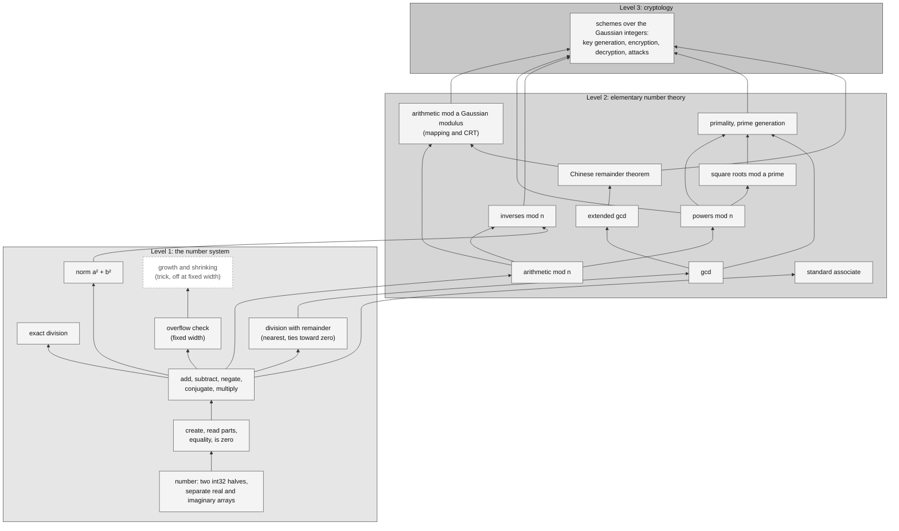

# Spec: exact Gaussian integers on the machine

Draft, Nov 3, 2026. The spec describes the build: what it contains and how each piece works. The reasons belong in the book. Decisions cited by number are in [`studies/decisions.md`](studies/decisions.md); the evidence is in [`studies/studies.md`](studies/studies.md) and [`research/`](research/).

## 1. Architecture

### 1.1 Three levels

The build has three levels. Each level uses only the levels below it, as in BLAS.

1. **Level 1, the number system.** A Gaussian integer and the arithmetic every higher level takes for granted.
2. **Level 2, elementary number theory.** The tools of an undergraduate number theory course, applied to the Gaussian integers: the gcd, congruences, inverses, the Chinese remainder theorem, primes. Algebraic and analytic number theory are out of scope without discussion, as is anything off the path to Level 3.
3. **Level 3, cryptology.** Schemes over the Gaussian integers built from Level 2, for researchers who design and attack them.

Operations needed by number theory but not by cryptology are deviations and need discussion (the list is in [`research/needs.md`](research/needs.md)).

### 1.2 The map

### 1.3 Rules that hold at every level

1. **Exact.** Integers only; no floating point anywhere.
2. **Closed.** Results stay in our type wherever possible (the norm returns N + 0i, 52). Leaving the type is refused (40).
3. **Fixed width is the textbook level.** Every operation works at a width designated by the user: two 32-bit halves at the smallest for real use, 256 to 4,096 bits for cryptology (50). Overflow at a fixed width is an error.
4. **Constant time is available.** Every operation has a form whose time does not depend on the values, or is marked as lacking one (research list).
5. **Vector lanes by default** (42), 32 bits as the unit (43), separate arrays of real and imaginary parts (15), and larger sizes as separate arrays of 32-bit pieces.
6. **General before special.** The spec builds the textbook answer for each operation; tricks come later. A method that fails on part of its inputs is not a textbook answer.
7. **Target ARM64 with NEON** (34). The published code is Nim with inline ARM64 assembly (47).

### 1.4 What each level contains, and its status

Status: **decided** (the textbook answer is decided), **open** (studied, but the textbook answer is not settled), **missing** (not yet designed).

**Level 1**

| Operation | Status |
|---|---|
| The number: two int32 halves, full two's-complement range (12), separate arrays (15); larger sizes as 32-bit pieces (43) | decided |
| Create from one or two integers, read the parts, equality, is zero | decided in principle, not yet written down |
| Add, subtract, negate, conjugate, multiply, with the overflow check (13, 20) | decided at 32-bit halves; missing at 1,024 to 4,096 bits |
| Norm, as N + 0i (52) | decided in principle; method missing |
| Exact division by the inverse mod 2^32 (29) | decided |
| Division with remainder, nearest, ties toward zero, mask form (28) | open: the reshaped methods (44, 45) fail on some divisors, so the textbook method that covers every divisor is to be settled |
| Overflow at a fixed width is an error (49, 50) | decided |
| Growth and shrinking with rule B (11, 18, 43): a trick | decided as a trick |

**Level 2**

| Operation | Status |
|---|---|
| Arithmetic mod an integer n: add, subtract, negate by one correction; multiply by Barrett (38) | decided at one piece; missing at many pieces |
| Arithmetic mod a Gaussian modulus: through the mapping to the integers mod p, mod n for inert primes, and the CRT | missing |
| Powers mod n, constant time | missing |
| Inverses mod n: the norm route with Euclid (22); a constant-time form (53) | decided, not constant time; constant-time form in research |
| gcd: the vector binary gcd with the count-leading-zeros instruction (31, 39) | decided, not constant time |
| Extended gcd | missing in vector form |
| Chinese remainder theorem | missing |
| Primality and prime generation | missing |
| Square roots mod a prime | missing |
| Standard associate | missing |

**Level 3**

| Operation | Status |
|---|---|
| Schemes, chosen from [`research/gaussian-crypto-survey.md`](research/gaussian-crypto-survey.md) | missing |

## 2. Level 1: the number system

To be written.

## 3. Level 2: elementary number theory

To be written.

## 4. Level 3: cryptology

To be written.
