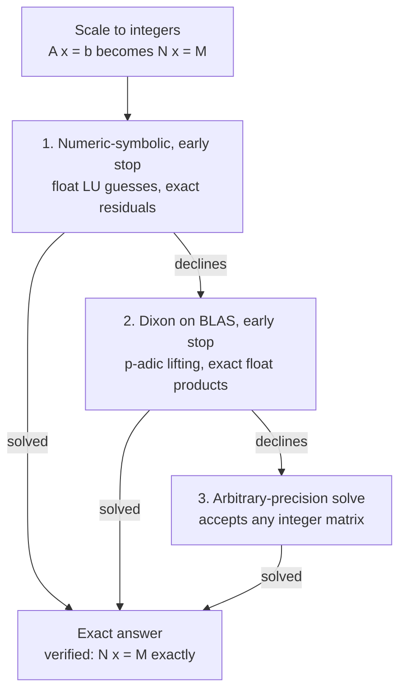

# Exact Number System Specification v0.1

Oct 26, 2026 · Andrew Emerson

## Purpose and scope

This spec freezes the number system of the language: what a number is, how it is stored, how arithmetic behaves, and how linear systems are solved. Every value is exact unless the program explicitly asks for rounding.

In scope: scalar numbers, integer storage tiers, typed columns, complex and algebraic numbers, special values, the solver chain, and determinism guarantees.

Out of scope for v0.1, and left to later specs: syntax, the type checker, transcendental functions (exp, log, trig), parallelism, I/O formats, and the table query language. Each design decision below names the benchmark that supports it, from the `exact-bench` suite (Chapters 1–12).

## Design principles

Five rules govern every later section. When two conflict, the earlier rule wins.

1. **Exact by default.** Every operation on representable inputs returns the mathematically exact result, or raises an error. Rounding happens only where the program asks for it, and never silently.
2. **Deterministic everywhere.** The same program on the same inputs gives bit-identical results on every platform, including WebAssembly. No result may depend on thread count, hardware, or evaluation order.
3. **Smallest tier that fits.** A value is stored in the narrowest representation that holds it exactly. It is promoted on overflow and demoted as soon as it fits again.
4. **One type per column.** A column holds values of one fixed-width type, so column operations compile to uniform loops. Width changes apply to the whole column.
5. **Decline rather than guess.** An algorithm that cannot guarantee an exact answer for some input reports that, and hands the input to a slower method that can. It never returns an approximate answer as if it were exact.

## Scalar numbers

A scalar is one tagged floating-slash rational. It occupies one 128-bit word when it fits, and moves to the unbounded big tier when it does not. Its value is

```math
x = (-1)^{s}\, i^{t}\, \frac{p}{q}, \qquad s, t \in \{0, 1\},\quad p \ge 1,\quad q \ge 1,\quad \gcd(p, q) = 1
```

The sign bit s and the imaginary bit t together pick one of the four units 1, i, −1, −i. Multiplying two scalars adds their turn counts 2s + t modulo 4. Zero and the special values are separate codes, below.

### Word layout

| Field | Bits | Contents |
| --- | --- | --- |
| sign s | 1 | 0 positive, 1 negative |
| imaginary t | 1 | 0 real part, 1 imaginary part |
| slash position | 7 | ℓ = bits(p) − 1, the stored length of the numerator, 0 to 118 |
| payload | 119 | numerator without its leading 1, then the denominator |

The numerator's leading 1 is implied (the hidden bit), so a value fits one word exactly when

```math
\operatorname{bits}(p) + \operatorname{bits}(q) \le 120
```

**Correction to earlier estimates.** Only the numerator's leading bit can be hidden. The denominator's length is not recorded, so its leading 1 must stay explicit to mark where it starts. The hidden-bit trick therefore recovers 1 bit, not 2. The tagged format has the same 120-bit budget as the untagged floating-slash measured in Chapter 8: the imaginary tag costs nothing net.

### Special codes

Slash positions 119 to 127 never occur in a stored number, which leaves 9 codes. Five are assigned, and four are reserved for later versions.

| Code | Meaning | Produced by |
| --- | --- | --- |
| 119 | zero (sign and imaginary bits must be 0) | any exact zero result |
| 120 | infinity, signed by s, real or imaginary by t | x / 0 for nonzero x, only where the program enables infinities |
| 121 | undefined | 0 / 0, ∞ − ∞, 0 · ∞ |
| 122 | wide handle: the value lives in the big tier, and the payload indexes it | any result over 120 bits |
| 123 | rounded marker: the value was produced by an explicit rounding request | `round(x, bits = B)` |
| 124–127 | reserved | — |

By default, division by zero raises an error, so codes 120 and 121 appear only in code that opts in to IEEE-style special values.

### Canonical form and equality

Every stored scalar is canonical: gcd(p, q) = 1, zero is code 119, and there is no negative zero. Two scalars are equal exactly when their canonical words, or their canonical big-tier values, are equal. Hashing uses the canonical form.

### Rounding on request

Rounding exists only as an explicit operation, `round(x, bits = B)`, or inside an explicitly declared bounded-precision block. It returns the element of the budget-B set nearest to x. Ties go to the smaller denominator, then toward zero. Chapter 8 proves that the continued-fraction algorithm finds this nearest element for any budget, and brute-force tests confirm it.

## Integer tiers

Every integer inside a number, whether a scalar's numerator and denominator or a column's numerators, lives in exactly one of three tiers, and always in the smallest that holds it.

| Tier | Representation | Range of each integer | Arithmetic |
| --- | --- | --- | --- |
| 64-bit | one `int64` | \|v\| ≤ 2⁶³ − 1 | compiled, vectorised, overflow-checked |
| 128-bit | two `uint64` words, two's complement | \|v\| ≤ 2¹²⁷ − 1 | compiled, overflow-checked |
| arbitrary | sign plus a variable-length array of words | unbounded | library calls |

Both fixed tiers are symmetric. −2⁶³ and −2¹²⁷ are excluded, because negating them wraps silently. Inputs containing them enter the next tier up.

**Promotion.** An operation runs in the higher of its operands' tiers. A compiled kernel counts the elements that would overflow, and if any do, the operation is redone one tier up. The product of two 64-bit values always fits 128 bits, so 64-bit multiplication goes straight to the 128-bit tier.

**Demotion.** After every operation that can widen a value, the result is checked, and moved down to the smallest tier that holds every element. For rationals, demotion is preceded by reduction: the common factor of the numerators and the denominator is divided out first, since smaller integers are what make demotion possible.

**Scalars** have two tiers, not three: a word (bits(p) + bits(q) ≤ 120, see Scalar numbers) or big (unbounded p and q). The same promote-and-demote rule applies.

## Columns

A table is a dictionary of columns, and each column has one element type. Columns are the fast path: their operations compile to uniform loops over machine words.

### Rational columns

A rational column stores n rationals with one shared denominator:

```math
x_i = \frac{p_i}{d}, \qquad d \ge 1, \qquad \gcd(d, p_1, \dots, p_n) = 1 \text{ after every operation}
```

The numerators p\_i share one integer tier (Integer tiers). A column of measured decimals with k places has d = 10^k and costs 8 bytes per value in the 64-bit tier, the same as a binary64 float.

| Operation | Result denominator | Notes |
| --- | --- | --- |
| x + y, x − y | lcm(d\_x, d\_y) | operands rescaled to the common denominator first |
| x · y | d\_x · d\_y, then reduced | 64-bit operands always produce a 128-bit product before demotion |
| x · (r/s), a scalar | d\_x · s, then reduced | numerators times r |
| sum, mean, variance | scalar result | blocked compiled reductions; variance in one pass with a split 128-bit accumulator |
| group-by sum, mean, variance | one scalar per group | compiled scatter in the 64-bit tier; per-group exact fallback |
| x > q, comparisons | boolean column | exact: p\_i > ⌊q · d⌋ for integer p\_i |
| filter | same denominator | then demoted |

A column is never wider than its widest element requires. Reductions over 64-bit data work in blocks of 4096 elements, where a bound proves no partial sum can overflow, so the inner loops vectorise. A block that breaks the bound falls back on its own, not the whole column.

### Complex columns

A complex column has one of two kinds, fixed for the whole column:

- **One-part:** one rational column plus one imaginary bit per element. Elements may be real or imaginary independently. It costs 8 bytes plus 1 bit per value in the 64-bit tier.
- **Two-part:** a real rational column and an imaginary rational column.

The kind is dispatched once per column, never per element. One-part arithmetic uses branch-free masks for the quarter-turn law: a product's imaginary bit is t\_x ⊕ t\_y, and its sign flips where t\_x ∧ t\_y. A result that needs two parts somewhere widens the column to two-part. A two-part result whose every element has at most one nonzero part narrows back to one-part.

## Arithmetic semantics

Addition, subtraction, multiplication and division of rationals are exact and total, except for division by zero. Results are canonical and in the smallest tier.

| Case | Default behaviour | With special values enabled |
| --- | --- | --- |
| x / 0, x ≠ 0 | error `DivisionByZero` | ±∞ (code 120) |
| 0 / 0 | error `DivisionByZero` | undefined (code 121) |
| result over 120 bits (scalar) | promoted to the big tier, exact | same |
| result over 2¹²⁷ − 1 (column) | column promoted to the arbitrary tier, exact | same |
| operation outside ℚ, such as √x or exp x | error, unless the value lies in a declared algebraic field (Algebraic extensions) | same |
| explicit `round(x, bits = B)` | nearest value within budget B, marked rounded | same |

**Comparison** (<, ≤, =) is exact. For p/q against r/s with q, s > 0, compare p · s with r · q in the needed tier. For complex values only = and ≠ are defined.

**Mixing with floats.** A float entering the language converts to its exact rational value, which every binary64 has. There is no implicit conversion back. Converting to float is an explicit `to_float(x)`, correctly rounded.

**Evaluation order** never changes a result, since exact arithmetic is associative. Compilers may reorder, fuse and parallelise freely: that freedom is what makes determinism cheap (Determinism and platform requirements).

## Algebraic extensions

Irrational values stay exact by living in a declared number field of fixed degree. A field ℚ(α) of degree m stores each element as m rational coordinates over the basis 1, α, …, α^(m−1), so its columns stay fixed width.

```math
\mathbb{Q}(\sqrt{2}) = \{\, a + b\sqrt{2} : a, b \in \mathbb{Q} \,\}, \qquad (a + b\sqrt{2})^{-1} = \frac{a - b\sqrt{2}}{a^2 - 2b^2}
```

v0.1 defines two kinds:

- **Gaussian rationals ℚ(i)**, the complex numbers of the earlier sections. They use the tag representation, so an element with a zero part stores one word, not two.
- **Quadratic fields ℚ(√n)** for squarefree n, declared per column or per scalar. They use plain coordinate pairs, as benchmarked for ℚ(√2) in Chapter 5.

Arithmetic is closed and exact within one field. Combining values from two different fields is an error in v0.1. Equality is coordinate equality, and a value whose irrational coordinates are all zero converts to a plain rational. That is how √2 · √2 becomes exactly 2.

## Linear algebra

`solve(A, b)` returns the exact solution of Ax = b for any nonsingular rational matrix, and raises `SingularMatrix` otherwise. A rational system is first scaled to integers, Nx = M. Then up to three methods are tried in order, each of which either returns the exact answer or declines:

1. **Numeric–symbolic refinement with early stopping.** A float LU guesses each correction, residuals are computed exactly, and the answer is reconstructed by continued fractions and verified with A·x = b. Applies when entries are below 2²⁰ and n ≤ 2048. Declines when floats gain fewer than 4 bits per step, as in ill-conditioned matrices.
2. **Dixon p-adic lifting on BLAS with early stopping.** Every heavy step is a float BLAS product kept within 2⁵³, so it is exact integer arithmetic. Same size limits. Declines when A is singular modulo five consecutive primes near 2²¹.
3. **Arbitrary-precision exact solve** (FLINT in the prototype). Accepts any integer matrix.



A method that cannot guarantee an exact answer hands the system on; whichever method solves it, the answer is verified before it is returned.

**Early stopping.** Methods 1 and 2 check at precision checkpoints of 64, 128, 256, … bits. They attempt reconstruction, and stop as soon as the candidate passes the exact check A·x = d·b. If no checkpoint verifies, they continue to the Hadamard bound, where reconstruction is guaranteed. Both paths end with the exact check, so a returned answer is always proven.

**Determinants** use the arbitrary-precision method directly. The solve-based shortcut was measured slower (Considered and dropped).

**Matrix multiplication** of integer-scaled matrices uses the arbitrary-precision library's multimodular product, which was measured at about 14.6× NumPy. No faster method is specified in v0.1.

## Determinism and platform requirements

Every exact result is bit-identical across platforms, because exact arithmetic has one right answer. The rules below keep the *path* to it deterministic too, so that performance does not vary unpredictably either.

- **Floats inside exact algorithms** (numeric–symbolic guesses, BLAS-exact products) may differ between platforms. They never affect the result, because every float-derived value is checked exactly or stays within the proven exact range of 2⁵³. They may change the number of refinement steps.
- **Rounding on request** is a pure function of the exact value and the budget, so it is identical everywhere.
- **Iteration order** of group-by and other unordered results is defined: groups come back in ascending key order.
- **Required integer operations:** 64-bit add, subtract and multiply with overflow detection, 64×64→128 multiply, count-trailing-zeros, and count-leading-zeros. All are native on x86-64 and ARM64. LLVM's i128 type provides them on every target.
- **WebAssembly** has no native 128-bit multiply, and LLVM lowers it to a short sequence of 64-bit operations. The 64-bit tier and float BLAS-exact kernels run unchanged under wasm64 and wasm32 with SIMD128. The arbitrary-precision tier needs a big-integer library compiled to WebAssembly, which is a build requirement, not a semantic change.
- **Threads** may split column work and lifting steps. Results do not depend on thread count. Reproducible timing is not promised.

## Evidence

The integrated prototype runs real pipelines within 1.8× to 17× of NumPy, exactly, and 27× to 390× faster than exact pure Python. All figures come from one shared 2-core cloud machine, single-threaded, and need confirming on target hardware.

| Decision | Benchmark | Result |
| --- | --- | --- |
| Exact rational columns | Ch. 6, column ops at 10⁷ values | sum 1.3×, a·b+c 0.86×, group-by 1.8×, variance 0.3× of NumPy time |
| 128-bit tier | Ch. 7, past-limit rows at 10⁶ values | a·b+c from 845× to 1.8× of NumPy, exact instead of rounded; variance from 27× to 2.0× |
| Floating-slash format | Ch. 8, rounding precision | about 10⁻³⁶ relative error at every magnitude from 10⁻¹² to 10¹⁸; fixed 64/64 fell to 10⁻²⁰ |
| Imaginary tag | Ch. 10 | 0.44–0.62× the time and half the storage of untagged pairs on real or imaginary data; 1.15× on general data |
| Numeric–symbolic + early stop | Ch. 7, n = 1000 | 0.64× FLINT's time on random systems, 0.12× on simple answers |
| Dixon on BLAS | Ch. 9, 30 cases | 0.81–0.88× FLINT's time for n ≥ 400, tied below |
| Integrated core | Ch. 12 | complex pipeline 1.8×, regression 5.7×, table pipeline 16.5×, simple-answer solve 7.3×, random solve 171× of NumPy time |

NumPy's worst relative error in Chapter 12 ranged from 5 × 10⁻¹⁵ to 6 × 10⁻¹⁰. On the 50 × 50 Hilbert system in Chapter 6, its answer was wrong by a factor of about 39.

## Open decisions

- [ ] **Hard dense solves.** Exact solving of random dense systems is about 171× NumPy's time at n = 500, because exact answers are about 1 KB per entry. Options: accept and document it, offer explicit rounded solves, or run large exact solves asynchronously.
- [ ] **Spare codes 124–127.** Candidates: a NaN-like "missing" value for table data, a lazy-symbolic marker, or keep them for versioning.
- [ ] **Demotion hysteresis.** v0.1 demotes immediately. A column that oscillates across a tier boundary would re-encode on every operation. Decide whether to delay demotion, once compiled benchmarks show whether it matters.
- [ ] **Recording the denominator's length.** Storing it would let the denominator's leading bit be hidden too, gaining a second bit but costing up to 7 bits of length field. As specified it does not pay. Revisit only if a cheaper encoding appears.
- [ ] **Mixed algebraic fields.** Whether ℚ(√2) and ℚ(√3) values may combine into ℚ(√2, √3), a degree-4 field, or must stay an error.
- [ ] **Compiled 128-bit group statistics.** Chapter 12 showed this one kernel is over half of the table pipeline's time. Implement it in the runtime before re-benchmarking.
- [ ] **Confirm the evidence on target hardware.** Re-run the benchmark suite on the machines the language will target.

## Considered and dropped

| Idea | Why it was dropped | Evidence |
| --- | --- | --- |
| Fixed-slash 64/64 (Q64) as the default scalar | precision collapses away from magnitude 1, and values near 10¹⁸ overflow | Ch. 8 |
| Unsigned-denominator 63/64 (Q64u) | 4× gain only below 1, none above; floating-slash already includes it | Ch. 8 |
| Determinant via a solve plus CRT | 1.4–1.7× slower than FLINT, which already uses the same divisor idea | Ch. 7 |
| 8- and 16-bit rational formats | almost every operation would round, so exactness is lost | discussion |
| Factoring out 2s and 5s | at best break-even on time, even with every addition trick; its size benefit is mostly delivered by shared denominators | Ch. 11 |
| Lazy gcd on unbounded rationals | denominators grow without bound in running sums, giving quadratic time | Ch. 11 review |
| Floats for precision-insensitive steps | weakens the exact-by-default promise for small gains | discussion |
