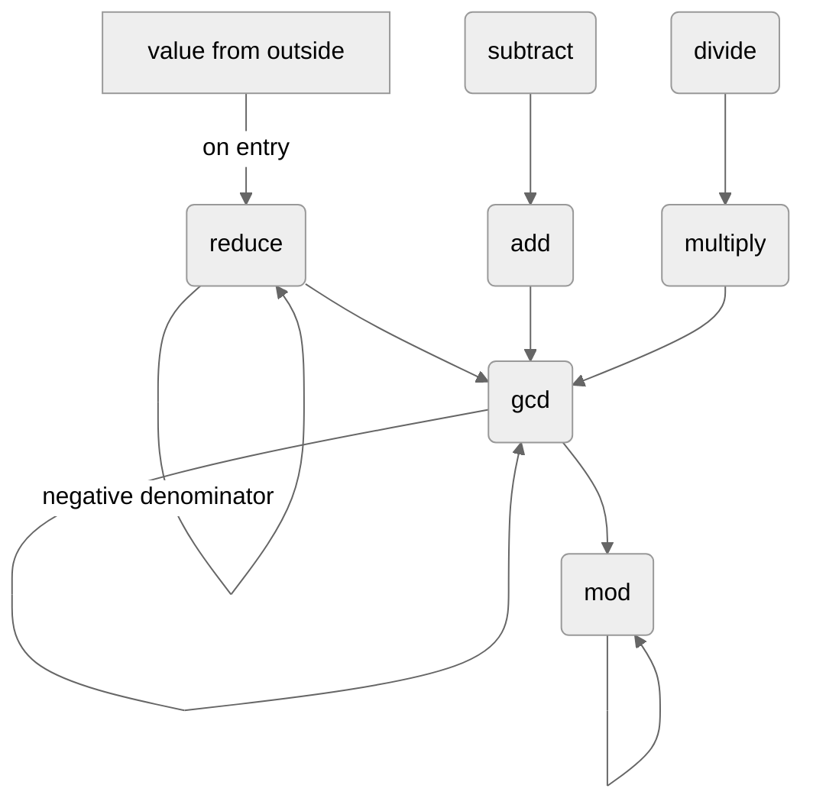

# Title TBD

## 1. Naive rational arithmetic

A rational number is a number that can be written as a fraction $\frac{p}{q}$, where $p$ and $q$ are integers and $q \neq 0$. The integer $p$ is the *numerator* and $q$ is the *denominator*. For example, $\frac{3}{4}$, $\frac{-2}{5}$ and $\frac{7}{1}$ are rational numbers.

A rational number is made of two integers, so a program that works with rationals works with integers underneath. Section 1.1 is about integers alone. Section 1.2 returns to rationals.

### 1.1 Integers

A computer stores an integer in base 2, as a fixed number of bits called its *width*. Common widths are 8, 16, 32 and 64 bits.

An *unsigned* integer uses all of its bits for the magnitude. With $w$ bits it holds every integer from $0$ to $2^w - 1$, so a 32-bit unsigned integer runs from $0$ to $4\,294\,967\,295$.

A *signed* integer spends a bit on the sign. With $w$ bits it holds every integer from $-2^{w-1}$ to $2^{w-1} - 1$, about half the unsigned maximum, so a 32-bit signed integer runs from $-2\,147\,483\,648$ to $2\,147\,483\,647$. An unsigned integer stores larger magnitudes in the same bits; a signed integer can also store negative numbers.

Integer addition, subtraction, multiplication, exact division, negation and comparison are taken as given for the rest of this paper. We are not trying to make them faster.

Their cost is stated in *big-O*. Big-O describes how fast the work grows as the numbers get longer, not how much work is done. It ignores constant factors, so three multiplications and two are both $O(n^2)$; removing a kind of step, such as all multiplications, changes it.

For integers of $n$ digits (in base 2, $n$ bits), adding or subtracting two of them takes $O(n)$ steps, and multiplying them takes $O(n^2)$, as does dividing one by the other exactly. Comparing two integers, for equality or for size, takes $O(n)$. Testing one integer against zero, with $=$, $<$ or $>$, takes $O(1)$, because a number knows its length: only zero has length $0$, and the sign is read in one step (section 1.2). Testing it against $1$ or $-1$ takes $O(1)$ for the same reason: a longer number fails at once, and a one-digit number is checked in one step.

For fixed-width machine integers each of these is a single instruction; the big-O describes integers too long to fit in one machine word.

### 1.2 Storing a rational number

A computer stores a rational number as a pair of integers, its numerator and its denominator. The most common layout is two signed integers of the same width. The running example in this paper is a signed 32-bit numerator next to a signed 32-bit denominator:

| Field | Type |
|---|---|
| numerator | signed 32-bit integer |
| denominator | signed 32-bit integer |

Other layouts and widths exist, such as 64-bit fields, or a signed numerator over an unsigned denominator, which forces the sign into the numerator. Each layout has trade-offs, and nothing in this paper depends on the choice except the big-O figures, whose one assumption is stated below. In every layout the denominator is never zero, and the number zero is stored as numerator $0$ over a nonzero denominator.

For the big-O, which describes integers longer than a machine word (section 1.1), the paper assumes that a number's sign is stored apart from its digits, so that negating it changes only the sign and takes $O(1)$; in two's complement, negation would take $O(n)$.

This paper describes algorithms in pseudocode. In it, `numerator(x)` and `denominator(x)` read the two stored integers of a rational `x`, and `rational(p, q)` builds the rational with numerator `p` and denominator `q`, for $q \neq 0$. It only pairs the two integers, and computes nothing.

In formulas a fraction is a division: $\frac{3}{4}$, also written $3/4$, is $3$ divided by $4$. In pseudocode, `/` is division, as in programming, and `rational(p, q)` builds a fraction, so the two never mix.

### 1.3 The sign

In arithmetic, a minus sign belongs to the whole rational number. A negative numerator can be moved outside the fraction, and so can a negative denominator:

$$
\frac{-3}{4} = -\frac{3}{4} = \frac{3}{-4}.
$$

If both integers are negative, the two signs cancel:

$$
\frac{-3}{-4} = \frac{3}{4}.
$$

A computer has only the two integers, and both of them can hold a sign. So $-\frac{3}{4}$ can be stored as $-3$ over $4$ or as $3$ over $-4$, and $\frac{3}{4}$ as $3$ over $4$ or as $-3$ over $-4$. Unlike in mathematics, where these are simply the same number, the machine does not reduce anything unless told to: it keeps whichever pair it was given.

Rewriting a stored pair as another pair with the same value is a *reduction*. The one reduction in this section moves the sign: **if the denominator is negative, negate both integers.** This covers both cases. Negative over negative becomes positive over positive, and positive over negative becomes negative over positive. Afterwards the denominator is positive, and the numerator carries the sign of the whole number.

> *Proof.* Negating both integers multiplies the fraction by $\frac{-1}{-1} = 1$, so the value stays the same. If $b < 0$, then $-b > 0$. Over a positive denominator, a fraction has the sign of its numerator. ∎

The function `reduce` applies this rule. In the pseudocode, a block is the indented lines under its header, such as a `FUNCTION` line, and it ends where the indentation returns. `LET` gives a name to a value, and every `LET` introduces a new name; a name never changes once given. `IF` tests a condition, and if it holds, the rest of the line after `THEN` runs. `RETURN` ends the function with its result. Conditions compare integers with `=`, `≠`, `<` and `>`; in a `LET`, `=` gives the name.

```text
FUNCTION reduce(x)
    LET a = numerator(x)
    LET b = denominator(x)
    IF b < 0 THEN RETURN rational(−a, −b)
    RETURN x
```

*Example.* `reduce` turns $3$ over $-4$ into $-3$ over $4$, and $-3$ over $-4$ into $3$ over $4$. It leaves $-3$ over $4$ as it is.

The test costs $O(1)$, and so do the two negations, when they run.

Every value that enters from outside, such as two integers a user supplies, goes through `reduce` before it is stored. So every stored denominator is positive. The operations below keep it that way on their own, since sums and products of positive denominators are positive. An operation needs `reduce` only where a negative denominator could arise, and only division, which turns its divisor upside down, can produce one; division places the sign itself (section 1.6).

A fixed place for the sign also bears on the checks below, which compare stored integers. With both denominators positive, two denominators can be equal, but the case of opposite denominators never arises.

### 1.4 Addition and subtraction

Each operation below takes two rational numbers, its *operands*, written $x = a/b$ and $y = c/d$. So $a$ and $c$ are the numerators, and $b$ and $d$ are the denominators, both positive.

To add two fractions, bring them over a common denominator:

$$
\frac{a}{b} + \frac{c}{d} = \frac{a \cdot d + c \cdot b}{b \cdot d}.
$$

Subtraction is addition with the second numerator negated:

$$
\frac{a}{b} - \frac{c}{d} = \frac{a}{b} + \frac{-c}{d}.
$$

The naive algorithm applies these formulas directly. It computes the numerator and the denominator of the result on separate lines, and then pairs them.

```text
FUNCTION add(x, y)
    LET a = numerator(x)
    LET b = denominator(x)
    LET c = numerator(y)
    LET d = denominator(y)
    LET p = a · d + c · b
    LET q = b · d
    RETURN rational(p, q)

FUNCTION subtract(x, y)
    LET c = numerator(y)
    LET d = denominator(y)
    RETURN add(x, rational(−c, d))
```

The denominator $b \cdot d$ is positive, and so is the $d$ passed on by `subtract`, so neither function calls `reduce`. Since `subtract` only calls `add`, everything below about addition applies to subtraction too. The one difference is that `subtract` negates $c$ first, so equal numerators become opposite ones, and opposite ones equal.

#### Special cases

The naive formula always gives the right answer, but for some inputs it does more work than it needs to. From here on we move beyond the naive approach by accounting for special cases: inputs where some stored integers are equal, opposite, zero or $1$, and a cheaper formula gives the same answer exactly.

The most important special case for addition is a shared denominator. If $d = b$, the two fractions already have a common denominator, and the numerators simply add:

$$
\frac{a}{b} + \frac{c}{b} = \frac{a + c}{b}.
$$

This needs one addition and no multiplication, so its cost drops from $O(n^2)$ to $O(n)$. The denominator of the result is the stored $b$, copied as it is.

*Example.* In $\dfrac{1}{5} + \dfrac{2}{5}$ the denominators are equal, so the result is

$$
\frac{1 + 2}{5} = \frac{3}{5}.
$$

A zero numerator is one of the most valuable special cases. If either numerator is zero, that operand is zero, and the sum is the other operand, with no arithmetic at all:

$$
\frac{0}{b} + \frac{c}{d} = \frac{c}{d},
\qquad
\frac{a}{b} + \frac{0}{d} = \frac{a}{b}.
$$

The test is against zero, so it costs $O(1)$.

An operand stored with the denominator $1$ is an *integer*. If one operand is an integer, the other's denominator is already a common one:

$$
\frac{a}{b} + \frac{c}{1} = \frac{a + c \cdot b}{b},
\qquad
\frac{a}{1} + \frac{c}{d} = \frac{a \cdot d + c}{d}.
$$

Each needs one multiplication instead of three, so it saves two but stays $O(n^2)$. If both operands are integers, the sum is $\frac{a + c}{1}$: one addition, $O(n)$. The tests are against $1$, so they cost $O(1)$.

If the numerators are equal, $c = a$, the common factor $a$ can be pulled out:

$$
\frac{a}{b} + \frac{a}{d} = \frac{a \cdot d + a \cdot b}{b \cdot d} = \frac{a \cdot (d + b)}{b \cdot d}.
$$

If they are opposite, $c = -a$, the same idea gives

$$
\frac{a}{b} + \frac{-a}{d} = \frac{a \cdot d - a \cdot b}{b \cdot d} = \frac{a \cdot (d - b)}{b \cdot d}.
$$

Both forms need two multiplications instead of three, so they save one multiplication but stay $O(n^2)$.

The table lists the naive formula first and then every special case. The big-O includes the check.

| Case | Condition | Result | Big-O |
|---|---|---|---|
| Naive | always | $\dfrac{a \cdot d + c \cdot b}{b \cdot d}$ | $O(n^2)$ |
| Zero numerator | $a = 0$ or $c = 0$ | the other operand | $O(1)$ |
| Both integers | $b = 1$ and $d = 1$ | $\dfrac{a + c}{1}$ | $O(n)$ |
| Integer $x$ | $b = 1$ | $\dfrac{a \cdot d + c}{d}$ | $O(n^2)$ |
| Integer $y$ | $d = 1$ | $\dfrac{a + c \cdot b}{b}$ | $O(n^2)$ |
| Shared denominator | $d = b$ | $\dfrac{a + c}{b}$ | $O(n)$ |
| Equal numerators | $c = a$ | $\dfrac{a \cdot (d + b)}{b \cdot d}$ | $O(n^2)$ |
| Opposite numerators | $c = -a$ | $\dfrac{a \cdot (d - b)}{b \cdot d}$ | $O(n^2)$ |

Notice that opposite denominators, $d = -b$, are not listed. A check for them would save work, as the check for a shared denominator does, if the case arose. It never arises: `reduce` has already put every sign in the numerator, so every stored denominator is positive, and two positive numbers are never opposites.

The naive path now runs only after every check has failed, so it pays for those checks: a small $O(n)$ overhead on top of its $O(n^2)$.

In the pseudocode the special cases come first, in table order, and each one that holds returns at once, so the rest of the function is skipped. Their order follows the rule of section 1.6. In the pseudocode, `AND` requires both conditions. The naive formula comes last.

```text
FUNCTION add(x, y)
    LET a = numerator(x)
    LET b = denominator(x)
    LET c = numerator(y)
    LET d = denominator(y)
    IF a = 0 THEN RETURN y
    IF c = 0 THEN RETURN x
    IF b = 1 AND d = 1 THEN RETURN rational(a + c, 1)
    IF b = 1 THEN RETURN rational(a · d + c, d)
    IF d = 1 THEN RETURN rational(a + c · b, b)
    IF d = b THEN RETURN rational(a + c, b)
    IF c = a THEN RETURN rational(a · (d + b), b · d)
    IF c = −a THEN RETURN rational(a · (d − b), b · d)
    LET p = a · d + c · b
    LET q = b · d
    RETURN rational(p, q)
```

### 1.5 Multiplication

Numerators multiply, and denominators multiply:

$$
\frac{a}{b} \cdot \frac{c}{d} = \frac{a \cdot c}{b \cdot d}.
$$

The naive algorithm applies this formula directly.

```text
FUNCTION multiply(x, y)
    LET a = numerator(x)
    LET b = denominator(x)
    LET c = numerator(y)
    LET d = denominator(y)
    LET p = a · c
    LET q = b · d
    RETURN rational(p, q)
```

#### Special cases

The most important special case for multiplication is a cross match: one operand's numerator equals the other operand's denominator. If $c = b$, the same integer $b$ appears once on top and once on the bottom, and it cancels exactly:

$$
\frac{a}{b} \cdot \frac{b}{d} = \frac{a \cdot b}{b \cdot d} = \frac{a}{d}.
$$

The result is the two outer stored integers, $a$ over $d$. The match also works the other way round, when $a = d$:

$$
\frac{a}{b} \cdot \frac{c}{a} = \frac{c}{b}.
$$

None of these forms needs a multiplication, so the cost drops from $O(n^2)$ to $O(n)$, the cost of the comparison.

*Example.* In $\dfrac{2}{3} \cdot \dfrac{3}{5}$ the second numerator equals the first denominator, so the result is

$$
\frac{2}{5}.
$$

The other special cases are briefer.

A zero numerator is one of the most valuable special cases. If either numerator is zero, the product is zero, and the zero operand is itself the answer, with no arithmetic at all: $\frac{0}{b} \cdot \frac{c}{d} = \frac{0}{b}$, and $\frac{a}{b} \cdot \frac{0}{d} = \frac{0}{d}$. This costs $O(1)$.

If one operand is stored as $1/1$, the product is the other operand. If one is stored as $-1/1$, the product is the other operand with its numerator negated. These checks test integers against $1$ and $-1$, and the negation only changes a sign, so they cost $O(1)$. A value $1$ stored some other way, such as $3/3$, is not caught, and takes a later path, which still gives the right answer.

An operand stored with the denominator $1$ is an integer, as in section 1.4. If both operands are integers, the product is $\frac{a \cdot c}{1}$: one multiplication instead of two. The test is against $1$, so it costs $O(1)$.

If both cross matches hold at once, the operands are reciprocals and the product is $1$:

$$
\frac{a}{b} \cdot \frac{b}{a} = 1.
$$

With positive denominators, the reciprocal of $\frac{a}{b}$ for a negative $a$ is stored as $\frac{-b}{-a}$, and the product is again $1$. If both cross matches hold but one of them is opposite, $c = -b$ or $a = -d$, the product is $-1$, as in $\frac{a}{b} \cdot \frac{-b}{a}$.

> *Proof.* The product is $\frac{a \cdot c}{b \cdot d}$. If $a = d$ and $c = b$, it is $\frac{d \cdot b}{b \cdot d} = 1$. If $a = -d$ and $c = -b$, it is $\frac{(-d) \cdot (-b)}{b \cdot d} = 1$. If one match is equal and the other opposite, one factor of the numerator changes sign, and the product is $-1$. ∎

A single cross match can also be opposite: $c = -b$, or $a = -d$. The shared integer still cancels, and leaves its sign in the numerator:

$$
\frac{a}{b} \cdot \frac{-b}{d} = \frac{-a}{d},
\qquad
\frac{-d}{b} \cdot \frac{c}{d} = \frac{-c}{b}.
$$

If only one operand is an integer, its denominator $1$ leaves the other's as it is:

$$
\frac{a}{1} \cdot \frac{c}{d} = \frac{a \cdot c}{d},
\qquad
\frac{a}{b} \cdot \frac{c}{1} = \frac{a \cdot c}{b}.
$$

This needs one multiplication instead of two, and stays $O(n^2)$. The tests are against $1$, so they cost $O(1)$, but they come after the cross matches: an integer operand that also forms a cross match, as in $\frac{a}{b} \cdot \frac{b}{1}$, gets the cross match's result, which needs no multiplication.

Not every coincidence helps. A shared denominator, the main case for addition, saves nothing here, since $\frac{a}{b} \cdot \frac{c}{b} = \frac{a \cdot c}{b \cdot b}$ still needs both multiplications, and a shared numerator saves nothing either. Neither gets a row or a check.

| Case | Condition | Result | Big-O |
|---|---|---|---|
| Naive | always | $\dfrac{a \cdot c}{b \cdot d}$ | $O(n^2)$ |
| Zero numerator | $a = 0$ or $c = 0$ | the zero operand | $O(1)$ |
| Factor $1$ | $a = 1$ and $b = 1$, or $c = 1$ and $d = 1$ | the other operand | $O(1)$ |
| Factor $-1$ in $x$ | $a = -1$ and $b = 1$ | $\dfrac{-c}{d}$ | $O(1)$ |
| Factor $-1$ in $y$ | $c = -1$ and $d = 1$ | $\dfrac{-a}{b}$ | $O(1)$ |
| Both integers | $b = 1$ and $d = 1$ | $\dfrac{a \cdot c}{1}$ | $O(n^2)$ |
| Reciprocals | $a = d$ and $c = b$, or $a = -d$ and $c = -b$ | $\dfrac{1}{1}$ | $O(n)$ |
| Opposite reciprocals | $a = d$ and $c = -b$, or $a = -d$ and $c = b$ | $\dfrac{-1}{1}$ | $O(n)$ |
| Cross match | $c = b$ | $\dfrac{a}{d}$ | $O(n)$ |
| Cross match, other way | $a = d$ | $\dfrac{c}{b}$ | $O(n)$ |
| Opposite cross match | $c = -b$ | $\dfrac{-a}{d}$ | $O(n)$ |
| Opposite cross match, other way | $a = -d$ | $\dfrac{-c}{b}$ | $O(n)$ |
| Integer $x$ | $b = 1$ | $\dfrac{a \cdot c}{d}$ | $O(n^2)$ |
| Integer $y$ | $d = 1$ | $\dfrac{a \cdot c}{b}$ | $O(n^2)$ |

As before, the naive path pays for every failed check, a small $O(n)$ overhead.

Reciprocals come before cross matches: a reciprocal pair is also a cross match, which would give the right value, but stored as $d$ over $d$ instead of $1$ over $1$. In the pseudocode, `OR` requires either of two conditions; the brackets group them.

```text
FUNCTION multiply(x, y)
    LET a = numerator(x)
    LET b = denominator(x)
    LET c = numerator(y)
    LET d = denominator(y)
    IF a = 0 THEN RETURN x
    IF c = 0 THEN RETURN y
    IF a = 1 AND b = 1 THEN RETURN y
    IF c = 1 AND d = 1 THEN RETURN x
    IF a = −1 AND b = 1 THEN RETURN rational(−c, d)
    IF c = −1 AND d = 1 THEN RETURN rational(−a, b)
    IF b = 1 AND d = 1 THEN RETURN rational(a · c, 1)
    IF (a = d AND c = b) OR (a = −d AND c = −b) THEN RETURN rational(1, 1)
    IF (a = d AND c = −b) OR (a = −d AND c = b) THEN RETURN rational(−1, 1)
    IF c = b THEN RETURN rational(a, d)
    IF a = d THEN RETURN rational(c, b)
    IF c = −b THEN RETURN rational(−a, d)
    IF a = −d THEN RETURN rational(−c, b)
    IF b = 1 THEN RETURN rational(a · c, d)
    IF d = 1 THEN RETURN rational(a · c, b)
    LET p = a · c
    LET q = b · d
    RETURN rational(p, q)
```

### 1.6 Division

Dividing by $\frac{c}{d}$ is multiplying by its flip $\frac{d}{c}$, which exists only when $c \neq 0$:

$$
\frac{a}{b} \div \frac{c}{d} = \frac{a}{b} \cdot \frac{d}{c}, \qquad c \neq 0.
$$

The flip moves $c$ into the denominator, so its denominator is negative when $c$ is. Division places the sign there and then, by the rule of `reduce`: when $c < 0$, the flip is stored as $-d$ over $-c$.

A condition without which a function has no answer is a *precondition*; for division it is $c \neq 0$. Every function keeps one order: preconditions first, then naming the parts, then the special cases, then the general method, except where a case needs a value the general method computes first, as in section 2's `add`. Special cases are ordered by the cost of their result, cheapest first; where two results cost the same, or two cases can no longer both hold after the earlier checks, the cheaper test goes first. So `divide` tests its divisor before naming its parts. The zero checks of `add` and `multiply` are special cases, not preconditions, since they have an answer. `ERROR` stops the computation with an error.

```text
FUNCTION divide(x, y)
    IF numerator(y) = 0 THEN ERROR
    LET c = numerator(y)
    LET d = denominator(y)
    IF c < 0 THEN RETURN multiply(x, rational(−d, −c))
    RETURN multiply(x, rational(d, c))
```

Division's special cases are multiplication's in disguise: `multiply` receives the flipped divisor, and its checks catch them. The table gives each case as a division, with the multiplication case that catches it. When $c < 0$ the flip has swapped the sign, so an equal match in the division becomes an opposite one in the multiplication. The flip itself, with its two tests and its negations, costs $O(1)$, and that is included. The table gives values, not stored pairs: when $c < 0$, a $c$ shown in a denominator is stored as $-c$, with the numerator negated to match.

| Case | Condition | Value | Caught by | Big-O |
|---|---|---|---|---|
| Naive | $c \neq 0$ | $\dfrac{a \cdot d}{b \cdot c}$ | naive | $O(n^2)$ |
| Zero dividend | $a = 0$ | $0$ | zero numerator | $O(1)$ |
| Divisor $1$ | $c = 1$ and $d = 1$ | $\dfrac{a}{b}$ | factor $1$ | $O(1)$ |
| Divisor $-1$ | $c = -1$ and $d = 1$ | $\dfrac{-a}{b}$ | factor $-1$ in $y$ | $O(1)$ |
| Dividend $1$ | $a = 1$ and $b = 1$ | $\dfrac{d}{c}$ | factor $1$ | $O(1)$ |
| Dividend $-1$ | $a = -1$ and $b = 1$ | $\dfrac{-d}{c}$ | factor $-1$ in $x$ | $O(1)$ |
| $x \div x$ | $c = a$ and $d = b$ | $1$ | reciprocals | $O(n)$ |
| $x \div (-x)$ | $c = -a$ and $d = b$ | $-1$ | opposite reciprocals | $O(n)$ |
| Shared numerator | $c = a$ | $\dfrac{d}{b}$ | cross match, other way; opposite if $c < 0$ | $O(n)$ |
| Opposite numerators | $c = -a$ | $\dfrac{-d}{b}$ | opposite cross match, other way; equal if $c < 0$ | $O(n)$ |
| Shared denominator | $d = b$ | $\dfrac{a}{c}$ | cross match; opposite if $c < 0$ | $O(n)$ |

> *Proof.* `multiply` receives $\frac{a}{b}$ and the flip, written here $\frac{c'}{d'}$. For $c > 0$, $c' = d$ and $d' = c$; for $c < 0$, $c' = -d$ and $d' = -c$. Each row in turn:
>
> - Naive: if no other case holds, `multiply` returns $\frac{a \cdot c'}{b \cdot d'}$, which is $\frac{a \cdot d}{b \cdot c}$ for $c > 0$ and $\frac{a \cdot (-d)}{b \cdot (-c)}$, the same value, for $c < 0$.
> - Zero dividend: $a = 0$ is the zero numerator.
> - Divisor $1$: occurs only for $c > 0$; the flip is $\frac{1}{1}$, factor $1$.
> - Divisor $-1$: occurs only for $c < 0$; the flip is $\frac{-1}{1}$, factor $-1$ in $y$.
> - Dividend $\pm 1$: $x$ is $\frac{1}{1}$ or $\frac{-1}{1}$, factor $1$ or factor $-1$ in $x$, which return $\frac{c'}{d'}$ or $\frac{-c'}{d'}$, of value $\frac{d}{c}$ or $\frac{-d}{c}$.
> - $x \div x$: for $c > 0$, $a = d'$ and $c' = b$. For $c < 0$, $a = -d'$ and $c' = -b$: both matches are opposite, which is the reciprocals case by section 1.5's sentence on a negative $a$.
> - $x \div (-x)$: for $c > 0$, $a = -d'$ and $c' = b$; for $c < 0$, $a = d'$ and $c' = -b$. Either way, opposite reciprocals.
> - Shared numerator: for $c > 0$, $a = d'$, the cross match the other way, giving $\frac{c'}{b} = \frac{d}{b}$; for $c < 0$, $a = -d'$, the opposite one, giving $\frac{-c'}{b} = \frac{d}{b}$.
> - Opposite numerators: for $c > 0$, $a = -d'$, giving $\frac{-c'}{b} = \frac{-d}{b}$; for $c < 0$, $a = d'$, giving $\frac{c'}{b} = \frac{-d}{b}$.
> - Shared denominator: for $c > 0$, $c' = b$, the cross match, giving $\frac{a}{d'} = \frac{a}{c}$; for $c < 0$, $c' = -b$, the opposite one, giving $\frac{-a}{d'} = \frac{a}{c}$. ∎

If an earlier case of `multiply` also holds, it catches the input first, and gives the same value.

Dividing by an integer $\frac{c}{1}$ flips it into $\frac{1}{c}$, which is not an integer unless $c = \pm 1$ (cases already caught), so the integer case does not carry over to the divisor.

So division needs only its zero-divisor check.

## 2. Rational arithmetic in lowest terms

### 2.1 Growing integers

The formulas of section 1 always give the right value, but they let the stored integers grow. In addition and multiplication the denominators multiply, so the denominator of a result has about as many digits as the two input denominators together.

*Example.* Add $\frac{1}{2} + \frac{1}{3} + \frac{1}{4} + \frac{1}{5} + \frac{1}{6}$ one term at a time with the `add` function of section 1. The running results are

$$
\frac{5}{6}, \qquad \frac{26}{24}, \qquad \frac{154}{120}, \qquad \frac{1044}{720}.
$$

The last denominator is $720 = 2 \cdot 3 \cdot 4 \cdot 5 \cdot 6$, yet the same value can also be written $\frac{29}{20}$. Carried on up to $\frac{1}{13}$, the sum is stored as $13\,575\,738\,240$ over $6\,227\,020\,800$. Both integers are past the 32-bit signed maximum of $2\,147\,483\,647$, while the same value can be written $\frac{785\,633}{360\,360}$, which fits easily.

So after a few operations the integers no longer fit in a fixed width. With integers of unlimited length the problem shows up as cost instead: every operation is $O(n^2)$ in the number of digits, and $n$ keeps growing. Either way, the stored integers are not *bounded*: nothing keeps them as small as the value allows.

### 2.2 Lowest terms

Section 1 used one reduction, the sign rule in `reduce`: if the denominator is negative, negate both integers. A fuller reduction cancels common factors too. In $\frac{26}{24}$ both integers are even, and dividing both by $2$ gives $\frac{13}{12}$, the same value with smaller integers.

The *greatest common divisor* of two integers $u$ and $v$, written $\gcd(u, v)$, is the largest positive integer that divides both of them exactly. For example, $\gcd(12, 18) = 6$. Signs do not matter: $\gcd(-12, 18) = 6$ as well. Every positive integer divides $0$, so $\gcd(u, 0) = |u|$ for any $u \neq 0$, where $|u|$, the *absolute value* of $u$, is $u$ with its sign removed: $|-12| = |12| = 12$.

Dividing the numerator and the denominator by their gcd gives the same value. Here $\gcd(12, 18) = 6$, and $12 = 2 \cdot 6$ and $18 = 3 \cdot 6$:

$$
\frac{12}{18} = \frac{2 \cdot 6}{3 \cdot 6} = \frac{2}{3}.
$$

After this division the numerator and denominator have gcd $1$, so nothing is left to cancel.

> *Proof.* Let $g = \gcd(u, v)$. If a positive $e$ divides $u/g$ and $v/g$, then $e \cdot g$ divides $u$ and $v$, so $e \cdot g \leq g$, and $e = 1$. ∎

Such a fraction is in *lowest terms*.

Lowest terms rests on one fact about divisibility: if $a$ and $b$ share no factor except $\pm 1$, and $b$ divides $a \cdot q$, then $b$ divides $q$.

> *Proof.* We can take $b > 0$, since $b$ divides an integer exactly when $-b$ does. We can take $q > 0$, since $b$ divides $0$, and divides $q$ exactly when it divides $-q$. Call a positive integer $m$ *good* if $b$ divides $a \cdot m$. Then $b$ is good, and so is $q$. Let $s$ be the smallest good integer. If $m$ is good and $m > s$, then $m - s$ is good too, since $b$ divides $a \cdot m - a \cdot s$. Subtracting $s$ again and again from a good $m$ stays good and stops at a good integer no larger than $s$, which can only be $s$. So $s$ divides every good integer: it divides $b$, say $b = s \cdot t$, and it divides $q$. Since $b = s \cdot t$ divides $a \cdot s$, $t$ divides $a$. And $t$ divides $b$. So $t$ is a common factor of $a$ and $b$, which means $t = 1$, $s = b$, and $b$ divides $q$. ∎

Every other fraction with the same value has a numerator and denominator that are the same whole multiple of these two, as $\frac{4}{6}$ and $\frac{10}{15}$ are of $\frac{2}{3}$.

> *Proof.* Let $\frac{a}{b}$ be the pair in lowest terms, so that $a$ and $b$ share no factor, and let $\frac{p}{q}$ have the same value, with $q > 0$ (otherwise negate both). Then $a \cdot q = p \cdot b$, so $b$ divides $a \cdot q$, and by the fact above, $b$ divides $q$. With $m = q/b$, $p \cdot b = a \cdot m \cdot b$, so $p = m \cdot a$ and $q = m \cdot b$. ∎

So lowest terms keeps the integers as small as the value allows. The multiple $m$ may be negative, when $b$ is.

By the fact about divisibility above, an integer $e$ that shares no factor with $x$ or with $y$ shares none with $x \cdot y$.

> *Proof.* A common divisor of $e$ and $x \cdot y$ divides $e$, so it shares no factor with $x$, and by the fact above it divides $y$. It divides $e$ and $y$, so it is $\pm 1$. ∎

Lowest terms fixes the integers only up to sign: $\frac{2}{3}$ and $\frac{-2}{-3}$ are both in lowest terms. The sign rule of section 1 settles this, by keeping the denominator positive. The value is the same either way, as in section 1; fixing the sign's place makes the stored form unique. A stored rational is *reduced* when its denominator is positive and the gcd of its numerator and denominator is $1$. Every rational number has exactly one reduced form. Zero's reduced form is $\frac{0}{1}$, since $\gcd(0, d) = d$ for a positive $d$.

> *Proof.* Dividing both integers by their gcd, and then the sign rule, give a reduced form with the same value; the sign rule keeps the gcd, since an integer divides $u$ exactly when it divides $-u$. If $\frac{p}{q}$ and $\frac{p'}{q'}$ are both reduced forms of one value, each is a whole multiple of the other, by the claim above. So the multiple is $\pm 1$, and since $q$ and $q'$ are both positive, it is $1$. ∎

### 2.3 Euclid's algorithm

Computing a gcd needs division with a remainder. For integers $u \geq 0$ and $v > 0$ there is exactly one way to write

$$
u = k \cdot v + r, \qquad 0 \leq r < v.
$$

> *Proof.* Let $k$ be the largest integer with $k \cdot v \leq u$; it exists, since $0 \cdot v \leq u$ and $k \cdot v > u$ for every $k > u$. Then $r = u - k \cdot v \geq 0$, and $r < v$, since otherwise $(k + 1) \cdot v \leq u$. If also $u = k' \cdot v + r'$ with $0 \leq r' < v$, then $r - r' = (k' - k) \cdot v$ is a multiple of $v$ strictly between $-v$ and $v$. So it is $0$, and $k' = k$. ∎

The integer $k$ is the *quotient* and $r$ is the *remainder*. Dividing an $n$-digit integer by another, by long division, takes $O(n^2)$, the same as multiplying them.

The remainder, read "$u$ mod $v$", is written $\text{mod}(u, v)$, and `mod(u, v)` in pseudocode. For example, $\text{mod}(84, 36) = 12$, since $84 = 2 \cdot 36 + 12$.

Long division in base 2 needs only addition, subtraction and comparison. The remainder by $v$ follows from the remainder by $2v$: if $r = \text{mod}(u, 2v)$, then $r < 2v$, so $\text{mod}(u, v)$ is $r$ when $r < v$ and $r - v$ otherwise. Each call doubles the divisor until it exceeds $u$, so there are at most about $n$ calls, each $O(n)$, and the total is $O(n^2)$.

```text
FUNCTION mod(u, v)
    IF u < v THEN RETURN u
    LET r = mod(u, v + v)
    IF r < v THEN RETURN r
    RETURN r − v
```

The calls of `mod` come to an end.

> *Proof.* A call with $u \geq v$ calls itself with the same $u$ and the divisor doubled, and a call with $u < v$ returns at once. Since $v \geq 1$, the divisor exceeds an $n$-digit $u$ after at most $n$ doublings, so there are at most $n + 1$ calls. ∎

The result is the remainder.

> *Proof.* By induction on the calls, from the last. If $u < v$, then $u = 0 \cdot v + u$ with $0 \leq u < v$, so the remainder is $u$. Otherwise $r = \text{mod}(u, 2v)$, so $0 \leq r < 2v$ and $u - r$ is a multiple of $2v$, hence of $v$. If $r < v$, then $r$ is the remainder by $v$. Otherwise $0 \leq r - v < v$, and $u - (r - v)$ is still a multiple of $v$, so $r - v$ is the remainder. Both follow from the uniqueness above. ∎

The cost is $O(n^2)$.

> *Proof.* If $v > u$ on the first call, the call is a single comparison. Otherwise every call that doubles its divisor has $v \leq u$, so no divisor passed on exceeds $2u$, and every integer in a call has at most $n + 1$ digits. Each comparison, the addition $v + v$ and the subtraction cost $O(n)$, and there are at most $n + 1$ calls. ∎

When the remainder is $0$, $v$ divides $u$ *exactly*, and the quotient is $k = u/v$. In pseudocode it is `u / v`; from here on `/` is used only where the division is exact. An exact quotient may be negative: `−12 / 6` and `12 / −6` are both $-2$.

The remainder has the same common divisors with $v$ as $u$ does. So

$$
\gcd(u, v) = \gcd(v,\ \text{mod}(u, v)).
$$

> *Proof.* Any integer that divides $u$ and $v$ also divides $r = u - k \cdot v$, and any integer that divides $v$ and $r$ also divides $u = k \cdot v + r$. So the two pairs have the same common divisors, and the same greatest one. ∎

Euclid's algorithm applies this rule until the second integer is $0$, and then $\gcd(u, 0) = u$ gives the answer. In the pseudocode the function calls itself on the new pair; each call works on a smaller pair, so the calls come to an end.

```text
FUNCTION gcd(u, v)
    IF v = 0 THEN RETURN u
    RETURN gcd(v, mod(u, v))
```

Let $u, v \geq 0$, not both $0$. The calls come to an end.

> *Proof.* Each call with $v > 0$ passes $\text{mod}(u, v) < v$ on as the new second integer. So the second integer falls at every call and stays $\geq 0$, and it reaches $0$. ∎

The result is $\gcd(u, v)$.

> *Proof.* Each call keeps the gcd, by the rule above. The last call returns $u = \gcd(u, 0)$, and there $u > 0$: either it is the first call, whose inputs are not both $0$, or $u$ is the previous call's $v > 0$. ∎

*Example.* Since $\text{mod}(84, 36) = 12$ and $\text{mod}(36, 12) = 0$,

$$
\gcd(84, 36) = \gcd(36, 12) = \gcd(12, 0) = 12.
$$

This version assumes that neither input is negative. Signs do not change the gcd, so negative inputs can simply be made positive first.

> *Proof.* An integer divides $u$ exactly when it divides $-u$, so $u$ and $-u$ have the same common divisors with $v$. ∎

```text
FUNCTION gcd(u, v)
    IF u < 0 THEN RETURN gcd(−u, v)
    IF v < 0 THEN RETURN gcd(u, −v)
    IF v = 0 THEN RETURN u
    RETURN gcd(v, mod(u, v))
```

Each remainder is smaller than the integer before it, and every two steps the larger integer at least halves, so for $n$-digit inputs there are at most $O(n)$ steps.

> *Proof.* Take a step on $u$ and $v$ with $0 < v \leq u$, and let $r = \text{mod}(u, v)$. If $v \leq u/2$, then $r < v \leq u/2$. Otherwise $k = 1$, and $r = u - v < u/2$. Two steps take the pair $u, v$ to $r$ and the next remainder, so the larger integer at least halves. An $n$-digit integer halves at most $n$ times before it reaches $0$, so there are at most about $2n$ steps, plus one when the first input is the smaller, since that step only swaps them. ∎

Each step is a long division, which can cost $O(n^2)$ on its own and suggests $O(n^3)$ in total. A closer count gives less. Computing $\text{mod}(u, v)$ as above costs about (digits of $u$) $\times$ (digits of $k$ $+ 1$): one call for each digit of the quotient, plus one, each an addition, subtraction or comparison on integers of at most $n + 1$ digits. The integer $u$ never has more than $n$ digits. The quotient has about as many digits as $u$ has more than $v$, and the next step divides $v$, so over all steps the quotient digits add up to at most about $n$, the digits of the first input. The extra $1$ per step adds at most the number of steps, $O(n)$. So the total is about $n \cdot (n + O(n))$, which is $O(n^2)$.

> *Proof.* No integer in Euclid's algorithm exceeds the larger input, and `mod` doubles its divisor only up to twice its first input. So every integer in every call of `mod` has at most $n + 1$ digits, and each call costs $O(n)$. A step with quotient $k$ makes about (digits of $k$) $+ 1$ calls, since the divisor doubles until it passes $u$. Each step has $u \geq k \cdot v$, and the next step divides $v$, so the product of all the quotients is at most the first input, and their digits add up to at most about $n$, plus one for each step. With $O(n)$ steps, that is $O(n)$ calls of `mod` in all, each $O(n)$, so $O(n^2)$. ∎

### 2.4 Reducing with the gcd

`reduce` now grows a second rule. The sign rule stays first: a negative denominator is made positive by negating both integers, and the new pair goes through `reduce` again. Then both integers are divided by their gcd.

```text
FUNCTION reduce(x)
    LET a = numerator(x)
    LET b = denominator(x)
    IF b < 0 THEN RETURN reduce(rational(−a, −b))
    LET g = gcd(a, b)
    IF g = 1 THEN RETURN x
    LET p = a / g
    LET q = b / g
    RETURN rational(p, q)
```

If $g = 1$, nothing cancels, and the pair is returned as it is, since dividing by $1$ would change nothing. Otherwise both integers are divided by $g$. Either way the result is reduced. For zero, $g = b$, and the result is $\frac{0}{1}$.

> *Proof.* `reduce` calls itself at most once, since the negated pair has a positive denominator; after that, $b > 0$. If $g = 1$, the pair is already reduced. Otherwise $g$ is positive and divides $b$, so $q$ is positive, and $p$ and $q$ have gcd $1$ (section 2.2). Neither step changes the value. ∎

*Example.* For $26$ over $-24$, the sign rule gives $-26$ over $24$, then $g = \gcd(-26, 24) = 2$, and the result is $\frac{-13}{12}$.

From here on, values are stored reduced. A value entering from outside, two integers $p$ and $q$ with $q \neq 0$, is stored as `reduce(rational(p, q))`, and every operation returns a reduced result. So every function below may assume that its operands are reduced: $b$ and $d$ are positive, $\gcd(a, b) = 1$ and $\gcd(c, d) = 1$.

Every function below ends in one of two ways:

- `RETURN reduce(rational(p, q))` passes the pair through `reduce`. It is used only where full reduction is needed: for values entering from outside, and in the methods that compute the naive result and then reduce it.
- `RETURN rational(p, q)` only pairs the integers. It is used where the method's result is already reduced: the gcd-first methods and the special cases.

The second way is safe because `rational(p, q)` changes nothing: the pair is stored exactly as computed, so the stored value is reduced exactly when $q > 0$ and $\gcd(p, q) = 1$. Each method below that returns this way shows both.

### 2.5 The trade-off

Reducing costs one gcd and two exact divisions, $O(n^2)$ in all, the same order as the naive operations of section 1. So reducing leaves the big-O of each operation unchanged, even though each operation now does more steps. What it buys is storage, by keeping the integers bounded, not speed per operation. Over many operations, the smaller integers keep $n$ small, so that every later operation works on shorter integers, as section 2.1 showed.

The trade-off is clearest for addition over a shared denominator. In section 1 it cost $O(n)$, one addition. Here the sum $\frac{a + c}{b}$ can still share a factor with $b$, as in $\frac{1}{6} + \frac{1}{6} = \frac{2}{6} = \frac{1}{3}$, so it needs a gcd, $\gcd(a + c, b)$, and its cost rises to $O(n^2)$. This is the price boundedness forces: a shortcut that leaves a common factor behind must still pay for the gcd that removes it. It stays a special case (section 2.6), since one gcd is still fewer than the general method's two.

### 2.6 Addition and subtraction

#### Reducing the naive result

The simplest way to keep sums reduced is to reduce the result of the naive formula: with $p = a \cdot d + c \cdot b$ and $q = b \cdot d$, the sum is $\frac{p}{q}$, with both integers divided by $\gcd(p, q)$.

```text
FUNCTION add(x, y)
    LET a = numerator(x)
    LET b = denominator(x)
    LET c = numerator(y)
    LET d = denominator(y)
    LET p = a · d + c · b
    LET q = b · d
    RETURN reduce(rational(p, q))
```

*Example.* The naive formula gives $\frac{1}{6} + \frac{1}{10} = \frac{16}{60}$, and $\gcd(16, 60) = 4$, so the result is $\frac{4}{15}$.

The products have up to $2n$ digits, and the gcd runs on them, but the cost is still $O(n^2)$.

#### Dividing out first

The two denominators often share a factor already, as $6$ and $10$ share $2$. Let $g = \gcd(b, d)$, and write $b = g \cdot b'$ and $d = g \cdot d'$, so that $b' = b/g$ and $d' = d/g$. Then $b' \cdot d$ is a common denominator, smaller than $b \cdot d$ by the factor $g$:

$$
\frac{a}{b} + \frac{c}{d} = \frac{a \cdot d'}{b' \cdot d} + \frac{c \cdot b'}{b' \cdot d} = \frac{t}{b' \cdot d}, \qquad t = a \cdot d' + c \cdot b'.
$$

This result can still have a common factor, but less of one. Because both operands are reduced, $t$ shares no factor with $b'$ or with $d'$, so whatever $t$ shares with the denominator $b' \cdot d = b' \cdot d' \cdot g$ divides $g$. Let $h = \gcd(t, g)$. Since $h$ divides $g$, it divides $d$ too. Let $p = t/h$ and $q = b' \cdot (d/h)$. Then the sum is $\frac{p}{q}$.

> *Proof.* Since $b' \cdot d = b \cdot d'$, the display holds, and dividing $t$ and $b' \cdot d$ by $h$ keeps the value, since $h$ divides $t$ and $d$. ∎

Nothing is left to cancel, and $q$ is positive, so $\frac{p}{q}$ is already reduced.

> *Proof.* By section 2.2, $b'$ and $d'$ share no factor. A common divisor of $t$ and $b'$ divides $t - c \cdot b' = a \cdot d'$, and it shares no factor with $a$, since $b'$ divides $b$; so it divides $d'$ (section 2.2), and it is $\pm 1$. Likewise $t$ shares no factor with $d'$. Then $p$, a divisor of $t$, shares no factor with $b'$ or $d'$, and none with $g/h$, by section 2.2, since $h = \gcd(t, g)$. So it shares none with $q = b' \cdot d' \cdot (g/h)$ (section 2.2), and $q$ is positive. ∎

Two gcds can come out as $1$, and then their divisions are skipped, since dividing by $1$ changes nothing. If $g = 1$, then $b' = b$ and $d' = d$, and $h = \gcd(t, 1) = 1$ is known without computing it. So the naive sum $\frac{a \cdot d + c \cdot b}{b \cdot d}$ is already reduced, and it is returned with no second gcd and no division. If $g > 1$ but $h = 1$, the sum is $\frac{t}{b' \cdot d}$.

```text
FUNCTION add(x, y)
    LET a = numerator(x)
    LET b = denominator(x)
    LET c = numerator(y)
    LET d = denominator(y)
    LET g = gcd(b, d)
    IF g = 1 THEN RETURN rational(a · d + c · b, b · d)
    LET b′ = b / g
    LET d′ = d / g
    LET t = a · d′ + c · b′
    LET h = gcd(t, g)
    IF h = 1 THEN RETURN rational(t, b′ · d)
    LET p = t / h
    LET q = b′ · (d / h)
    RETURN rational(p, q)
```

*Example.* In $\frac{1}{6} + \frac{1}{10}$, $g = 2$, $b' = 3$ and $d' = 5$, so $t = 5 + 3 = 8$ and $h = \gcd(8, 2) = 2$. Then $p = 4$ and $q = 3 \cdot 5 = 15$, and the result is $\frac{4}{15}$.

The two gcds run on $6$ and $10$ and on $8$ and $2$, instead of on $16$ and $60$.

This method does more steps than reducing the naive result, but every step works on smaller integers: the gcds run on the input denominators and on $g$, and the products are smaller by the factor $g$. Its cost is $O(n^2)$, the same order.

Subtraction stays defined through `add`, as in section 1. Negating the numerator of a reduced value leaves it reduced, so `subtract` still passes `add` a reduced operand.

#### Special cases

With reduced operands, some coincidences between the stored integers tell in advance what a gcd of the general method will be, or replace part of the method with a cheaper formula. Each is checked by value, on the stored integers. Some need no gcd at all, and some need one gcd instead of two.

The most important special case is again a shared denominator, $d = b$. The numerators simply add, as in section 1, but the sum $\frac{a + c}{b}$ can share a factor with $b$, so it is reduced by one gcd, $\gcd(a + c, b)$, as section 2.5 showed. The general method would reach the same result with two gcds, the first of them $\gcd(b, b)$.

With $s = a + c$ and $k = \gcd(s, b)$, the sum is $\frac{s}{b}$ if $k = 1$, and otherwise $\frac{s/k}{b/k}$. Either way it is reduced.

> *Proof.* If $k = 1$, then $\gcd(s, b) = 1$. Otherwise $s/k$ and $b/k$ have gcd $1$ (section 2.2), and $b/k$ is positive, since $b$ and $k$ are. ∎

*Example.* In $\dfrac{1}{6} + \dfrac{1}{6}$ the denominators are equal, so the sum is $\frac{2}{6}$, and $\gcd(2, 6) = 2$ gives $\dfrac{1}{3}$.

If the denominators are equal and the numerators opposite, $d = b$ and $c = -a$, then $y = -x$, and the sum is zero. Its reduced form $\frac{0}{1}$ is known, so it is returned directly, with no gcd. Since `subtract` negates the numerator of $y$, it reaches this case for $x - x$.

A cross match, one operand's numerator equal to the other operand's denominator or to its negation, needs no gcd. It is written $d = \pm a$ or $b = \pm c$, where $\pm$ stands for either sign: $d = \pm a$ means $d = a$ or $d = -a$. In either case $g = \gcd(b, d) = 1$. With $g = 1$ the naive result is already reduced, as above:

$$
\frac{a}{b} + \frac{c}{d} = \frac{a \cdot d + c \cdot b}{b \cdot d}.
$$

> *Proof.* Since $\frac{a}{b}$ is reduced, $a$ and $b$ share no factor, so if $d = \pm a$, then $g = \gcd(b, d) = 1$. The same holds for $b = \pm c$, since $c$ and $d$ share no factor. ∎

The check replaces the gcd. The equal and the opposite match are handled the same way, so they share a row.

*Example.* In $\dfrac{2}{3} + \dfrac{5}{2}$ the second denominator equals the first numerator, so the result is

$$
\frac{2 \cdot 2 + 5 \cdot 3}{3 \cdot 2} = \frac{19}{6}.
$$

If the numerators are equal, $c = a$, the common factor $a$ comes out of $t$, as in section 1:

$$
t = a \cdot d' + a \cdot b' = a \cdot (d' + b').
$$

Since $g$ divides $b$, and $a$ shares no factor with $b$, $a$ shares no factor with $g$ either. So with $s = d' + b'$, $h = \gcd(t, g) = \gcd(s, g)$, a gcd of smaller integers, and the sum is $\frac{p}{q}$ with $p = a \cdot (s/h)$ and $q = b' \cdot (d/h)$. If $g = 1$, the sum is $\frac{a \cdot (d + b)}{b \cdot d}$, already reduced; if $h = 1$, it is $\frac{a \cdot s}{b' \cdot d}$.

> *Proof.* Any integer that divides $s$ and $g$ divides $t = a \cdot s$ and $g$. Conversely, one that divides $a \cdot s$ and $g$ shares no factor with $a$, since $a$ shares none with $g$, so it divides $s$ (section 2.2). So $\gcd(t, g) = \gcd(s, g)$. ∎

If they are opposite, $c = -a$, the same holds with a minus sign: $s = d' - b'$, $t = a \cdot s$, and $h = \gcd(s, g)$; if $g = 1$, the sum is $\frac{a \cdot (d - b)}{b \cdot d}$. Here $d' - b'$ is never $0$: $b'$ and $d'$ share no factor, so $d' = b'$ only when both are $1$, which means $d = b$, a case already handled.

Both forms save one multiplication, and their second gcd runs on $d' \pm b'$ instead of $t$, but they stay $O(n^2)$. Each result is the general method's for $c = \pm a$, so it is reduced for the same reason; with $g = 1$, it is the naive sum, reduced as above.

A zero numerator is again one of the most valuable special cases. If either numerator is zero, the sum is the other operand, as in section 1, with no arithmetic and no gcd: $\frac{0}{1} + \frac{c}{d} = \frac{c}{d}$. The test costs $O(1)$.

Integers need no gcd at all. If both operands are integers, $b = 1$ and $d = 1$, the sum is $\frac{a + c}{1}$, which is reduced since its denominator is $1$: one addition. If only $y$ is an integer, $d = 1$, the sum of section 1, $\frac{a + c \cdot b}{b}$, is already reduced, since

$$
\gcd(a + c \cdot b,\ b) = \gcd(a, b) = 1.
$$

> *Proof.* Any integer that divides $b$ divides $a + c \cdot b$ exactly when it divides $a$. ∎

Likewise, if only $x$ is an integer, $b = 1$, the sum $\frac{a \cdot d + c}{d}$ is reduced, since $\gcd(a \cdot d + c, d) = \gcd(c, d) = 1$. Each needs one multiplication and no gcd, $O(n^2)$, where the general method needs two gcds. The tests are against $1$, so they cost $O(1)$.

Later, when every whole number is stored once, $0$ and $1$ will sit at fixed places, so these checks become a comparison of positions.

The table lists the general method first. The big-O includes the checks.

| Case | Condition | Result | Big-O |
|---|---|---|---|
| General | always | $\dfrac{t}{b' \cdot d}$, reduced by $\gcd(t, g)$ | $O(n^2)$ |
| Zero numerator | $a = 0$ or $c = 0$ | the other operand | $O(1)$ |
| Both integers | $b = 1$ and $d = 1$ | $\dfrac{a + c}{1}$ | $O(n)$ |
| Integer $x$ | $b = 1$ | $\dfrac{a \cdot d + c}{d}$ | $O(n^2)$ |
| Integer $y$ | $d = 1$ | $\dfrac{a + c \cdot b}{b}$ | $O(n^2)$ |
| $x + (-x)$ | $c = -a$ and $d = b$ | $\dfrac{0}{1}$ | $O(n)$ |
| Cross match | $d = a$ or $d = -a$, or $b = c$ or $b = -c$ | $\dfrac{a \cdot d + c \cdot b}{b \cdot d}$ | $O(n^2)$ |
| Shared denominator | $d = b$ | $\dfrac{a + c}{b}$, reduced by $\gcd(a + c, b)$ | $O(n^2)$ |
| Equal numerators | $c = a$ | $\dfrac{a \cdot (d' + b')}{b' \cdot d}$, reduced by $\gcd(d' + b', g)$ | $O(n^2)$ |
| Opposite numerators | $c = -a$ | $\dfrac{a \cdot (d' - b')}{b' \cdot d}$, reduced by $\gcd(d' - b', g)$ | $O(n^2)$ |

As in section 1, opposite denominators are not listed. A check for them would save work if the case arose, but it never arises: `reduce` has already put every sign in the numerator, so every stored denominator is positive.

The $O(1)$ checks come first. Both integers and $x + (-x)$ come before the shared denominator, of which they are instances that need no gcd. The equal and opposite numerators start like the general method, so they are checked after $g$ is known: inside the test for $g = 1$, and again once $b'$ and $d'$ are computed.

A case that takes more than one line is written as a block. When `THEN` ends the line, the block indented under it runs only if the condition holds.

```text
FUNCTION add(x, y)
    LET a = numerator(x)
    LET b = denominator(x)
    LET c = numerator(y)
    LET d = denominator(y)
    IF a = 0 THEN RETURN y
    IF c = 0 THEN RETURN x
    IF b = 1 AND d = 1 THEN RETURN rational(a + c, 1)
    IF b = 1 THEN RETURN rational(a · d + c, d)
    IF d = 1 THEN RETURN rational(a + c · b, b)
    IF c = −a AND d = b THEN RETURN rational(0, 1)
    IF d = a OR d = −a OR b = c OR b = −c THEN RETURN rational(a · d + c · b, b · d)
    IF d = b THEN
        LET s = a + c
        LET k = gcd(s, b)
        IF k = 1 THEN RETURN rational(s, b)
        RETURN rational(s / k, b / k)
    LET g = gcd(b, d)
    IF g = 1 THEN
        IF c = a THEN RETURN rational(a · (d + b), b · d)
        IF c = −a THEN RETURN rational(a · (d − b), b · d)
        RETURN rational(a · d + c · b, b · d)
    LET b′ = b / g
    LET d′ = d / g
    IF c = a THEN
        LET s₊ = d′ + b′
        LET h₊ = gcd(s₊, g)
        IF h₊ = 1 THEN RETURN rational(a · s₊, b′ · d)
        RETURN rational(a · (s₊ / h₊), b′ · (d / h₊))
    IF c = −a THEN
        LET s₋ = d′ − b′
        LET h₋ = gcd(s₋, g)
        IF h₋ = 1 THEN RETURN rational(a · s₋, b′ · d)
        RETURN rational(a · (s₋ / h₋), b′ · (d / h₋))
    LET t = a · d′ + c · b′
    LET h = gcd(t, g)
    IF h = 1 THEN RETURN rational(t, b′ · d)
    LET p = t / h
    LET q = b′ · (d / h)
    RETURN rational(p, q)
```

### 2.7 Multiplication

#### Reducing the naive result

As for addition, the simplest way is to reduce the naive product, $\frac{p}{q}$ with $p = a \cdot c$ and $q = b \cdot d$.

```text
FUNCTION multiply(x, y)
    LET a = numerator(x)
    LET b = denominator(x)
    LET c = numerator(y)
    LET d = denominator(y)
    LET p = a · c
    LET q = b · d
    RETURN reduce(rational(p, q))
```

*Example.* The naive formula gives $\frac{4}{9} \cdot \frac{3}{8} = \frac{12}{72}$, and $\gcd(12, 72) = 12$, so the result is $\frac{1}{6}$.

The cost is $O(n^2)$.

#### Dividing out first

Since $\frac{a}{b}$ is reduced, $a$ and $b$ share no factor, and neither do $c$ and $d$. So any factor that cancels in the product lies between $a$ and $d$, or between $c$ and $b$. Let $g = \gcd(a, d)$ and $h = \gcd(c, b)$, and divide them out before multiplying: write $a = g \cdot a'$ and $d = g \cdot d'$, and $c = h \cdot c'$ and $b = h \cdot b'$. Then the product is $\frac{p}{q}$, with

$$
p = a' \cdot c', \qquad q = b' \cdot d'.
$$

> *Proof.* $\frac{a \cdot c}{b \cdot d} = \frac{g \cdot h \cdot a' \cdot c'}{g \cdot h \cdot b' \cdot d'} = \frac{p}{q}$. ∎

Nothing is left to cancel, and $q$ is positive, so $\frac{p}{q}$ is already reduced, with no gcd at the end.

> *Proof.* By section 2.2, $a'$ shares no factor with $d'$, and $c'$ none with $b'$. Since $a'$ divides $a$, $b'$ divides $b$, and $a$ shares no factor with $b$, $a'$ shares none with $b'$; likewise $c'$ shares none with $d'$. So $a'$ and $c'$ each share no factor with $b' \cdot d'$, and then neither does $p = a' \cdot c'$ (section 2.2). And $q$ is positive, since $b$, $d$, $g$ and $h$ are. ∎

A gcd that comes out as $1$ is not divided by, since dividing by $1$ changes nothing: if $g = 1$, $a$ and $d$ are used as they are, and if $h = 1$, so are $c$ and $b$. If both are $1$, the naive product is already reduced.

```text
FUNCTION multiply(x, y)
    LET a = numerator(x)
    LET b = denominator(x)
    LET c = numerator(y)
    LET d = denominator(y)
    LET g = gcd(a, d)
    LET h = gcd(c, b)
    IF g = 1 AND h = 1 THEN RETURN rational(a · c, b · d)
    IF g = 1 THEN RETURN rational(a · (c / h), (b / h) · d)
    IF h = 1 THEN RETURN rational((a / g) · c, b · (d / g))
    LET p = (a / g) · (c / h)
    LET q = (b / h) · (d / g)
    RETURN rational(p, q)
```

*Example.* In $\frac{4}{9} \cdot \frac{3}{8}$, $g = \gcd(4, 8) = 4$ and $h = \gcd(3, 9) = 3$, so $p = 1 \cdot 1 = 1$ and $q = 3 \cdot 2 = 6$, and the result is $\frac{1}{6}$.

The two gcds run on the inputs, and the products are of smaller integers. The cost is $O(n^2)$, the same order.

#### Special cases

The most important special case is a shared denominator, $d = b$. In section 1 it saved nothing. Now both gcds of the general method are known to be $1$: $\gcd(a, d) = \gcd(a, b) = 1$, and $\gcd(c, b) = \gcd(c, d) = 1$. So the naive product is already reduced:

$$
\frac{a}{b} \cdot \frac{c}{b} = \frac{a \cdot c}{b \cdot b}.
$$

This needs no gcd at all.

*Example.* $\dfrac{2}{5} \cdot \dfrac{3}{5} = \dfrac{6}{25}$.

A zero numerator is again one of the most valuable special cases. If either numerator is zero, the product is zero, and the zero operand, $\frac{0}{1}$, is the answer, with no arithmetic and no gcd.

In reduced form the value $1$ is always stored as $\frac{1}{1}$ and $-1$ as $\frac{-1}{1}$, so the factor $\pm 1$ checks of section 1 now catch every such operand, and their results are reduced: negating a numerator keeps a value reduced.

If both operands are integers, the product $\frac{a \cdot c}{1}$ is reduced, with no gcd. Reciprocals and opposite reciprocals give $\frac{1}{1}$ and $\frac{-1}{1}$ as in section 1. They come before the cross matches, which they are instances of: a cross match would give the same pair, but only after a gcd.

If the numerators are equal, $c = a$, both gcds are again $1$, since $\gcd(a, d) = \gcd(c, d)$ and $\gcd(c, b) = \gcd(a, b)$, and the product is $\frac{a \cdot a}{b \cdot d}$. If they are opposite, $c = -a$, the same holds, and the product is $\frac{-(a \cdot a)}{b \cdot d}$.

If only $x$ is an integer, $b = 1$, the cross gcd $\gcd(c, b) = \gcd(c, 1) = 1$ is known, and one cross gcd is left, $k_5 = \gcd(a, d)$: the product is $\frac{a \cdot c}{d}$ if $k_5 = 1$, and otherwise $\frac{(a/k_5) \cdot c}{d/k_5}$. Likewise, if only $y$ is an integer, $d = 1$, then $\gcd(a, d) = 1$, and the one gcd is $k_6 = \gcd(c, b)$: the product is $\frac{a \cdot c}{b}$ if $k_6 = 1$, and otherwise $\frac{a \cdot (c/k_6)}{b/k_6}$. Each result is the general method's with one gcd known to be $1$, so it is reduced for the same reason. These cases come after the shared denominator and the equal and opposite numerators, which need no gcd, and before the cross matches, which also need one gcd but whose tests compare the operands.

A cross match, the main case of section 1, still cancels the matched integer, but what is left can share a factor: $\frac{2}{3} \cdot \frac{3}{4} = \frac{2}{4}$, which reduces to $\frac{1}{2}$. It stays a special case, since only one gcd remains. If $c = b$, then $h = \gcd(b, b) = b$ is known, and the product is $\frac{a}{d}$, reduced by $\gcd(a, d)$. If $a = d$, then $g = d$ is known, and the product is $\frac{c}{b}$, reduced by $\gcd(c, b)$. An opposite match, $c = -b$ or $a = -d$, leaves its sign in the numerator, and the product is $\frac{-a}{d}$ or $\frac{-c}{b}$, reduced by the same gcd. Each is a block of its own, which divides by the gcd only when it is not $1$, as in section 2.6. The denominator, $d$ or $b$, is positive, so the result is reduced.

*Example.* In $\dfrac{2}{3} \cdot \dfrac{3}{4}$ the second numerator equals the first denominator, so the product is $\frac{2}{4}$, and $\gcd(2, 4) = 2$ gives $\dfrac{1}{2}$.

| Case | Condition | Result | Big-O |
|---|---|---|---|
| General | always | $\dfrac{p}{q}$, with $p = a' \cdot c'$ and $q = b' \cdot d'$ | $O(n^2)$ |
| Zero numerator | $a = 0$ or $c = 0$ | the zero operand | $O(1)$ |
| Factor $1$ | $a = 1$ and $b = 1$, or $c = 1$ and $d = 1$ | the other operand | $O(1)$ |
| Factor $-1$ in $x$ | $a = -1$ and $b = 1$ | $\dfrac{-c}{d}$ | $O(1)$ |
| Factor $-1$ in $y$ | $c = -1$ and $d = 1$ | $\dfrac{-a}{b}$ | $O(1)$ |
| Both integers | $b = 1$ and $d = 1$ | $\dfrac{a \cdot c}{1}$ | $O(n^2)$ |
| Reciprocals | $a = d$ and $c = b$, or $a = -d$ and $c = -b$ | $\dfrac{1}{1}$ | $O(n)$ |
| Opposite reciprocals | $a = d$ and $c = -b$, or $a = -d$ and $c = b$ | $\dfrac{-1}{1}$ | $O(n)$ |
| Shared denominator | $d = b$ | $\dfrac{a \cdot c}{b \cdot b}$ | $O(n^2)$ |
| Equal numerators | $c = a$ | $\dfrac{a \cdot a}{b \cdot d}$ | $O(n^2)$ |
| Opposite numerators | $c = -a$ | $\dfrac{-(a \cdot a)}{b \cdot d}$ | $O(n^2)$ |
| Integer $x$ | $b = 1$ | $\dfrac{a \cdot c}{d}$, reduced by $\gcd(a, d)$ | $O(n^2)$ |
| Integer $y$ | $d = 1$ | $\dfrac{a \cdot c}{b}$, reduced by $\gcd(c, b)$ | $O(n^2)$ |
| Cross match | $c = b$ | $\dfrac{a}{d}$, reduced by $\gcd(a, d)$ | $O(n^2)$ |
| Cross match, other way | $a = d$ | $\dfrac{c}{b}$, reduced by $\gcd(c, b)$ | $O(n^2)$ |
| Opposite cross match | $c = -b$ | $\dfrac{-a}{d}$, reduced by $\gcd(a, d)$ | $O(n^2)$ |
| Opposite cross match, other way | $a = -d$ | $\dfrac{-c}{b}$, reduced by $\gcd(c, b)$ | $O(n^2)$ |

```text
FUNCTION multiply(x, y)
    LET a = numerator(x)
    LET b = denominator(x)
    LET c = numerator(y)
    LET d = denominator(y)
    IF a = 0 THEN RETURN x
    IF c = 0 THEN RETURN y
    IF a = 1 AND b = 1 THEN RETURN y
    IF c = 1 AND d = 1 THEN RETURN x
    IF a = −1 AND b = 1 THEN RETURN rational(−c, d)
    IF c = −1 AND d = 1 THEN RETURN rational(−a, b)
    IF b = 1 AND d = 1 THEN RETURN rational(a · c, 1)
    IF (a = d AND c = b) OR (a = −d AND c = −b) THEN RETURN rational(1, 1)
    IF (a = d AND c = −b) OR (a = −d AND c = b) THEN RETURN rational(−1, 1)
    IF d = b THEN RETURN rational(a · c, b · b)
    IF c = a THEN RETURN rational(a · a, b · d)
    IF c = −a THEN RETURN rational(−(a · a), b · d)
    IF b = 1 THEN
        LET k₅ = gcd(a, d)
        IF k₅ = 1 THEN RETURN rational(a · c, d)
        RETURN rational((a / k₅) · c, d / k₅)
    IF d = 1 THEN
        LET k₆ = gcd(c, b)
        IF k₆ = 1 THEN RETURN rational(a · c, b)
        RETURN rational(a · (c / k₆), b / k₆)
    IF c = b THEN
        LET k₁ = gcd(a, d)
        IF k₁ = 1 THEN RETURN rational(a, d)
        RETURN rational(a / k₁, d / k₁)
    IF a = d THEN
        LET k₂ = gcd(c, b)
        IF k₂ = 1 THEN RETURN rational(c, b)
        RETURN rational(c / k₂, b / k₂)
    IF c = −b THEN
        LET k₃ = gcd(a, d)
        IF k₃ = 1 THEN RETURN rational(−a, d)
        RETURN rational((−a) / k₃, d / k₃)
    IF a = −d THEN
        LET k₄ = gcd(c, b)
        IF k₄ = 1 THEN RETURN rational(−c, b)
        RETURN rational((−c) / k₄, b / k₄)
    LET g = gcd(a, d)
    LET h = gcd(c, b)
    IF g = 1 AND h = 1 THEN RETURN rational(a · c, b · d)
    IF g = 1 THEN RETURN rational(a · (c / h), (b / h) · d)
    IF h = 1 THEN RETURN rational((a / g) · c, b · (d / g))
    LET p = (a / g) · (c / h)
    LET q = (b / h) · (d / g)
    RETURN rational(p, q)
```

### 2.8 Division

Division stays as in section 1: it tests its precondition first, multiplies by the flipped divisor, and places the sign inline.

```text
FUNCTION divide(x, y)
    IF numerator(y) = 0 THEN ERROR
    LET c = numerator(y)
    LET d = denominator(y)
    IF c < 0 THEN RETURN multiply(x, rational(−d, −c))
    RETURN multiply(x, rational(d, c))
```

It never calls `reduce`. A flipped reduced fraction is still reduced: $d$ and $c$ share no factor, and the inline sign keeps the denominator positive. So `multiply` receives two reduced operands, and returns a reduced result.

Its special cases are again multiplication's in disguise, now those of section 2.7. Zero, $\pm 1$, $x \div x$ and $x \div (-x)$ map as in section 1.6. The shared numerator, opposite numerators and shared denominator of section 1.6 are again caught by cross matches, which now cost one gcd. Two cross matches in the division become new special cases of multiplication, since the flip turns them into shared parts. As in section 1.6, the table gives values, not stored pairs.

| Case | Condition | Value | Caught by | Big-O |
|---|---|---|---|---|
| Naive | $c \neq 0$ | $\dfrac{a \cdot d}{b \cdot c}$ | general | $O(n^2)$ |
| Shared numerator | $c = a$ | $\dfrac{d}{b}$ | cross match, other way; opposite if $c < 0$ | $O(n^2)$ |
| Opposite numerators | $c = -a$ | $\dfrac{-d}{b}$ | opposite cross match, other way; equal if $c < 0$ | $O(n^2)$ |
| Shared denominator | $d = b$ | $\dfrac{a}{c}$ | cross match; opposite if $c < 0$ | $O(n^2)$ |
| Cross match | $c = b$ | $\dfrac{a \cdot d}{b \cdot c}$ | shared denominator | $O(n^2)$ |
| Opposite cross match | $c = -b$ | $\dfrac{a \cdot d}{b \cdot c}$ | shared denominator | $O(n^2)$ |
| Cross match, other way | $d = a$ | $\dfrac{a \cdot d}{b \cdot c}$ | equal numerators; opposite if $c < 0$ | $O(n^2)$ |
| Opposite cross match, other way | $d = -a$ | $\dfrac{a \cdot d}{b \cdot c}$ | opposite numerators; equal if $c < 0$ | $O(n^2)$ |

The flipped divisor has denominator $|c|$, so $c = \pm b$ makes it share $x$'s denominator. Its numerator is $\pm d$, so $d = \pm a$ makes it share $x$'s numerator up to sign.

### 2.9 The library

The functions built so far fit together into one library for exact rational arithmetic.

#### The promise

A stored value is in lowest terms with its sign in the numerator: its denominator is positive, and the gcd of its two integers is $1$. The four operations, `add`, `subtract`, `multiply` and `divide`, accept values in this form and return values in this form, and `reduce` returns this form whatever pair it is given. This is what makes the pieces one library: no operation has to check or repair its operands, and every result can be passed straight to the next operation.

The other functions sit outside this promise. `mod` and `gcd` take two integers, not rationals. `rational` and `reduce` accept pairs that are not reduced: `rational` pairs whatever it is given, and `reduce` turns any such pair into a stored value, so it is the way in.

#### The interface

| Function | Takes | Returns or promises | Defined in |
|---|---|---|---|
| `rational(p, q)` | two integers, $q \neq 0$ | the pair $p$ over $q$, exactly as given, reduced or not | 1.2 |
| `numerator(x)` | a rational | its stored numerator | 1.2 |
| `denominator(x)` | a rational | its stored denominator, positive for every stored value | 1.2 |
| `mod(u, v)` | two integers, $u \geq 0$ and $v > 0$ | the remainder of $u$ divided by $v$ | 2.3 |
| `gcd(u, v)` | two integers, not both $0$ | the largest positive integer that divides both | 2.3 |
| `reduce(x)` | a pair with a nonzero denominator | the reduced form of the same value | 1.3, extended in 2.4 |
| `add(x, y)` | two reduced values | the reduced $x + y$ | 1.4, 2.6 |
| `subtract(x, y)` | two reduced values | the reduced $x - y$ | 1.4, kept in 2.6 |
| `multiply(x, y)` | two reduced values | the reduced $x \cdot y$ | 1.5, 2.7 |
| `divide(x, y)` | two reduced values | the reduced $x \div y$, or `ERROR` if $y = 0$ | 1.6, kept in 2.8 |

#### The map

Each arrow points from a function to a function it calls. The functions are the rounded boxes; `numerator`, `denominator` and `rational` are left out, since every function except `gcd` and `mod` calls them. The square box stands for a value entering from outside, such as two integers a user supplies.



No operation calls `reduce`. It is called from outside, once for each value that enters, and it calls itself only when that value's denominator is negative, to apply the sign rule before the gcd. `gcd` calls `mod` and then itself once for each step of Euclid's algorithm. `mod` calls itself once for each doubling of its divisor. Division by zero is not drawn: `divide` tests its divisor first and stops with `ERROR` if it is zero, before it calls `multiply`.

#### A worked computation

Take $x = \frac{5}{6}$ and $y = \frac{1}{10}$, already stored in lowest terms, and compute $(x - y) \div z$, where $z$ enters from outside as the pair $-44$ over $30$, which is not reduced. In pseudocode:

```text
LET z = reduce(rational(−44, 30))
LET r = subtract(x, y)
LET w = divide(r, z)
```

The value should be $\left(\frac{5}{6} - \frac{1}{10}\right) \div \frac{-44}{30} = \frac{11}{15} \div \frac{-22}{15} = -\frac{1}{2}$. The calls below follow the code in order, with each check and the branch it takes. Each of `subtract`, `add`, `divide` and `multiply` runs exactly once, and `reduce` runs exactly once, on $z$.

*Entry.* `reduce` receives $-44$ over $30$: $a = -44$, $b = 30$. The denominator is positive, so the sign rule does not fire, and `reduce` does not call itself. Then $g = \gcd(-44, 30)$: the first input is negative, so it is made positive, and $\gcd(44, 30) = \gcd(30, 14) = \gcd(14, 2) = \gcd(2, 0) = 2$. Since $g \neq 1$, $p = -44/2 = -22$ and $q = 30/2 = 15$, and $z$ is stored as $\frac{-22}{15}$.

*Subtraction.* `subtract` receives $x$ and $y$, reads $c = 1$ and $d = 10$, and calls `add` on $x$ and `rational(−1, 10)`. Negating the numerator keeps $y$ reduced, so the new pair needs no `reduce`.

*Addition.* `add` receives $\frac{5}{6}$ and $\frac{-1}{10}$: $a = 5$, $b = 6$, $c = -1$, $d = 10$.

| Step | Check or value | Outcome |
|---|---|---|
| zero numerator | $a = 0$? $c = 0$? | no |
| integers | $b = 1$ and $d = 1$? $b = 1$? $d = 1$? | no |
| $x + (-x)$ | $c = -a$ and $d = b$? | no |
| cross match | $d = \pm a$ or $b = \pm c$? | no: $10 \neq \pm 5$ and $6 \neq \pm 1$ |
| shared denominator | $d = b$? | no |
| first gcd | $g = \gcd(6, 10) = \gcd(10, 6) = \gcd(6, 4) = \gcd(4, 2) = \gcd(2, 0) = 2$ | not $1$ |
| divide out | $b' = 6/2 = 3$, $d' = 10/2 = 5$ | |
| equal numerators | $c = a$? | no |
| opposite numerators | $c = -a$? | no |
| numerator | $t = a \cdot d' + c \cdot b' = 5 \cdot 5 + (-1) \cdot 3 = 22$ | |
| second gcd | $h = \gcd(22, 2) = \gcd(2, 0) = 2$ | not $1$ |
| result | $p = t/h = 11$ over $q = b' \cdot (d/h) = 3 \cdot 5 = 15$ | $\frac{11}{15}$ |

This is the gcd-first method in full. The common factor $2$ of the denominators came out before any multiplication, so the products are of $5$, $3$ and $-1$ instead of $10$ and $6$, and the second gcd runs on $22$ and $g = 2$. The naive formula would have built $\frac{44}{60}$ and needed $\gcd(44, 60)$. The result $r = \frac{11}{15}$ is already reduced; `subtract` returns it, and it goes on unchanged.

*Division.* `divide` receives $r = \frac{11}{15}$ and $z = \frac{-22}{15}$. The divisor's numerator is not zero, so the precondition holds, and $c = -22$, $d = 15$. Since $c < 0$, the flip $15$ over $-22$ would have a negative denominator, so `divide` places the sign itself and calls `multiply` on $r$ and `rational(−15, 22)`.

*Multiplication.* `multiply` receives $\frac{11}{15}$ and $\frac{-15}{22}$: $a = 11$, $b = 15$, $c = -15$, $d = 22$.

| Step | Check or value | Outcome |
|---|---|---|
| zero numerator | $a = 0$? $c = 0$? | no |
| factor $1$ | $a = 1$ and $b = 1$? $c = 1$ and $d = 1$? | no: $a \neq 1$ and $c \neq 1$ |
| factor $-1$ | $a = -1$ and $b = 1$? $c = -1$ and $d = 1$? | no: $a \neq -1$ and $c \neq -1$ |
| both integers | $b = 1$ and $d = 1$? | no |
| reciprocals | $a = d$ and $c = b$, or $a = -d$ and $c = -b$? | no: $a \neq \pm 22$ |
| opposite reciprocals | $a = d$ and $c = -b$, or $a = -d$ and $c = b$? | no: $a \neq \pm 22$ |
| shared denominator | $d = b$? | no |
| equal numerators | $c = a$? | no |
| opposite numerators | $c = -a$? | no |
| integers | $b = 1$? $d = 1$? | no |
| cross match | $c = b$? | no: $-15 \neq 15$ |
| cross match, other way | $a = d$? | no |
| opposite cross match | $c = -b$? | yes: this branch runs |
| its gcd | $k_3 = \gcd(11, 22) = \gcd(22, 11) = \gcd(11, 0) = 11$ | not $1$ |
| result | $(-a)/k_3 = -1$ over $d/k_3 = 2$ | $\frac{-1}{2}$ |

This is the shared-denominator row of section 2.8's table: $r$ and $z$ share the denominator $15$, and since $c < 0$ the flip turns it into an opposite cross match. The matched $15$ cancels and leaves its sign in the numerator, and one gcd removes the $11$ left over.

The computation ends at $w = \frac{-1}{2}$, the value it should have. `reduce` ran once, on $z$, as it entered, and never on a result: $\frac{11}{15}$ left `add` already reduced and went into `divide` as it was, the flipped divisor was built with `rational`, and $\frac{-1}{2}$ left `multiply` reduced. `reduce` is the way in; after that, the operations keep every result reduced on their own.

## 3. Sharing parts across many values

Sections 1 and 2 worked on two values at a time. Each special case was a coincidence between two operands, such as a shared denominator, and a check on the stored integers had to find it. Real data often have such a coincidence built in, for many values at once: a column of prices is all in cents, so every amount is a whole number of hundredths. This section stores such values together, with the part they share stored once: values that share a denominator form a *column*, and values that share a numerator form a *row*. Storing the shared part once saves storage, and it guarantees a special case for every two values of a column or row, so that no check is needed. Section 3.1 builds columns, and section 3.2 rows.

### 3.1 Shared denominators

#### Storage

A column stores one positive integer $D$ once, and a list of integers, one for each value. An integer $u$ in the list stands for the value $\frac{u}{D}$. The integers in the list are the column's *entries*, and $D$ is its *shared denominator*.

*Example.* Amounts of money in cents form a column with $D = 100$. The amounts \$3.10, \$0.45 and \$0.25 are stored as the shared $100$ and the entries $310$, $45$ and $25$. Times in minutes form a column with $D = 60$: an hour and a half is the entry $90$.

Storing $N$ values one at a time, as in section 2, takes $2N$ integers, a numerator and a denominator for each. The column takes $N + 1$: one entry for each value, and $D$ once. So it saves $N - 1$ integers, nearly half. The count is of integers, not of digits: an entry can be longer than the numerator of the same value in lowest terms, as the next part shows.

#### The promise

A column keeps a different promise from the library's. In section 2.9, every stored value is in lowest terms. An entry is not: over $D = 100$, the value $\frac{1}{2}$ is the entry $50$, which stands for $\frac{50}{100}$, and $\gcd(50, 100) = 50$. The value is exact, but not reduced, and it cannot be reduced inside the column, since $\frac{1}{2}$ has the denominator $2$, not $100$.

So a column promises something weaker: **each entry is exact over the shared denominator.** Nothing is cancelled inside the column. A value is reduced when it is *taken out* of the column, and from then on it is an ordinary stored value of section 2. This is a conscious trade. The column gives up lowest terms inside itself, and with it the bound of section 2.2 on the size of its entries, which lowest terms gave, and in return every value in it has the same denominator.

#### Lists, columns and rows in pseudocode

The pseudocode needs a list. A list holds integers in order. `empty` is the list with no integers, and `L = empty` holds when the list `L` is empty. `prepend(u, L)` builds the list whose first integer is `u`, followed by the integers of `L`. For a list that is not empty, `first(L)` reads its first integer and `rest(L)` the list of the others. Like `rational`, these only pair and read what they are given, and compute nothing, so each costs $O(1)$.

A column is likewise a pair. `pair(s, L)` builds the column with the shared integer `s` and the list of entries `L`, and `shared(g)` and `entries(g)` read them back. A row of section 3.2 is the same pair, with a shared numerator.

#### Creating a column, and joining it

A new column starts with no entries. Its shared denominator must be positive, like every stored denominator, so that is its precondition.

```text
FUNCTION column(q)
    IF q < 1 THEN ERROR
    RETURN pair(q, empty)
```

A stored value $x = \frac{a}{b}$ joins a column by being written over $D$. If $b$ divides $D$, then

$$
\frac{a}{b} = \frac{a \cdot (D/b)}{D},
$$

and the entry is $a \cdot (D/b)$. This is exact only when $b$ divides $D$. Otherwise no integer entry exists, and the value cannot join: $\frac{1}{3}$ of a dollar is not a whole number of cents, so it has no entry over $100$. Divisibility is not just enough but needed, because $x$ is reduced.

> *Proof.* If $\frac{a}{b} = \frac{u}{D}$, then $a \cdot D = u \cdot b$, so $b$ divides $a \cdot D$, and since $b$ shares no factor with $a$, it divides $D$ (section 2.2). ∎

So the precondition is $\text{mod}(D, b) = 0$.

`join` does not change the column it is given: like every function in this paper, it returns a new value, here the column with one more entry. If $b = D$, the entry is $a$ itself, with no division and no multiplication.

```text
FUNCTION join(c, x)
    IF mod(shared(c), denominator(x)) ≠ 0 THEN ERROR
    LET D = shared(c)
    LET L = entries(c)
    LET a = numerator(x)
    LET b = denominator(x)
    IF b = D THEN RETURN pair(D, prepend(a, L))
    RETURN pair(D, prepend(a · (D / b), L))
```

The big-O includes the precondition, a long division. When $b = D$ its quotient is $1$, a single digit, so by the count of section 2.3 it costs $O(n)$.

> *Proof.* $\text{mod}(D, D)$ makes two calls. The inner one, on $D$ and $2D$, returns $D$ at once, since $D < 2D$, and the outer one returns $D - D = 0$. Each compares, adds or subtracts integers of at most $n + 1$ digits, so each costs $O(n)$. ∎

| Case | Condition | Entry | Big-O |
|---|---|---|---|
| General | $b$ divides $D$ | $a \cdot (D/b)$ | $O(n^2)$ |
| Same denominator | $b = D$ | $a$ | $O(n)$ |

A value often arrives already as an entry, such as an amount read as a whole number of cents. It is placed in the list as it is, as `pair(D, prepend(u, entries(c)))` for any integer `u`, with no work at all. A value entering the library of section 2 from outside pays a gcd in `reduce`; an entry pays nothing, since the column does not promise lowest terms.

#### Adding within a column

Two entries $u$ and $v$ of a column stand for $\frac{u}{D}$ and $\frac{v}{D}$, and their sum is

$$
\frac{u}{D} + \frac{v}{D} = \frac{u + v}{D}.
$$

This is the shared-denominator case of section 1.4. Within a column it needs no check: every two values of a column share their denominator, by construction. And it needs no gcd: $u + v$ is an entry over $D$, exact, which is all the column promises. In section 2.6 the same case paid a gcd, since its result had to be in lowest terms. So adding within a column is one integer addition, `u + v`, $O(n)$, and its result is an entry of the same column. It needs no function of its own.

Subtraction within a column is `u - v`, likewise. Nothing here is a new formula: it is section 1.4's special case, made certain.

#### Deferred reduction

A column allows one thing that no pair of stored values could. In section 2, every result is reduced at once, since every stored value must be in lowest terms. So a run of additions pays for reduction at every step. Worse, reducing a sum takes it off the shared denominator: $\frac{1}{6} + \frac{1}{6} = \frac{2}{6}$ reduces to $\frac{1}{3}$, which is no longer over $6$, so the next addition of a value over $6$ is no longer the shared-denominator case.

In a column, every partial sum is kept as an entry over $D$, and the sum is reduced once, at the end, when it is taken out. This is *deferred reduction*: a whole run of entries is added, and reduced once.

`tally` adds the entries of a list. Like `gcd`, it calls itself, here on the rest of the list; the list is one shorter each time, so the calls come to an end. The empty list tallies to $0$.

```text
FUNCTION tally(L)
    IF L = empty THEN RETURN 0
    RETURN first(L) + tally(rest(L))
```

Taking an entry $k$ out of a column gives the reduced form of $\frac{k}{D}$. Taking a value out is how it enters the promise of section 2.9, so it goes through `reduce`, the way in, as a value from outside does. Two special cases skip the gcd. If $k = 0$, the value is zero, and its reduced form $\frac{0}{1}$ is known. If $D = 1$, the column holds whole numbers, and $\frac{k}{1}$ is already reduced.

```text
FUNCTION take(c, k)
    LET D = shared(c)
    IF k = 0 THEN RETURN rational(0, 1)
    IF D = 1 THEN RETURN rational(k, 1)
    RETURN reduce(rational(k, D))
```

| Case | Condition | Result | Big-O |
|---|---|---|---|
| General | always | $\dfrac{k}{D}$, reduced by $\gcd(k, D)$ | $O(n^2)$ |
| Zero | $k = 0$ | $\dfrac{0}{1}$ | $O(1)$ |
| Whole numbers | $D = 1$ | $\dfrac{k}{1}$ | $O(1)$ |

The sum of a column is the tally of its entries, taken out once.

```text
FUNCTION sum(c)
    LET s = tally(entries(c))
    RETURN take(c, s)
```

An empty column sums to $\frac{0}{1}$, and so does a column whose entries cancel, such as $45$ and $-45$.

*Example.* A column of four amounts, \$3.10, \$0.45, a refund of \$1.20 and \$0.25, arrives in cents. Over $D = 100$ the entries are $310$, $45$, $-120$ and $25$, placed as they are. `sum` adds them,

$$
310 + 45 + (-120) + 25 = 260,
$$

and takes out $\frac{260}{100}$: $\gcd(260, 100) = 20$ gives $\frac{13}{5}$, that is \$2.60. That is four integer additions, one of them to the empty list's $0$, and one gcd. The same column in section 2's library enters as four values through `reduce`, $\frac{31}{10}$, $\frac{9}{20}$, $\frac{-6}{5}$ and $\frac{1}{4}$, with one gcd each, and is then summed by three calls of `add`, with two gcds each: ten gcds in all. The result is the same, $\frac{13}{5}$, and it is reduced either way. It is not over $100$: taken out, the sum is an ordinary stored value.

For $N$ values the sum costs $N$ additions and one reduction. The sum can be longer than any entry, but only by about $\log_2 N$ bits, since in size it is at most $N$ times the largest entry. So with $n$ the length of the sum, the cost is $O(N \cdot n + n^2)$. Section 2's library pays $N - 1$ additions of $O(n^2)$ each, and a gcd on entry for each value.

| Method | Condition | Result | Big-O |
|---|---|---|---|
| General | always | $N - 1$ calls of section 2.6's `add`, each reduced | $O(N \cdot n^2)$ |
| Deferred reduction | the values are in one column | $N$ additions of entries, one reduction | $O(N \cdot n + n^2)$ |

#### What is new

Most of this section is section 1's shared-denominator case, made certain: within a column it always holds, so it is never checked, and it costs one addition. Two things are new. The storage saving: one denominator for $N$ values. And deferred reduction, an algorithm no pair of stored values could use, since the library's promise forbids keeping a sum unreduced between steps; the column's weaker promise allows it. The price is that inside a column values are not in lowest terms, and entries can grow until they are taken out.

A column is for addition and subtraction. A product of two entries, $\frac{u \cdot v}{D \cdot D}$, is not over $D$; it is computed by taking both values out and using section 2.7's `multiply`.

In terms of section 2.9's interface: `column` takes a positive integer and returns an empty column; `join` takes a column and a stored value whose denominator divides the column's, and returns the column with that value's entry added, or `ERROR`; `tally` takes a list of entries and returns their sum; `take` takes a column and an entry over its denominator, and returns a reduced value; and `sum` takes a column and returns its reduced sum. Only `take` calls `reduce`, once for each value taken out, and `sum` calls it once for the whole column.

### 3.2 Shared numerators

#### Storage

The mirror image of a column is a *row*. It stores one nonzero integer $a$ once, the *shared numerator*, and a list of positive integers, its entries. An entry $b$ stands for the value $\frac{a}{b}$. As in section 3.1, $N$ values take $N + 1$ integers instead of $2N$.

The natural example is the *unit fractions*, one part in $b$, which share the numerator $1$: the chance of one in six of a die showing a six, a share of one in four, or the terms $\frac{1}{2}, \frac{1}{3}, \frac{1}{4}, \dots$ of a harmonic sum such as the one of section 2.1.

#### The promise

Here the row keeps the library's promise: **each value $\frac{a}{b}$ in the row is in lowest terms**, with $b > 0$ and $\gcd(a, b) = 1$. Unlike in a column, joining keeps it at no cost, and the multiplication below needs it.

Mirroring section 3.1, a value $\frac{c}{d}$ could join by scaling its denominator instead, as $\frac{a}{d \cdot (a/c)}$, when $c$ divides $a$. But such an entry is never in lowest terms unless $c = a$, which is no scaling at all, since $a$ and $d \cdot (a/c)$ share the factor $a/c$. When $c = -a$ the factor is $-1$, so the gcd is $1$, and the entry fails only on the sign: its denominator $-d$ is negative. So scaling is not allowed. A stored value joins only if its numerator is $a$ exactly, and then its entry is its own denominator, as stored.

A raw entry $b$ is placed in the list directly, as `pair(shared(r), prepend(b, entries(r)))`, as in section 3.1. This is the caller's promise, which the row does not check: $b > 0$, and $\gcd(a, b) = 1$ unless $a = \pm 1$. When $a = \pm 1$ the gcd is $1$ for every $b$, so the promise needs no gcd: every positive integer is an entry of the row of $1$, and of the row of $-1$. In any other row, keeping the promise is the caller's work, a gcd for each raw entry unless the caller knows it already.

A row with the numerator $0$ could hold only $\frac{0}{1}$, so $p \neq 0$ is the precondition of a new row of $p$.

`join` and `take` apply to either a column or a row, and what they do depends on which one is given: for a column they are the functions of section 3.1, and for a row the functions below.

```text
FUNCTION row(p)
    IF p = 0 THEN ERROR
    RETURN pair(p, empty)

FUNCTION join(r, x)
    IF numerator(x) ≠ shared(r) THEN ERROR
    LET a = shared(r)
    LET L = entries(r)
    LET b = denominator(x)
    RETURN pair(a, prepend(b, L))
```

The precondition compares two integers, so joining costs $O(n)$. A value that cannot join, such as $\frac{2}{5}$ in the row of $3$, stops with `ERROR`.

#### Multiplying within a row

Two values of the row, $\frac{a}{b}$ and $\frac{a}{d}$, multiply with no gcd:

$$
\frac{a}{b} \cdot \frac{a}{d} = \frac{a \cdot a}{b \cdot d}, \quad \text{already in lowest terms.}
$$

> *Proof.* $a$ shares no factor with $b$ or with $d$, so none with $b \cdot d$ (section 2.2). By the same step, $a \cdot a$ shares none with $b \cdot d$. ∎

This is the equal-numerators case of section 2.7, made certain: within the row it always holds, so it is never checked. For unit fractions it reads

$$
\frac{1}{b} \cdot \frac{1}{d} = \frac{1}{b \cdot d}.
$$

*Example.* The chance that two dice both show a six is $\frac{1}{6} \cdot \frac{1}{6} = \frac{1}{36}$. In the row of $3$, $\frac{3}{4} \cdot \frac{3}{5} = \frac{9}{20}$.

The product's numerator is $a \cdot a$, not $a$. So precisely: the product stays in the row only when $a \cdot a = a$, that is, when $a = 1$. In the row of $1$, the product of the entries $b$ and $d$ is the entry $b \cdot d$, and it can be placed in the list at once, still in lowest terms. In every other row the product leaves: $\frac{9}{20}$ is in lowest terms, but its numerator is $9$, so it is an ordinary stored value, outside the row of $3$. In the row of $-1$, the product $\frac{1}{b \cdot d}$ belongs to the row of $1$.

`product` takes the row and two of its entries, here named `j` and `k`.

```text
FUNCTION product(r, j, k)
    LET a = shared(r)
    RETURN rational(a · a, j · k)
```

The result is a stored value of section 2, with no gcd, and the two products cost $O(n^2)$. Section 2.7's `multiply` already skips both gcds when the numerators are equal: that is its equal-numerators case. So the row does not save the gcds. It saves only the checks that `multiply` makes on the way to that case, which within the row are certain.

The other operations gain less. A sum of two values of the row is section 2.6's equal-numerators case, which still needs a gcd. A quotient is section 2.8's shared-numerator case, $\frac{a}{b} \div \frac{a}{d} = \frac{d}{b}$, which needs one gcd, since $b$ and $d$ can share a factor: $\frac{1}{2} \div \frac{1}{4} = \frac{4}{2} = 2$. The row spares only the checks. And since its values are already in lowest terms, there is nothing to defer: deferred reduction has no counterpart here.

#### Taking a value out

Every value in the row is in lowest terms, so taking one out only pairs the integers, with no gcd, and costs $O(1)$. This is the mirror of section 3.1, where taking out is where the gcd is paid.

```text
FUNCTION take(r, k)
    LET a = shared(r)
    RETURN rational(a, k)
```

#### What is new

Nothing here is a new algorithm: multiplying within the row is section 2.7's equal-numerators case, which already needs no gcd. Only two things are new: storage and certainty. The storage saving: one numerator for $N$ values. And certainty: within the row the numerators are always equal, so no check has to find it.

In terms of section 2.9's interface: `row` takes a nonzero integer and returns an empty row; `join` takes a row and a stored value with the row's numerator, and returns the row with that value's denominator added, or `ERROR`; `product` takes a row and two of its entries, and returns the reduced product, a stored value; and `take` takes a row and an entry, and returns the reduced value. None of them calls `reduce` or `gcd`.

#### Shared numerators are rarer

Shared numerators are rarer in practice than shared denominators. Data usually share a scale, such as cents, minutes or a unit of measure, and a scale is a denominator. Values with a common numerator arise mainly as unit fractions, one part in $b$, and products of unit fractions, which the row of $1$ holds. Outside that row a product leaves at once, so a row of any other numerator keeps its values only until they are multiplied.

## Appendix A. The library in Python

This appendix is the final pseudocode of the library, that of section 2 together with `subtract` from section 1.4, translated line for line into Python so that it can be run. It adds nothing to the library and changes nothing in it. Each function keeps its name, its names for values, its special cases, and the divisions it skips when a gcd is $1$, in the same order.

The translation is direct. A rational is a Python pair `(p, q)`. `LET` is an assignment, `·` is `*`, `−` is `-`, `=` in a condition is `==`, and `AND` and `OR` are `and` and `or`. `rational`, `numerator` and `denominator` are defined in prose, so each becomes a short function of its own. `mod` has pseudocode in section 2.3, and is translated like the other functions. `/`, used only where the division is exact, is `//`, which gives the exact quotient, of either sign, whenever there is no remainder. `ERROR` raises Python's error for division by zero. Names that Python does not accept are spelled out: `b′` and `d′` as `b_prime` and `d_prime`, `s₊` and `h₊` as `s_plus` and `h_plus`, `s₋` and `h₋` as `s_minus` and `h_minus`, and `k₁` to `k₆` as `k1` to `k6`. Python's integers have no fixed width, so the fixed-width storage of section 1 is not modelled.

```python
def rational(p, q):
    return (p, q)


def numerator(x):
    return x[0]


def denominator(x):
    return x[1]


def mod(u, v):
    if u < v: return u
    r = mod(u, v + v)
    if r < v: return r
    return r - v


def gcd(u, v):
    if u < 0: return gcd(-u, v)
    if v < 0: return gcd(u, -v)
    if v == 0: return u
    return gcd(v, mod(u, v))


def reduce(x):
    a = numerator(x)
    b = denominator(x)
    if b < 0: return reduce(rational(-a, -b))
    g = gcd(a, b)
    if g == 1: return x
    p = a // g
    q = b // g
    return rational(p, q)


def add(x, y):
    a = numerator(x)
    b = denominator(x)
    c = numerator(y)
    d = denominator(y)
    if a == 0: return y
    if c == 0: return x
    if b == 1 and d == 1: return rational(a + c, 1)
    if b == 1: return rational(a * d + c, d)
    if d == 1: return rational(a + c * b, b)
    if c == -a and d == b: return rational(0, 1)
    if d == a or d == -a or b == c or b == -c: return rational(a * d + c * b, b * d)
    if d == b:
        s = a + c
        k = gcd(s, b)
        if k == 1: return rational(s, b)
        return rational(s // k, b // k)
    g = gcd(b, d)
    if g == 1:
        if c == a: return rational(a * (d + b), b * d)
        if c == -a: return rational(a * (d - b), b * d)
        return rational(a * d + c * b, b * d)
    b_prime = b // g
    d_prime = d // g
    if c == a:
        s_plus = d_prime + b_prime
        h_plus = gcd(s_plus, g)
        if h_plus == 1: return rational(a * s_plus, b_prime * d)
        return rational(a * (s_plus // h_plus), b_prime * (d // h_plus))
    if c == -a:
        s_minus = d_prime - b_prime
        h_minus = gcd(s_minus, g)
        if h_minus == 1: return rational(a * s_minus, b_prime * d)
        return rational(a * (s_minus // h_minus), b_prime * (d // h_minus))
    t = a * d_prime + c * b_prime
    h = gcd(t, g)
    if h == 1: return rational(t, b_prime * d)
    p = t // h
    q = b_prime * (d // h)
    return rational(p, q)


def subtract(x, y):
    c = numerator(y)
    d = denominator(y)
    return add(x, rational(-c, d))


def multiply(x, y):
    a = numerator(x)
    b = denominator(x)
    c = numerator(y)
    d = denominator(y)
    if a == 0: return x
    if c == 0: return y
    if a == 1 and b == 1: return y
    if c == 1 and d == 1: return x
    if a == -1 and b == 1: return rational(-c, d)
    if c == -1 and d == 1: return rational(-a, b)
    if b == 1 and d == 1: return rational(a * c, 1)
    if (a == d and c == b) or (a == -d and c == -b): return rational(1, 1)
    if (a == d and c == -b) or (a == -d and c == b): return rational(-1, 1)
    if d == b: return rational(a * c, b * b)
    if c == a: return rational(a * a, b * d)
    if c == -a: return rational(-(a * a), b * d)
    if b == 1:
        k5 = gcd(a, d)
        if k5 == 1: return rational(a * c, d)
        return rational((a // k5) * c, d // k5)
    if d == 1:
        k6 = gcd(c, b)
        if k6 == 1: return rational(a * c, b)
        return rational(a * (c // k6), b // k6)
    if c == b:
        k1 = gcd(a, d)
        if k1 == 1: return rational(a, d)
        return rational(a // k1, d // k1)
    if a == d:
        k2 = gcd(c, b)
        if k2 == 1: return rational(c, b)
        return rational(c // k2, b // k2)
    if c == -b:
        k3 = gcd(a, d)
        if k3 == 1: return rational(-a, d)
        return rational((-a) // k3, d // k3)
    if a == -d:
        k4 = gcd(c, b)
        if k4 == 1: return rational(-c, b)
        return rational((-c) // k4, b // k4)
    g = gcd(a, d)
    h = gcd(c, b)
    if g == 1 and h == 1: return rational(a * c, b * d)
    if g == 1: return rational(a * (c // h), (b // h) * d)
    if h == 1: return rational((a // g) * c, b * (d // g))
    p = (a // g) * (c // h)
    q = (b // h) * (d // g)
    return rational(p, q)


def divide(x, y):
    if numerator(y) == 0: raise ZeroDivisionError
    c = numerator(y)
    d = denominator(y)
    if c < 0: return multiply(x, rational(-d, -c))
    return multiply(x, rational(d, c))
```

The library was checked against exact rational arithmetic, on every sign combination, zero, $\pm 1$, division by zero, random values, every special case and the worked computation of section 2.9; the checks are kept outside the paper, in [`verify/`](verify/README.md).

## Appendix B. The section 3 library in Python

This appendix is the pseudocode of sections 3.1 and 3.2, translated line for line into Python so that it can be run. It adds nothing to columns and rows and changes nothing in them. It uses the functions of Appendix A, `rational`, `numerator`, `denominator`, `mod` and `reduce`, as they are there, and does not repeat them.

The translation is that of Appendix A, with these additions. A list is a chain of Python pairs: `empty` is Python's `None`, `prepend(u, L)` is the pair `(u, L)`, and `first` and `rest` read its two parts. These, and `shared` and `entries`, are defined in prose in section 3.1, so they become short functions of their own. The pseudocode tells a column from a row by context, but Python must be told, so a column is a Python `Column` and a row a `Row`, two kinds of pair, and `pair` is written `Column` in the functions of section 3.1 and `Row` in those of section 3.2. `join` and `take` are each one Python function, named `g` for the column or row it is given: if `g` is a `Column`, it runs the definition of section 3.1, and otherwise that of section 3.2. `sum` is written `sum_`, since `sum` is a Python built-in. And `ERROR`, which here means a value that cannot join or a shared part that is not allowed, raises Python's `ValueError`; none of these errors is a division by zero.

```python
from collections import namedtuple

empty = None
Column = namedtuple("Column", "shared entries")
Row = namedtuple("Row", "shared entries")


def prepend(u, L):
    return (u, L)


def first(L):
    return L[0]


def rest(L):
    return L[1]


def shared(g):
    return g[0]


def entries(g):
    return g[1]


def column(q):
    if q < 1: raise ValueError
    return Column(q, empty)


def row(p):
    if p == 0: raise ValueError
    return Row(p, empty)


def join(g, x):
    if isinstance(g, Column):
        if mod(shared(g), denominator(x)) != 0: raise ValueError
        D = shared(g)
        L = entries(g)
        a = numerator(x)
        b = denominator(x)
        if b == D: return Column(D, prepend(a, L))
        return Column(D, prepend(a * (D // b), L))
    if numerator(x) != shared(g): raise ValueError
    a = shared(g)
    L = entries(g)
    b = denominator(x)
    return Row(a, prepend(b, L))


def take(g, k):
    if isinstance(g, Column):
        D = shared(g)
        if k == 0: return rational(0, 1)
        if D == 1: return rational(k, 1)
        return reduce(rational(k, D))
    a = shared(g)
    return rational(a, k)


def tally(L):
    if L == empty: return 0
    return first(L) + tally(rest(L))


def sum_(c):
    s = tally(entries(c))
    return take(c, s)


def product(r, j, k):
    a = shared(r)
    return rational(a * a, j * k)
```

As in section 3.2, a raw entry placed in a row is the caller's promise, $b > 0$ and $\gcd(a, b) = 1$ unless $a = \pm 1$, and no function here checks it. `tally` calls itself once for each entry, as in section 3.1, so Python's default recursion limit (1000) bounds the length of a list it can tally. The columns and rows were checked against exact rational arithmetic, including signs, zero, values that cannot join, empty columns, sums that reduce to zero, raw entries that keep section 3.2's promise and every example of section 3; the checks are kept outside the paper, in [`verify/`](verify/README.md).
