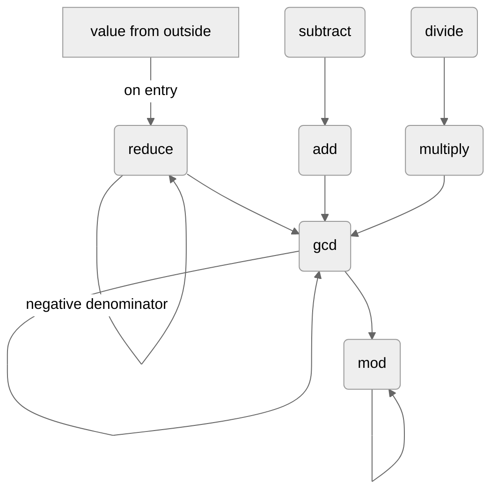

# Title TBD

## 1. Integers

A rational number is a number that can be written as a fraction $\frac{p}{q}$, where $p$ and $q$ are integers and $q \neq 0$. The integer $p$ is the *numerator* and $q$ is the *denominator*. For example, $\frac{3}{4}$, $\frac{-2}{5}$ and $\frac{7}{1}$ are rational numbers.

A rational number is made of two integers, so a program that works with rationals works with integers underneath. Section 1 is about integers alone. Section 2 returns to rationals.

### 1.1 Integers

A computer stores an integer in base 2, as a fixed number of bits called its *width*. Common widths are 8, 16, 32 and 64 bits.

An *unsigned* integer uses all of its bits for the magnitude. With $w$ bits it holds every integer from $0$ to $2^w - 1$, so a 32-bit unsigned integer runs from $0$ to $4\,294\,967\,295$.

A *signed* integer spends a bit on the sign. With $w$ bits it holds every integer from $-2^{w-1}$ to $2^{w-1} - 1$, about half the unsigned maximum, so a 32-bit signed integer runs from $-2\,147\,483\,648$ to $2\,147\,483\,647$. An unsigned integer stores larger magnitudes in the same bits; a signed integer can also store negative numbers.

Integer addition, subtraction, multiplication, exact division, negation and comparison are taken as given for the rest of this paper. We are not trying to make them faster.

Their cost is stated in *big-O*. Big-O describes how fast the work grows as the numbers get longer, not how much work is done. It ignores constant factors, so three multiplications and two are both $O(n^2)$; removing a kind of step, such as all multiplications, changes it.

For integers of $n$ digits (in base 2, $n$ bits), adding or subtracting two of them takes $O(n)$ steps, and multiplying them takes $O(n^2)$, as does dividing one by the other exactly. Comparing two integers, for equality or for size, takes $O(n)$. The paper assumes that an integer's sign is stored apart from its digits, so that negating it changes only the sign and takes $O(1)$; in two's complement, negation would take $O(n)$. Testing one integer against zero, with $=$, $<$ or $>$, takes $O(1)$, because a number knows its length: only zero has length $0$, and the sign is read in one step. Testing it against $1$ or $-1$ takes $O(1)$ for the same reason: a longer number fails at once, and a one-digit number is checked in one step.

For fixed-width machine integers each of these is a single instruction; the big-O describes integers too long to fit in one machine word.

### 1.2 Growing integers

The product of two integers has about as many digits as the two together, so integers that are multiplied again and again grow.

*Example.* Multiply $2 \cdot 3 \cdot 4 \cdot 5 \cdot 6$ one factor at a time. The running products are

$$
6, \qquad 24, \qquad 120, \qquad 720.
$$

Carried on up to $13$, the product is $6\,227\,020\,800$, past the 32-bit signed maximum of $2\,147\,483\,647$.

So after a few operations the integers no longer fit in a fixed width. With integers of unlimited length the problem shows up as cost instead: every multiplication is $O(n^2)$ in the number of digits, and $n$ keeps growing.

### 1.3 Euclid's algorithm

The *greatest common divisor* of two integers $u$ and $v$, written $\gcd(u, v)$, is the largest positive integer that divides both of them exactly. For example, $\gcd(12, 18) = 6$. Signs do not matter: $\gcd(-12, 18) = 6$ as well. Every positive integer divides $0$, so $\gcd(u, 0) = |u|$ for any $u \neq 0$, where $|u|$, the *absolute value* of $u$, is $u$ with its sign removed: $|-12| = |12| = 12$.

Computing a gcd needs division with a remainder. For integers $u \geq 0$ and $v > 0$ there is exactly one way to write

$$
u = k \cdot v + r, \qquad 0 \leq r < v.
$$

> *Proof.* Let $k$ be the largest integer with $k \cdot v \leq u$; it exists, since $0 \cdot v \leq u$ and $k \cdot v > u$ for every $k > u$. Then $r = u - k \cdot v \geq 0$, and $r < v$, since otherwise $(k + 1) \cdot v \leq u$. If also $u = k' \cdot v + r'$ with $0 \leq r' < v$, then $r - r' = (k' - k) \cdot v$ is a multiple of $v$ strictly between $-v$ and $v$. So it is $0$, and $k' = k$. ∎

The integer $k$ is the *quotient* and $r$ is the *remainder*. Dividing an $n$-digit integer by another, by long division, takes $O(n^2)$, the same as multiplying them.

The remainder, read "$u$ mod $v$", is written $\text{mod}(u, v)$, and `mod(u, v)` in pseudocode. For example, $\text{mod}(84, 36) = 12$, since $84 = 2 \cdot 36 + 12$.

Long division in base 2 needs only addition, subtraction and comparison. The remainder by $v$ follows from the remainder by $2v$: if $r = \text{mod}(u, 2v)$, then $r < 2v$, so $\text{mod}(u, v)$ is $r$ when $r < v$ and $r - v$ otherwise. Each call doubles the divisor until it exceeds $u$, so there are at most about $n$ calls, each $O(n)$, and the total is $O(n^2)$.

This paper describes algorithms in pseudocode. A block is the indented lines under its header, such as a `FUNCTION` line, and it ends where the indentation returns. `LET` gives a name to a value, and every `LET` introduces a new name; a name never changes once given. `IF` tests a condition, and if it holds, the rest of the line after `THEN` runs. `RETURN` ends the function with its result. Conditions compare integers with `=`, `≠`, `<` and `>`; in a `LET`, `=` gives the name.

```text
FUNCTION mod(u, v)
    IF u < v THEN RETURN u
    LET r = mod(u, v + v)
    IF r < v THEN RETURN r
    RETURN r − v
```

The calls of `mod` come to an end.

> *Proof.* A call with $u \geq v$ calls itself with the same $u$ and the divisor doubled, and a call with $u < v$ returns at once. Since $v \geq 1$, the divisor exceeds an $n$-digit $u$ after at most $n$ doublings, so there are at most $n + 1$ calls. ∎

The result is the remainder.

> *Proof.* By induction on the calls, from the last. If $u < v$, then $u = 0 \cdot v + u$ with $0 \leq u < v$, so the remainder is $u$. Otherwise $r = \text{mod}(u, 2v)$, so $0 \leq r < 2v$ and $u - r$ is a multiple of $2v$, hence of $v$. If $r < v$, then $r$ is the remainder by $v$. Otherwise $0 \leq r - v < v$, and $u - (r - v)$ is still a multiple of $v$, so $r - v$ is the remainder. Both follow from the uniqueness above. ∎

The cost is $O(n^2)$.

> *Proof.* If $v > u$ on the first call, the call is a single comparison. Otherwise every call that doubles its divisor has $v \leq u$, so no divisor passed on exceeds $2u$, and every integer in a call has at most $n + 1$ digits. Each comparison, the addition $v + v$ and the subtraction cost $O(n)$, and there are at most $n + 1$ calls. ∎

When the remainder is $0$, $v$ divides $u$ *exactly*, and the quotient $k = u/v$ is the exact division of section 1.1. In pseudocode it is `u / v`: `/` always means this exact integer division, and it is used only where the division is exact. An exact quotient may be negative: `−12 / 6` and `12 / −6` are both $-2$.

The remainder has the same common divisors with $v$ as $u$ does. So

$$
\gcd(u, v) = \gcd(v,\ \text{mod}(u, v)).
$$

> *Proof.* Any integer that divides $u$ and $v$ also divides $r = u - k \cdot v$, and any integer that divides $v$ and $r$ also divides $u = k \cdot v + r$. So the two pairs have the same common divisors, and the same greatest one. ∎

Euclid's algorithm applies this rule until the second integer is $0$, and then $\gcd(u, 0) = u$ gives the answer. In the pseudocode the function calls itself on the new pair; each call works on a smaller pair, so the calls come to an end.

```text
FUNCTION gcd(u, v)
    IF v = 0 THEN RETURN u
    RETURN gcd(v, mod(u, v))
```

Let $u, v \geq 0$, not both $0$. The calls come to an end.

> *Proof.* Each call with $v > 0$ passes $\text{mod}(u, v) < v$ on as the new second integer. So the second integer falls at every call and stays $\geq 0$, and it reaches $0$. ∎

The result is $\gcd(u, v)$.

> *Proof.* Each call keeps the gcd, by the rule above. The last call returns $u = \gcd(u, 0)$, and there $u > 0$: either it is the first call, whose inputs are not both $0$, or $u$ is the previous call's $v > 0$. ∎

*Example.* Since $\text{mod}(84, 36) = 12$ and $\text{mod}(36, 12) = 0$,

$$
\gcd(84, 36) = \gcd(36, 12) = \gcd(12, 0) = 12.
$$

This version assumes that neither input is negative. Signs do not change the gcd, so negative inputs can simply be made positive first.

> *Proof.* An integer divides $u$ exactly when it divides $-u$, so $u$ and $-u$ have the same common divisors with $v$. ∎

```text
FUNCTION gcd(u, v)
    IF u < 0 THEN RETURN gcd(−u, v)
    IF v < 0 THEN RETURN gcd(u, −v)
    IF v = 0 THEN RETURN u
    RETURN gcd(v, mod(u, v))
```

Each remainder is smaller than the integer before it, and every two steps the larger integer at least halves, so for $n$-digit inputs there are at most $O(n)$ steps.

> *Proof.* Take a step on $u$ and $v$ with $0 < v \leq u$, and let $r = \text{mod}(u, v)$. If $v \leq u/2$, then $r < v \leq u/2$. Otherwise $k = 1$, and $r = u - v < u/2$. Two steps take the pair $u, v$ to $r$ and the next remainder, so the larger integer at least halves. An $n$-digit integer halves at most $n$ times before it reaches $0$, so there are at most about $2n$ steps, plus one when the first input is the smaller, since that step only swaps them. ∎

Each step is a long division, which can cost $O(n^2)$ on its own and suggests $O(n^3)$ in total. A closer count gives less. Computing $\text{mod}(u, v)$ as above costs about (digits of $u$) $\times$ (digits of $k$ $+ 1$): one call for each digit of the quotient, plus one, each an addition, subtraction or comparison on integers of at most $n + 1$ digits. The integer $u$ never has more than $n$ digits. The quotient has about as many digits as $u$ has more than $v$, and the next step divides $v$, so over all steps the quotient digits add up to at most about $n$, the digits of the first input. The extra $1$ per step adds at most the number of steps, $O(n)$. So the total is about $n \cdot (n + O(n))$, which is $O(n^2)$.

> *Proof.* No integer in Euclid's algorithm exceeds the larger input, and `mod` doubles its divisor only up to twice its first input. So every integer in every call of `mod` has at most $n + 1$ digits, and each call costs $O(n)$. A step with quotient $k$ makes about (digits of $k$) $+ 1$ calls, since the divisor doubles until it passes $u$. Each step has $u \geq k \cdot v$, and the next step divides $v$, so the product of all the quotients is at most the first input, and their digits add up to at most about $n$, plus one for each step. With $O(n)$ steps, that is $O(n)$ calls of `mod` in all, each $O(n)$, so $O(n^2)$. ∎

### 1.4 Integers that share no factor

Two integers *share no factor* when their only common divisors are $1$ and $-1$, that is, when their gcd is $1$. One fact about divisibility is used again and again: if $a$ and $b$ share no factor, and $b$ divides $a \cdot q$, then $b$ divides $q$.

> *Proof.* We can take $b > 0$, since $b$ divides an integer exactly when $-b$ does. We can take $q > 0$, since $b$ divides $0$, and divides $q$ exactly when it divides $-q$. Call a positive integer $m$ *good* if $b$ divides $a \cdot m$. Then $b$ is good, and so is $q$. Let $s$ be the smallest good integer. If $m$ is good and $m > s$, then $m - s$ is good too, since $b$ divides $a \cdot m - a \cdot s$. Subtracting $s$ again and again from a good $m$ stays good and stops at a good integer no larger than $s$, which can only be $s$. So $s$ divides every good integer: it divides $b$, say $b = s \cdot t$, and it divides $q$. Since $b = s \cdot t$ divides $a \cdot s$, $t$ divides $a$. And $t$ divides $b$. So $t$ is a common factor of $a$ and $b$, which means $t = 1$, $s = b$, and $b$ divides $q$. ∎

By the fact about divisibility above, an integer $e$ that shares no factor with $x$ or with $y$ shares none with $x \cdot y$.

> *Proof.* A common divisor of $e$ and $x \cdot y$ divides $e$, so it shares no factor with $x$, and by the fact above it divides $y$. It divides $e$ and $y$, so it is $\pm 1$. ∎

### 1.5 The least common multiple

A *common multiple* of two nonzero integers $u$ and $v$ is an integer that both of them divide exactly. Their *least common multiple*, written $\text{lcm}(u, v)$, is the smallest positive one. For example, $\text{lcm}(4, 6) = 12$. It exists, since $|u \cdot v|$ is a positive common multiple. Signs do not matter, as for the gcd: $\text{lcm}(-4, 6) = 12$ as well.

Every common multiple of $u$ and $v$ is a multiple of $\text{lcm}(u, v)$.

> *Proof.* Let $m = \text{lcm}(u, v)$, and let $M$ be a common multiple. We can take $M \geq 0$, since $-M$ is a common multiple too. Write $M = k \cdot m + r$ with $0 \leq r < m$ (section 1.3). Both $u$ and $v$ divide $M$ and $m$, so they divide $r = M - k \cdot m$. So $r$ is a common multiple smaller than $m$, and it cannot be positive. So $r = 0$. ∎

The lcm and the gcd of two nonzero integers multiply to the product of the integers, without its sign:

$$
\text{lcm}(u, v) \cdot \gcd(u, v) = |u \cdot v|.
$$

> *Proof.* Let $g = \gcd(u, v)$, and write $u = g \cdot u'$ and $v = g \cdot v'$. Then $u'$ and $v'$ share no factor: if a positive $e$ divides both, then $e \cdot g$ divides $u$ and $v$, so $e \cdot g \leq g$, and $e = 1$. Let $m = |u' \cdot v'| \cdot g$. It is a common multiple, since $m = |u \cdot v'| = |u' \cdot v|$. Let $M$ be a positive common multiple, and write $M = u \cdot k$. Since $v$ divides $u \cdot k$, $g \cdot v'$ divides $g \cdot u' \cdot k$, so $v'$ divides $u' \cdot k$, and by section 1.4 $v'$ divides $k$. So $|k| \geq |v'|$, and $M = |u \cdot k| \geq |u \cdot v'| = m$. So $m$ is the least common multiple, and $m \cdot g = |u' \cdot v'| \cdot g \cdot g = |u \cdot v|$. ∎

So the lcm costs one gcd: $\text{lcm}(u, v) = (|u| / g) \cdot |v|$, an exact division and a multiplication after it. For example, $\gcd(6, 10) = 2$, so $\text{lcm}(6, 10) = 3 \cdot 10 = 30$.

For powers of one base, both are known without a gcd: the gcd is the smaller power, and the lcm the larger. For a positive integer $B$ and exponents $0 \leq i \leq j$,

$$
\gcd(B^i, B^j) = B^i, \qquad \text{lcm}(B^i, B^j) = B^j.
$$

> *Proof.* $B^j = B^i \cdot B^{j - i}$, so $B^i$ divides both powers, and every common divisor divides $B^i$, so none is larger than $B^i$. So $\gcd(B^i, B^j) = B^i$. By the product above, $\text{lcm}(B^i, B^j) = B^i \cdot B^j / B^i = B^j$. ∎

For example, $\gcd(100, 10\,000) = 100$ and $\text{lcm}(100, 10\,000) = 10\,000$.

## 2. Rationals

Sections 2.1–2.5 store rationals and compute with them without reduction, by the direct formulas. Sections 2.6–2.11 keep every value in lowest terms, using the gcd of section 1, and section 2.12 gathers the functions into one library.

### 2.1 Storing a rational number

A computer stores a rational number as a pair of integers, its numerator and its denominator. The most common layout is two signed integers of the same width. The running example in this paper is a signed 32-bit numerator next to a signed 32-bit denominator:

| Field | Type |
|---|---|
| numerator | signed 32-bit integer |
| denominator | signed 32-bit integer |

Other layouts and widths exist, such as 64-bit fields, or a signed numerator over an unsigned denominator, which forces the sign into the numerator. Each layout has trade-offs, and nothing in this paper depends on the choice except the big-O figures, whose one assumption, a sign stored apart from the digits, is stated in section 1.1. In every layout the denominator is never zero, and the number zero is stored as numerator $0$ over a nonzero denominator.

In the pseudocode, `numerator(x)` and `denominator(x)` read the two stored integers of a rational `x`, and `rational(p, q)` builds the rational with numerator `p` and denominator `q`, for $q \neq 0$. It only pairs the two integers, and computes nothing.

In formulas a fraction is a division: $\frac{3}{4}$, also written $3/4$, is $3$ divided by $4$. In pseudocode, `/` is exact integer division (section 1.3), and `rational(p, q)` builds a fraction, so the two never mix.

### 2.2 The sign

In arithmetic, a minus sign belongs to the whole rational number. A negative numerator can be moved outside the fraction, and so can a negative denominator:

$$
\frac{-3}{4} = -\frac{3}{4} = \frac{3}{-4}.
$$

If both integers are negative, the two signs cancel:

$$
\frac{-3}{-4} = \frac{3}{4}.
$$

A computer has only the two integers, and both of them can hold a sign. So $-\frac{3}{4}$ can be stored as $-3$ over $4$ or as $3$ over $-4$, and $\frac{3}{4}$ as $3$ over $4$ or as $-3$ over $-4$. Unlike in mathematics, where these are simply the same number, the machine does not reduce anything unless told to: it keeps whichever pair it was given.

Rewriting a stored pair as another pair with the same value is a *reduction*. The one reduction in this section moves the sign: **if the denominator is negative, negate both integers.** This covers both cases. Negative over negative becomes positive over positive, and positive over negative becomes negative over positive. Afterwards the denominator is positive, and the numerator carries the sign of the whole number.

> *Proof.* Negating both integers multiplies the fraction by $\frac{-1}{-1} = 1$, so the value stays the same. If $b < 0$, then $-b > 0$. Over a positive denominator, a fraction has the sign of its numerator. ∎

The function `reduce` applies this rule.

```text
FUNCTION reduce(x)
    LET a = numerator(x)
    LET b = denominator(x)
    IF b < 0 THEN RETURN rational(−a, −b)
    RETURN x
```

*Example.* `reduce` turns $3$ over $-4$ into $-3$ over $4$, and $-3$ over $-4$ into $3$ over $4$. It leaves $-3$ over $4$ as it is.

The test costs $O(1)$, and so do the two negations, when they run.

Every value that enters from outside, such as two integers a user supplies, goes through `reduce` before it is stored. So every stored denominator is positive. The operations below keep it that way on their own, since sums and products of positive denominators are positive. An operation needs `reduce` only where a negative denominator could arise, and only division, which turns its divisor upside down, can produce one; division places the sign itself (section 2.5).

A fixed place for the sign also bears on the checks below, which compare stored integers. With both denominators positive, two denominators can be equal, but the case of opposite denominators never arises.

### 2.3 Addition and subtraction without reduction

Each operation below takes two rational numbers, its *operands*, written $x = a/b$ and $y = c/d$. So $a$ and $c$ are the numerators, and $b$ and $d$ are the denominators, both positive.

To add two fractions, bring them over a common denominator:

$$
\frac{a}{b} + \frac{c}{d} = \frac{a \cdot d + c \cdot b}{b \cdot d}.
$$

Subtraction is addition with the second numerator negated:

$$
\frac{a}{b} - \frac{c}{d} = \frac{a}{b} + \frac{-c}{d}.
$$

The naive algorithm applies these formulas directly. It computes the numerator and the denominator of the result on separate lines, and then pairs them.

```text
FUNCTION add(x, y)
    LET a = numerator(x)
    LET b = denominator(x)
    LET c = numerator(y)
    LET d = denominator(y)
    LET p = a · d + c · b
    LET q = b · d
    RETURN rational(p, q)

FUNCTION subtract(x, y)
    LET c = numerator(y)
    LET d = denominator(y)
    RETURN add(x, rational(−c, d))
```

The denominator $b \cdot d$ is positive, and so is the $d$ passed on by `subtract`, so neither function calls `reduce`. Since `subtract` only calls `add`, everything below about addition applies to subtraction too. The one difference is that `subtract` negates $c$ first, so equal numerators become opposite ones, and opposite ones equal.

#### Special cases

The naive formula always gives the right answer, but for some inputs it does more work than it needs to. From here on we move beyond the naive approach by accounting for special cases: inputs where some stored integers are equal, opposite, zero or $1$, and a cheaper formula gives the same answer exactly.

The most important special case for addition is a shared denominator. If $d = b$, the two fractions already have a common denominator, and the numerators simply add:

$$
\frac{a}{b} + \frac{c}{b} = \frac{a + c}{b}.
$$

This needs one addition and no multiplication, so its cost drops from $O(n^2)$ to $O(n)$. The denominator of the result is the stored $b$, copied as it is.

*Example.* In $\dfrac{1}{5} + \dfrac{2}{5}$ the denominators are equal, so the result is

$$
\frac{1 + 2}{5} = \frac{3}{5}.
$$

A zero numerator is one of the most valuable special cases. If either numerator is zero, that operand is zero, and the sum is the other operand, with no arithmetic at all:

$$
\frac{0}{b} + \frac{c}{d} = \frac{c}{d},
\qquad
\frac{a}{b} + \frac{0}{d} = \frac{a}{b}.
$$

The test is against zero, so it costs $O(1)$.

An operand stored with the denominator $1$ is an *integer*. If one operand is an integer, the other's denominator is already a common one:

$$
\frac{a}{b} + \frac{c}{1} = \frac{a + c \cdot b}{b},
\qquad
\frac{a}{1} + \frac{c}{d} = \frac{a \cdot d + c}{d}.
$$

Each needs one multiplication instead of three, so it saves two but stays $O(n^2)$. If both operands are integers, the sum is $\frac{a + c}{1}$: one addition, $O(n)$. The tests are against $1$, so they cost $O(1)$.

If the numerators are equal, $c = a$, the common factor $a$ can be pulled out:

$$
\frac{a}{b} + \frac{a}{d} = \frac{a \cdot d + a \cdot b}{b \cdot d} = \frac{a \cdot (d + b)}{b \cdot d}.
$$

If they are opposite, $c = -a$, the same idea gives

$$
\frac{a}{b} + \frac{-a}{d} = \frac{a \cdot d - a \cdot b}{b \cdot d} = \frac{a \cdot (d - b)}{b \cdot d}.
$$

Both forms need two multiplications instead of three, so they save one multiplication but stay $O(n^2)$.

The table lists the naive formula first and then every special case. The big-O includes the check.

| Case | Condition | Result | Big-O |
|---|---|---|---|
| Naive | always | $\dfrac{a \cdot d + c \cdot b}{b \cdot d}$ | $O(n^2)$ |
| Zero numerator | $a = 0$ or $c = 0$ | the other operand | $O(1)$ |
| Both integers | $b = 1$ and $d = 1$ | $\dfrac{a + c}{1}$ | $O(n)$ |
| Integer $x$ | $b = 1$ | $\dfrac{a \cdot d + c}{d}$ | $O(n^2)$ |
| Integer $y$ | $d = 1$ | $\dfrac{a + c \cdot b}{b}$ | $O(n^2)$ |
| Shared denominator | $d = b$ | $\dfrac{a + c}{b}$ | $O(n)$ |
| Equal numerators | $c = a$ | $\dfrac{a \cdot (d + b)}{b \cdot d}$ | $O(n^2)$ |
| Opposite numerators | $c = -a$ | $\dfrac{a \cdot (d - b)}{b \cdot d}$ | $O(n^2)$ |

Notice that opposite denominators, $d = -b$, are not listed. A check for them would save work, as the check for a shared denominator does, if the case arose. It never arises: `reduce` has already put every sign in the numerator, so every stored denominator is positive, and two positive numbers are never opposites.

The naive path now runs only after every check has failed, so it pays for those checks: a small $O(n)$ overhead on top of its $O(n^2)$.

In the pseudocode the special cases come first, in table order, and each one that holds returns at once, so the rest of the function is skipped. Special cases are ordered by the cost of their result, cheapest first; where two results cost the same, or two cases can no longer both hold after the earlier checks, the cheaper test goes first. In the pseudocode, `AND` requires both conditions. The naive formula comes last.

```text
FUNCTION add(x, y)
    LET a = numerator(x)
    LET b = denominator(x)
    LET c = numerator(y)
    LET d = denominator(y)
    IF a = 0 THEN RETURN y
    IF c = 0 THEN RETURN x
    IF b = 1 AND d = 1 THEN RETURN rational(a + c, 1)
    IF b = 1 THEN RETURN rational(a · d + c, d)
    IF d = 1 THEN RETURN rational(a + c · b, b)
    IF d = b THEN RETURN rational(a + c, b)
    IF c = a THEN RETURN rational(a · (d + b), b · d)
    IF c = −a THEN RETURN rational(a · (d − b), b · d)
    LET p = a · d + c · b
    LET q = b · d
    RETURN rational(p, q)
```

### 2.4 Multiplication without reduction

Numerators multiply, and denominators multiply:

$$
\frac{a}{b} \cdot \frac{c}{d} = \frac{a \cdot c}{b \cdot d}.
$$

The naive algorithm applies this formula directly.

```text
FUNCTION multiply(x, y)
    LET a = numerator(x)
    LET b = denominator(x)
    LET c = numerator(y)
    LET d = denominator(y)
    LET p = a · c
    LET q = b · d
    RETURN rational(p, q)
```

#### Special cases

The most important special case for multiplication is a cross match: one operand's numerator equals the other operand's denominator. If $c = b$, the same integer $b$ appears once on top and once on the bottom, and it cancels exactly:

$$
\frac{a}{b} \cdot \frac{b}{d} = \frac{a \cdot b}{b \cdot d} = \frac{a}{d}.
$$

The result is the two outer stored integers, $a$ over $d$. The match also works the other way round, when $a = d$:

$$
\frac{a}{b} \cdot \frac{c}{a} = \frac{c}{b}.
$$

None of these forms needs a multiplication, so the cost drops from $O(n^2)$ to $O(n)$, the cost of the comparison.

*Example.* In $\dfrac{2}{3} \cdot \dfrac{3}{5}$ the second numerator equals the first denominator, so the result is

$$
\frac{2}{5}.
$$

The other special cases are briefer.

A zero numerator is one of the most valuable special cases. If either numerator is zero, the product is zero, and the zero operand is itself the answer, with no arithmetic at all: $\frac{0}{b} \cdot \frac{c}{d} = \frac{0}{b}$, and $\frac{a}{b} \cdot \frac{0}{d} = \frac{0}{d}$. This costs $O(1)$.

If one operand is stored as $1/1$, the product is the other operand. If one is stored as $-1/1$, the product is the other operand with its numerator negated. These checks test integers against $1$ and $-1$, and the negation only changes a sign, so they cost $O(1)$. A value $1$ stored some other way, such as $3/3$, is not caught, and takes a later path, which still gives the right answer.

An operand stored with the denominator $1$ is an integer, as in section 2.3. If both operands are integers, the product is $\frac{a \cdot c}{1}$: one multiplication instead of two. The test is against $1$, so it costs $O(1)$.

If both cross matches hold at once, the operands are reciprocals and the product is $1$:

$$
\frac{a}{b} \cdot \frac{b}{a} = 1.
$$

With positive denominators, the reciprocal of $\frac{a}{b}$ for a negative $a$ is stored as $\frac{-b}{-a}$, and the product is again $1$. If both cross matches hold but one of them is opposite, $c = -b$ or $a = -d$, the product is $-1$, as in $\frac{a}{b} \cdot \frac{-b}{a}$.

> *Proof.* The product is $\frac{a \cdot c}{b \cdot d}$. If $a = d$ and $c = b$, it is $\frac{d \cdot b}{b \cdot d} = 1$. If $a = -d$ and $c = -b$, it is $\frac{(-d) \cdot (-b)}{b \cdot d} = 1$. If one match is equal and the other opposite, one factor of the numerator changes sign, and the product is $-1$. ∎

A single cross match can also be opposite: $c = -b$, or $a = -d$. The shared integer still cancels, and leaves its sign in the numerator:

$$
\frac{a}{b} \cdot \frac{-b}{d} = \frac{-a}{d},
\qquad
\frac{-d}{b} \cdot \frac{c}{d} = \frac{-c}{b}.
$$

If only one operand is an integer, its denominator $1$ leaves the other's as it is:

$$
\frac{a}{1} \cdot \frac{c}{d} = \frac{a \cdot c}{d},
\qquad
\frac{a}{b} \cdot \frac{c}{1} = \frac{a \cdot c}{b}.
$$

This needs one multiplication instead of two, and stays $O(n^2)$. The tests are against $1$, so they cost $O(1)$, but they come after the cross matches: an integer operand that also forms a cross match, as in $\frac{a}{b} \cdot \frac{b}{1}$, gets the cross match's result, which needs no multiplication.

Not every coincidence helps. A shared denominator, the main case for addition, saves nothing here, since $\frac{a}{b} \cdot \frac{c}{b} = \frac{a \cdot c}{b \cdot b}$ still needs both multiplications, and a shared numerator saves nothing either. Neither gets a row or a check.

| Case | Condition | Result | Big-O |
|---|---|---|---|
| Naive | always | $\dfrac{a \cdot c}{b \cdot d}$ | $O(n^2)$ |
| Zero numerator | $a = 0$ or $c = 0$ | the zero operand | $O(1)$ |
| Factor $1$ | $a = 1$ and $b = 1$, or $c = 1$ and $d = 1$ | the other operand | $O(1)$ |
| Factor $-1$ in $x$ | $a = -1$ and $b = 1$ | $\dfrac{-c}{d}$ | $O(1)$ |
| Factor $-1$ in $y$ | $c = -1$ and $d = 1$ | $\dfrac{-a}{b}$ | $O(1)$ |
| Both integers | $b = 1$ and $d = 1$ | $\dfrac{a \cdot c}{1}$ | $O(n^2)$ |
| Reciprocals | $a = d$ and $c = b$, or $a = -d$ and $c = -b$ | $\dfrac{1}{1}$ | $O(n)$ |
| Opposite reciprocals | $a = d$ and $c = -b$, or $a = -d$ and $c = b$ | $\dfrac{-1}{1}$ | $O(n)$ |
| Cross match | $c = b$ | $\dfrac{a}{d}$ | $O(n)$ |
| Cross match, other way | $a = d$ | $\dfrac{c}{b}$ | $O(n)$ |
| Opposite cross match | $c = -b$ | $\dfrac{-a}{d}$ | $O(n)$ |
| Opposite cross match, other way | $a = -d$ | $\dfrac{-c}{b}$ | $O(n)$ |
| Integer $x$ | $b = 1$ | $\dfrac{a \cdot c}{d}$ | $O(n^2)$ |
| Integer $y$ | $d = 1$ | $\dfrac{a \cdot c}{b}$ | $O(n^2)$ |

As before, the naive path pays for every failed check, a small $O(n)$ overhead.

Reciprocals come before cross matches: a reciprocal pair is also a cross match, which would give the right value, but stored as $d$ over $d$ instead of $1$ over $1$. In the pseudocode, `OR` requires either of two conditions; the brackets group them.

```text
FUNCTION multiply(x, y)
    LET a = numerator(x)
    LET b = denominator(x)
    LET c = numerator(y)
    LET d = denominator(y)
    IF a = 0 THEN RETURN x
    IF c = 0 THEN RETURN y
    IF a = 1 AND b = 1 THEN RETURN y
    IF c = 1 AND d = 1 THEN RETURN x
    IF a = −1 AND b = 1 THEN RETURN rational(−c, d)
    IF c = −1 AND d = 1 THEN RETURN rational(−a, b)
    IF b = 1 AND d = 1 THEN RETURN rational(a · c, 1)
    IF (a = d AND c = b) OR (a = −d AND c = −b) THEN RETURN rational(1, 1)
    IF (a = d AND c = −b) OR (a = −d AND c = b) THEN RETURN rational(−1, 1)
    IF c = b THEN RETURN rational(a, d)
    IF a = d THEN RETURN rational(c, b)
    IF c = −b THEN RETURN rational(−a, d)
    IF a = −d THEN RETURN rational(−c, b)
    IF b = 1 THEN RETURN rational(a · c, d)
    IF d = 1 THEN RETURN rational(a · c, b)
    LET p = a · c
    LET q = b · d
    RETURN rational(p, q)
```

### 2.5 Division without reduction

Dividing by $\frac{c}{d}$ is multiplying by its flip $\frac{d}{c}$, which exists only when $c \neq 0$:

$$
\frac{a}{b} \div \frac{c}{d} = \frac{a}{b} \cdot \frac{d}{c}, \qquad c \neq 0.
$$

The flip moves $c$ into the denominator, so its denominator is negative when $c$ is. Division places the sign there and then, by the rule of `reduce`: when $c < 0$, the flip is stored as $-d$ over $-c$.

A condition without which a function has no answer is a *precondition*; for division it is $c \neq 0$. Every function keeps one order: preconditions first, then naming the parts, then the special cases, then the general method, except where a case needs a value the general method computes first, as in section 2.9's `add`. Special cases are ordered as in section 2.3. So `divide` tests its divisor before naming its parts. The zero checks of `add` and `multiply` are special cases, not preconditions, since they have an answer. `ERROR` stops the computation with an error.

```text
FUNCTION divide(x, y)
    IF numerator(y) = 0 THEN ERROR
    LET c = numerator(y)
    LET d = denominator(y)
    IF c < 0 THEN RETURN multiply(x, rational(−d, −c))
    RETURN multiply(x, rational(d, c))
```

Division's special cases are multiplication's in disguise: `multiply` receives the flipped divisor, and its checks catch them. The table gives each case as a division, with the multiplication case that catches it. When $c < 0$ the flip has swapped the sign, so an equal match in the division becomes an opposite one in the multiplication. The flip itself, with its two tests and its negations, costs $O(1)$, and that is included. The table gives values, not stored pairs: when $c < 0$, a $c$ shown in a denominator is stored as $-c$, with the numerator negated to match.

| Case | Condition | Value | Caught by | Big-O |
|---|---|---|---|---|
| Naive | $c \neq 0$ | $\dfrac{a \cdot d}{b \cdot c}$ | naive | $O(n^2)$ |
| Zero dividend | $a = 0$ | $0$ | zero numerator | $O(1)$ |
| Divisor $1$ | $c = 1$ and $d = 1$ | $\dfrac{a}{b}$ | factor $1$ | $O(1)$ |
| Divisor $-1$ | $c = -1$ and $d = 1$ | $\dfrac{-a}{b}$ | factor $-1$ in $y$ | $O(1)$ |
| Dividend $1$ | $a = 1$ and $b = 1$ | $\dfrac{d}{c}$ | factor $1$ | $O(1)$ |
| Dividend $-1$ | $a = -1$ and $b = 1$ | $\dfrac{-d}{c}$ | factor $-1$ in $x$ | $O(1)$ |
| $x \div x$ | $c = a$ and $d = b$ | $1$ | reciprocals | $O(n)$ |
| $x \div (-x)$ | $c = -a$ and $d = b$ | $-1$ | opposite reciprocals | $O(n)$ |
| Shared numerator | $c = a$ | $\dfrac{d}{b}$ | cross match, other way; opposite if $c < 0$ | $O(n)$ |
| Opposite numerators | $c = -a$ | $\dfrac{-d}{b}$ | opposite cross match, other way; equal if $c < 0$ | $O(n)$ |
| Shared denominator | $d = b$ | $\dfrac{a}{c}$ | cross match; opposite if $c < 0$ | $O(n)$ |

> *Proof.* `multiply` receives $\frac{a}{b}$ and the flip, written here $\frac{c'}{d'}$. For $c > 0$, $c' = d$ and $d' = c$; for $c < 0$, $c' = -d$ and $d' = -c$. Each row in turn:
>
> - Naive: if no other case holds, `multiply` returns $\frac{a \cdot c'}{b \cdot d'}$, which is $\frac{a \cdot d}{b \cdot c}$ for $c > 0$ and $\frac{a \cdot (-d)}{b \cdot (-c)}$, the same value, for $c < 0$.
> - Zero dividend: $a = 0$ is the zero numerator.
> - Divisor $1$: occurs only for $c > 0$; the flip is $\frac{1}{1}$, factor $1$.
> - Divisor $-1$: occurs only for $c < 0$; the flip is $\frac{-1}{1}$, factor $-1$ in $y$.
> - Dividend $\pm 1$: $x$ is $\frac{1}{1}$ or $\frac{-1}{1}$, factor $1$ or factor $-1$ in $x$, which return $\frac{c'}{d'}$ or $\frac{-c'}{d'}$, of value $\frac{d}{c}$ or $\frac{-d}{c}$.
> - $x \div x$: for $c > 0$, $a = d'$ and $c' = b$. For $c < 0$, $a = -d'$ and $c' = -b$: both matches are opposite, which is the reciprocals case by section 2.4's sentence on a negative $a$.
> - $x \div (-x)$: for $c > 0$, $a = -d'$ and $c' = b$; for $c < 0$, $a = d'$ and $c' = -b$. Either way, opposite reciprocals.
> - Shared numerator: for $c > 0$, $a = d'$, the cross match the other way, giving $\frac{c'}{b} = \frac{d}{b}$; for $c < 0$, $a = -d'$, the opposite one, giving $\frac{-c'}{b} = \frac{d}{b}$.
> - Opposite numerators: for $c > 0$, $a = -d'$, giving $\frac{-c'}{b} = \frac{-d}{b}$; for $c < 0$, $a = d'$, giving $\frac{c'}{b} = \frac{-d}{b}$.
> - Shared denominator: for $c > 0$, $c' = b$, the cross match, giving $\frac{a}{d'} = \frac{a}{c}$; for $c < 0$, $c' = -b$, the opposite one, giving $\frac{-a}{d'} = \frac{a}{c}$. ∎

If an earlier case of `multiply` also holds, it catches the input first, and gives the same value.

Dividing by an integer $\frac{c}{1}$ flips it into $\frac{1}{c}$, which is not an integer unless $c = \pm 1$ (cases already caught), so the integer case does not carry over to the divisor.

So division needs only its zero-divisor check.

### 2.6 Lowest terms

The formulas of sections 2.3–2.5 always give the right value, but they let the stored integers grow. In addition and multiplication the denominators multiply, so the denominator of a result has about as many digits as the two input denominators together, as in section 1.2.

*Example.* Add $\frac{1}{2} + \frac{1}{3} + \frac{1}{4} + \frac{1}{5} + \frac{1}{6}$ one term at a time with the `add` function of section 2.3. The running results are

$$
\frac{5}{6}, \qquad \frac{26}{24}, \qquad \frac{154}{120}, \qquad \frac{1044}{720}.
$$

The last denominator is $720 = 2 \cdot 3 \cdot 4 \cdot 5 \cdot 6$, yet the same value can also be written $\frac{29}{20}$. Carried on up to $\frac{1}{13}$, the sum is stored as $13\,575\,738\,240$ over $6\,227\,020\,800$. Both integers are past the 32-bit signed maximum of $2\,147\,483\,647$, while the same value can be written $\frac{785\,633}{360\,360}$, which fits easily.

So the stored integers overflow a fixed width, or with unlimited length cost more at every step, as in section 1.2, although the value does not need them. They are not *bounded*: nothing keeps them as small as the value allows.

Sections 2.1–2.5 used one reduction, the sign rule in `reduce`: if the denominator is negative, negate both integers. A fuller reduction cancels common factors too. In $\frac{26}{24}$ both integers are even, and dividing both by $2$ gives $\frac{13}{12}$, the same value with smaller integers.

Dividing the numerator and the denominator by their gcd (section 1.3) gives the same value. Here $\gcd(12, 18) = 6$, and $12 = 2 \cdot 6$ and $18 = 3 \cdot 6$:

$$
\frac{12}{18} = \frac{2 \cdot 6}{3 \cdot 6} = \frac{2}{3}.
$$

After this division the numerator and denominator have gcd $1$, so nothing is left to cancel.

> *Proof.* Let $g = \gcd(u, v)$. If a positive $e$ divides $u/g$ and $v/g$, then $e \cdot g$ divides $u$ and $v$, so $e \cdot g \leq g$, and $e = 1$. ∎

Such a fraction is in *lowest terms*.

Every other fraction with the same value has a numerator and denominator that are the same whole multiple of these two, as $\frac{4}{6}$ and $\frac{10}{15}$ are of $\frac{2}{3}$.

> *Proof.* Let $\frac{a}{b}$ be the pair in lowest terms, so that $\gcd(a, b) = 1$: $a$ and $b$ share no factor. Let $\frac{p}{q}$ have the same value, with $q > 0$ (otherwise negate both). Then $a \cdot q = p \cdot b$, so $b$ divides $a \cdot q$, and by the fact of section 1.4, $b$ divides $q$. With $m = q/b$, $p \cdot b = a \cdot m \cdot b$, so $p = m \cdot a$ and $q = m \cdot b$. ∎

So lowest terms keeps the integers as small as the value allows. The multiple $m$ may be negative, when $b$ is.

Lowest terms fixes the integers only up to sign: $\frac{2}{3}$ and $\frac{-2}{-3}$ are both in lowest terms. The sign rule of section 2.2 settles this, by keeping the denominator positive. The value is the same either way, as in section 2.2; fixing the sign's place makes the stored form unique. A stored rational is *reduced* when its denominator is positive and the gcd of its numerator and denominator is $1$. Every rational number has exactly one reduced form. Zero's reduced form is $\frac{0}{1}$, since $\gcd(0, d) = d$ for a positive $d$.

> *Proof.* Dividing both integers by their gcd, and then the sign rule, give a reduced form with the same value; the sign rule keeps the gcd, since an integer divides $u$ exactly when it divides $-u$. If $\frac{p}{q}$ and $\frac{p'}{q'}$ are both reduced forms of one value, each is a whole multiple of the other, by the claim above. So the multiple is $\pm 1$, and since $q$ and $q'$ are both positive, it is $1$. ∎

### 2.7 Reducing with the gcd

`reduce` now grows a second rule. The sign rule stays first: a negative denominator is made positive by negating both integers, and the new pair goes through `reduce` again. Then both integers are divided by their gcd.

```text
FUNCTION reduce(x)
    LET a = numerator(x)
    LET b = denominator(x)
    IF b < 0 THEN RETURN reduce(rational(−a, −b))
    LET g = gcd(a, b)
    IF g = 1 THEN RETURN x
    LET p = a / g
    LET q = b / g
    RETURN rational(p, q)
```

If $g = 1$, nothing cancels, and the pair is returned as it is, since dividing by $1$ would change nothing. Otherwise both integers are divided by $g$. Either way the result is reduced. For zero, $g = b$, and the result is $\frac{0}{1}$.

> *Proof.* `reduce` calls itself at most once, since the negated pair has a positive denominator; after that, $b > 0$. If $g = 1$, the pair is already reduced. Otherwise $g$ is positive and divides $b$, so $q$ is positive, and $p$ and $q$ have gcd $1$ (section 2.6). Neither step changes the value. ∎

*Example.* For $26$ over $-24$, the sign rule gives $-26$ over $24$, then $g = \gcd(-26, 24) = 2$, and the result is $\frac{-13}{12}$.

From here on, values are stored reduced. A value entering from outside, two integers $p$ and $q$ with $q \neq 0$, is stored as `reduce(rational(p, q))`, and every operation returns a reduced result. So every function below may assume that its operands are reduced: $b$ and $d$ are positive, $\gcd(a, b) = 1$ and $\gcd(c, d) = 1$.

Every function below ends in one of two ways:

- `RETURN reduce(rational(p, q))` passes the pair through `reduce`. It is used only where full reduction is needed: for values entering from outside, and in the methods that compute the naive result and then reduce it.
- `RETURN rational(p, q)` only pairs the integers. It is used where the method's result is already reduced: the gcd-first methods and the special cases.

The second way is safe because `rational(p, q)` changes nothing: the pair is stored exactly as computed, so the stored value is reduced exactly when $q > 0$ and $\gcd(p, q) = 1$. Each method below that returns this way shows both.

### 2.8 The trade-off

Reducing costs one gcd and two exact divisions, $O(n^2)$ in all, the same order as the naive operations of sections 2.3–2.5. So reducing leaves the big-O of each operation unchanged, even though each operation now does more steps. What it buys is storage, by keeping the integers bounded, not speed per operation. Over many operations, the smaller integers keep $n$ small, so that every later operation works on shorter integers, as section 2.6 showed.

The trade-off is clearest for addition over a shared denominator. In section 2.3 it cost $O(n)$, one addition. Here the sum $\frac{a + c}{b}$ can still share a factor with $b$, as in $\frac{1}{6} + \frac{1}{6} = \frac{2}{6} = \frac{1}{3}$, so it needs a gcd, $\gcd(a + c, b)$, and its cost rises to $O(n^2)$. This is the price boundedness forces: a shortcut that leaves a common factor behind must still pay for the gcd that removes it. It stays a special case (section 2.9), since one gcd is still fewer than the general method's two.

A shared denominator is the case where two denominators have everything in common. At the other end, $3$ and $10$ have nothing in common. Between them lie pairs that share some factors and not others: $6$ and $10$ are not equal, but they share the factor $2$, so $\frac{1}{6} + \frac{1}{10}$ can be written over $30$ instead of $60$. Dividing out what two numbers share before multiplying already benefits from whatever they share, however little of it: the integers it multiplies are smaller by the shared factor. The cost is finding the shared part. A stored integer carries no record of its factors, so the shared part is found by Euclid's algorithm, every time two numbers meet.

If the factors of the stored integers were already known, the gcd would be nearly free: it could be read off the factors instead of computed.

### 2.9 Addition and subtraction in lowest terms

#### Reducing the naive result

The simplest way to keep sums reduced is to reduce the result of the naive formula: with $p = a \cdot d + c \cdot b$ and $q = b \cdot d$, the sum is $\frac{p}{q}$, with both integers divided by $\gcd(p, q)$.

```text
FUNCTION add(x, y)
    LET a = numerator(x)
    LET b = denominator(x)
    LET c = numerator(y)
    LET d = denominator(y)
    LET p = a · d + c · b
    LET q = b · d
    RETURN reduce(rational(p, q))
```

*Example.* The naive formula gives $\frac{1}{6} + \frac{1}{10} = \frac{16}{60}$, and $\gcd(16, 60) = 4$, so the result is $\frac{4}{15}$.

The products have up to $2n$ digits, and the gcd runs on them, but the cost is still $O(n^2)$.

#### Dividing out first

The two denominators often share a factor already, as $6$ and $10$ share $2$. Let $g = \gcd(b, d)$, and write $b = g \cdot b'$ and $d = g \cdot d'$, so that $b' = b/g$ and $d' = d/g$. Then $b' \cdot d$ is a common denominator, smaller than $b \cdot d$ by the factor $g$:

$$
\frac{a}{b} + \frac{c}{d} = \frac{a \cdot d'}{b' \cdot d} + \frac{c \cdot b'}{b' \cdot d} = \frac{t}{b' \cdot d}, \qquad t = a \cdot d' + c \cdot b'.
$$

This result can still have a common factor, but less of one. Because both operands are reduced, $t$ shares no factor with $b'$ or with $d'$, so whatever $t$ shares with the denominator $b' \cdot d = b' \cdot d' \cdot g$ divides $g$. Let $h = \gcd(t, g)$. Since $h$ divides $g$, it divides $d$ too. Let $p = t/h$ and $q = b' \cdot (d/h)$. Then the sum is $\frac{p}{q}$.

> *Proof.* Since $b' \cdot d = b \cdot d'$, the display holds, and dividing $t$ and $b' \cdot d$ by $h$ keeps the value, since $h$ divides $t$ and $d$. ∎

Nothing is left to cancel, and $q$ is positive, so $\frac{p}{q}$ is already reduced.

> *Proof.* By section 2.6, $b'$ and $d'$ share no factor. A common divisor of $t$ and $b'$ divides $t - c \cdot b' = a \cdot d'$, and it shares no factor with $a$, since $b'$ divides $b$; so it divides $d'$ (section 1.4), and it is $\pm 1$. Likewise $t$ shares no factor with $d'$. Then $p$, a divisor of $t$, shares no factor with $b'$ or $d'$, and none with $g/h$, by section 2.6, since $h = \gcd(t, g)$. So it shares none with $q = b' \cdot d' \cdot (g/h)$ (section 1.4), and $q$ is positive. ∎

Two gcds can come out as $1$, and then their divisions are skipped, since dividing by $1$ changes nothing. If $g = 1$, then $b' = b$ and $d' = d$, and $h = \gcd(t, 1) = 1$ is known without computing it. So the naive sum $\frac{a \cdot d + c \cdot b}{b \cdot d}$ is already reduced, and it is returned with no second gcd and no division. If $g > 1$ but $h = 1$, the sum is $\frac{t}{b' \cdot d}$.

```text
FUNCTION add(x, y)
    LET a = numerator(x)
    LET b = denominator(x)
    LET c = numerator(y)
    LET d = denominator(y)
    LET g = gcd(b, d)
    IF g = 1 THEN RETURN rational(a · d + c · b, b · d)
    LET b′ = b / g
    LET d′ = d / g
    LET t = a · d′ + c · b′
    LET h = gcd(t, g)
    IF h = 1 THEN RETURN rational(t, b′ · d)
    LET p = t / h
    LET q = b′ · (d / h)
    RETURN rational(p, q)
```

*Example.* In $\frac{1}{6} + \frac{1}{10}$, $g = 2$, $b' = 3$ and $d' = 5$, so $t = 5 + 3 = 8$ and $h = \gcd(8, 2) = 2$. Then $p = 4$ and $q = 3 \cdot 5 = 15$, and the result is $\frac{4}{15}$.

The two gcds run on $6$ and $10$ and on $8$ and $2$, instead of on $16$ and $60$.

This method does more steps than reducing the naive result, but every step works on smaller integers: the gcds run on the input denominators and on $g$, and the products are smaller by the factor $g$. Its cost is $O(n^2)$, the same order.

Subtraction stays defined through `add`, as in section 2.3. Negating the numerator of a reduced value leaves it reduced, so `subtract` still passes `add` a reduced operand.

#### Special cases

With reduced operands, some coincidences between the stored integers tell in advance what a gcd of the general method will be, or replace part of the method with a cheaper formula. Each is checked by value, on the stored integers. Some need no gcd at all, and some need one gcd instead of two.

The most important special case is again a shared denominator, $d = b$. The numerators simply add, as in section 2.3, but the sum $\frac{a + c}{b}$ can share a factor with $b$, so it is reduced by one gcd, $\gcd(a + c, b)$, as section 2.8 showed. The general method would reach the same result with two gcds, the first of them $\gcd(b, b)$.

With $s = a + c$ and $k = \gcd(s, b)$, the sum is $\frac{s}{b}$ if $k = 1$, and otherwise $\frac{s/k}{b/k}$. Either way it is reduced.

> *Proof.* If $k = 1$, then $\gcd(s, b) = 1$. Otherwise $s/k$ and $b/k$ have gcd $1$ (section 2.6), and $b/k$ is positive, since $b$ and $k$ are. ∎

*Example.* In $\dfrac{1}{6} + \dfrac{1}{6}$ the denominators are equal, so the sum is $\frac{2}{6}$, and $\gcd(2, 6) = 2$ gives $\dfrac{1}{3}$.

If the denominators are equal and the numerators opposite, $d = b$ and $c = -a$, then $y = -x$, and the sum is zero. Its reduced form $\frac{0}{1}$ is known, so it is returned directly, with no gcd. Since `subtract` negates the numerator of $y$, it reaches this case for $x - x$.

A cross match, one operand's numerator equal to the other operand's denominator or to its negation, needs no gcd. It is written $d = \pm a$ or $b = \pm c$, where $\pm$ stands for either sign: $d = \pm a$ means $d = a$ or $d = -a$. In either case $g = \gcd(b, d) = 1$. With $g = 1$ the naive result is already reduced, as above:

$$
\frac{a}{b} + \frac{c}{d} = \frac{a \cdot d + c \cdot b}{b \cdot d}.
$$

> *Proof.* Since $\frac{a}{b}$ is reduced, $a$ and $b$ share no factor, so if $d = \pm a$, then $g = \gcd(b, d) = 1$. The same holds for $b = \pm c$, since $c$ and $d$ share no factor. ∎

The check replaces the gcd. The equal and the opposite match are handled the same way, so they share a row.

*Example.* In $\dfrac{2}{3} + \dfrac{5}{2}$ the second denominator equals the first numerator, so the result is

$$
\frac{2 \cdot 2 + 5 \cdot 3}{3 \cdot 2} = \frac{19}{6}.
$$

If the numerators are equal, $c = a$, the common factor $a$ comes out of $t$, as in section 2.3:

$$
t = a \cdot d' + a \cdot b' = a \cdot (d' + b').
$$

Since $g$ divides $b$, and $a$ shares no factor with $b$, $a$ shares no factor with $g$ either. So with $s = d' + b'$, $h = \gcd(t, g) = \gcd(s, g)$, a gcd of smaller integers, and the sum is $\frac{p}{q}$ with $p = a \cdot (s/h)$ and $q = b' \cdot (d/h)$. If $g = 1$, the sum is $\frac{a \cdot (d + b)}{b \cdot d}$, already reduced; if $h = 1$, it is $\frac{a \cdot s}{b' \cdot d}$.

> *Proof.* Any integer that divides $s$ and $g$ divides $t = a \cdot s$ and $g$. Conversely, one that divides $a \cdot s$ and $g$ shares no factor with $a$, since $a$ shares none with $g$, so it divides $s$ (section 1.4). So $\gcd(t, g) = \gcd(s, g)$. ∎

If they are opposite, $c = -a$, the same holds with a minus sign: $s = d' - b'$, $t = a \cdot s$, and $h = \gcd(s, g)$; if $g = 1$, the sum is $\frac{a \cdot (d - b)}{b \cdot d}$. Here $d' - b'$ is never $0$: $b'$ and $d'$ share no factor, so $d' = b'$ only when both are $1$, which means $d = b$, a case already handled.

Both forms save one multiplication, and their second gcd runs on $d' \pm b'$ instead of $t$, but they stay $O(n^2)$. Each result is the general method's for $c = \pm a$, so it is reduced for the same reason; with $g = 1$, it is the naive sum, reduced as above.

A zero numerator is again one of the most valuable special cases. If either numerator is zero, the sum is the other operand, as in section 2.3, with no arithmetic and no gcd: $\frac{0}{1} + \frac{c}{d} = \frac{c}{d}$. The test costs $O(1)$.

Integers need no gcd at all. If both operands are integers, $b = 1$ and $d = 1$, the sum is $\frac{a + c}{1}$, which is reduced since its denominator is $1$: one addition. If only $y$ is an integer, $d = 1$, the sum of section 2.3, $\frac{a + c \cdot b}{b}$, is already reduced, since

$$
\gcd(a + c \cdot b,\ b) = \gcd(a, b) = 1.
$$

> *Proof.* Any integer that divides $b$ divides $a + c \cdot b$ exactly when it divides $a$. ∎

Likewise, if only $x$ is an integer, $b = 1$, the sum $\frac{a \cdot d + c}{d}$ is reduced, since $\gcd(a \cdot d + c, d) = \gcd(c, d) = 1$. Each needs one multiplication and no gcd, $O(n^2)$, where the general method needs two gcds. The tests are against $1$, so they cost $O(1)$.

The table lists the general method first. The big-O includes the checks.

| Case | Condition | Result | Big-O |
|---|---|---|---|
| General | always | $\dfrac{t}{b' \cdot d}$, reduced by $\gcd(t, g)$ | $O(n^2)$ |
| Zero numerator | $a = 0$ or $c = 0$ | the other operand | $O(1)$ |
| Both integers | $b = 1$ and $d = 1$ | $\dfrac{a + c}{1}$ | $O(n)$ |
| Integer $x$ | $b = 1$ | $\dfrac{a \cdot d + c}{d}$ | $O(n^2)$ |
| Integer $y$ | $d = 1$ | $\dfrac{a + c \cdot b}{b}$ | $O(n^2)$ |
| $x + (-x)$ | $c = -a$ and $d = b$ | $\dfrac{0}{1}$ | $O(n)$ |
| Cross match | $d = a$ or $d = -a$, or $b = c$ or $b = -c$ | $\dfrac{a \cdot d + c \cdot b}{b \cdot d}$ | $O(n^2)$ |
| Shared denominator | $d = b$ | $\dfrac{a + c}{b}$, reduced by $\gcd(a + c, b)$ | $O(n^2)$ |
| Equal numerators | $c = a$ | $\dfrac{a \cdot (d' + b')}{b' \cdot d}$, reduced by $\gcd(d' + b', g)$ | $O(n^2)$ |
| Opposite numerators | $c = -a$ | $\dfrac{a \cdot (d' - b')}{b' \cdot d}$, reduced by $\gcd(d' - b', g)$ | $O(n^2)$ |

As in section 2.3, opposite denominators are not listed. A check for them would save work if the case arose, but it never arises: `reduce` has already put every sign in the numerator, so every stored denominator is positive.

The $O(1)$ checks come first. Both integers and $x + (-x)$ come before the shared denominator, of which they are instances that need no gcd. The equal and opposite numerators start like the general method, so they are checked after $g$ is known: inside the test for $g = 1$, and again once $b'$ and $d'$ are computed.

A case that takes more than one line is written as a block. When `THEN` ends the line, the block indented under it runs only if the condition holds.

```text
FUNCTION add(x, y)
    LET a = numerator(x)
    LET b = denominator(x)
    LET c = numerator(y)
    LET d = denominator(y)
    IF a = 0 THEN RETURN y
    IF c = 0 THEN RETURN x
    IF b = 1 AND d = 1 THEN RETURN rational(a + c, 1)
    IF b = 1 THEN RETURN rational(a · d + c, d)
    IF d = 1 THEN RETURN rational(a + c · b, b)
    IF c = −a AND d = b THEN RETURN rational(0, 1)
    IF d = a OR d = −a OR b = c OR b = −c THEN RETURN rational(a · d + c · b, b · d)
    IF d = b THEN
        LET s = a + c
        LET k = gcd(s, b)
        IF k = 1 THEN RETURN rational(s, b)
        RETURN rational(s / k, b / k)
    LET g = gcd(b, d)
    IF g = 1 THEN
        IF c = a THEN RETURN rational(a · (d + b), b · d)
        IF c = −a THEN RETURN rational(a · (d − b), b · d)
        RETURN rational(a · d + c · b, b · d)
    LET b′ = b / g
    LET d′ = d / g
    IF c = a THEN
        LET s₊ = d′ + b′
        LET h₊ = gcd(s₊, g)
        IF h₊ = 1 THEN RETURN rational(a · s₊, b′ · d)
        RETURN rational(a · (s₊ / h₊), b′ · (d / h₊))
    IF c = −a THEN
        LET s₋ = d′ − b′
        LET h₋ = gcd(s₋, g)
        IF h₋ = 1 THEN RETURN rational(a · s₋, b′ · d)
        RETURN rational(a · (s₋ / h₋), b′ · (d / h₋))
    LET t = a · d′ + c · b′
    LET h = gcd(t, g)
    IF h = 1 THEN RETURN rational(t, b′ · d)
    LET p = t / h
    LET q = b′ · (d / h)
    RETURN rational(p, q)
```

### 2.10 Multiplication in lowest terms

#### Reducing the naive result

As for addition, the simplest way is to reduce the naive product, $\frac{p}{q}$ with $p = a \cdot c$ and $q = b \cdot d$.

```text
FUNCTION multiply(x, y)
    LET a = numerator(x)
    LET b = denominator(x)
    LET c = numerator(y)
    LET d = denominator(y)
    LET p = a · c
    LET q = b · d
    RETURN reduce(rational(p, q))
```

*Example.* The naive formula gives $\frac{4}{9} \cdot \frac{3}{8} = \frac{12}{72}$, and $\gcd(12, 72) = 12$, so the result is $\frac{1}{6}$.

The cost is $O(n^2)$.

#### Dividing out first

Since $\frac{a}{b}$ is reduced, $a$ and $b$ share no factor, and neither do $c$ and $d$. So any factor that cancels in the product lies between $a$ and $d$, or between $c$ and $b$. Let $g = \gcd(a, d)$ and $h = \gcd(c, b)$, and divide them out before multiplying: write $a = g \cdot a'$ and $d = g \cdot d'$, and $c = h \cdot c'$ and $b = h \cdot b'$. Then the product is $\frac{p}{q}$, with

$$
p = a' \cdot c', \qquad q = b' \cdot d'.
$$

> *Proof.* $\frac{a \cdot c}{b \cdot d} = \frac{g \cdot h \cdot a' \cdot c'}{g \cdot h \cdot b' \cdot d'} = \frac{p}{q}$. ∎

Nothing is left to cancel, and $q$ is positive, so $\frac{p}{q}$ is already reduced, with no gcd at the end.

> *Proof.* By section 2.6, $a'$ shares no factor with $d'$, and $c'$ none with $b'$. Since $a'$ divides $a$, $b'$ divides $b$, and $a$ shares no factor with $b$, $a'$ shares none with $b'$; likewise $c'$ shares none with $d'$. So $a'$ and $c'$ each share no factor with $b' \cdot d'$, and then neither does $p = a' \cdot c'$ (section 1.4). And $q$ is positive, since $b$, $d$, $g$ and $h$ are. ∎

A gcd that comes out as $1$ is not divided by, since dividing by $1$ changes nothing: if $g = 1$, $a$ and $d$ are used as they are, and if $h = 1$, so are $c$ and $b$. If both are $1$, the naive product is already reduced.

```text
FUNCTION multiply(x, y)
    LET a = numerator(x)
    LET b = denominator(x)
    LET c = numerator(y)
    LET d = denominator(y)
    LET g = gcd(a, d)
    LET h = gcd(c, b)
    IF g = 1 AND h = 1 THEN RETURN rational(a · c, b · d)
    IF g = 1 THEN RETURN rational(a · (c / h), (b / h) · d)
    IF h = 1 THEN RETURN rational((a / g) · c, b · (d / g))
    LET p = (a / g) · (c / h)
    LET q = (b / h) · (d / g)
    RETURN rational(p, q)
```

*Example.* In $\frac{4}{9} \cdot \frac{3}{8}$, $g = \gcd(4, 8) = 4$ and $h = \gcd(3, 9) = 3$, so $p = 1 \cdot 1 = 1$ and $q = 3 \cdot 2 = 6$, and the result is $\frac{1}{6}$.

The two gcds run on the inputs, and the products are of smaller integers. The cost is $O(n^2)$, the same order.

#### Special cases

The most important special case is a shared denominator, $d = b$. In section 2.4 it saved nothing. Now both gcds of the general method are known to be $1$: $\gcd(a, d) = \gcd(a, b) = 1$, and $\gcd(c, b) = \gcd(c, d) = 1$. So the naive product is already reduced:

$$
\frac{a}{b} \cdot \frac{c}{b} = \frac{a \cdot c}{b \cdot b}.
$$

This needs no gcd at all.

*Example.* $\dfrac{2}{5} \cdot \dfrac{3}{5} = \dfrac{6}{25}$.

A zero numerator is again one of the most valuable special cases. If either numerator is zero, the product is zero, and the zero operand, $\frac{0}{1}$, is the answer, with no arithmetic and no gcd.

In reduced form the value $1$ is always stored as $\frac{1}{1}$ and $-1$ as $\frac{-1}{1}$, so the factor $\pm 1$ checks of section 2.4 now catch every such operand, and their results are reduced: negating a numerator keeps a value reduced.

If both operands are integers, the product $\frac{a \cdot c}{1}$ is reduced, with no gcd. Reciprocals and opposite reciprocals give $\frac{1}{1}$ and $\frac{-1}{1}$ as in section 2.4. They come before the cross matches, which they are instances of: a cross match would give the same pair, but only after a gcd.

If the numerators are equal, $c = a$, both gcds are again $1$, since $\gcd(a, d) = \gcd(c, d)$ and $\gcd(c, b) = \gcd(a, b)$, and the product is $\frac{a \cdot a}{b \cdot d}$. If they are opposite, $c = -a$, the same holds, and the product is $\frac{-(a \cdot a)}{b \cdot d}$.

If only $x$ is an integer, $b = 1$, the cross gcd $\gcd(c, b) = \gcd(c, 1) = 1$ is known, and one cross gcd is left, $k_5 = \gcd(a, d)$: the product is $\frac{a \cdot c}{d}$ if $k_5 = 1$, and otherwise $\frac{(a/k_5) \cdot c}{d/k_5}$. Likewise, if only $y$ is an integer, $d = 1$, then $\gcd(a, d) = 1$, and the one gcd is $k_6 = \gcd(c, b)$: the product is $\frac{a \cdot c}{b}$ if $k_6 = 1$, and otherwise $\frac{a \cdot (c/k_6)}{b/k_6}$. Each result is the general method's with one gcd known to be $1$, so it is reduced for the same reason. These cases come after the shared denominator and the equal and opposite numerators, which need no gcd, and before the cross matches, which also need one gcd but whose tests compare the operands.

A cross match, the main case of section 2.4, still cancels the matched integer, but what is left can share a factor: $\frac{2}{3} \cdot \frac{3}{4} = \frac{2}{4}$, which reduces to $\frac{1}{2}$. It stays a special case, since only one gcd remains. If $c = b$, then $h = \gcd(b, b) = b$ is known, and the product is $\frac{a}{d}$, reduced by $\gcd(a, d)$. If $a = d$, then $g = d$ is known, and the product is $\frac{c}{b}$, reduced by $\gcd(c, b)$. An opposite match, $c = -b$ or $a = -d$, leaves its sign in the numerator, and the product is $\frac{-a}{d}$ or $\frac{-c}{b}$, reduced by the same gcd. Each is a block of its own, which divides by the gcd only when it is not $1$, as in section 2.9. The denominator, $d$ or $b$, is positive, so the result is reduced.

*Example.* In $\dfrac{2}{3} \cdot \dfrac{3}{4}$ the second numerator equals the first denominator, so the product is $\frac{2}{4}$, and $\gcd(2, 4) = 2$ gives $\dfrac{1}{2}$.

| Case | Condition | Result | Big-O |
|---|---|---|---|
| General | always | $\dfrac{p}{q}$, with $p = a' \cdot c'$ and $q = b' \cdot d'$ | $O(n^2)$ |
| Zero numerator | $a = 0$ or $c = 0$ | the zero operand | $O(1)$ |
| Factor $1$ | $a = 1$ and $b = 1$, or $c = 1$ and $d = 1$ | the other operand | $O(1)$ |
| Factor $-1$ in $x$ | $a = -1$ and $b = 1$ | $\dfrac{-c}{d}$ | $O(1)$ |
| Factor $-1$ in $y$ | $c = -1$ and $d = 1$ | $\dfrac{-a}{b}$ | $O(1)$ |
| Both integers | $b = 1$ and $d = 1$ | $\dfrac{a \cdot c}{1}$ | $O(n^2)$ |
| Reciprocals | $a = d$ and $c = b$, or $a = -d$ and $c = -b$ | $\dfrac{1}{1}$ | $O(n)$ |
| Opposite reciprocals | $a = d$ and $c = -b$, or $a = -d$ and $c = b$ | $\dfrac{-1}{1}$ | $O(n)$ |
| Shared denominator | $d = b$ | $\dfrac{a \cdot c}{b \cdot b}$ | $O(n^2)$ |
| Equal numerators | $c = a$ | $\dfrac{a \cdot a}{b \cdot d}$ | $O(n^2)$ |
| Opposite numerators | $c = -a$ | $\dfrac{-(a \cdot a)}{b \cdot d}$ | $O(n^2)$ |
| Integer $x$ | $b = 1$ | $\dfrac{a \cdot c}{d}$, reduced by $\gcd(a, d)$ | $O(n^2)$ |
| Integer $y$ | $d = 1$ | $\dfrac{a \cdot c}{b}$, reduced by $\gcd(c, b)$ | $O(n^2)$ |
| Cross match | $c = b$ | $\dfrac{a}{d}$, reduced by $\gcd(a, d)$ | $O(n^2)$ |
| Cross match, other way | $a = d$ | $\dfrac{c}{b}$, reduced by $\gcd(c, b)$ | $O(n^2)$ |
| Opposite cross match | $c = -b$ | $\dfrac{-a}{d}$, reduced by $\gcd(a, d)$ | $O(n^2)$ |
| Opposite cross match, other way | $a = -d$ | $\dfrac{-c}{b}$, reduced by $\gcd(c, b)$ | $O(n^2)$ |

```text
FUNCTION multiply(x, y)
    LET a = numerator(x)
    LET b = denominator(x)
    LET c = numerator(y)
    LET d = denominator(y)
    IF a = 0 THEN RETURN x
    IF c = 0 THEN RETURN y
    IF a = 1 AND b = 1 THEN RETURN y
    IF c = 1 AND d = 1 THEN RETURN x
    IF a = −1 AND b = 1 THEN RETURN rational(−c, d)
    IF c = −1 AND d = 1 THEN RETURN rational(−a, b)
    IF b = 1 AND d = 1 THEN RETURN rational(a · c, 1)
    IF (a = d AND c = b) OR (a = −d AND c = −b) THEN RETURN rational(1, 1)
    IF (a = d AND c = −b) OR (a = −d AND c = b) THEN RETURN rational(−1, 1)
    IF d = b THEN RETURN rational(a · c, b · b)
    IF c = a THEN RETURN rational(a · a, b · d)
    IF c = −a THEN RETURN rational(−(a · a), b · d)
    IF b = 1 THEN
        LET k₅ = gcd(a, d)
        IF k₅ = 1 THEN RETURN rational(a · c, d)
        RETURN rational((a / k₅) · c, d / k₅)
    IF d = 1 THEN
        LET k₆ = gcd(c, b)
        IF k₆ = 1 THEN RETURN rational(a · c, b)
        RETURN rational(a · (c / k₆), b / k₆)
    IF c = b THEN
        LET k₁ = gcd(a, d)
        IF k₁ = 1 THEN RETURN rational(a, d)
        RETURN rational(a / k₁, d / k₁)
    IF a = d THEN
        LET k₂ = gcd(c, b)
        IF k₂ = 1 THEN RETURN rational(c, b)
        RETURN rational(c / k₂, b / k₂)
    IF c = −b THEN
        LET k₃ = gcd(a, d)
        IF k₃ = 1 THEN RETURN rational(−a, d)
        RETURN rational((−a) / k₃, d / k₃)
    IF a = −d THEN
        LET k₄ = gcd(c, b)
        IF k₄ = 1 THEN RETURN rational(−c, b)
        RETURN rational((−c) / k₄, b / k₄)
    LET g = gcd(a, d)
    LET h = gcd(c, b)
    IF g = 1 AND h = 1 THEN RETURN rational(a · c, b · d)
    IF g = 1 THEN RETURN rational(a · (c / h), (b / h) · d)
    IF h = 1 THEN RETURN rational((a / g) · c, b · (d / g))
    LET p = (a / g) · (c / h)
    LET q = (b / h) · (d / g)
    RETURN rational(p, q)
```

### 2.11 Division in lowest terms

Division stays as in section 2.5: it tests its precondition first, multiplies by the flipped divisor, and places the sign inline.

```text
FUNCTION divide(x, y)
    IF numerator(y) = 0 THEN ERROR
    LET c = numerator(y)
    LET d = denominator(y)
    IF c < 0 THEN RETURN multiply(x, rational(−d, −c))
    RETURN multiply(x, rational(d, c))
```

It never calls `reduce`. A flipped reduced fraction is still reduced: $d$ and $c$ share no factor, and the inline sign keeps the denominator positive. So `multiply` receives two reduced operands, and returns a reduced result.

Its special cases are again multiplication's in disguise, now those of section 2.10. Zero, $\pm 1$, $x \div x$ and $x \div (-x)$ map as in section 2.5. The shared numerator, opposite numerators and shared denominator of section 2.5 are again caught by cross matches, which now cost one gcd. Two cross matches in the division become new special cases of multiplication, since the flip turns them into shared parts. As in section 2.5, the table gives values, not stored pairs.

| Case | Condition | Value | Caught by | Big-O |
|---|---|---|---|---|
| Naive | $c \neq 0$ | $\dfrac{a \cdot d}{b \cdot c}$ | general | $O(n^2)$ |
| Shared numerator | $c = a$ | $\dfrac{d}{b}$ | cross match, other way; opposite if $c < 0$ | $O(n^2)$ |
| Opposite numerators | $c = -a$ | $\dfrac{-d}{b}$ | opposite cross match, other way; equal if $c < 0$ | $O(n^2)$ |
| Shared denominator | $d = b$ | $\dfrac{a}{c}$ | cross match; opposite if $c < 0$ | $O(n^2)$ |
| Cross match | $c = b$ | $\dfrac{a \cdot d}{b \cdot c}$ | shared denominator | $O(n^2)$ |
| Opposite cross match | $c = -b$ | $\dfrac{a \cdot d}{b \cdot c}$ | shared denominator | $O(n^2)$ |
| Cross match, other way | $d = a$ | $\dfrac{a \cdot d}{b \cdot c}$ | equal numerators; opposite if $c < 0$ | $O(n^2)$ |
| Opposite cross match, other way | $d = -a$ | $\dfrac{a \cdot d}{b \cdot c}$ | opposite numerators; equal if $c < 0$ | $O(n^2)$ |

The flipped divisor has denominator $|c|$, so $c = \pm b$ makes it share $x$'s denominator. Its numerator is $\pm d$, so $d = \pm a$ makes it share $x$'s numerator up to sign.

### 2.12 The library

The functions built so far fit together into one library for exact rational arithmetic.

#### The promise

A stored value is in lowest terms with its sign in the numerator: its denominator is positive, and the gcd of its two integers is $1$. The four operations, `add`, `subtract`, `multiply` and `divide`, accept values in this form and return values in this form, and `reduce` returns this form whatever pair it is given. This is what makes the pieces one library: no operation has to check or repair its operands, and every result can be passed straight to the next operation.

The other functions sit outside this promise. `mod` and `gcd` take two integers, not rationals. `rational` and `reduce` accept pairs that are not reduced: `rational` pairs whatever it is given, and `reduce` turns any such pair into a stored value, so it is the way in.

#### The interface

| Function | Takes | Returns or promises | Defined in |
|---|---|---|---|
| `rational(p, q)` | two integers, $q \neq 0$ | the pair $p$ over $q$, exactly as given, reduced or not | 2.1 |
| `numerator(x)` | a rational | its stored numerator | 2.1 |
| `denominator(x)` | a rational | its stored denominator, positive for every stored value | 2.1 |
| `mod(u, v)` | two integers, $u \geq 0$ and $v > 0$ | the remainder of $u$ divided by $v$ | 1.3 |
| `gcd(u, v)` | two integers, not both $0$ | the largest positive integer that divides both | 1.3 |
| `reduce(x)` | a pair with a nonzero denominator | the reduced form of the same value | 2.2, extended in 2.7 |
| `add(x, y)` | two reduced values | the reduced $x + y$ | 2.3, 2.9 |
| `subtract(x, y)` | two reduced values | the reduced $x - y$ | 2.3, kept in 2.9 |
| `multiply(x, y)` | two reduced values | the reduced $x \cdot y$ | 2.4, 2.10 |
| `divide(x, y)` | two reduced values | the reduced $x \div y$, or `ERROR` if $y = 0$ | 2.5, kept in 2.11 |

#### The map

Each arrow points from a function to a function it calls. The functions are the rounded boxes; `numerator`, `denominator` and `rational` are left out, since every function except `gcd` and `mod` calls them. The square box stands for a value entering from outside, such as two integers a user supplies.



No operation calls `reduce`. It is called from outside, once for each value that enters, and it calls itself only when that value's denominator is negative, to apply the sign rule before the gcd. `gcd` calls `mod` and then itself once for each step of Euclid's algorithm. `mod` calls itself once for each doubling of its divisor. Division by zero is not drawn: `divide` tests its divisor first and stops with `ERROR` if it is zero, before it calls `multiply`.

#### A worked computation

Take $x = \frac{5}{6}$ and $y = \frac{1}{10}$, already stored in lowest terms, and compute $(x - y) \div z$, where $z$ enters from outside as the pair $-44$ over $30$, which is not reduced. In pseudocode:

```text
LET z = reduce(rational(−44, 30))
LET r = subtract(x, y)
LET w = divide(r, z)
```

The value should be $\left(\frac{5}{6} - \frac{1}{10}\right) \div \frac{-44}{30} = \frac{11}{15} \div \frac{-22}{15} = -\frac{1}{2}$. The calls below follow the code in order, with each check and the branch it takes. Each of `subtract`, `add`, `divide` and `multiply` runs exactly once, and `reduce` runs exactly once, on $z$.

*Entry.* `reduce` receives $-44$ over $30$: $a = -44$, $b = 30$. The denominator is positive, so the sign rule does not fire, and `reduce` does not call itself. Then $g = \gcd(-44, 30)$: the first input is negative, so it is made positive, and $\gcd(44, 30) = \gcd(30, 14) = \gcd(14, 2) = \gcd(2, 0) = 2$. Since $g \neq 1$, $p = -44/2 = -22$ and $q = 30/2 = 15$, and $z$ is stored as $\frac{-22}{15}$.

*Subtraction.* `subtract` receives $x$ and $y$, reads $c = 1$ and $d = 10$, and calls `add` on $x$ and `rational(−1, 10)`. Negating the numerator keeps $y$ reduced, so the new pair needs no `reduce`.

*Addition.* `add` receives $\frac{5}{6}$ and $\frac{-1}{10}$: $a = 5$, $b = 6$, $c = -1$, $d = 10$.

| Step | Check or value | Outcome |
|---|---|---|
| zero numerator | $a = 0$? $c = 0$? | no |
| integers | $b = 1$ and $d = 1$? $b = 1$? $d = 1$? | no |
| $x + (-x)$ | $c = -a$ and $d = b$? | no |
| cross match | $d = \pm a$ or $b = \pm c$? | no: $10 \neq \pm 5$ and $6 \neq \pm 1$ |
| shared denominator | $d = b$? | no |
| first gcd | $g = \gcd(6, 10) = \gcd(10, 6) = \gcd(6, 4) = \gcd(4, 2) = \gcd(2, 0) = 2$ | not $1$ |
| divide out | $b' = 6/2 = 3$, $d' = 10/2 = 5$ | |
| equal numerators | $c = a$? | no |
| opposite numerators | $c = -a$? | no |
| numerator | $t = a \cdot d' + c \cdot b' = 5 \cdot 5 + (-1) \cdot 3 = 22$ | |
| second gcd | $h = \gcd(22, 2) = \gcd(2, 0) = 2$ | not $1$ |
| result | $p = t/h = 11$ over $q = b' \cdot (d/h) = 3 \cdot 5 = 15$ | $\frac{11}{15}$ |

This is the gcd-first method in full. The common factor $2$ of the denominators came out before any multiplication, so the products are of $5$, $3$ and $-1$ instead of $10$ and $6$, and the second gcd runs on $22$ and $g = 2$. The naive formula would have built $\frac{44}{60}$ and needed $\gcd(44, 60)$. The result $r = \frac{11}{15}$ is already reduced; `subtract` returns it, and it goes on unchanged.

*Division.* `divide` receives $r = \frac{11}{15}$ and $z = \frac{-22}{15}$. The divisor's numerator is not zero, so the precondition holds, and $c = -22$, $d = 15$. Since $c < 0$, the flip $15$ over $-22$ would have a negative denominator, so `divide` places the sign itself and calls `multiply` on $r$ and `rational(−15, 22)`.

*Multiplication.* `multiply` receives $\frac{11}{15}$ and $\frac{-15}{22}$: $a = 11$, $b = 15$, $c = -15$, $d = 22$.

| Step | Check or value | Outcome |
|---|---|---|
| zero numerator | $a = 0$? $c = 0$? | no |
| factor $1$ | $a = 1$ and $b = 1$? $c = 1$ and $d = 1$? | no: $a \neq 1$ and $c \neq 1$ |
| factor $-1$ | $a = -1$ and $b = 1$? $c = -1$ and $d = 1$? | no: $a \neq -1$ and $c \neq -1$ |
| both integers | $b = 1$ and $d = 1$? | no |
| reciprocals | $a = d$ and $c = b$, or $a = -d$ and $c = -b$? | no: $a \neq \pm 22$ |
| opposite reciprocals | $a = d$ and $c = -b$, or $a = -d$ and $c = b$? | no: $a \neq \pm 22$ |
| shared denominator | $d = b$? | no |
| equal numerators | $c = a$? | no |
| opposite numerators | $c = -a$? | no |
| integers | $b = 1$? $d = 1$? | no |
| cross match | $c = b$? | no: $-15 \neq 15$ |
| cross match, other way | $a = d$? | no |
| opposite cross match | $c = -b$? | yes: this branch runs |
| its gcd | $k_3 = \gcd(11, 22) = \gcd(22, 11) = \gcd(11, 0) = 11$ | not $1$ |
| result | $(-a)/k_3 = -1$ over $d/k_3 = 2$ | $\frac{-1}{2}$ |

This is the shared-denominator row of section 2.11's table: $r$ and $z$ share the denominator $15$, and since $c < 0$ the flip turns it into an opposite cross match. The matched $15$ cancels and leaves its sign in the numerator, and one gcd removes the $11$ left over.

The computation ends at $w = \frac{-1}{2}$, the value it should have. `reduce` ran once, on $z$, as it entered, and never on a result: $\frac{11}{15}$ left `add` already reduced and went into `divide` as it was, the flipped divisor was built with `rational`, and $\frac{-1}{2}$ left `multiply` reduced. `reduce` is the way in; after that, the operations keep every result reduced on their own.

## 3. Decimals

A *decimal* is a rational number whose denominator is a power of $10$, such as $3.75 = \frac{375}{100}$. This chapter builds a type for decimals on the idea of a shared denominator.

Section 2 worked on two values at a time. Each special case was a coincidence between two operands, such as a shared denominator, and a check on the stored integers had to find it. Real data often have such a coincidence built in, for many values at once: a column of prices is all in cents, so every amount is a whole number of hundredths. Such values can be stored together, with the part they share stored once: values that share a denominator form a *column*, and values that share a numerator form a *row*. Storing the shared part once saves storage, and it guarantees a special case for every two values of a column or row, so that no check is needed.

Section 3.1 builds columns, and section 3.2 makes denominators shared with the lcm of section 1.5. Sections 3.3–3.5 build the decimal type and its arithmetic. Section 3.6 shows the simplest form of partial sharing, section 3.7 how decimals depart from lowest terms, and section 3.8 division. Section 3.9 adds the decimals to the library. Rows are the subject of section 4.1.

### 3.1 Shared denominators

#### Storage

A column stores one positive integer $D$ once, and a list of integers, one for each value. An integer $u$ in the list stands for the value $\frac{u}{D}$. The integers in the list are the column's *entries*, and $D$ is its *shared denominator*.

*Example.* Amounts of money in cents form a column with $D = 100$. The amounts \$3.10, \$0.45 and \$0.25 are stored as the shared $100$ and the entries $310$, $45$ and $25$. Times in minutes form a column with $D = 60$: an hour and a half is the entry $90$.

Storing $N$ values one at a time, as in section 2, takes $2N$ integers, a numerator and a denominator for each. The column takes $N + 1$: one entry for each value, and $D$ once. So it saves $N - 1$ integers, nearly half. The count is of integers, not of digits: an entry can be longer than the numerator of the same value in lowest terms, as the next part shows.

#### The promise

A column keeps a different promise from the library's. In section 2.12, every stored value is in lowest terms. An entry is not: over $D = 100$, the value $\frac{1}{2}$ is the entry $50$, which stands for $\frac{50}{100}$, and $\gcd(50, 100) = 50$. The value is exact, but not reduced, and it cannot be reduced inside the column, since $\frac{1}{2}$ has the denominator $2$, not $100$.

So a column promises something weaker: **each entry is exact over the shared denominator.** Nothing is cancelled inside the column. A value is reduced when it is *taken out* of the column, and from then on it is an ordinary stored value of section 2. This is a conscious trade. The column gives up lowest terms inside itself, and with it the bound of section 2.6 on the size of its entries, which lowest terms gave, and in return every value in it has the same denominator.

#### Lists, columns and rows in pseudocode

The pseudocode needs a list. A list holds integers in order; a list of other values, such as stored values, works the same way. `empty` is the list with no integers, and `L = empty` holds when the list `L` is empty. `prepend(u, L)` builds the list whose first integer is `u`, followed by the integers of `L`. For a list that is not empty, `first(L)` reads its first integer and `rest(L)` the list of the others. Like `rational`, these only pair and read what they are given, and compute nothing, so each costs $O(1)$.

A column is likewise a pair. `pair(s, L)` builds the column with the shared integer `s` and the list of entries `L`, and `shared(g)` and `entries(g)` read them back. A row of section 4.1 is the same pair, with a shared numerator.

#### Creating a column, and joining it

A new column starts with no entries. Its shared denominator must be positive, like every stored denominator, so that is its precondition.

```text
FUNCTION column(q)
    IF q < 1 THEN ERROR
    RETURN pair(q, empty)
```

A stored value $x = \frac{a}{b}$ joins a column by being written over $D$. If $b$ divides $D$, then

$$
\frac{a}{b} = \frac{a \cdot (D/b)}{D},
$$

and the entry is $a \cdot (D/b)$. This is exact only when $b$ divides $D$. Otherwise no integer entry exists, and the value cannot join: $\frac{1}{3}$ of a dollar is not a whole number of cents, so it has no entry over $100$. Divisibility is not just enough but needed, because $x$ is reduced.

> *Proof.* If $\frac{a}{b} = \frac{u}{D}$, then $a \cdot D = u \cdot b$, so $b$ divides $a \cdot D$, and since $b$ shares no factor with $a$, it divides $D$ (section 1.4). ∎

So the precondition is $\text{mod}(D, b) = 0$.

`join` does not change the column it is given: like every function in this paper, it returns a new value, here the column with one more entry. If $b = D$, the entry is $a$ itself, with no division and no multiplication.

```text
FUNCTION join(c, x)
    IF mod(shared(c), denominator(x)) ≠ 0 THEN ERROR
    LET D = shared(c)
    LET L = entries(c)
    LET a = numerator(x)
    LET b = denominator(x)
    IF b = D THEN RETURN pair(D, prepend(a, L))
    RETURN pair(D, prepend(a · (D / b), L))
```

The big-O includes the precondition, a long division. When $b = D$ its quotient is $1$, a single digit, so by the count of section 1.3 it costs $O(n)$.

> *Proof.* $\text{mod}(D, D)$ makes two calls. The inner one, on $D$ and $2D$, returns $D$ at once, since $D < 2D$, and the outer one returns $D - D = 0$. Each compares, adds or subtracts integers of at most $n + 1$ digits, so each costs $O(n)$. ∎

| Case | Condition | Entry | Big-O |
|---|---|---|---|
| General | $b$ divides $D$ | $a \cdot (D/b)$ | $O(n^2)$ |
| Same denominator | $b = D$ | $a$ | $O(n)$ |

A value often arrives already as an entry, such as an amount read as a whole number of cents. It is placed in the list as it is, as `pair(D, prepend(u, entries(c)))` for any integer `u`, with no work at all. A value entering the library of section 2 from outside pays a gcd in `reduce`; an entry pays nothing, since the column does not promise lowest terms.

#### Adding within a column

Two entries $u$ and $v$ of a column stand for $\frac{u}{D}$ and $\frac{v}{D}$, and their sum is

$$
\frac{u}{D} + \frac{v}{D} = \frac{u + v}{D}.
$$

This is the shared-denominator case of section 2.3. Within a column it needs no check: every two values of a column share their denominator, by construction. And it needs no gcd: $u + v$ is an entry over $D$, exact, which is all the column promises. In section 2.9 the same case paid a gcd, since its result had to be in lowest terms. So adding within a column is one integer addition, `u + v`, $O(n)$, and its result is an entry of the same column. It needs no function of its own.

Subtraction within a column is `u - v`, likewise. Nothing here is a new formula: it is section 2.3's special case, made certain.

#### Deferred reduction

A column allows one thing that no pair of stored values could. In section 2's library, every result is reduced at once, since every stored value must be in lowest terms. So a run of additions pays for reduction at every step. Worse, reducing a sum takes it off the shared denominator: $\frac{1}{6} + \frac{1}{6} = \frac{2}{6}$ reduces to $\frac{1}{3}$, which is no longer over $6$, so the next addition of a value over $6$ is no longer the shared-denominator case.

In a column, every partial sum is kept as an entry over $D$, and the sum is reduced once, at the end, when it is taken out. This is *deferred reduction*: a whole run of entries is added, and reduced once.

`tally` adds the entries of a list. Like `gcd`, it calls itself, here on the rest of the list; the list is one shorter each time, so the calls come to an end. The empty list tallies to $0$.

```text
FUNCTION tally(L)
    IF L = empty THEN RETURN 0
    RETURN first(L) + tally(rest(L))
```

Taking an entry $k$ out of a column gives the reduced form of $\frac{k}{D}$. Taking a value out is how it enters the promise of section 2.12, so it goes through `reduce`, the way in, as a value from outside does. Two special cases skip the gcd. If $k = 0$, the value is zero, and its reduced form $\frac{0}{1}$ is known. If $D = 1$, the column holds whole numbers, and $\frac{k}{1}$ is already reduced.

```text
FUNCTION take(c, k)
    LET D = shared(c)
    IF k = 0 THEN RETURN rational(0, 1)
    IF D = 1 THEN RETURN rational(k, 1)
    RETURN reduce(rational(k, D))
```

| Case | Condition | Result | Big-O |
|---|---|---|---|
| General | always | $\dfrac{k}{D}$, reduced by $\gcd(k, D)$ | $O(n^2)$ |
| Zero | $k = 0$ | $\dfrac{0}{1}$ | $O(1)$ |
| Whole numbers | $D = 1$ | $\dfrac{k}{1}$ | $O(1)$ |

The sum of a column is the tally of its entries, taken out once.

```text
FUNCTION sum(c)
    LET s = tally(entries(c))
    RETURN take(c, s)
```

An empty column sums to $\frac{0}{1}$, and so does a column whose entries cancel, such as $45$ and $-45$.

*Example.* A column of four amounts, \$3.10, \$0.45, a refund of \$1.20 and \$0.25, arrives in cents. Over $D = 100$ the entries are $310$, $45$, $-120$ and $25$, placed as they are. `sum` adds them,

$$
310 + 45 + (-120) + 25 = 260,
$$

and takes out $\frac{260}{100}$: $\gcd(260, 100) = 20$ gives $\frac{13}{5}$, that is \$2.60. That is four integer additions, one of them to the empty list's $0$, and one gcd. The same column in section 2's library enters as four values through `reduce`, $\frac{31}{10}$, $\frac{9}{20}$, $\frac{-6}{5}$ and $\frac{1}{4}$, with one gcd each, and is then summed by three calls of `add`, with two gcds each: ten gcds in all. The result is the same, $\frac{13}{5}$, and it is reduced either way. It is not over $100$: taken out, the sum is an ordinary stored value.

For $N$ values the sum costs $N$ additions and one reduction. The sum can be longer than any entry, but only by about $\log_2 N$ bits, since in size it is at most $N$ times the largest entry. So with $n$ the length of the sum, the cost is $O(N \cdot n + n^2)$. Section 2's library pays $N - 1$ additions of $O(n^2)$ each, and a gcd on entry for each value.

| Method | Condition | Result | Big-O |
|---|---|---|---|
| General | always | $N - 1$ calls of section 2.9's `add`, each reduced | $O(N \cdot n^2)$ |
| Deferred reduction | the values are in one column | $N$ additions of entries, one reduction | $O(N \cdot n + n^2)$ |

#### What is new

Most of this section is section 2.3's shared-denominator case, made certain: within a column it always holds, so it is never checked, and it costs one addition. Two things are new. The storage saving: one denominator for $N$ values. And deferred reduction, an algorithm no pair of stored values could use, since the library's promise forbids keeping a sum unreduced between steps; the column's weaker promise allows it. The price is that inside a column values are not in lowest terms, and entries can grow until they are taken out.

A column is for addition and subtraction. A product of two entries, $\frac{u \cdot v}{D \cdot D}$, is not over $D$; it is computed by taking both values out and using section 2.10's `multiply`.

Only `take` calls `reduce`, once for each value taken out, and `sum` calls it once for the whole column. Section 3.9 lists these functions with the decimal ones, in the terms of section 2.12's interface.

### 3.2 Common multiples

A column needs values that share a denominator. Money arrives that way: every amount is a whole number of cents. Section 2 could only find a shared denominator by checking, two values at a time. So the question is: when do you know that denominators are shared?

The lcm of section 1.5 answers it, by making them shared. A value joins a column when its denominator divides the column's (section 3.1). So for values $\frac{a_1}{b_1}, \dots, \frac{a_N}{b_N}$, a column over a common multiple of $b_1, \dots, b_N$ takes them all, and the least one keeps the entries smallest. The sum of the values is then the sum of that column: one lcm, then integer additions, then one reduction, a gcd and the division by it.

The lcm of several nonzero integers is the smallest positive integer that all of them divide. It is computed two at a time: with $L_1 = |b_1|$ and $L_i = \text{lcm}(L_{i-1}, b_i)$, the last, $L_N$, is the lcm of all of them.

> *Proof.* By induction on $i$, $L_i$ is a positive common multiple of $b_1, \dots, b_i$, and every common multiple of $b_1, \dots, b_i$ is a multiple of $L_i$. For $i = 1$ both hold. For $i > 1$, $L_i$ is a multiple of $L_{i-1}$, hence of $b_1, \dots, b_{i-1}$, and a multiple of $b_i$. A common multiple $M$ of $b_1, \dots, b_i$ is a multiple of $L_{i-1}$, by induction, and of $b_i$, so it is a multiple of $\text{lcm}(L_{i-1}, b_i) = L_i$ (section 1.5). So no positive common multiple is smaller than $L_N$. ∎

*Example.* Section 2.6 added $\frac{1}{2} + \frac{1}{3} + \frac{1}{4} + \frac{1}{5} + \frac{1}{6}$ and stored the result over $720$. The lcm of the denominators is built in four steps,

$$
\text{lcm}(2, 3) = 6, \qquad \text{lcm}(6, 4) = 12, \qquad \text{lcm}(12, 5) = 60, \qquad \text{lcm}(60, 6) = 60,
$$

each with one gcd. Over $D = 60$ the five values join as the entries $30$, $20$, $15$, $12$ and $10$. `sum` adds them to $87$ and takes out $\frac{87}{60}$: $\gcd(87, 60) = 3$ gives $\frac{29}{20}$, the value of section 2.6. Carried on up to $\frac{1}{13}$, the lcm is $360\,360$, the denominator of the reduced sum of section 2.6, and the entries add to $785\,633$, which shares no factor with $360\,360$.

Building the lcm costs one gcd for each denominator after the first. The saving is largest when the lcm is known in advance, with no gcd at all: cents are over $100$ and minutes over $60$, whatever the amounts. The decimals of the next section are a whole family of such denominators, and for them the lcm is always known.

### 3.3 Decimals

A decimal is a rational number $\frac{u}{10^k}$, with an integer $u$ and $k \geq 0$. Money is the first example: \$3.10 is $\frac{310}{100}$. But one column does not hold all decimals. An interest rate of $0.035$ is $\frac{35}{1000}$, a quantity of $7$ is $\frac{7}{1}$, and a price is over $100$. Their denominators are not shared, but they are all powers of $10$.

A first idea is to store these denominators once, in one table that every decimal shares. The table holds the powers of $10$ in order, and it never changes. A decimal stores its numerator and a small integer, its *handle*, which says where in the table its denominator is:

| Handle | Denominator |
|---|---|
| $0$ | $1$ |
| $1$ | $10$ |
| $2$ | $100$ |
| $3$ | $1000$ |
| $\dots$ | $\dots$ |

Two decimals share a denominator exactly when their handles are equal. So the check of section 2.3 for a shared denominator becomes a comparison of two small integers.

Then the table turns out to hold nothing that the handle does not already say. The denominator at place $k$ is $10^k$, so the handle is just the exponent. A decimal needs its numerator and $k$, and nothing else: no table, no shared structure, and no column to join.

### 3.4 The decimal type

A decimal is stored as an integer numerator $u$ and a small integer $k \geq 0$, its *scale*, and it stands for $\frac{u}{10^k}$. For example, $0.75$ is the numerator $75$ with scale $2$, and \$3.10 is $310$ with scale $2$.

The scale is small. A signed 64-bit integer holds $10^{18}$ but not $10^{19}$, since its largest value is $2^{63} - 1 = 9\,223\,372\,036\,854\,775\,807$. So $18$ is the largest scale at which the value $1$, the numerator $10^k$, can be stored, and the scale runs from $0$ to $18$. It fits in a byte, an 8-bit unsigned integer, which holds $0$ to $255$. For 32-bit numerators the largest scale is $9$. The numerator's width is a layout choice, as for every stored integer of section 2.1, and nothing in this chapter depends on it except this limit. The examples take 64-bit numerators, so the scale is the one field with a fixed bound:

| Field | Type |
|---|---|
| numerator | signed integer, as in section 2.1 (64 bits here) |
| scale | unsigned 8-bit integer, $0$ to $18$ |

A negative scale could store large round numbers, such as $5$ with scale $-6$ for $5\,000\,000$; that is an optional extension, not used here.

In the pseudocode, `decimal(u, k)` builds the decimal with numerator `u` and scale `k`, for $0 \leq k \leq 18$, and `scale(x)` reads the scale of a decimal `x`. Like `rational`, `decimal` only pairs the two integers. `numerator(x)` reads a decimal's numerator as it reads a rational's.

The arithmetic needs $10^k$ from $k$. `power` computes it by multiplying by $10$, $k$ times.

```text
FUNCTION power(k)
    IF k = 0 THEN RETURN 1
    RETURN 10 · power(k − 1)
```

For $k \geq 0$, the calls come to an end, and the result is $10^k$.

> *Proof.* $k$ falls by $1$ at each call and stops at $0$. By induction on $k$: $10^0 = 1$, and $10^k = 10 \cdot 10^{k-1}$. ∎

Since $k \leq 18$, it makes at most $19$ calls, on integers that fit the numerator's width. A program can also keep the nineteen powers in a fixed table, read by $k$; the scale is then the handle of section 3.3.

### 3.5 Arithmetic on decimals

#### Addition at one scale

Decimals of the same scale $k$ share the denominator $10^k$: they are entries of the column over $10^k$, and they add as section 3.1's entries do. One comparison finds the case, since two decimals share a denominator exactly when their scales are equal. Then the numerators add:

$$
\frac{u}{10^k} + \frac{v}{10^k} = \frac{u + v}{10^k}.
$$

The first version of decimal addition handles only this case. Equal scales are its precondition, and it stops with `ERROR` otherwise.

```text
FUNCTION add_decimals(x, y)
    IF scale(x) ≠ scale(y) THEN ERROR
    LET u = numerator(x)
    LET k = scale(x)
    LET v = numerator(y)
    RETURN decimal(u + v, k)
```

*Example.* \$3.10 + \$0.45 is $310 + 45 = 355$ with scale $2$, that is \$3.55.

#### Addition at different scales

If the scales differ, say $k < m$, the larger power is a common multiple of both denominators. It is their lcm, by section 1.5, and it is known with no gcd: it is $10^m$. So $x$ is aligned to the larger scale, its numerator multiplied by $10^{m-k}$, and the numerators add:

$$
\frac{u}{10^k} + \frac{v}{10^m} = \frac{u \cdot 10^{m-k} + v}{10^m}, \qquad k < m.
$$

> *Proof.* $10^m = 10^k \cdot 10^{m-k}$, so $\frac{u}{10^k} = \frac{u \cdot 10^{m-k}}{10^k \cdot 10^{m-k}} = \frac{u \cdot 10^{m-k}}{10^m}$. ∎

If $k > m$, $y$ is aligned to scale $k$ in the same way. The result has the larger of the two scales, so it never exceeds $18$.

```text
FUNCTION add_decimals(x, y)
    LET u = numerator(x)
    LET k = scale(x)
    LET v = numerator(y)
    LET m = scale(y)
    IF k = m THEN RETURN decimal(u + v, k)
    IF k < m THEN RETURN decimal(u · power(m − k) + v, m)
    RETURN decimal(u + v · power(k − m), k)
```

*Example.* $3.10 + 0.035$ is $310$ with scale $2$ plus $35$ with scale $3$. The first is aligned to scale $3$, $310 \cdot 10 = 3100$, and the sum is $3135$ with scale $3$, that is $3.135$.

| Case | Condition | Result | Big-O |
|---|---|---|---|
| Same scale | $k = m$ | $u + v$, scale $k$ | $O(n)$ |
| Align $x$ | $k < m$ | $u \cdot 10^{m-k} + v$, scale $m$ | $O(n)$ |
| Align $y$ | $k > m$ | $u + v \cdot 10^{k-m}$, scale $k$ | $O(n)$ |

The scales are small integers, so comparing them costs $O(1)$, and so does `power`, whose integers fit in one machine word. Aligning multiplies an $n$-digit numerator by that one-word power, which takes $O(n)$: long multiplication in base $2$ adds a shifted copy of the $n$-digit numerator once for each digit of the power, and the power has at most $64$ digits. Neither case needs a gcd, since a decimal does not promise lowest terms (section 3.7).

Subtraction is addition with the second numerator negated, as in section 2.3.

```text
FUNCTION subtract_decimals(x, y)
    LET v = numerator(y)
    LET m = scale(y)
    RETURN add_decimals(x, decimal(−v, m))
```

#### Multiplication

Numerators multiply, and the powers of $10$ multiply, so their exponents add:

$$
\frac{u}{10^k} \cdot \frac{v}{10^m} = \frac{u \cdot v}{10^{k+m}}.
$$

> *Proof.* $10^k \cdot 10^m = 10^{k+m}$, since both are the product of $k + m$ tens. ∎

So multiplication adds scales. The product of two decimals is a decimal, with one multiplication of numerators and no gcd.

The new scale can exceed $18$, as for $0.000\,000\,001 \cdot 0.000\,000\,000\,1$, scales $9$ and $10$. Then the product has no stored form, and multiplication stops with `ERROR`. This is *scale overflow*. The numerators follow section 2.1's stance on width, as for every rational in this paper; the scale is the one bounded field, and its overflow is an error, decided by the scales alone. Nothing is rounded, so every decimal result in this chapter is exact. The error depends only on the operands, so the check is a precondition.

```text
FUNCTION multiply_decimals(x, y)
    IF scale(x) + scale(y) > 18 THEN ERROR
    LET u = numerator(x)
    LET k = scale(x)
    LET v = numerator(y)
    LET m = scale(y)
    RETURN decimal(u · v, k + m)
```

*Example.* \$3.10 times $0.035$ is $310 \cdot 35 = 10\,850$ with scale $2 + 3 = 5$, that is $0.108\,50$.

The cost is one multiplication, $O(n^2)$, and one addition of small scales. Section 2.10's `multiply` needs up to two gcds for the same product.

### 3.6 Partial sharing

Two decimals with different scales do not share a denominator, but they share part of it. By section 1.5, for scales $k \leq m$,

$$
\gcd(10^k, 10^m) = 10^k, \qquad \text{lcm}(10^k, 10^m) = 10^m.
$$

This is the middle ground of section 2.8, between nothing in common and everything in common, and it is its easiest form: the shared part is already known. Section 2.8 observed that the cost of partial sharing is finding the gcd, by Euclid's algorithm, and that known factors would make it nearly free. A decimal's denominator has known factors, since its scale says how many tens it is made of. So the gcd of two denominators is read off by comparing two scales, with no division at all.

With the gcd known, the dividing out first of section 2.9 becomes the alignment of section 3.5. For $b = 10^k$ and $d = 10^m$ with $k < m$, section 2.9's $g = \gcd(b, d)$ is $10^k$, so $b' = 1$ and $d' = 10^{m-k}$. Its common denominator $b' \cdot d$ is $10^m$, and its numerator $t = a \cdot d' + c \cdot b'$ is $u \cdot 10^{m-k} + v$, which is exactly what `add_decimals` computes.

> *Proof.* $b' = b/g = 10^k / 10^k = 1$ and $d' = d/g = 10^m / 10^k = 10^{m-k}$, so $b' \cdot d = 10^m$ and $t = u \cdot 10^{m-k} + v \cdot 1$, with $a = u$ and $c = v$. ∎

Section 2.9 then computes a second gcd, $h$, to bring the sum to lowest terms. A decimal does not need it, as the next section shows. So decimal addition is section 2.9's method with its first gcd known and its second skipped.

### 3.7 Decimals and lowest terms

A decimal keeps its power of $10$, even where lowest terms would not. The value $\frac{1}{2}$ is the decimal $0.50$, the numerator $50$ with scale $2$. In lowest terms it is $\frac{1}{2}$, whose denominator $2$ is not a power of $10$. And $0.5$, the numerator $5$ with scale $1$, is the same value, stored another way. So a decimal departs from lowest terms on purpose. It keeps the promise of a column (section 3.1): **each decimal is exact over its own power of $10$.** It is not reduced, and a value can have more than one stored form.

This is deferred reduction (section 3.1), carried all the way. Decimals are added, subtracted and multiplied with no gcd, and their results stay decimals over powers of $10$. Reduction happens only when a decimal is taken out as a stored value of section 2.

A decimal $\frac{u}{10^k}$ is the entry $u$ of the column over $10^k$, so it is taken out by section 3.1's `take`, which reduces it.

```text
FUNCTION to_rational(x)
    LET u = numerator(x)
    LET k = scale(x)
    RETURN take(column(power(k)), u)
```

`take` skips the gcd for $u = 0$ and for $k = 0$, whose power is $1$.

*Example.* `to_rational` takes $0.50$ out as $\frac{50}{100}$, reduced by $\gcd(50, 100) = 50$ to $\frac{1}{2}$.

### 3.8 Division

Division of decimals is exact, but it can leave the decimals. $1 \div 8 = 0.125$ is a decimal, but $1 \div 3$ is not, since no $\frac{u}{10^k}$ equals $\frac{1}{3}$. So a quotient of decimals is in general a rational, as $7 \div 2$ leaves the integers.

A positive integer $q$ *has no prime factors but $2$ and $5$* when $q = 2^i \cdot 5^j$ for some $i, j \geq 0$. So $1$, $8$, $20$ and $125$ have no prime factors other than $2$ and $5$, and $3$ and $6$ have another.

#### Which rationals are decimals

`strip(q, f)` divides $q$ by $f$ as long as $f$ divides it, for $q \geq 1$ and $f \geq 2$.

```text
FUNCTION strip(q, f)
    IF mod(q, f) ≠ 0 THEN RETURN q
    RETURN strip(q / f, f)
```

The calls come to an end, and the result $w$ satisfies $q = f^i \cdot w$ for some $i \geq 0$, with $f$ not dividing $w$.

> *Proof.* Each call that does not return passes on $q/f$, a positive integer smaller than $q$, so the calls come to an end. The last call returns its $q$, which $f$ does not divide, and each earlier call has $q = f \cdot (q/f)$. ∎

A reduced $\frac{p}{q}$ is a decimal exactly when $q$ has no prime factors but $2$ and $5$, and that is when $\text{strip}(\text{strip}(q, 2), 5) = 1$. It is a decimal with scale $k$ exactly when $q$ divides $10^k$, and then its numerator is $p \cdot (10^k / q)$.

> *Proof.* If $q$ divides $10^k$, then $\frac{p}{q} = \frac{p \cdot (10^k / q)}{10^k}$. Conversely, if $\frac{p}{q} = \frac{u}{10^k}$, then by section 2.6 $10^k$ is a whole multiple of $q$, so $q$ divides $10^k$. So $\frac{p}{q}$ is a decimal exactly when $q$ divides some $10^k$.
>
> If $q = 2^i \cdot 5^j$, take $k$ the larger of $i$ and $j$. Then $10^k = 2^k \cdot 5^k = q \cdot 2^{k-i} \cdot 5^{k-j}$, so $q$ divides $10^k$. Also $\text{strip}(q, 2) = 5^j$, since $5^j$ is odd, and $\text{strip}(5^j, 5) = 1$.
>
> If $w = \text{strip}(\text{strip}(q, 2), 5)$, then $q = 2^i \cdot 5^j \cdot w$ for some $i, j \geq 0$. So $w = 1$ means $q = 2^i \cdot 5^j$. Now let $q$ divide $10^k$. By the strip property, $5$ does not divide $w$, and $2$ does not divide $\text{strip}(q, 2)$, so it does not divide $w$, which divides $\text{strip}(q, 2)$. A common divisor of $w$ and $2$ divides $2$, so it is $\pm 1$ or $\pm 2$, and it is not $\pm 2$; so $w$ shares no factor with $2$, and likewise none with $5$. By section 1.4, applied to one factor at a time, $w$ shares no factor with $10^k = 2^k \cdot 5^k$. But $w$ divides $q$, which divides $10^k$, so $w$ is a common divisor of $w$ and $10^k$, and $w = 1$. ∎

`places(q, k)` finds the smallest scale from $k$ on whose power $q$ divides. It stops at $19$, one past the largest scale.

```text
FUNCTION places(q, k)
    IF k > 18 THEN RETURN k
    IF mod(power(k), q) = 0 THEN RETURN k
    RETURN places(q, k + 1)
```

For $q \geq 1$, `places(q, 0)` returns the smallest $k \leq 18$ with $q$ dividing $10^k$, or $19$ if there is none.

> *Proof.* The calls try $k = 0, 1, 2, \dots$ in order, and each returns its $k$ if $q$ divides $10^k$. So the first $k$ returned this way is the smallest. If none up to $18$ works, the call with $k = 19$ returns $19$. ∎

`to_decimal` turns a reduced rational into a decimal when it is one, with the smallest scale that holds it. If the value is not a decimal, it returns the rational as it is. If the value is a decimal but needs a scale above $18$, it stops with `ERROR`, the scale overflow of section 3.5.

```text
FUNCTION to_decimal(r)
    LET p = numerator(r)
    LET q = denominator(r)
    IF strip(strip(q, 2), 5) ≠ 1 THEN RETURN r
    LET k = places(q, 0)
    IF k > 18 THEN ERROR
    RETURN decimal(p · (power(k) / q), k)
```

For a reduced $r$, `to_decimal` returns $r$ itself exactly when $r$ is not a decimal, stops with `ERROR` exactly when $r$ is a decimal whose smallest scale exceeds $18$, and otherwise returns a decimal with the value of $r$, at that smallest scale.

> *Proof.* By the claim on `strip`, the first test returns $r$ exactly when $r$ is not a decimal. Otherwise $q$ divides some $10^k$, and by the claim on `places`, $k$ is the smallest such scale if it is at most $18$, and $19$ if the smallest exceeds $18$. In the first case the result is $\frac{p \cdot (10^k / q)}{10^k} = \frac{p}{q}$. ∎

#### Dividing decimals

Dividing two decimals takes both out (section 3.7), divides them as section 2.11 does, and turns the quotient back into a decimal when it is one. The divisor must not be zero.

```text
FUNCTION divide_decimals(x, y)
    IF numerator(y) = 0 THEN ERROR
    LET r = divide(to_rational(x), to_rational(y))
    RETURN to_decimal(r)
```

*Example.* For $1 \div 8$, the quotient is $\frac{1}{8}$. `strip` gives $1$, `places` finds $k = 3$, since $8$ does not divide $1$, $10$ or $100$ but divides $1000$, and the result is $1 \cdot 1000/8 = 125$ with scale $3$, that is $0.125$. For $7 \div 2$ the result is $3.5$, the numerator $35$ with scale $1$. For $1 \div 0.3$ the quotient is $\frac{10}{3}$, which is not a decimal, so it is returned as a rational.

Which divisors keep the result a decimal? Let $y \neq 0$ be a decimal, $\frac{c}{d}$ in lowest terms. Then $x \div y$ is a decimal for every decimal $x$ exactly when $|c|$ has no prime factors but $2$ and $5$. For any other $y$, some quotients leave the decimals, as $1 \div y$ does, just as dividing by $2$ leaves the integers for $7$. A particular quotient can still be a decimal: $0.6 \div 0.3 = 2$, as $6 \div 2 = 3$ stays an integer.

> *Proof.* The reduced form of $\frac{1}{y} = \frac{d}{c}$ is $\frac{d}{c}$ if $c > 0$ and $\frac{-d}{-c}$ if $c < 0$, with the denominator $|c|$, since $c$ and $d$ share no factor. If $|c| = 2^i \cdot 5^j$, then $\frac{1}{y}$ is a decimal, $\frac{w}{10^m}$, by the claim above. So for a decimal $x = \frac{u}{10^k}$, $x \div y = x \cdot \frac{1}{y} = \frac{u \cdot w}{10^{k+m}}$, a decimal (section 3.5). Conversely, if $x \div y$ is a decimal for every decimal $x$, take $x = 1$, the numerator $1$ with scale $0$: then $\frac{1}{y}$ is a decimal, and by the claim above its reduced denominator $|c|$ is $2^i \cdot 5^j$. ∎

Here a decimal means any $\frac{u}{10^k}$; whether its scale fits in $18$ is the separate question of scale overflow, which `to_decimal` answers with `ERROR`.

### 3.9 The library

The functions of this chapter extend the library of section 2.12.

#### The promise

A decimal is a numerator and a scale from $0$ to $18$, exact over its power of $10$, and not reduced. `add_decimals`, `subtract_decimals` and `multiply_decimals` accept decimals and return decimals, with the scale of the result decided by the scales of the operands: the larger one for a sum, their total for a product. `to_rational` takes a decimal out as a stored value of section 2.12, reduced. `to_decimal` and `divide_decimals` return a decimal at the smallest scale that holds the value, or, if the value is not a decimal, a stored value of section 2.12. No decimal result is rounded: a result that needs a scale above $18$ stops with `ERROR`.

Columns keep the promise of section 3.1: each entry is exact over the shared denominator, and a value is reduced when it is taken out.

#### The interface

| Function | Takes | Returns or promises | Defined in |
|---|---|---|---|
| `column(q)` | an integer $q \geq 1$ | an empty column over $q$, or `ERROR` | 3.1 |
| `join(c, x)` | a column and a stored value | the column with the value's entry added, or `ERROR` if its denominator does not divide the column's | 3.1 |
| `tally(L)` | a list of entries | their sum | 3.1 |
| `take(c, k)` | a column and an entry | the reduced value of the entry | 3.1 |
| `sum(c)` | a column | the reduced sum of its entries | 3.1 |
| `decimal(u, k)` | an integer and a scale, $0 \leq k \leq 18$ | the decimal $\frac{u}{10^k}$, exactly as given | 3.4 |
| `scale(x)` | a decimal | its scale | 3.4 |
| `power(k)` | an integer $k \geq 0$ | $10^k$ | 3.4 |
| `add_decimals(x, y)` | two decimals | $x + y$, at the larger scale | 3.5 |
| `subtract_decimals(x, y)` | two decimals | $x - y$, at the larger scale | 3.5 |
| `multiply_decimals(x, y)` | two decimals | $x \cdot y$, at the total scale, or `ERROR` if it exceeds $18$ | 3.5 |
| `to_rational(x)` | a decimal | its reduced value | 3.7 |
| `strip(q, f)` | integers $q \geq 1$ and $f \geq 2$ | $q$ with every factor $f$ divided out | 3.8 |
| `places(q, k)` | integers $q \geq 1$ and $k \geq 0$ | the smallest scale from $k$ on whose power $q$ divides, or $19$ | 3.8 |
| `to_decimal(r)` | a reduced value | the value as a decimal, or $r$ if it is not one, or `ERROR` if its scale would exceed $18$ | 3.8 |
| `divide_decimals(x, y)` | two decimals | the exact $x \div y$, as `to_decimal` gives it, or `ERROR` if $y = 0$ | 3.8 |

`numerator` reads a decimal as it reads a rational. Among the decimal functions, only `to_rational` and `divide_decimals` compute a gcd, through `take` and `divide`; addition, subtraction and multiplication need none.

## 4. Matrices

Chapter 3 stored a shared denominator once for many values. This chapter carries the same sharing further. Section 4.1 shares numerators, the mirror image of a column. Section 4.2 turns to matrices, in which integers recur as numerators and as denominators across many cells, and stores each integer of a matrix once. Building such a matrix raises one question, whether an integer has been seen before; sections 4.3 and 4.4 answer it with an index and with a hash table, and section 4.5 packs the result. Section 4.6 gives the matrix operations, section 4.7 counts what the storage saves and costs, and section 4.8 adds matrices to the library.

### 4.1 Shared numerators

#### Storage

The mirror image of a column is a *row*. It stores one nonzero integer $a$ once, the *shared numerator*, and a list of positive integers, its entries. An entry $b$ stands for the value $\frac{a}{b}$. As in section 3.1, $N$ values take $N + 1$ integers instead of $2N$.

The natural example is the *unit fractions*, one part in $b$, which share the numerator $1$: the chance of one in six of a die showing a six, a share of one in four, or the terms $\frac{1}{2}, \frac{1}{3}, \frac{1}{4}, \dots$ of a harmonic sum such as the one of section 2.6.

#### The promise

Here the row keeps the library's promise: **each value $\frac{a}{b}$ in the row is in lowest terms**, with $b > 0$ and $\gcd(a, b) = 1$. Unlike in a column, joining keeps it at no cost, and the multiplication below needs it.

Mirroring section 3.1, a value $\frac{c}{d}$ could join by scaling its denominator instead, as $\frac{a}{d \cdot (a/c)}$, when $c$ divides $a$. But such an entry is never in lowest terms unless $c = a$, which is no scaling at all, since $a$ and $d \cdot (a/c)$ share the factor $a/c$. When $c = -a$ the factor is $-1$, so the gcd is $1$, and the entry fails only on the sign: its denominator $-d$ is negative. So scaling is not allowed. A stored value joins only if its numerator is $a$ exactly, and then its entry is its own denominator, as stored.

A raw entry $b$ is placed in the list directly, as `pair(shared(r), prepend(b, entries(r)))`, as in section 3.1. This is the caller's promise, which the row does not check: $b > 0$, and $\gcd(a, b) = 1$ unless $a = \pm 1$. When $a = \pm 1$ the gcd is $1$ for every $b$, so the promise needs no gcd: every positive integer is an entry of the row of $1$, and of the row of $-1$. In any other row, keeping the promise is the caller's work, a gcd for each raw entry unless the caller knows it already.

A row with the numerator $0$ could hold only $\frac{0}{1}$, so $p \neq 0$ is the precondition of a new row of $p$.

`join` and `take` apply to either a column or a row, and what they do depends on which one is given: for a column they are the functions of section 3.1, and for a row the functions below.

```text
FUNCTION row(p)
    IF p = 0 THEN ERROR
    RETURN pair(p, empty)

FUNCTION join(r, x)
    IF numerator(x) ≠ shared(r) THEN ERROR
    LET a = shared(r)
    LET L = entries(r)
    LET b = denominator(x)
    RETURN pair(a, prepend(b, L))
```

The precondition compares two integers, so joining costs $O(n)$. A value that cannot join, such as $\frac{2}{5}$ in the row of $3$, stops with `ERROR`.

#### Multiplying within a row

Two values of the row, $\frac{a}{b}$ and $\frac{a}{d}$, multiply with no gcd:

$$
\frac{a}{b} \cdot \frac{a}{d} = \frac{a \cdot a}{b \cdot d}, \quad \text{already in lowest terms.}
$$

> *Proof.* $a$ shares no factor with $b$ or with $d$, so none with $b \cdot d$ (section 1.4). By the same step, $a \cdot a$ shares none with $b \cdot d$. ∎

This is the equal-numerators case of section 2.10, made certain: within the row it always holds, so it is never checked. For unit fractions it reads

$$
\frac{1}{b} \cdot \frac{1}{d} = \frac{1}{b \cdot d}.
$$

*Example.* The chance that two dice both show a six is $\frac{1}{6} \cdot \frac{1}{6} = \frac{1}{36}$. In the row of $3$, $\frac{3}{4} \cdot \frac{3}{5} = \frac{9}{20}$.

The product's numerator is $a \cdot a$, not $a$. So precisely: the product stays in the row only when $a \cdot a = a$, that is, when $a = 1$. In the row of $1$, the product of the entries $b$ and $d$ is the entry $b \cdot d$, and it can be placed in the list at once, still in lowest terms. In every other row the product leaves: $\frac{9}{20}$ is in lowest terms, but its numerator is $9$, so it is an ordinary stored value, outside the row of $3$. In the row of $-1$, the product $\frac{1}{b \cdot d}$ belongs to the row of $1$.

`product` takes the row and two of its entries, here named `j` and `k`.

```text
FUNCTION product(r, j, k)
    LET a = shared(r)
    RETURN rational(a · a, j · k)
```

The result is a stored value of section 2, with no gcd, and the two products cost $O(n^2)$. Section 2.10's `multiply` already skips both gcds when the numerators are equal: that is its equal-numerators case. So the row does not save the gcds. It saves only the checks that `multiply` makes on the way to that case, which within the row are certain.

The other operations gain less. A sum of two values of the row is section 2.9's equal-numerators case, which still needs a gcd. A quotient is section 2.11's shared-numerator case, $\frac{a}{b} \div \frac{a}{d} = \frac{d}{b}$, which needs one gcd, since $b$ and $d$ can share a factor: $\frac{1}{2} \div \frac{1}{4} = \frac{4}{2} = 2$. The row spares only the checks. And since its values are already in lowest terms, there is nothing to defer: deferred reduction has no counterpart here.

#### Taking a value out

Every value in the row is in lowest terms, so taking one out only pairs the integers, with no gcd, and costs $O(1)$. This is the mirror of section 3.1, where taking out is where the gcd is paid.

```text
FUNCTION take(r, k)
    LET a = shared(r)
    RETURN rational(a, k)
```

#### What is new

Nothing here is a new algorithm: multiplying within the row is section 2.10's equal-numerators case, which already needs no gcd. Only two things are new: storage and certainty. The storage saving: one numerator for $N$ values. And certainty: within the row the numerators are always equal, so no check has to find it.

In terms of section 2.12's interface: `row` takes a nonzero integer and returns an empty row; `join` takes a row and a stored value with the row's numerator, and returns the row with that value's denominator added, or `ERROR`; `product` takes a row and two of its entries, and returns the reduced product, a stored value; and `take` takes a row and an entry, and returns the reduced value. None of them calls `reduce` or `gcd`.

#### Shared numerators are rarer

Shared numerators are rarer in practice than shared denominators. Data usually share a scale, such as cents, minutes or a unit of measure, and a scale is a denominator. Values with a common numerator arise mainly as unit fractions, one part in $b$, and products of unit fractions, which the row of $1$ holds. Outside that row a product leaves at once, so a row of any other numerator keeps its values only until they are multiplied.

So the row stays an idea of this chapter, in pseudocode only. The matrices below do not use it, and the library of section 4.8 does not include it.

### 4.2 Matrices

A *matrix* is a table of values in $r$ rows and $c$ columns, with $r, c \geq 1$. Its values are its *cells*. The cell in row $i$ and column $j$ is $x_{ij}$, with rows and columns counted from $0$. The rows and columns of a matrix are lines of cells; they are not the columns of section 3.1 or the rows of section 4.1. In this chapter every cell is a stored value of section 2.12, in lowest terms.

Stored one cell at a time, as in section 2.1, a matrix takes $2rc$ integers: a numerator and a denominator for each cell.

#### Integers recur

A column shares one denominator, and a row one numerator. In a matrix, integers recur in both places at once. A matrix filled from a few values repeats them in many cells, and small integers such as $1$, $2$ and $3$ turn up as numerators in some cells and as denominators in others.

*Example.* The matrix

$$
A = \begin{pmatrix} \frac{1}{2} & \frac{1}{3} \\ \frac{2}{3} & \frac{17}{2} \end{pmatrix}
$$

has four cells and eight integers. Read row by row, each numerator before its denominator, they are $1, 2, 1, 3, 2, 3, 17, 2$. Only four of them are different: $1$, $2$, $3$ and $17$. The $2$ is a denominator in two cells and a numerator in a third.

Neither a column nor a row can hold this. A column needs one denominator for all its values, and a row one numerator.

#### Storage

So each integer of a matrix is stored once. A stored matrix holds two things:

- its *list*: each different integer of its cells, once, at the positions $0$ to $W - 1$, where $W$ is the number of different integers;
- its *cells*: for each cell, two small integers called *handles*, the positions in the list of its numerator and of its denominator.

This is the handle of section 3.3, with one difference. There the table of powers of $10$ was fixed, and turned out to hold nothing the handle did not already say. Here each matrix has its own list, made from its own integers.

*Example.* With the list $1, 2, 3, 17$ at positions $0$ to $3$, the matrix $A$ above is stored as follows.

| Cell | Value | Numerator handle | Denominator handle |
|---|---|---|---|
| $x_{00}$ | $\frac{1}{2}$ | $0$ | $1$ |
| $x_{01}$ | $\frac{1}{3}$ | $0$ | $2$ |
| $x_{10}$ | $\frac{2}{3}$ | $1$ | $2$ |
| $x_{11}$ | $\frac{17}{2}$ | $3$ | $1$ |

A handle is a position below $W$, so it needs only as many bits as $W$ does. Here $W = 4$, and an 8-bit handle holds every position. Section 4.7 counts what this saves.

The list keeps each integer with its sign, so $5$ and $-5$ are two entries. A layout could store magnitudes only and keep each sign in its cell, so that they share one entry; this chapter keeps the simpler form.

#### Arrays in pseudocode

The list and the cells need *arrays*. An array has a fixed number of slots, numbered from $0$, and any slot can be read or written in one step, $O(1)$, apart from copying the integer itself. `array(n)` builds an array of `n` slots, each holding the mark `unused`, which is not an integer; a condition may also compare a slot with `unused`, by `=` or `≠`. `size(A)` is the number of slots of `A`, and `A[i]` reads slot `i`, for $0 \leq i <$ `size(A)`.

An array is the one value in this paper that changes after it is made. `SET A[i] = v` writes `v` into slot `i` of `A`, in place. This lets a table be filled one integer at a time, at $O(1)$ a step, instead of being built anew at every step. Arrays change only while a matrix is being built; a finished matrix never changes.

Some functions only change arrays, and have no result. Such a function returns with `RETURN` alone, or at the end of its block, and it is called on a line of its own, as `DO f(x)`.

A stored matrix is built by `matrix(r, c, w, H, L)`: its numbers of rows and columns, its handle width `w` in bits, the array `H` of its $2rc$ handles, and the array `L` of its list. The cells are counted row by row, so the cell $x_{ij}$ is cell $k = i \cdot c + j$. Its numerator's handle is `H[2 · k]`, and its denominator's is `H[2 · k + 1]`. `row_count(M)`, `column_count(M)`, `handles(M)` and `values(M)` read the other four parts back; no function here needs to read the width. Like `rational`, `matrix` only pairs what it is given, and computes nothing.

#### Reading a cell

`cell(M, k)` reads cell `k`, and `entry(M, i, j)` reads $x_{ij}$, for $0 \leq i < r$ and $0 \leq j < c$, which is the caller's promise.

```text
FUNCTION cell(M, k)
    LET H = handles(M)
    LET L = values(M)
    RETURN rational(L[H[2 · k]], L[H[2 · k + 1]])

FUNCTION entry(M, i, j)
    RETURN cell(M, i · column_count(M) + j)
```

Each integer is read in two steps: first its handle, then the list at that position. This extra step is an *indirection*.

#### The question

Building the list is where the work lies. The cells arrive one at a time, and for each integer the build must answer one question: **have I seen this integer before, and at what position?** If it has, the cell takes the old position. If not, the integer gets a new one. Sections 4.3 and 4.4 give two tools for this question.

### 4.3 An index

The intuitive tool is an *index*: the list itself, kept in order of arrival. The first integer gets position $0$, the next new one position $1$, and so on. To answer the question for an integer $v$, search the list from position $0$, comparing each entry with $v$.

```text
FUNCTION search(L, n, v, k)
    IF k = n THEN RETURN n
    IF L[k] = v THEN RETURN k
    RETURN search(L, n, v, k + 1)
```

`search(L, n, v, 0)` returns the first position below `n` that holds `v`, or `n` if none does.

> *Proof.* The calls compare $v$ with `L[0]`, `L[1]`, … in order, and return the first $k$ with `L[k]` $= v$. If there is none below $n$, the call with $k = n$ returns $n$. ∎

So, with $n$ entries in the list, `search(L, n, v, 0)` answers the question. If it returns a position below $n$, $v$ was seen there. If it returns $n$, $v$ is new: `SET L[n] = v` adds it at position $n$, and the list has $n + 1$ entries. Either way the result is $v$'s handle.

*Example.* For the matrix $A$ of section 4.2, the index receives $1, 2, 1, 3, 2, 3, 17, 2$ and makes the list $1, 2, 3, 17$, with the handles of section 4.2's table.

The index is already packed: its entries are exactly the different integers so far, with no gaps. Its cost is the search. A new integer is compared with every entry before it is added. If the $N$ integers of a matrix are all different, the $k$-th is compared with the $k - 1$ before it, and the build makes $N(N - 1)/2$ comparisons.

> *Proof.* Write the sum $0 + 1 + \dots + (N - 1)$ twice, once forwards and once backwards, and add the two term by term. Each of the $N$ pairs adds to $N - 1$, so twice the sum is $N(N - 1)$. ∎

A $100 \times 100$ matrix has $N = 20\,000$ integers, so the build then makes nearly $200$ million comparisons. With repeats a search can stop early, but every new integer still scans the whole list. When the integers are all different, the work grows with the square of the matrix's size: double the rows and the columns, and the cells grow fourfold, but the comparisons sixteenfold.

The index is the idea in its plainest form, and it stays in pseudocode only. The library uses the tool of the next section.

### 4.4 A hash table

A *hash table* answers the same question without scanning the list. It is an array of more slots than it will ever fill. Each integer $v$ has a *home* slot, computed from $v$ alone. A function from values to slots is a *hash function*. This chapter uses the simplest one: the remainder of $v$, with its sign removed, by the number of slots $n$.

```text
FUNCTION home(v, n)
    IF v < 0 THEN RETURN mod(−v, n)
    RETURN mod(v, n)
```

Two integers can share a home, as $1$ and $17$ do in a table of $16$ slots, and so do $v$ and $-v$. This is a *collision*. When the home is taken by another integer, the table tries the next slot, and the next, wrapping from the last slot to slot $0$, until it finds either $v$ or an unused slot. This is *open addressing* with *linear probing*: every integer is kept in a slot of the table itself, and a search walks forward one slot at a time.

```text
FUNCTION probe(T, v, s)
    IF T[s] = unused THEN RETURN s
    IF T[s] = v THEN RETURN s
    IF s + 1 = size(T) THEN RETURN probe(T, v, 0)
    RETURN probe(T, v, s + 1)
```

`put` answers the question. It probes from $v$'s home. If the probe stops at $v$, then $v$ was seen before, and its slot is the answer. If it stops at an unused slot, $v$ is new, and it is written there.

```text
FUNCTION put(T, v)
    LET s = probe(T, v, home(v, size(T)))
    IF T[s] = unused THEN SET T[s] = v
    RETURN s
```

During a build a handle is a slot of the table, not yet a position in the list. `place` puts the two integers of a stored value `x` as cell `k`.

```text
FUNCTION place(T, H, k, x)
    SET H[2 · k] = put(T, numerator(x))
    SET H[2 · k + 1] = put(T, denominator(x))
```

#### Sizing the table

A matrix of $r \times c$ cells has $2rc$ integers, so at most $2rc$ different ones. The build table has $4rc$ slots, twice that worst case. The fraction of slots in use is the *load factor*, so the load factor stays at most $\frac{1}{2}$ for the whole build. The size is known from the dimensions before the first cell arrives, so the table never has to grow.

*Example.* For the matrix $A$ of section 4.2, $r = c = 2$, and the table has $16$ slots. The homes of $1$, $2$ and $3$ are slots $1$, $2$ and $3$. The first six integers, $1, 2, 1, 3, 2, 3$, go to their homes or are found there. The home of $17$ is slot $1$, which holds $1$; slots $2$ and $3$ hold $2$ and $3$, and slot $4$ is unused, so $17$ goes there. The last integer, $2$, is found at its home. The table ends with $1$, $2$, $3$ and $17$ in slots $1$ to $4$, and the cells hold the slots $(1, 2)$, $(1, 3)$, $(2, 3)$ and $(4, 2)$.

#### Why it is correct

Two facts make the hash table correct. The first is that the probe comes to an end.

> *Proof.* A build puts two integers per cell, so at most $2rc$ of the $4rc$ slots are ever used. Since $rc \geq 1$, at least one slot is unused at every probe. The calls visit the slots $s$, $s + 1$, …, then $0$, $1$, … in turn, so the first `size(T)` calls visit every slot, the unused one among them, and the call that reaches it returns. A call returns earlier if it meets $v$. ∎

The second is that `put` finds every repeat, and each different integer takes exactly one slot. In a table that starts with every slot unused, two things hold after any number of calls of `put`:

- (a) no integer is in two slots;
- (b) if $v$ is in slot $s$, every slot from $v$'s home forward to $s$, wrapping past the last slot, is used.

And `put(T, v)` returns the slot that holds $v$, if there is one; otherwise it writes $v$ into an unused slot and returns that.

> *Proof.* By induction on the calls of `put`. Both conditions hold for the table with every slot unused. `put` writes only into an unused slot, so no call changes a used slot or makes it unused. Take a call `put(T, v)`. If $v$ is in a slot $s$, then by (b) every slot from the home to $s$ is used, and by (a) none of them before $s$ holds $v$. So the probe passes them all and returns $s$, and nothing is written. If $v$ is in no slot, the probe cannot stop at $v$, so it stops at the first unused slot from the home, and `put` writes $v$ there. Then (a) still holds, since $v$ was in no slot. Condition (b) holds for $v$, since every slot the probe passed was used, and for every other integer, since no slot became unused. ∎

So two integers of a build get the same slot exactly when they are equal.

#### Why probes stay short

A probe starts at the home and stops at $v$ or at the first unused slot after it. So its length is at most the length of the run of used slots it starts in, plus one. If the used slots were scattered at random, each slot would be unused with chance at least one half while the table is at most half full, and a probe would look at no more than two slots on average, just as a fair coin takes two tosses on average to show heads. Linear probing does not scatter them quite so well. A collision puts an integer next to its home, so used slots gather into runs, and a long run catches more homes and grows faster than a short one. This is *primary clustering*. While the table is at most half full, the runs hold only a few slots on average. As the load factor nears $1$, they merge and lengthen quickly, and probes grow long. That is why the table is twice the worst case.

This is an argument, not a proof. It assumes that the hash function spreads the integers over the slots. The remainder does so for integers with no pattern, but integers with the same remainder all start from one home. A program can use another hash function and change nothing else in this chapter: the two proofs above hold whatever the home is.

The index scans every entry for each new integer. The hash table looks at a short run of slots. It pays in memory instead: $4rc$ slots, many of them unused at the end, and handles that are slots below $4rc$, which can need more bits than positions below $W$. Packing removes both.

### 4.5 Packing

When a build ends, the table holds the $W$ different integers of the matrix, spread over $4rc$ slots with unused slots between them. The table has done its work: no more integers will arrive. So the build *packs* it: it copies the integers, in slot order, into a list of exactly $W$ entries, and copies every handle into a new array, rewritten from a slot to a position.

The map from an old slot to its new position is an array `P` with a slot for each slot of the table. `positions` walks the table in slot order and gives each used slot the next position. It returns the number of positions it gave, $W$.

```text
FUNCTION positions(T, P, s, k)
    IF s = size(T) THEN RETURN k
    IF T[s] = unused THEN RETURN positions(T, P, s + 1, k)
    SET P[s] = k
    RETURN positions(T, P, s + 1, k + 1)
```

`copy_values` copies the integer of each used slot to its position in the list `L`. `rewrite` writes, for each handle `h` in `H`, the position `P[h]` into the same place of the new array `G`.

```text
FUNCTION copy_values(T, P, L, s)
    IF s = size(T) THEN RETURN
    IF T[s] ≠ unused THEN SET L[P[s]] = T[s]
    DO copy_values(T, P, L, s + 1)

FUNCTION rewrite(H, P, G, i)
    IF i = size(H) THEN RETURN
    SET G[i] = P[H[i]]
    DO rewrite(H, P, G, i + 1)
```

The new handles need fewer bits, so `G` is a narrower array than `H`. `bits(m)` gives the smallest of the widths $8$, $16$, $32$ and $64$ whose unsigned integers hold every handle from $0$ to $m$.

```text
FUNCTION bits(m)
    IF m < 256 THEN RETURN 8
    IF m < 65536 THEN RETURN 16
    IF m < 4294967296 THEN RETURN 32
    RETURN 64
```

`pack` puts these together. It returns the stored matrix.

```text
FUNCTION pack(r, c, T, H)
    LET P = array(size(T))
    LET W = positions(T, P, 0, 0)
    LET L = array(W)
    DO copy_values(T, P, L, 0)
    LET G = array(size(H))
    DO rewrite(H, P, G, 0)
    RETURN matrix(r, c, bits(W − 1), G, L)
```

The table `T`, the map `P` and the build handles `H` are not part of the result. Once `pack` returns, nothing needs them, and a program frees them there. The hash table is strictly a build tool: a stored matrix is its cells and its list.

*Example.* For the matrix $A$, the used slots are $1$ to $4$, so `positions` maps them to the positions $0$ to $3$, and $W = 4$. The list is $1, 2, 3, 17$. The cells' slots $(1, 2)$, $(1, 3)$, $(2, 3)$ and $(4, 2)$ become $(0, 1)$, $(0, 2)$, $(1, 2)$ and $(3, 1)$, the handles of section 4.2. The width is `bits(3)` $= 8$. Here the slot order happens to be the order of arrival; in general it is not.

Packing keeps every cell's value, and the list holds each different integer of the matrix exactly once, with no unused entry.

> *Proof.* `positions` visits the slots in order and gives the used ones the positions $0, 1, \dots, W - 1$, one each. So `P` maps the used slots one to one onto $0$ to $W - 1$, and $W$ is the number of used slots. `copy_values` writes `T[s]` into `L[P[s]]` for each used slot $s$, so every entry of `L` is written, each with the integer of a different used slot. By section 4.4 these are the different integers of the matrix, each once. Each handle $h$ in `H` is a slot that `put` returned, and that slot then held the integer put. No later call changes a used slot, so `T[h]` is still that integer when the build ends. `rewrite` writes into each place of `G` the position `P[h]` of the handle $h$ in the same place of `H`, and `L[P[h]]` $=$ `T[h]`. So `cell` reads the same numerator and denominator as before. ∎

The handle width suffices, both after packing and during the build.

> *Proof.* After packing every handle is a position below $W$, so it is at most $W - 1$. `bits(W − 1)` returns the first $w$ of $8$, $16$ and $32$ with $W - 1 < 2^w$, or $64$. An unsigned $w$-bit integer holds $0$ to $2^w - 1$ (section 1.1), so every handle fits; $64$ bits hold every position below $2^{64}$. During the build every handle is a slot below $4rc$, so the same argument gives the width `bits(4rc − 1)`. Since $W \leq 2rc < 4rc$, and `bits` never gives a smaller width for a larger $m$, packing never widens a handle. ∎

A list of $2^{64}$ entries or more is more than a computer can store.

### 4.6 Matrix operations

Every matrix the library stores is built through a temporary table and then packed: an input, a result, and every matrix made along the way. So every operation reads its operands in the same way, by handle, whatever made them.

#### Building from values

`build(r, c, X)` stores a matrix from a list `X` of section 3.1, holding $rc$ stored values row by row: `first(X)` is $x_{00}$. That the list holds exactly $rc$ values, each in lowest terms, is the caller's promise. `place_all` places them as cells $0$, $1$, $2$, ….

```text
FUNCTION place_all(T, H, k, X)
    IF X = empty THEN RETURN
    DO place(T, H, k, first(X))
    DO place_all(T, H, k + 1, rest(X))

FUNCTION build(r, c, X)
    IF r < 1 OR c < 1 THEN ERROR
    LET T = array(4 · r · c)
    LET H = array(2 · r · c)
    DO place_all(T, H, 0, X)
    RETURN pack(r, c, T, H)
```

#### Addition

Two matrices of the same dimensions add cell by cell: the sum $C = A + B$ has the cells $c_{ij} = a_{ij} + b_{ij}$. Each cell is a sum of section 2.9.

```text
FUNCTION add_cells(A, B, T, H, k)
    IF k = row_count(A) · column_count(A) THEN RETURN
    DO place(T, H, k, add(cell(A, k), cell(B, k)))
    DO add_cells(A, B, T, H, k + 1)

FUNCTION add_matrices(A, B)
    IF row_count(A) ≠ row_count(B) OR column_count(A) ≠ column_count(B) THEN ERROR
    LET r = row_count(A)
    LET c = column_count(A)
    LET T = array(4 · r · c)
    LET H = array(2 · r · c)
    DO add_cells(A, B, T, H, 0)
    RETURN pack(r, c, T, H)
```

#### Multiplication

An $r \times m$ matrix $A$ times an $m \times c$ matrix $B$ is the $r \times c$ matrix $C = A \cdot B$ with the cells

$$
c_{ij} = a_{i0} \cdot b_{0j} + a_{i1} \cdot b_{1j} + \dots + a_{i,m-1} \cdot b_{m-1,j}.
$$

The number of columns of $A$ must equal the number of rows of $B$. `dot` computes one cell, from the term $t$ on. Each product is section 2.10's `multiply`, and each sum section 2.9's `add`.

```text
FUNCTION dot(A, B, i, j, t)
    LET x = multiply(entry(A, i, t), entry(B, t, j))
    IF t + 1 = column_count(A) THEN RETURN x
    RETURN add(x, dot(A, B, i, j, t + 1))

FUNCTION product_cells(A, B, T, H, i, j)
    IF j = column_count(B) THEN RETURN
    DO place(T, H, i · column_count(B) + j, dot(A, B, i, j, 0))
    DO product_cells(A, B, T, H, i, j + 1)

FUNCTION product_rows(A, B, T, H, i)
    IF i = row_count(A) THEN RETURN
    DO product_cells(A, B, T, H, i, 0)
    DO product_rows(A, B, T, H, i + 1)

FUNCTION multiply_matrices(A, B)
    IF column_count(A) ≠ row_count(B) THEN ERROR
    LET r = row_count(A)
    LET c = column_count(B)
    LET T = array(4 · r · c)
    LET H = array(2 · r · c)
    DO product_rows(A, B, T, H, 0)
    RETURN pack(r, c, T, H)
```

Each operation returns a stored matrix whose cells are the exact results, in lowest terms.

> *Proof.* `dot(A, B, i, j, t)` is $a_{it} \cdot b_{tj} + \dots + a_{i,m-1} \cdot b_{m-1,j}$, by induction from $t = m - 1$ down: the last call returns its one product, and each earlier call adds its product to the rest. So `place` receives, for each cell, the value of section 2's `add` or `multiply` on values in lowest terms, which is in lowest terms (section 2.12); for `build`, each value is in lowest terms by the caller's promise. `place_all`, `add_cells` and `product_rows` with `product_cells` reach every cell $k$ from $0$ to $rc - 1$ once, and `cell` reads back each value after packing, by section 4.5. ∎

#### What the operations use

The arithmetic on cells is chapter 2's, unchanged: `add` and `multiply`, with every special case. Those cases compare integers by value, such as $d = b$ or $c = a$. Inside one matrix, equal handles mean equal integers, by sections 4.4 and 4.5, so a check inside one matrix could compare handles instead. But the operands of `add` and `multiply` here come from two matrices, each with its own list, and position $1$ of one list need not hold the integer at position $1$ of the other. So the tests compare values, read through the handles, as chapter 2 does.

No integer has a fixed place. The integers $0$ and $1$ are stored like any other, only when a cell uses them, at whatever slot the probe gives. Every test for zero or one is a test of values, as in chapter 2.

*Example.* Take $A$ of section 4.2 and

$$
B = \begin{pmatrix} \frac{1}{2} & \frac{2}{3} \\ \frac{1}{3} & \frac{1}{2} \end{pmatrix}.
$$

The sum $A + B$ has the cells $\frac{1}{2} + \frac{1}{2} = 1$, $\frac{1}{3} + \frac{2}{3} = 1$, $\frac{2}{3} + \frac{1}{3} = 1$ and $\frac{17}{2} + \frac{1}{2} = 9$. Its eight integers are $1, 1, 1, 1, 1, 1, 9, 1$, and only two are different. In the table of $16$ slots, $1$ lands in slot $1$ and $9$ in slot $9$. The list is $1, 9$, and the cells' handles are $(0, 0)$, $(0, 0)$, $(0, 0)$ and $(1, 0)$.

The product $A \cdot B$ has the cells $\frac{13}{36}$, $\frac{1}{2}$, $\frac{19}{6}$ and $\frac{169}{36}$. Its eight integers are $13, 36, 1, 2, 19, 6, 169, 36$, and seven are different. Their homes are slots $13$, $4$, $1$, $2$, $3$, $6$ and $9$, with no collision, so the list, in slot order, is $1, 2, 19, 36, 6, 169, 13$. Here the sum shares a great deal and the product little.

### 4.7 What it costs

#### The stored matrix

The count is in bytes, with section 2.1's layout: every integer is a signed 32-bit integer, $4$ bytes. A plain matrix stores two integers per cell, $8rc$ bytes. A packed matrix stores its list, $4W$ bytes, and two handles per cell, $2rc \cdot h$ bytes, where $h$ is the handle width in bytes. Its dimensions and width add a few bytes, left out here.

So the packed matrix is the smaller one exactly when

$$
4W + 2rc \cdot h < 8rc.
$$

With 8-bit handles, $h = 1$, this is $W < \frac{3}{2} rc$: fewer than three quarters of the $2rc$ integers are different. With 16-bit handles it is $W < rc$: fewer than half are. With 32-bit handles, which a list needs once $W$ passes $65\,536$, it never holds, since each handle is as large as the integer it replaces.

*Example.* A $100 \times 100$ matrix has $10\,000$ cells. Stored plainly it takes $80\,000$ bytes.

| Different integers $W$ | Handle width | List | Cells | Total | Against plain |
|---|---|---|---|---|---|
| $200$ | $8$ bits | $800$ | $20\,000$ | $20\,800$ | $26\%$ |
| $5\,000$ | $16$ bits | $20\,000$ | $40\,000$ | $60\,000$ | $75\%$ |
| $20\,000$, all different | $16$ bits | $80\,000$ | $40\,000$ | $120\,000$ | $150\%$ |

The win is memory, and it depends on repeats. With few different integers the matrix shrinks to about a quarter. With none repeated it grows by half.

The integers here fit 32 bits. With longer integers, as in section 1.2, a list entry costs more and a handle the same, so each repeat saves more.

#### The build

While a matrix is built it also has its table, $4rc$ slots of $4$ bytes. An unused slot needs a mark, such as a value no cell uses, or one more bit per slot. The handles are slots below $4rc$, so they have the width `bits(4rc − 1)`. Packing adds the map, $4rc$ entries at that width, the list, and the new handles, $2rc$ at the width `bits(W − 1)`.

*Example.* For the $100 \times 100$ matrix, $4rc = 40\,000$, so a build handle needs 16 bits. The table takes $160\,000$ bytes, not counting its marks, the build handles $40\,000$ and the map $80\,000$. With $W = 200$, the list adds $800$, and the new 8-bit handles $20\,000$. So just before the table, the map and the build handles are freed, the build holds $300\,800$ bytes, nearly four times the plain matrix. Once they are freed, the matrix takes $20\,800$.

This cost is temporary. Each matrix is packed before the next build begins, so at most one table and one map exist at a time. A computation such as $A \cdot B + C \cdot D$ builds and packs $A \cdot B$, then $C \cdot D$, then their sum; every matrix it keeps holds only cells and a list.

Packing is one extra step after the build. It walks the $4rc$ slots of the table twice, once to give positions and once to copy, walks the $2rc$ handles once, and copies each of the $W$ integers once. Each walk does $O(1)$ work per slot or handle.

#### Reading

Reading costs one indirection. `cell` reads a handle and then the list, two reads for each integer where a plain matrix needs one. Each is $O(1)$.

#### No claim on speed

This chapter claims nothing about speed. A build pays for hashing, probing and packing, and every read pays an indirection. The arithmetic on cells is chapter 2's, the same either way. The index of section 4.3 has the opposite trade: it needs no table, since its list is packed from the start, but its build time grows with the square of the matrix's size. Each tool has its own win.

What the list stores need not be an integer: any value that recurs across the cells could be kept once, in the same way.

### 4.8 The library

The functions of sections 4.2–4.6, except the index of section 4.3, extend the library of sections 2.12 and 3.9. The rows of section 4.1 stay outside it.

#### The promise

A stored matrix has $r \geq 1$ rows and $c \geq 1$ columns. Its list holds $W$ integers, all different, each used by some cell, with no unused entry. Its cells hold $2rc$ handles, each a position below $W$, at the width `bits(W − 1)`. Each cell is a stored value of section 2.12, in lowest terms. `build`, `add_matrices` and `multiply_matrices` return matrices in this form. `cell`, `entry` and the operations read them by handle only. No stored matrix holds a table: a table exists only during one build, and is freed when it is packed.

#### The interface

| Function | Takes | Returns or promises | Defined in |
|---|---|---|---|
| `array(n)` | an integer $n \geq 0$ | an array of $n$ slots, each `unused` | 4.2 |
| `size(A)` | an array | its number of slots | 4.2 |
| `matrix(r, c, w, H, L)` | dimensions, a width, handles and a list | the stored matrix, exactly as given | 4.2 |
| `row_count(M)`, `column_count(M)`, `handles(M)`, `values(M)` | a stored matrix | its parts but the width | 4.2 |
| `cell(M, k)` | a stored matrix and $0 \leq k < rc$ | its cell $k$, counted row by row | 4.2 |
| `entry(M, i, j)` | a stored matrix, $0 \leq i < r$ and $0 \leq j < c$ | its cell $x_{ij}$ | 4.2 |
| `home(v, n)` | an integer and $n \geq 1$ | the home slot of $v$ in $n$ slots | 4.4 |
| `probe(T, v, s)` | a build table, an integer and a slot | the first slot from $s$ on that holds $v$ or is unused | 4.4 |
| `put(T, v)` | a build table and an integer | the one slot that holds $v$, writing it if it is new | 4.4 |
| `place(T, H, k, x)` | a build table, handles, a cell and a stored value | changes: the slots of $x$'s integers in cell $k$'s handles | 4.4 |
| `positions(T, P, s, k)` | a build table, a map, a slot and a position | changes: the map, from slot $s$ on; returns $k$ plus the number of used slots from $s$ on | 4.5 |
| `copy_values(T, P, L, s)` | a build table, its map, a list and a slot | changes: the list, from slot $s$ on | 4.5 |
| `rewrite(H, P, G, i)` | build handles, a map, new handles and a place | changes: the new handles, from place $i$ on | 4.5 |
| `bits(m)` | an integer $m \geq 0$ | the smallest of 8, 16, 32, 64 that holds $0$ to $m$ unsigned | 4.5 |
| `pack(r, c, T, H)` | dimensions, a finished build table and its handles | the stored matrix | 4.5 |
| `place_all(T, H, k, X)` | a build table, handles, a cell and a list of stored values | changes: the cells from $k$ on | 4.6 |
| `build(r, c, X)` | dimensions and a list of $rc$ stored values | the stored matrix, or `ERROR` if $r < 1$ or $c < 1$ | 4.6 |
| `add_cells(A, B, T, H, k)` | two matrices, a build table, handles and a cell | changes: the cells from $k$ on | 4.6 |
| `add_matrices(A, B)` | two stored matrices | the stored $A + B$, or `ERROR` if their dimensions differ | 4.6 |
| `dot(A, B, i, j, t)` | two stored matrices, a cell and a term | the sum of the terms from $t$ on, in lowest terms | 4.6 |
| `product_cells(A, B, T, H, i, j)` | as above, a row and a column | changes: the cells of row $i$ from column $j$ on | 4.6 |
| `product_rows(A, B, T, H, i)` | as above and a row | changes: the cells from row $i$ on | 4.6 |
| `multiply_matrices(A, B)` | two stored matrices | the stored $A \cdot B$, or `ERROR` if the columns of $A$ and the rows of $B$ differ in number | 4.6 |

Only `pack` turns a table into a matrix, and every function that makes a matrix calls it once. The arithmetic is section 2's `add` and `multiply`; no function here computes a gcd of its own.

## Appendix A. The library in Python

This appendix is the final pseudocode of the library, that of sections 1.3 and 2.7–2.11 together with `subtract` from section 2.3, translated line for line into Python so that it can be run. It adds nothing to the library and changes nothing in it. Each function keeps its name, its names for values, its special cases, and the divisions it skips when a gcd is $1$, in the same order.

The translation is direct. A rational is a Python pair `(p, q)`. `LET` is an assignment, `·` is `*`, `−` is `-`, `=` in a condition is `==`, and `AND` and `OR` are `and` and `or`. `rational`, `numerator` and `denominator` are defined in prose, so each becomes a short function of its own. `mod` has pseudocode in section 1.3, and is translated like the other functions. `/`, used only where the division is exact, is `//`, which gives the exact quotient, of either sign, whenever there is no remainder. `ERROR` raises Python's error for division by zero. Names that Python does not accept are spelled out: `b′` and `d′` as `b_prime` and `d_prime`, `s₊` and `h₊` as `s_plus` and `h_plus`, `s₋` and `h₋` as `s_minus` and `h_minus`, and `k₁` to `k₆` as `k1` to `k6`. Python's integers have no fixed width, so the fixed-width storage of sections 1.1 and 2.1 is not modelled.

```python
def rational(p, q):
    return (p, q)


def numerator(x):
    return x[0]


def denominator(x):
    return x[1]


def mod(u, v):
    if u < v: return u
    r = mod(u, v + v)
    if r < v: return r
    return r - v


def gcd(u, v):
    if u < 0: return gcd(-u, v)
    if v < 0: return gcd(u, -v)
    if v == 0: return u
    return gcd(v, mod(u, v))


def reduce(x):
    a = numerator(x)
    b = denominator(x)
    if b < 0: return reduce(rational(-a, -b))
    g = gcd(a, b)
    if g == 1: return x
    p = a // g
    q = b // g
    return rational(p, q)


def add(x, y):
    a = numerator(x)
    b = denominator(x)
    c = numerator(y)
    d = denominator(y)
    if a == 0: return y
    if c == 0: return x
    if b == 1 and d == 1: return rational(a + c, 1)
    if b == 1: return rational(a * d + c, d)
    if d == 1: return rational(a + c * b, b)
    if c == -a and d == b: return rational(0, 1)
    if d == a or d == -a or b == c or b == -c: return rational(a * d + c * b, b * d)
    if d == b:
        s = a + c
        k = gcd(s, b)
        if k == 1: return rational(s, b)
        return rational(s // k, b // k)
    g = gcd(b, d)
    if g == 1:
        if c == a: return rational(a * (d + b), b * d)
        if c == -a: return rational(a * (d - b), b * d)
        return rational(a * d + c * b, b * d)
    b_prime = b // g
    d_prime = d // g
    if c == a:
        s_plus = d_prime + b_prime
        h_plus = gcd(s_plus, g)
        if h_plus == 1: return rational(a * s_plus, b_prime * d)
        return rational(a * (s_plus // h_plus), b_prime * (d // h_plus))
    if c == -a:
        s_minus = d_prime - b_prime
        h_minus = gcd(s_minus, g)
        if h_minus == 1: return rational(a * s_minus, b_prime * d)
        return rational(a * (s_minus // h_minus), b_prime * (d // h_minus))
    t = a * d_prime + c * b_prime
    h = gcd(t, g)
    if h == 1: return rational(t, b_prime * d)
    p = t // h
    q = b_prime * (d // h)
    return rational(p, q)


def subtract(x, y):
    c = numerator(y)
    d = denominator(y)
    return add(x, rational(-c, d))


def multiply(x, y):
    a = numerator(x)
    b = denominator(x)
    c = numerator(y)
    d = denominator(y)
    if a == 0: return x
    if c == 0: return y
    if a == 1 and b == 1: return y
    if c == 1 and d == 1: return x
    if a == -1 and b == 1: return rational(-c, d)
    if c == -1 and d == 1: return rational(-a, b)
    if b == 1 and d == 1: return rational(a * c, 1)
    if (a == d and c == b) or (a == -d and c == -b): return rational(1, 1)
    if (a == d and c == -b) or (a == -d and c == b): return rational(-1, 1)
    if d == b: return rational(a * c, b * b)
    if c == a: return rational(a * a, b * d)
    if c == -a: return rational(-(a * a), b * d)
    if b == 1:
        k5 = gcd(a, d)
        if k5 == 1: return rational(a * c, d)
        return rational((a // k5) * c, d // k5)
    if d == 1:
        k6 = gcd(c, b)
        if k6 == 1: return rational(a * c, b)
        return rational(a * (c // k6), b // k6)
    if c == b:
        k1 = gcd(a, d)
        if k1 == 1: return rational(a, d)
        return rational(a // k1, d // k1)
    if a == d:
        k2 = gcd(c, b)
        if k2 == 1: return rational(c, b)
        return rational(c // k2, b // k2)
    if c == -b:
        k3 = gcd(a, d)
        if k3 == 1: return rational(-a, d)
        return rational((-a) // k3, d // k3)
    if a == -d:
        k4 = gcd(c, b)
        if k4 == 1: return rational(-c, b)
        return rational((-c) // k4, b // k4)
    g = gcd(a, d)
    h = gcd(c, b)
    if g == 1 and h == 1: return rational(a * c, b * d)
    if g == 1: return rational(a * (c // h), (b // h) * d)
    if h == 1: return rational((a // g) * c, b * (d // g))
    p = (a // g) * (c // h)
    q = (b // h) * (d // g)
    return rational(p, q)


def divide(x, y):
    if numerator(y) == 0: raise ZeroDivisionError
    c = numerator(y)
    d = denominator(y)
    if c < 0: return multiply(x, rational(-d, -c))
    return multiply(x, rational(d, c))
```

The library was checked against exact rational arithmetic, on every sign combination, zero, $\pm 1$, division by zero, random values, every special case and the worked computation of section 2.12; the checks are kept outside the paper, in [`verify/`](verify/README.md).

## Appendix B. The extension library in Python

This appendix is the pseudocode that extends the library, translated line for line into Python so that it can be run, in two parts: B.1, the decimals of chapter 3, and B.2, the matrices of chapter 4. It adds nothing to them and changes nothing in them. It uses the functions of Appendix A as they are there, and does not repeat them. The rows of section 4.1 and the index of section 4.3 are ideas in pseudocode only, outside the library, and are not translated.

### B.1 Decimals

This part is the columns of section 3.1 and the decimals of sections 3.4–3.8. It uses `rational`, `numerator`, `denominator`, `mod`, `reduce` and `divide` from Appendix A.

The translation is that of Appendix A, with these additions. A list is a chain of Python pairs: `empty` is Python's `None`, `prepend(u, L)` is the pair `(u, L)`, and `first` and `rest` read its two parts. These, and `shared` and `entries`, are defined in prose in section 3.1, so they become short functions of their own, as do `decimal` and `scale` of section 3.4; `numerator` is Appendix A's, which reads a decimal as it reads a rational. The pseudocode tells a column and a decimal apart by context, but Python must be told, so a column is a Python `Column` and a decimal a `Decimal`, two kinds of pair, and `pair` is written `Column`. A rational stays a plain pair, so that a result of `to_decimal` or `divide_decimals` can be told apart as a decimal or a rational. `sum` is written `sum_`, since `sum` is a Python built-in. `ERROR` raises Python's error for division by zero where the divisor is zero, as in Appendix A, its `OverflowError` where a scale would exceed $18$, and its `ValueError` otherwise, for a value that cannot join or a shared denominator that is not allowed.

```python
from collections import namedtuple

empty = None
Column = namedtuple("Column", "shared entries")
Decimal = namedtuple("Decimal", "numerator scale")


def prepend(u, L):
    return (u, L)


def first(L):
    return L[0]


def rest(L):
    return L[1]


def shared(g):
    return g[0]


def entries(g):
    return g[1]


def column(q):
    if q < 1: raise ValueError
    return Column(q, empty)


def join(c, x):
    if mod(shared(c), denominator(x)) != 0: raise ValueError
    D = shared(c)
    L = entries(c)
    a = numerator(x)
    b = denominator(x)
    if b == D: return Column(D, prepend(a, L))
    return Column(D, prepend(a * (D // b), L))


def take(c, k):
    D = shared(c)
    if k == 0: return rational(0, 1)
    if D == 1: return rational(k, 1)
    return reduce(rational(k, D))


def tally(L):
    if L == empty: return 0
    return first(L) + tally(rest(L))


def sum_(c):
    s = tally(entries(c))
    return take(c, s)


def decimal(u, k):
    return Decimal(u, k)


def scale(x):
    return x[1]


def power(k):
    if k == 0: return 1
    return 10 * power(k - 1)


def add_decimals(x, y):
    u = numerator(x)
    k = scale(x)
    v = numerator(y)
    m = scale(y)
    if k == m: return decimal(u + v, k)
    if k < m: return decimal(u * power(m - k) + v, m)
    return decimal(u + v * power(k - m), k)


def subtract_decimals(x, y):
    v = numerator(y)
    m = scale(y)
    return add_decimals(x, decimal(-v, m))


def multiply_decimals(x, y):
    if scale(x) + scale(y) > 18: raise OverflowError
    u = numerator(x)
    k = scale(x)
    v = numerator(y)
    m = scale(y)
    return decimal(u * v, k + m)


def to_rational(x):
    u = numerator(x)
    k = scale(x)
    return take(column(power(k)), u)


def strip(q, f):
    if mod(q, f) != 0: return q
    return strip(q // f, f)


def places(q, k):
    if k > 18: return k
    if mod(power(k), q) == 0: return k
    return places(q, k + 1)


def to_decimal(r):
    p = numerator(r)
    q = denominator(r)
    if strip(strip(q, 2), 5) != 1: return r
    k = places(q, 0)
    if k > 18: raise OverflowError
    return decimal(p * (power(k) // q), k)


def divide_decimals(x, y):
    if numerator(y) == 0: raise ZeroDivisionError
    r = divide(to_rational(x), to_rational(y))
    return to_decimal(r)
```

`decimal` does not check its scale: like `rational`, it only pairs, and the scale from $0$ to $18$ is the caller's promise. Python's integers have no fixed width, so a numerator never overflows here, but the limit on scales is kept. `tally`, `power`, `strip` and `places` call themselves, as in the paper, so Python's default recursion limit (1000) bounds the length of a list `tally` can add.

### B.2 Matrices

This part is the matrices of sections 4.2 and 4.4–4.6. It uses `rational`, `numerator`, `denominator`, `mod`, `add` and `multiply` from Appendix A, and `empty`, `first`, `rest` and `namedtuple` from B.1.

The translation is that of B.1, with these additions. `unused` is Python's `None`. An array is a Python list: `array(n)` is `[unused] * n`, `size` is `len`, and `A[i]` and `SET A[i] = v` are Python's own reading and writing of a list's slot, which changes the list in place. `DO f(x)` is the call `f(x)` on a line of its own, and `RETURN` alone is `return`. A stored matrix is a Python `Matrix`, a named tuple of five parts; `matrix` and the four functions that read the parts are defined in prose in section 4.2, so they become short functions of their own. `ERROR` raises Python's `ValueError`. The mark `unused` is compared with `==`, as the pseudocode compares it with `=`, and never equals an integer. The fixed widths of section 4.7 are not modelled: the part `width` records the handle width that `bits` gives, and Python stores every handle as an integer of its own.

```python
unused = None
Matrix = namedtuple("Matrix", "rows columns width handles values")


def array(n):
    return [unused] * n


def size(A):
    return len(A)


def matrix(r, c, w, H, L):
    return Matrix(r, c, w, H, L)


def row_count(M):
    return M[0]


def column_count(M):
    return M[1]


def handles(M):
    return M[3]


def values(M):
    return M[4]


def cell(M, k):
    H = handles(M)
    L = values(M)
    return rational(L[H[2 * k]], L[H[2 * k + 1]])


def entry(M, i, j):
    return cell(M, i * column_count(M) + j)


def home(v, n):
    if v < 0: return mod(-v, n)
    return mod(v, n)


def probe(T, v, s):
    if T[s] == unused: return s
    if T[s] == v: return s
    if s + 1 == size(T): return probe(T, v, 0)
    return probe(T, v, s + 1)


def put(T, v):
    s = probe(T, v, home(v, size(T)))
    if T[s] == unused: T[s] = v
    return s


def place(T, H, k, x):
    H[2 * k] = put(T, numerator(x))
    H[2 * k + 1] = put(T, denominator(x))


def positions(T, P, s, k):
    if s == size(T): return k
    if T[s] == unused: return positions(T, P, s + 1, k)
    P[s] = k
    return positions(T, P, s + 1, k + 1)


def copy_values(T, P, L, s):
    if s == size(T): return
    if T[s] != unused: L[P[s]] = T[s]
    copy_values(T, P, L, s + 1)


def rewrite(H, P, G, i):
    if i == size(H): return
    G[i] = P[H[i]]
    rewrite(H, P, G, i + 1)


def bits(m):
    if m < 256: return 8
    if m < 65536: return 16
    if m < 4294967296: return 32
    return 64


def pack(r, c, T, H):
    P = array(size(T))
    W = positions(T, P, 0, 0)
    L = array(W)
    copy_values(T, P, L, 0)
    G = array(size(H))
    rewrite(H, P, G, 0)
    return matrix(r, c, bits(W - 1), G, L)


def place_all(T, H, k, X):
    if X == empty: return
    place(T, H, k, first(X))
    place_all(T, H, k + 1, rest(X))


def build(r, c, X):
    if r < 1 or c < 1: raise ValueError
    T = array(4 * r * c)
    H = array(2 * r * c)
    place_all(T, H, 0, X)
    return pack(r, c, T, H)


def add_cells(A, B, T, H, k):
    if k == row_count(A) * column_count(A): return
    place(T, H, k, add(cell(A, k), cell(B, k)))
    add_cells(A, B, T, H, k + 1)


def add_matrices(A, B):
    if row_count(A) != row_count(B) or column_count(A) != column_count(B): raise ValueError
    r = row_count(A)
    c = column_count(A)
    T = array(4 * r * c)
    H = array(2 * r * c)
    add_cells(A, B, T, H, 0)
    return pack(r, c, T, H)


def dot(A, B, i, j, t):
    x = multiply(entry(A, i, t), entry(B, t, j))
    if t + 1 == column_count(A): return x
    return add(x, dot(A, B, i, j, t + 1))


def product_cells(A, B, T, H, i, j):
    if j == column_count(B): return
    place(T, H, i * column_count(B) + j, dot(A, B, i, j, 0))
    product_cells(A, B, T, H, i, j + 1)


def product_rows(A, B, T, H, i):
    if i == row_count(A): return
    product_cells(A, B, T, H, i, 0)
    product_rows(A, B, T, H, i + 1)


def multiply_matrices(A, B):
    if column_count(A) != row_count(B): raise ValueError
    r = row_count(A)
    c = column_count(B)
    T = array(4 * r * c)
    H = array(2 * r * c)
    product_rows(A, B, T, H, 0)
    return pack(r, c, T, H)
```

`build`'s list of $rc$ stored values, and the bounds of `cell` and `entry`, are the caller's promise, as in section 4.6, and no function here checks them. The walks over a table call themselves once per slot, so Python's default recursion limit (1000) bounds a matrix at about $250$ cells; the checks raise the limit.

The code of both parts was checked against exact rational arithmetic: for B.1, including signs, zero, values that cannot join, empty columns, sums that reduce to zero, decimals at every scale, scale overflow, quotients that leave the decimals, and every example of chapter 3; for B.2, matrices of many shapes built, added and multiplied, with their cells against a plain reference matrix of exact fractions, their lists against the different integers of their cells, their widths, the load factor of every build table, collisions that wrap past the last slot, and every example of chapter 4. The rows of section 4.1 and the index of section 4.3 are checked too, from their pseudocode. The checks are kept outside the paper, in [`verify/`](verify/README.md).
